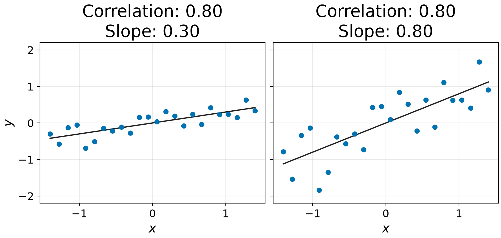
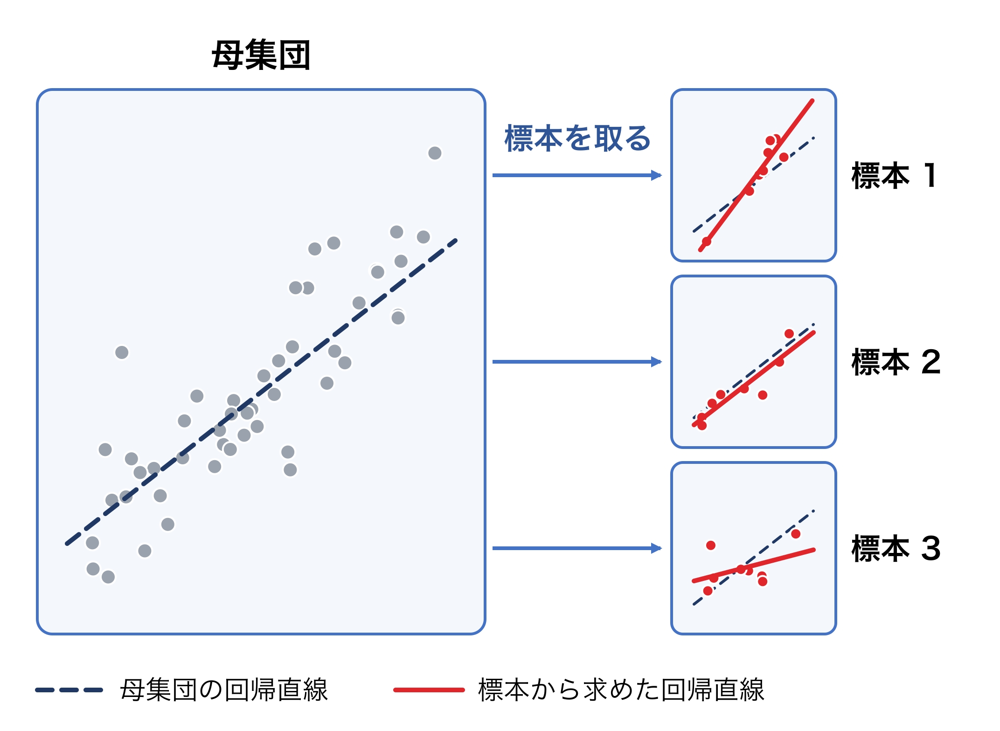
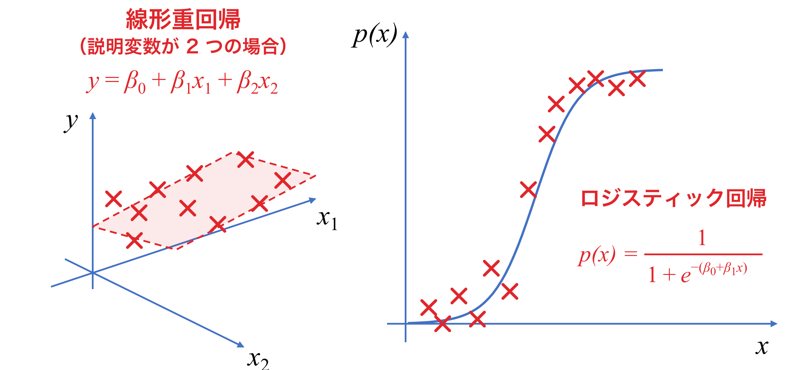
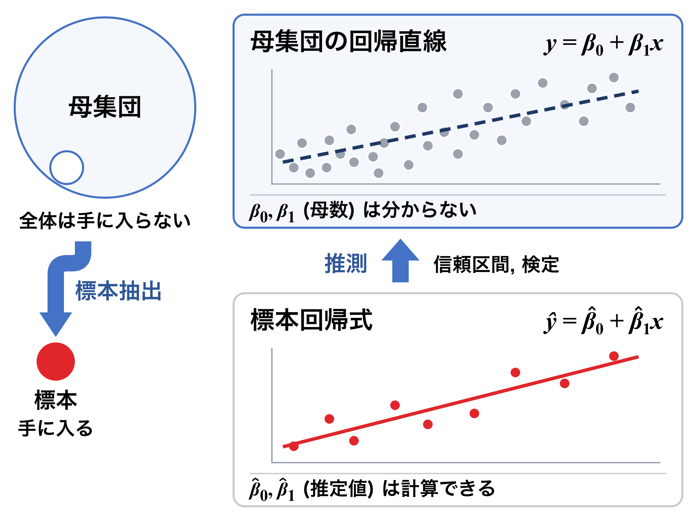
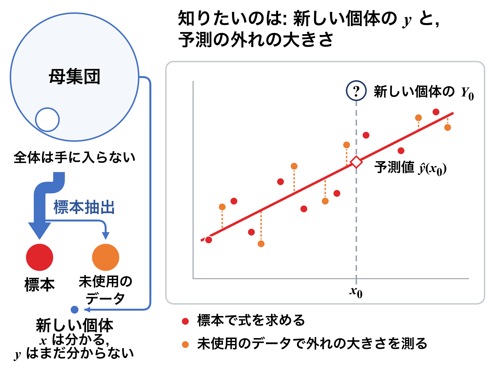
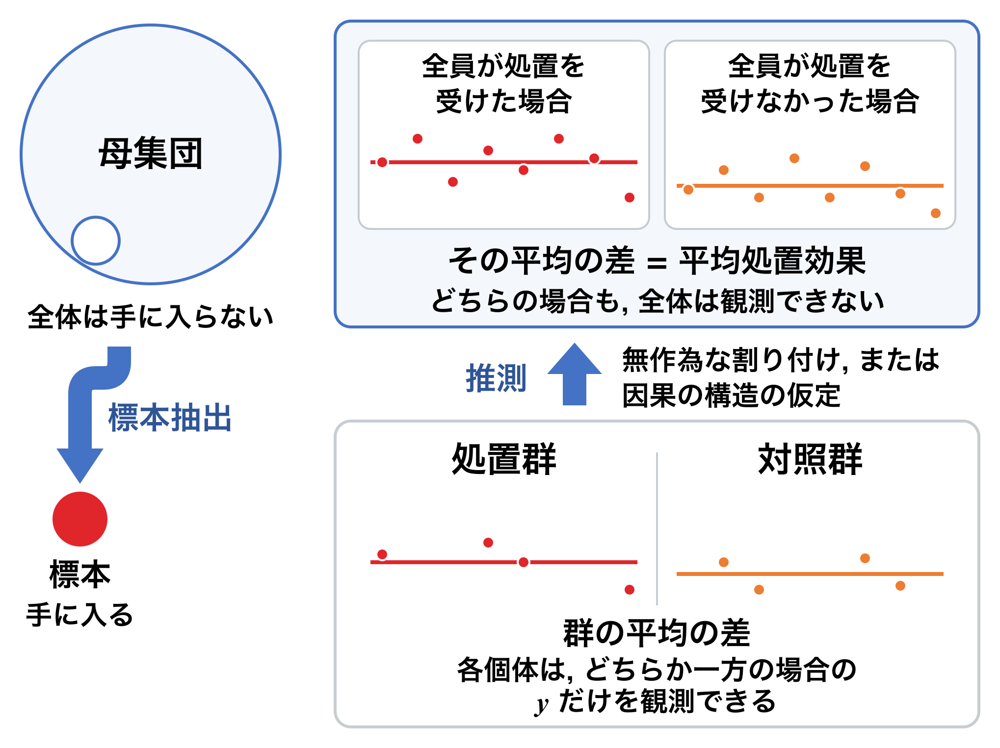

2 つの量的変数に関係があるかないかは, まず[散布図](block:vis-relation#scatter)で点の並びを見て判断します.
その関係の向きと直線的な強さを数値で表したものが[ピアソンの相関係数](block:num-correlation#correlation)です.
点が右上がりに並ぶと相関係数は正, 右下がりに並ぶと負になり, 直線に近く並ぶほど絶対値が 1 に近づきます.

しかし, 相関係数からは, 一方が 1 違うときに他方が平均でどれだけ違うか (関係の大きさ) は分かりません.
図は, 横軸と縦軸の目盛りをそろえた 2 組の合成データです.
相関係数はどちらも 0.80 ですが, 横軸の値が 1 違うとき, 直線の高さの差は左で 0.30, 右で 0.80 です.

{.wide}

**回帰分析**では, 例えば横軸の値ごとに, 縦軸の変数の平均を式で表します.
直線で表すと, 傾きから横軸の値が 1 違うときの平均の差が分かります.

この式は, 手元のデータから求めます.
調べたい対象の集団全体を**母集団**, 母集団から取り出した手元のデータを**標本**と呼びます.
標本から求めた式は, 同じ母集団から標本を取り直すと, 含まれる観測が変わるため変わります.

図は説明のために作った模式図です.
左は母集団で, 破線は母集団の回帰直線です.
右の 3 つは, 同じ母集団から取った標本と, それぞれの標本から求めた回帰直線 (赤の実線) です.
どの標本も同じ母集団から取ったものですが, 直線の傾きと切片は標本ごとに異なります.
母集団について平均の差を述べるには, 標本の取り方を踏まえ, 推定値のこのばらつきも考える必要があります.
このばらつきをもとに, 母集団の係数について値の範囲を示すのが**信頼区間**です.
**検定**では, 例えば母集団の傾きが 0 だと仮定したときに, 標本で得た傾き以上に 0 から離れた傾きがどれほど起こりやすいかを調べます.
ばらつきの測り方は[回帰係数の分布・信頼区間・検定](block:reg-ols#coefficient-test)にあります.

まず回帰式の形と各部の名前を確かめ, そのうえで回帰分析を何に使うかを整理します.

# 回帰式と回帰係数 {#regression-equation}

::: note
回帰分析では,

$$
y = \beta_0 + \beta_1 x + \varepsilon
$$

のような式で変数 y と x の関係を表し, この式を**回帰式, 回帰方程式**と呼びます. このとき,

- 説明される変数 y を **被説明変数**, **目的変数**などと呼びます.

- 説明する変数 x を**説明変数**, **独立変数**などと呼びます.

    ここでの「独立」は, 確率変数どうしが独立であるという意味ではありません.

- $\varepsilon$ は, x の値が同じでも観測ごとに異なる y のずれを表し, **誤差**と呼びます. x の値ごとに誤差の平均を 0 とするので, $\beta_0 + \beta_1 x$ は x の値が同じ観測の y の平均を表します. 誤差の性質は[母回帰式と誤差](block:reg-ols#population-model)で扱います.

- 回帰式における **$\beta_0$**のような変数に乗じられていない値を**切片**といいます.

    切片は, $x = 0$ のときの y の平均を意味しています.

- 変数に乗じられている**$\beta_1$**のような値を**傾き**といい, $\beta_0,\beta_1$ などを併せて**回帰係数**といいます.

    傾きは, x が 1 違うときの y の平均の差を表しています.

- 説明変数が一つの回帰式を求める分析を**単回帰分析**, 2 つ以上の説明変数を用いる場合を**重回帰分析**といいます.

- y が x の線形関数である場合を **線形回帰 (Linear regression)**, それ以外のものを**非線形回帰 (non-linear regression)**といいます.

    次の図の右の**ロジスティック回帰**は非線形回帰の例で, 目的変数が 0 か 1 の値をとるときに使います.
    例えば単位を取得した学生を 1, 取得しなかった学生を 0 とすると, 勉強時間が同じ学生どうしの 0 と 1 の平均は, 単位を取得した学生の割合です. 10 人のうち 7 人が取得したなら, 平均は $7/10 = 0.7$ です.
    母集団では, この平均が単位を取得する確率にあたります.
    ロジスティック回帰は, 説明変数の線形式を 0 と 1 の間の確率に変換して, この確率を表します.
    目的変数の取りうる値に応じて分布と平均の表し方を選ぶモデルを**一般化線形モデル**と呼び, ロジスティック回帰はその一つです.
    変換の式と確率の求め方は[一般化線形モデル](block:reg-glm)にあります.

{.wide}

:::

# 回帰分析の目的 {#regression-goals}

[回帰式と回帰係数](#regression-equation)で名前を確かめた回帰式は, どのような問いに答えるために使うのでしょうか.
@gelman2020regression [§1.2] は, 回帰の主な用途として次の 4 つを挙げています.

- **予測**: 既にある観測を式で表し, 新しいデータの値を当てること. 例として, 選挙の得票率や病気の診断が挙げられています.
- **関連を調べること**: ある変数や変数の組から, 目的変数をどれだけ予測できるかを要約すること. 例として, 病気の危険因子を特定することが挙げられています.
- **外挿**: 標本と関心のある母集団との既知の違いを調整して, 母集団について述べること. 例として, 回答者が母集団を代表していない世論調査の調整が挙げられています.
- **因果推論**: 処置を受けた場合と受けなかった場合の結果を比べ, 処置の効果を推定すること.

本稿では, 回帰分析の結果が誰について何を述べるかで, 目的を**関係の定量化と母集団への推測**, **予測**, **因果推論**の 3 つに分けます.
この分け方は, 上の 4 つの用途をもとに本稿で組んだものです.
関連を調べる用途に, 標本から母集団について述べる推測を合わせたものを, 関係の定量化と母集団への推測と呼びます.
外挿は, どの目的でも結果を別の集団へ広げるときに要る手順として, 目的ごとの説明の後で扱います.

3 つの目的の違いを, 一組の記録で確かめます.
ある大学の学生について, GPA, 週あたりの勉強時間とアルバイト時間, 奨学生かどうかを記録したとします.
この例では, 推測や予測の対象とする学生の集団が母集団です.
これは架空の例で, 実際の分析には[合成 GPA の学習用データ](block:reg-gpa#gpa-data)を使います.
この記録から, 目的ごとに異なる問いを立てられます.
次の表では, 問いを目的ごとに並べ, それぞれの前提と確かめ方を比べます.

| 問い | 誰について何を述べるか | 何を前提にするか | 何で確かめるか |
|---|---|---|---|
| (a) [関係の定量化と母集団への推測](block:reg-multiple). 他の条件が同じで, 勉強時間だけ週 1 時間違う学生を比べると, 平均 GPA はどれだけ違うか | 標本を取った母集団での, 条件をそろえた平均の差 | 母集団からの抽出に偏りがなく, 比べる条件を先に決めていること. 比較する条件の範囲で, 回帰式が平均の差を表せること | 係数と信頼区間を示し, 必要なら検定する. 同じ母集団の別の標本でも差を調べる |
| (b) [予測](block:reg-prediction). 次に入学する学生の GPA をどれだけ正確に当てられるか | 同じ母集団の新しい学生 1 人ずつの GPA と, 予測の誤差 | 新しい学生が標本と同じ分布から来て, 予測に使う変数を予測時に得られること | 回帰式を決めるときに使わなかったデータで, 予測値と実際の値の差を測る |
| (c) [因果推論](block:reg-causal). 勉強時間を増やす介入を行うと, 平均 GPA はどう変わるか | 同じ母集団で, 介入する場合としない場合の平均 GPA の差 | 介入内容を定め, 観測した結果と介入した場合の結果を結び付ける因果の構造を仮定すること. 無作為な割り付けで比較できる場合もある | 観測データから目的の差を求められる条件を調べ, 仮定を変えた場合や, 別の設計で得た結果を検討する |

目的によって, 何を前提にし, どの変数を回帰式に入れ, 結果をどう確かめるかが変わります.
@shmueli2010explain は, 理論から導いた因果の仮説を統計モデルで検証することを「説明」, 新しい観測の値を当てることを「予測」と呼んで区別し, 研究の設計とデータの収集, 変数の選び方, 手法の選び方, モデルの評価と検証など, モデルを作るどの段階でも, 2 つの目的で扱いが変わることを示しています.
同じ論文は, 回帰式を因果推論や予測のためでなく, 変数どうしの関連を捉えるために当てはめる場合を「記述」と呼んでいます.
表の (a) で求めるのは, 観測した条件をそろえた学生どうしの平均の差で, この「記述」にあたります.
例えば, 奨学生区分とアルバイト時間を式に入れると, 両方の条件が同じ学生どうしで, 勉強時間が異なるときの平均 GPA の差を求められます.
標本から母集団での平均の差を推定するときは, 標本の選び方が根拠になります.

母集団の回帰式の係数 $\beta_0, \beta_1$ のように, 母集団を特徴付ける値を**母数**と呼びます.
標本から求めた回帰式は, 母集団の回帰式と区別して $\hat y = \hat\beta_0 + \hat\beta_1 x$ と書き, その係数 $\hat\beta_0, \hat\beta_1$ を母数の**推定値**と呼びます.
次の図は, この目的での母集団と標本の関係を, 説明のために描いた模式図です. 点は実データではありません.
母集団全体は手に入らないので, 母数は分かりません.
手に入る標本からは推定値を計算でき, 信頼区間や検定を使って, 推定値から母数について述べます.
この手順が, 関係の定量化と母集団への推測の「推測」にあたります.

::: note
**頻度論とベイズ統計学**

表の (a) のように母集団について述べるとき, この分野では**頻度論**の枠組みを使います.
頻度論では母数を固定した値とみなし, 同じ手順で標本を取り直したときのばらつき (標本ごとに回帰直線が異なる図で見たもの) から, 信頼区間と検定を作ります.

**ベイズ統計学**では, 母数の不確かさを確率分布で表します.
データを観測する前の不確かさを表す事前分布と, データの出方を表すモデルを組み合わせ, 観測後の事後分布を求めます.
事後分布は, 例えば GPA の傾きがどの範囲にあるかを述べるのに使えます.

2 つの枠組みの違いは, 不確かさをどう表すかにあります.
どちらの枠組みでも, 関係の定量化, 予測, 因果推論の問いを扱えます.
ベイズの考え方と実例は[統計モデリングとベイズ統計学の基礎](block:bayes-intro)にあります.
:::

新しく入学した学生の GPA を予測するときは, 例えば同じ勉強時間の学生の平均 GPA を予測値として使えます.
予測の誤差には, 手元の標本から平均を推定するときの誤差と, 勉強時間が同じでも残る個人差が含まれます.
新しい学生の成績が予測値からどれだけ外れるかは, 回帰式を決めるときに使わなかったデータで測ります.

次の図は, 予測での母集団と標本の関係を, 推測の図と同じ形で描いた模式図です. 点は実データではありません.
母集団から, 回帰式を求める標本とは別に, 回帰式を決めるときに使わないデータ (図の未使用のデータ) を取り分けます.
新しい個体 (新しく入学した学生) については, 説明変数の値 $x_0$ は分かっていても, 目的変数の値 $Y_0$ はまだ分かりません.
標本から求めた回帰式による $x_0$ での予測値を $\hat y(x_0)$ と書くと, 知りたいのは $Y_0$ と, $\hat y(x_0)$ が $Y_0$ からどれだけ外れるかです.

誤差を測る手順と, 平均についての区間と個人についての予測区間の読み方は[予測](block:reg-prediction)にあります.

勉強時間を増やす取り組みの効果を知りたい場合は, 同じ学生集団が取り組みを受けた場合と受けなかった場合の平均 GPA を比べます.
観測データで勉強時間の異なる学生を比べると, 勉強時間以外の条件も異なることがあります.
観測データから介入した場合としなかった場合の平均の差を求められるかは, 勉強時間と GPA がどう決まるかについての仮定や, データを集めた設計によって変わります.
@hernan2019second は, データサイエンスの課題を, データの特徴を要約する記述, 入力から出力を当てる予測, 世界が違っていた場合の結果を当てる反事実の予測の 3 つに分け, 因果推論を反事実の予測に含めています.
そして, 予測と因果推論の違いを専門知識の役割に求めています.
予測では, 何を当てるかと使う変数の候補を決めて測れば, あとはデータから入力と出力の対応を求められます.
因果推論では, 結果がどのように生じるかという因果の構造についての知識が, 多くの場合は確かめられない仮定として要ります.

勉強時間を増やす取り組みのように, 効果を知りたい働きかけを**処置**と呼びます.
同じ母集団の全員が処置を受けた場合の平均と, 全員が受けなかった場合の平均の差を**平均処置効果**と呼び, これが因果推論の目的です.
次の図は, この目的での母集団と標本の関係を描いた模式図です. 点は実データではありません.
どちらの場合についても, 母集団全体の結果は観測できません.
標本の各個体についても, 観測できるのは処置を受けた場合か受けなかった場合の一方の結果だけです.
標本で計算できるのは, 処置を受けた個体の集まり (**処置群**) と受けなかった個体の集まり (**対照群**) の平均の差です.
この差を平均処置効果に結び付けるのが, 処置の無作為な割り付けか, 因果の構造についての仮定です.

いずれの目的でも, 別の年度や別の大学の学生まで対象を広げるときは, 学習環境や GPA の付け方が元の学生集団とどの程度共通するかを調べます.
平均の差の推測, 新しい学生の予測, 介入の効果のいずれについても, 元の集団で求めた結果を広げた先の集団に当てはめるには, 追加の前提が要ります.
これは, 節の初めに挙げた 4 つの用途のうちの外挿にあたります.
@gelman2020regression [§1.2] は外挿の例として, 自ら参加を申し出た学校の標本から, 州のすべての学校について結論を出す場合も挙げています.

表に挙げたどの目的でも, 問いを立てる前にデータを見て, 調べる関係を決めることがあります. この作業を**探索**と呼びます.
例えば運動時間も記録していれば, 勉強時間, アルバイト時間, 運動時間をそれぞれ GPA と組み合わせた散布図を描き, どの関係を詳しく調べるかを考えます.
@leek2015what はデータ分析を, 記述, 探索, 推測, 予測, 因果, 機構の 6 種類に分けています.
そのうち探索は, 測った値どうしの傾向や関係を探して仮説を生む分析で, 見つけたことを探索だけで確かめられることはまれだとしています.
探索で見つけた関係は仮説として扱い, 別のデータを集めて確かめます.
データを見て回帰式に入れる変数を選ぶ方法は[モデル選択](block:reg-selection)にあります.

::: warn
@leek2015what は, データ分析で最も多い誤りは, 分析している問いの種類を取り違えることだとしています.
挙げられている取り違えを表の言葉で言うと, 次のようになります.

- (a) で求めた係数を, (c) の介入した場合の差として読む. Leek と Peng はこの誤りを「相関は因果を意味しない」という言い回しで示しています.
- 探索で見つけた関係を, (a) の母集団での差として報告する. この誤りは data dredging と呼ばれています.
- 探索で選んだ式の当てはまりを, (b) の新しい学生への予測の誤差とみなす. この誤りは過学習 (overfitting) と呼ばれています.
:::

回帰をどの目的に使い, 分析のどの点を重視するかは, 分野によって異なります.
@shmueli2010explain によると, 経済学, 心理学, 教育学, 環境科学などでは統計モデルがほとんど因果の説明のためだけに使われ, 自然言語処理や生物情報学では予測が重視されています.
分野ごとにどのような問題が調べられ, どのような方法が使われてきたかは, [学問分野ごとの手法の違いと経緯](block:reg-selection-more#model-selection-history)にあります.

本稿では, これらの目的のうち, まず関係の定量化と母集団への推測を扱います.
[単回帰分析](block:reg-simple)で, OECD の出生率のデータを使い, 関係の大きさを傾きで表します.
[重回帰分析](block:reg-multiple)では, 条件をそろえたときの平均の差を考え, [合成 GPA のデータ](block:reg-gpa)で実際に回帰係数を求めます.
次に, 予測と因果推論でそれぞれ注意する点を順に確かめます.
[予測](block:reg-prediction)では[未使用のデータで予測の誤差を測り](block:reg-evaluate), [因果推論](block:reg-causal)では介入した場合の平均の差を求めるための条件を考えます.
最後に, [データを見て回帰式に入れる変数を選ぶ場合](block:reg-selection)に, 選んだ式で何を確かめられるかを考えます.

# 演習 {#exercises}

## Exercise REG-INTRO-1 {#exercise-reg-intro-1}

**GPA についての 3 つの問い**

次の問いを, 関係の定量化と母集団への推測, 予測, 因果推論のいずれかに分類してください.
それぞれ, 誰について述べるかと, 結果を得るために必要な前提を 1 つずつ挙げてください.

1. 今年度の学生で, 奨学生区分とアルバイト時間が同じ場合に,
   勉強時間が週 1 時間長い学生の平均 GPA はどれだけ高いか.
2. 来年度, 入学後 1 か月の勉強時間の記録を使うと, 新入生の学期末 GPA をどれだけ正確に当てられるか.
3. 学期中に自習時間を週 1 時間設けると, 同じ学生集団の学期末の平均 GPA はどう変わるか.

回答

1. 関係の定量化と母集団への推測です.
   対象は今年度の学生の母集団です. 母集団から偏りなく標本を取ることが前提です.
2. 予測です. 対象は次に入学する学生一人ひとりです.
   例えば, 回帰式を作った標本と来年度の新入生の分布が同じという前提を置きます.
   来年度と同様の条件をもつ未使用の学生データで誤差を測ります.
3. 因果推論です. 対象は自習時間を設ける場合と設けない場合の, 同じ学生集団の平均の差です.
   例えば, 自習時間を設けるかどうかを無作為に割り付けて, 群の比較ができるようにします.

## Exercise REG-INTRO-2 {#exercise-reg-intro-2}

**データを見てから見つけた関係**

担当者は, 勉強時間・運動時間・アルバイト時間と GPA の散布図を作り,
関係が目立った運動時間について詳しく調べることにしました.
この時点の作業を分類してください.
同じ大学の母集団でも関係が成り立つかを確かめるには, 次にどのような標本を使いますか.

回答

関係を探しながら変数を選んでいるので探索です.
運動時間と GPA に関係があるという仮説を立て,
同じ大学の対象学生から新しく偏りなく取った標本で確かめます.
新しい標本を見る前に, どの条件をそろえ, どの回帰係数を調べるかを決めます.

