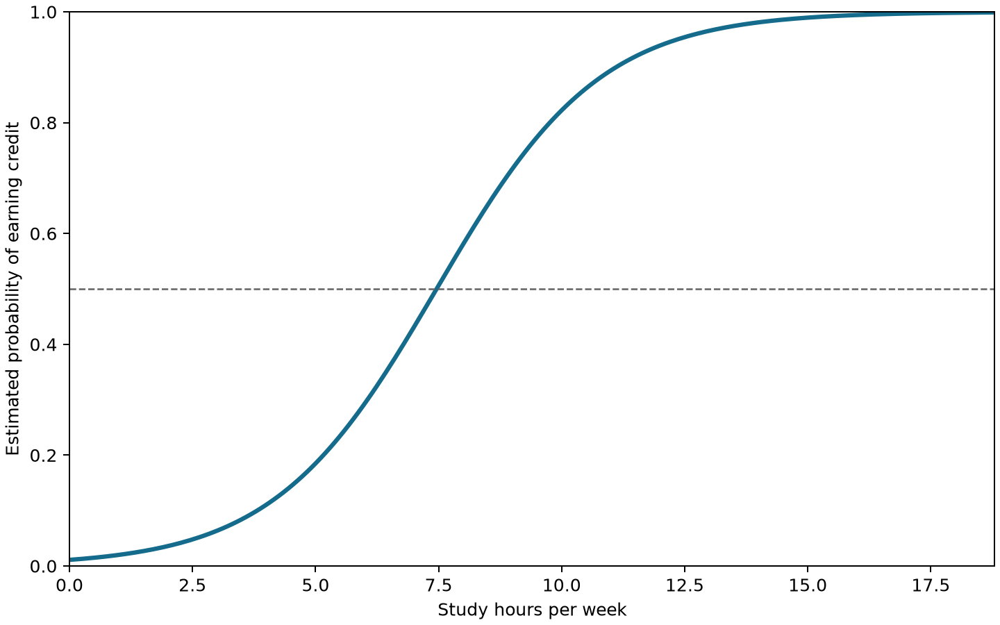

[一般化線形モデル](block:reg-glm)では, 取得確率をロジスティック関数で表し, 係数をオッズ比として読む方法を確かめました.
本稿では, 週あたりの勉強時間とアルバイト時間を使って係数を推定します.
アルバイト時間が等しい学生どうしで, 勉強時間の違いに対応する取得オッズの比と取得確率の差を求めます.

# 単位取得データの読み込み {#credit-data}

練習用の架空のデータには, 学生 200 人について, 1 週間の勉強時間とアルバイト時間, ある科目の単位を取得したかどうかを記録しています.
[単位取得データの CSV](https://github.com/yakagika/yakagika.github.io/blob/main/slds_data/dsp5/credit.csv) をダウンロードし, コードと同じフォルダに `credit.csv` として保存してください.

| 列 | 内容 |
|---|---|
| `Credit` | 単位を取得した学生は 1, 取得しなかった学生は 0 |
| `Study_Hours` | 1 週間の勉強時間 (時間) |
| `Part_time_Work` | 1 週間のアルバイト時間 (時間) |

データを読み込み, 単位を取得した人数と割合を求めます.

~~~ python
import matplotlib.pyplot as plt
import numpy as np
import pandas as pd
import statsmodels.api as sm

credit = pd.read_csv("credit.csv")

student_count = len(credit)
pass_count = credit["Credit"].sum()
pass_rate = credit["Credit"].mean()
print(f"学生数 {student_count}")
print(f"単位を取得した学生数 {pass_count}")
print(f"単位の取得割合 {pass_rate:.2f}")
~~~

~~~ text
学生数 200
単位を取得した学生数 102
単位の取得割合 0.51
~~~

`Credit` の平均 0.51 は, 標本全体で単位を取得した割合です.

まず, 勉強時間だけを説明変数にして, 線形回帰を当てはめます.
切片を含む直線を最小二乗法で求め, 各学生の勉強時間を代入すると, 何人の当てはめ値が 0 から 1 の範囲を外れるでしょうか.

~~~ python
study = sm.add_constant(credit[["Study_Hours"]])
linear_fit = sm.OLS(credit["Credit"], study).fit()
fitted = linear_fit.predict(study)
slope = linear_fit.params["Study_Hours"]
print(f"傾き {slope:.3f}, 0 未満 {(fitted < 0).sum()} 人, 1 超 {(fitted > 1).sum()} 人")

order = credit["Study_Hours"].sort_values().index
fig, ax = plt.subplots()
ax.scatter(credit["Study_Hours"], credit["Credit"], alpha=0.4)
ax.plot(credit.loc[order, "Study_Hours"], fitted.loc[order], color="tab:red")
for boundary in (0, 1):
    ax.axhline(boundary, color="gray", linestyle=":")
ax.set(xlabel="Study hours per week", ylabel="Credit (0 or 1)")
plt.show()
plt.close(fig)
~~~

~~~ text
傾き 0.077, 0 未満 6 人, 1 超 15 人
~~~

[二値の応答に一次式を当てはめた図](block:reg-glm#binary-response)と同じように, 実測点は 0 と 1 に並びます.
勉強時間順に当てはめ値を結ぶと, 観測した範囲の両端で直線が水平線を越えます.

# statsmodels による係数とオッズ比の推定 {#fit-logit}

## 係数と信頼区間

取得確率を 0 から 1 の範囲で表すため, 勉強時間とアルバイト時間を説明変数にしたロジスティック回帰を当てはめます.
`sm.Logit` に目的変数と説明変数を渡し, `fit()` で係数を最尤法によって推定します.
`sm.add_constant` は, 切片 $\beta_0$ を推定するための 1 の列を先頭に加えます.
`disp=False` を指定すると, `fit()` は最適化の経過を表示せずに結果を返します.

~~~ python
hours = credit[["Study_Hours", "Part_time_Work"]]
predictors = sm.add_constant(hours)
response = credit["Credit"]
result = sm.Logit(response, predictors).fit(disp=False)

intervals = result.conf_int()
intervals.columns = ["lower_95", "upper_95"]
coefficient_table = intervals.assign(coefficient=result.params)
coefficient_table = coefficient_table[["coefficient", "lower_95", "upper_95"]]
print(coefficient_table.to_string(float_format="{:.3f}".format))
~~~

~~~ text
                coefficient  lower_95  upper_95
const                -2.166    -3.378    -0.954
Study_Hours           0.603     0.431     0.775
Part_time_Work       -0.197    -0.281    -0.112
~~~

`coefficient` は対数オッズの尺度での推定値です.
`lower_95` と `upper_95` は, モデルの仮定のもとで標本の取り方によるばらつきを反映した
近似的な 95% 信頼区間の両端です.

勉強時間の係数 $\hat\beta_1$ は 0.603 です.
アルバイト時間が等しい学生どうしで, 勉強時間が週 1 時間長い学生の取得の対数オッズは 0.603 高いと推定されます.
同じ勉強時間の学生どうしでは, アルバイト時間が週 1 時間長い学生の取得の対数オッズは 0.197 低いと推定されます.

推定手順と各係数の検定は, 次の出力で確かめられます.

~~~ python
print(result.summary())
print("反復回数", result.mle_retvals["iterations"])
~~~

出力の上段から推定方法, 尤度, 収束を示す行を抜き出し, 続けて係数表の見出しと勉強時間の行, 最後に反復回数を示します.

~~~ text
Method:                           MLE   Df Model:                            2
Date:                Mon, 23 Nov 2026   Pseudo R-squ.:                  0.4102
Time:                        16:11:58   Log-Likelihood:                -81.739
converged:                       True   LL-Null:                       -138.59
                     coef    std err          z      P>|z|      [0.025      0.975]
Study_Hours        0.6028      0.088      6.875      0.000       0.431       0.775
反復回数 7
~~~

出力の `Method` は `MLE` (最尤法), `converged` は `True`, 反復回数は 7 です.
係数を更新する数値計算が収束したかはここで確かめます.
係数表の `z` は推定値を標準誤差で割った値で, 勉強時間では 6.875 です.
`P>|z|` は母集団の係数が 0 という帰無仮説のもとでの両側 P 値です. 表の 0.000 は小数第 3 位までの丸め表示です.

`Log-Likelihood` は両方の時間を使った式の最大対数尤度 (−81.739),
`LL-Null` は切片だけの式の最大対数尤度 (−138.59) です.
`Pseudo R-squ.` の 0.4102 は, この二つの値から $1-(-81.739)/(-138.59)$ と計算した疑似決定係数です.
切片だけの式からの当てはまりの改善を, 対数尤度で表しています.

同じ 0/1 の応答を, 学生ごとに試行回数 1 の二項分布で表すこともできます.
`Binomial()` の既定のリンク関数はロジットなので, 同じ説明変数を渡せば推定する式も共通です.

~~~ python
binomial_fit = sm.GLM(response, predictors, family=sm.families.Binomial()).fit()
print(np.allclose(result.params, binomial_fit.params))
~~~

~~~ text
True
~~~

両方の方法で求めた三つの係数は, 数値計算の許容誤差の範囲で一致します.

## オッズ比と信頼区間

推定した係数は, 一方の時間が同じで, もう一方の時間が週 1 時間違う学生どうしの対数オッズの差を表します.
取得オッズを何倍かで読むには, 対数オッズの差を指数関数に通します.
係数を指数関数に通した値が, 比べる時間が週 1 時間違う学生どうしのオッズ比です.
指数関数は単調に増加するので, 信頼区間の下限と上限にも同じ変換を施します.
オッズ比を示す表には, 勉強時間とアルバイト時間の係数を使います.

~~~ python
odds_ratio_table = np.exp(coefficient_table.loc[hours.columns])
odds_ratio_table = odds_ratio_table.rename(columns={"coefficient": "odds_ratio"})
print(odds_ratio_table.to_string(float_format="{:.3f}".format))
~~~

~~~ text
                odds_ratio  lower_95  upper_95
Study_Hours          1.827     1.539     2.170
Part_time_Work       0.821     0.755     0.894
~~~

アルバイト時間が同じ学生どうしで, 勉強時間が週 1 時間長い学生の取得オッズは短い学生の約 1.83 倍です
(95% 信頼区間は約 1.54 から 2.17).
勉強時間が同じ学生どうしでは, アルバイト時間が週 1 時間長い学生の取得オッズは短い学生の約 0.82 倍です
(95% 信頼区間は約 0.76 から 0.89).

# アルバイト時間をそろえた予測確率と分類 {#fitted-probabilities}

## 予測確率の曲線

アルバイト時間には標本平均を使い, 勉強時間には標本で観測した最小値から最大値までの値を入れます.
`predict()` に渡す表は, 当てはめ時と同じ列順にします.
`const` には切片のために 1 を入れます.
`predict()` は各行の線形予測子をロジスティック関数に通した確率を返します.

~~~ python
mean_work = credit["Part_time_Work"].mean()
study_hours = np.linspace(
    credit["Study_Hours"].min(),
    credit["Study_Hours"].max(),
    200,
)
prediction_grid = pd.DataFrame(
    {
        "const": 1.0,
        "Study_Hours": study_hours,
        "Part_time_Work": mean_work,
    }
)
probabilities = result.predict(prediction_grid)

fig, ax = plt.subplots(figsize=(8, 5), layout="constrained")
ax.plot(study_hours, probabilities, color="#146b8c", linewidth=2.5)
ax.axhline(0.5, color="#626262", linestyle="--", linewidth=1)
ax.set(
    xlabel="Study hours per week",
    ylabel="Estimated probability of earning credit",
    xlim=(study_hours[0], study_hours[-1]),
    ylim=(0, 1),
)
plt.show()
plt.close(fig)
~~~

アルバイト時間を標本平均の週約 11.85 時間にそろえると, 推定取得確率は勉強時間に対して S 字の曲線を描き, どの勉強時間でも 0 から 1 の範囲に収まります.
曲線は, 勉強時間が週約 7.46 時間のところで, 確率 0.5 の破線と交わります.
交点の勉強時間は, 線形予測子を 0 と置いた式を勉強時間について解いて求めます.

~~~ python
intercept = result.params["const"]
study_coefficient = result.params["Study_Hours"]
work_coefficient = result.params["Part_time_Work"]
boundary_study = -(intercept + work_coefficient * mean_work) / study_coefficient

print(f"アルバイト時間の標本平均 {mean_work:.2f} 時間")
print(f"取得確率が 0.5 になる勉強時間 {boundary_study:.2f} 時間")
~~~

~~~ text
アルバイト時間の標本平均 11.85 時間
取得確率が 0.5 になる勉強時間 7.46 時間
~~~

## しきい値による分類

予測確率にしきい値 (例えば 0.5) を設けると, 取得か未取得かを予測できます.
予測確率がしきい値以上なら取得 (1), 未満なら未取得 (0) と分類します.
新しい学生に対する分類の正解率は, 係数の推定やしきい値の選択に使っていないデータで測ります.
データの分け方は[予測](block:reg-prediction)を参照してください.

[分類の評価](block:ml-classification#classification-evaluation)では, 実測と予測のクラスを混同行列に並べ, どちら向きの誤分類が何件あったかを読みます.
[手書き数字の分類器を比べる演習](block:img-recognition#exercise-dsp11-1)では, ロジスティック回帰を 0 から 9 の多クラス分類に使います.
そこで使う `LogisticRegression` は既定で係数に正則化をかけるため, ここでの `sm.Logit` とは係数を求める基準も異なります.

# 演習 {#exercises}

## Exercise REG-LOGIT-1 {#exercise-reg-logit-1}

**勉強時間が週 5 時間と 10 時間の学生の比較**

アルバイト時間を標本平均にそろえ, 勉強時間が週 5 時間の学生と週 10 時間の学生の取得確率を, 推定したモデルから求めてください.
勉強時間が長い学生の取得確率から短い学生の取得確率を引き, 差をパーセントポイントで示してください.
勉強時間が長い学生の取得オッズは短い学生の何倍ですか.

回答

`predict()` に 2 人分の説明変数を渡します.
丸める前の確率を使って, 確率の差とオッズ比を計算します.

~~~ python
students = pd.DataFrame(
    {
        "const": 1.0,
        "Study_Hours": [5, 10],
        "Part_time_Work": mean_work,
    }
)
probability_5, probability_10 = result.predict(students)
difference = probability_10 - probability_5
odds_5 = probability_5 / (1 - probability_5)
odds_10 = probability_10 / (1 - probability_10)

print(f"週 5 時間の取得確率 {probability_5:.3f}")
print(f"週 10 時間の取得確率 {probability_10:.3f}")
print(f"確率の差 {100 * difference:.1f} パーセントポイント")
print(f"取得オッズの比 {odds_10 / odds_5:.2f} 倍")
~~~

~~~ text
週 5 時間の取得確率 0.185
週 10 時間の取得確率 0.822
確率の差 63.7 パーセントポイント
取得オッズの比 20.37 倍
~~~

約 63.7 パーセントポイントは, アルバイト時間を標本平均にそろえた 2 人の取得確率を引き算した値です.
約 20.37 倍は, 同じ確率をオッズに変換してから割り算した値です.
勉強時間が週 5 時間違う学生どうしなら, アルバイト時間が同じという条件のもとで
$\exp(5\hat\beta_1)$ と計算しても同じオッズ比が得られます.

