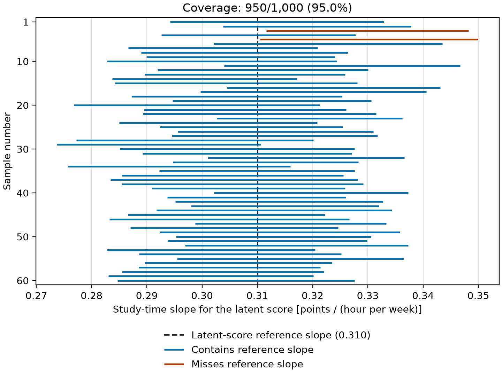

[回帰式と回帰係数](block:reg-intro#regression-equation)では, 勉強時間と平均 GPA の関係を直線で表しました.
母集団で平均がどう変わるかを表す式と, 一つの標本から求める直線を区別すると,
標本を取り直したときに傾きが変わる理由と, そのばらつきの測り方が分かります.

# 母回帰式と誤差 {#population-model}

勉強時間を確率変数 $X$, GPA を確率変数 $Y$ とします.
母集団で, 勉強時間が同じ学生の GPA を平均した値が**条件つき期待値** $E(Y \mid X)$ です.
例えば, $E(Y \mid X = 10)$ は, 週 10 時間勉強する学生の平均 GPA です.
説明変数の値ごとにこの平均を与える式を**母回帰式**と呼びます.
[回帰式と回帰係数](block:reg-intro#regression-equation)の $m(x)$ を母回帰式として書くと,
$m(x)=E(Y \mid X=x)$ です.

母回帰式が直線のときは $E(Y \mid X) = \beta_0 + \beta_1 X$ と書けます.
週あたりの勉強時間が 1 時間異なる学生を比べると, 母集団の平均 GPA の差は $\beta_1$ です.
$\beta_0$ と $\beta_1$ は母集団の係数なので, 同じ母集団から標本を取り直しても値は固定です.

同じ勉強時間の学生でも, 一人ひとりの GPA は平均からずれます.
個人の値と, その条件での平均の差を**誤差** $\varepsilon$ と呼びます.

$$
\varepsilon = Y - E(Y \mid X).
$$

$X$ を同じ値にそろえて $\varepsilon$ の平均を取ると,
$Y$ の平均 $E(Y \mid X)$ からその平均を引くことになるので 0 です.

$$
E(\varepsilon \mid X) = E(Y \mid X) - E(Y \mid X) = 0.
$$

この関係は, 平均が曲線で表される場合にも成り立ちます.
母回帰式が直線なら, $i$ 人目について $Y_i = \beta_0 + \beta_1 X_i + \varepsilon_i$ と書けます.

## 合成 GPA の潜在得点

合成データでは, 奨学生のときに 1, 非奨学生のときに 0 をとる変数を $X_1$,
週あたりの勉強時間を $X_2$, アルバイト時間を $X_3$ とします.
生成の過程では, まず**潜在得点** $Y^\ast$ を次の式で作ります.

$$
Y^\ast = 0.5 + 0.6 X_1 + 0.25 X_2 - 0.1 X_3 + \varepsilon^\ast.
$$

$\varepsilon^\ast$ は各学生に独立に加える, 平均 0, 標準偏差 0.1 の正規分布の乱数です.
潜在得点では, 奨学生区分とアルバイト時間が同じで,
勉強時間が週 1 時間長い学生ほど, 平均が 0.25 高くなります.

観測する GPA は, 潜在得点が 0 未満なら 0, 4 より大きければ 4 とし,
その間では潜在得点と同じ値にします.
この打ち切りのため, 観測 GPA の条件つき平均は全域で直線になりません.
例えば潜在得点が 4 を超えやすい条件では, 観測 GPA の平均は 4 に近づきます.
観測 GPA に当てはめた直線の係数は, 潜在得点の生成式の係数とは異なります.

# 最小二乗法と標本回帰式 {#least-squares}

100 人の勉強時間と GPA を観測したとします.
第 $i$ 番目の観測値を $(x_i,y_i)$, 標本の大きさを $n$ とします.
切片を $a$, 傾きを $b$ とする候補の直線 $a+bx$ について,
点 $(x_i,y_i)$ と直線の縦方向の差は $y_i-a-bx_i$ です.
**最小二乗法**では, この差を二乗して足し合わせ, 和が最小になる直線を選びます.

$$
Q(a,b) = \sum_{i=1}^n (y_i-a-bx_i)^2.
$$

$Q(a,b)$ の $a,b$ による偏微分を 0 とおくと, 次の**正規方程式**が得られます.

$$
\begin{aligned}
n a + b\sum_{i=1}^n x_i &= \sum_{i=1}^n y_i, \\
a\sum_{i=1}^n x_i + b\sum_{i=1}^n x_i^2 &= \sum_{i=1}^n x_i y_i.
\end{aligned}
$$

$x_i$ と $y_i$ の標本平均を $\bar x$ と $\bar y$ とします.
1 本目の式から $a=\bar y-b\bar x$ が得られます.
これを 2 本目の式に代入し, $S_{xx}=\sum_{i=1}^n(x_i-\bar x)^2$ とおくと,
最小二乗推定値は次のとおりです.

$$
\begin{aligned}
\hat\beta_1 &= \frac{\sum_{i=1}^n(x_i-\bar x)(y_i-\bar y)}{S_{xx}}, \\
\hat\beta_0 &= \bar y - \hat\beta_1\bar x.
\end{aligned}
$$

勉強時間が全員で同じなら $S_{xx}=0$ になり, 傾きは一つに決まりません.
異なる勉強時間の学生がいれば $S_{xx}>0$ となり, 解は一つに決まります.
このとき, 切片の式から直線は点 $(\bar x,\bar y)$ を通ります.

観測データから求めた式 $\hat y=\hat\beta_0+\hat\beta_1x$ を**標本回帰式**と呼びます.
第 $i$ 番目の学生について, 直線が与える値を**当てはめ値** $\hat y_i$,
観測値との差を**残差** $e_i=y_i-\hat y_i$ と呼びます.
誤差 $\varepsilon_i$ の計算には, 観測値 $y_i$ に加えて, 未知の母集団の条件つき平均が必要です.
残差 $e_i$ は, 標本回帰式の当てはめ値 $\hat y_i$ を観測値 $y_i$ から引けば計算できます.
正規方程式から $\sum_i e_i=0$ になります.

# 回帰係数の分布・信頼区間・検定 {#coefficient-test}

## 傾きの標本分布

GPA の標本を取り直すと, 同じ計算をしても推定値は変わります.
推定値が標本によって変わる様子を表す分布を**標本分布**と呼びます.
まず, 母回帰式が直線になる場合の分布を求めます.

標本中の説明変数を並べた $\boldsymbol X=(X_1,\dots,X_n)$ の値を固定します.
古典的な単回帰モデルでは, この条件のもとで, 各誤差 $\varepsilon_i$ が
互いに独立で, 同じ正規分布 $N(0,\sigma^2)$ に従うと仮定します.
平均は 0, 分散はどの $x_i$ でも同じ $\sigma^2$ です.

$Y_i=\beta_0+\beta_1 x_i+\varepsilon_i$ を傾きの推定式に代入します.
$\sum_i(x_i-\bar x)=0$ なので, 推定値と母数の差は誤差の重みつき和になります.

$$
\hat\beta_1-\beta_1=\frac{\sum_{i=1}^n(x_i-\bar x)\varepsilon_i}{S_{xx}}.
$$

条件つきで平均を取ると, 右辺は 0 です.
誤差が独立なので, 右辺の分散は各項の重みの二乗に $\sigma^2$ を掛けた値の和になります.
重みの二乗和は $1/S_{xx}$ です.
したがって, 固定した $\boldsymbol X$ のもとでの傾きの分布は次のとおりです.

$$
\operatorname{Var}(\hat\beta_1\mid \boldsymbol X)=\frac{\sigma^2}{S_{xx}},
\qquad
\hat\beta_1\mid\boldsymbol X \sim N\!\left(\beta_1,\frac{\sigma^2}{S_{xx}}\right).
$$

誤差の分散が一定なら, 勉強時間の散らばり $S_{xx}$ が大きいほど傾きの分散は小さくなります.

## 標準誤差と t 統計量

未知の誤差分散 $\sigma^2$ は, 残差の二乗和から推定します.
一般に, 切片と $k$ 個の説明変数をもつ回帰式では,
独立な係数を $k+1$ 個推定するので, 残差の自由度は $n-k-1$ です.
単回帰では $k=1$ なので, 自由度は $n-2$ です.

$$
s^2 = \frac{\sum_{i=1}^n e_i^2}{n-k-1}.
$$

単回帰の傾きの標本分布の標準偏差 $\sigma/\sqrt{S_{xx}}$ に $s$ を代入します.
得られる $\operatorname{SE}(\hat\beta_1)=s/\sqrt{S_{xx}}$ が傾きの**標準誤差**の推定値です.
正規性と等分散の仮定のもとでは, 傾きと $s^2$ は条件つきで独立で,
$(n-2)s^2/\sigma^2$ は自由度 $n-2$ のカイ二乗分布に従います.
このとき, 傾きの誤差を推定した標準誤差で割った統計量は t 分布に従います.

$$
T=\frac{\hat\beta_1-\beta_1}{\operatorname{SE}(\hat\beta_1)}
\ \sim\ t_{n-2} \qquad (\boldsymbol X \text{ を固定}).
$$

## 95% 信頼区間の読み方

自由度 $n-2$ の t 分布の 97.5 パーセンタイルを $t_{n-2,\,0.975}$ とすると,
$T$ がその正負の値の間に入る確率は 95% です.
この不等式を $\beta_1$ について解くと, 次の**95% 信頼区間**になります.

$$
\hat\beta_1 \ \pm\ t_{n-2,\,0.975}\operatorname{SE}(\hat\beta_1).
$$

モデルの仮定が成り立つとき, 標本を取り直して毎回この式で区間を作ると,
長期的にはその 95% が母集団の傾き $\beta_1$ を含みます.
母集団の傾きは固定されており, 標本を変えると区間の両端が動きます.

## 合成 GPA で区間を繰り返し求める {#coverage}

架空の学生を作る同じ仕組みから, 100 人の標本を独立に 1,000 回取りました.
各回で勉強時間だけを説明変数にし, 打ち切る前の潜在得点に最小二乗の直線を当てはめ,
通常の t 分布を使って傾きの 95% 信頼区間を求めます.
潜在得点の条件つき平均は直線で, 誤差の分散は勉強時間によらず一定です.
t 区間の計算では, 奨学生区分による差を含む誤差の分布を正規分布で近似します.

母集団での傾きは, 別に生成した 20 万人から求めた最小二乗係数 (約 0.310) で近似します.
生成式の係数 0.25 は, 奨学生区分とアルバイト時間をそろえた比較です.
勉強時間とアルバイト時間には関連があるため, アルバイト時間をそろえない単回帰では傾きが変わります.
比較する条件と係数の関係は[偏回帰係数とそろえる条件](block:reg-multiple#partial-coefficients)にあります.

横線 1 本が 1 標本の区間で, 図には最初の 60 本を標本を取った順に並べています.
横軸は勉強時間の係数で, 単位は週 1 時間あたりの潜在得点の差です.
黒い縦の破線と交わる青い区間は, 母集団の近似値を含みます.
破線と交わらない橙色の区間は近似値を外しています.
全 1,000 本では 950 本が近似値を含み, **被覆割合**は 95.0% でした.

同じ標本の観測 GPA に同じ手順を使うと, 母集団の傾きの近似値 0.272 を含んだ区間は
1,000 本のうち 877 本 (87.7%) でした. 20 万人のうち約 12% が 0 か 4 で打ち切られています.
打ち切りによって条件つき平均が曲がり, 誤差の分散も勉強時間によって変わるため,
通常の t 区間の式が前提とする線形性と等分散性が崩れます.

## 傾きが 0 かを調べる {#slope-test}

母集団の傾きが 0 かを調べる両側検定では,
帰無仮説を $H_0:\beta_1=0$, 対立仮説を $H_1:\beta_1\ne 0$ とします.
$T$ の式の $\beta_1$ に 0 を代入し, 観測値 $t_{\mathrm{obs}}$ を求めます.
**P 値**は, 帰無仮説とモデルの仮定のもとで,
$t$ 分布から得る統計量の絶対値が $|t_{\mathrm{obs}}|$ 以上となる確率です.

同じ標準誤差と t 分布を使うと, P 値が 0.05 未満のとき,
95% 信頼区間には 0 が含まれません.
区間を見れば, 0 と整合するかに加え, どの程度の正負の差までデータと整合するかが分かります.
問いに沿って先に定めた式では, 5% 水準で有意かどうかにかかわらず, 係数と区間を報告します.

## 同じ係数をベイズで推定すると {#bayesian-inference}

ベイズ統計学では, 傾き $\beta_1$ などの母数に事前分布を置き,
観測データの出方を記述するモデルと組み合わせて事後分布を求めます.
**95% 信用区間**は, 観測データと仮定したモデル・事前分布のもとで,
母数がその範囲に入る事後確率が 95% となる区間です.
同じ 95% でも, 頻度論の信頼区間では標本を取り直す手順の被覆割合を指します.
事前分布と事後分布の計算は[データサイエンス実践 第13章](/lectures/dsp13.html)にあります.

# 当てはまりの指標と F 検定 {#model-fit}

## 決定係数

切片を含む最小二乗回帰では, 標本における目的変数の散らばりを, 次の二乗和で表せます.

- **全変動**は $\sum_i(y_i-\bar y)^2$ です. GPA が標本の平均からどれだけ散らばっているかを表します.
- **回帰変動**は $\sum_i(\hat y_i-\bar y)^2$ です. 回帰式が学生ごとに与える値の散らばりを表します.
- **残差変動**は $\sum_i(y_i-\hat y_i)^2$ です. 回帰式を当てはめた後に残る散らばりを表します.

観測値の平均からの差は, $y_i-\bar y=(\hat y_i-\bar y)+e_i$ です.
二乗して足すと, 交差項の和は正規方程式により 0 です.
したがって, 全変動は回帰変動と残差変動の和になります.
全変動が正のとき, 回帰変動が全変動に占める割合を**決定係数** $R^2$ と呼びます.

$$
R^2=\frac{\sum_i(\hat y_i-\bar y)^2}{\sum_i(y_i-\bar y)^2}
    =1-\frac{\sum_i e_i^2}{\sum_i(y_i-\bar y)^2}.
$$

標本に回帰式がよく当てはまるほど残差変動は小さく, $R^2$ は 1 に近づきます.

## 自由度調整済み決定係数

同じ標本で説明変数を追加すると,
追加した変数の係数を 0 として元と同じ式を選ぶこともできます.
そのため, 最小二乗法で求めた残差変動は増えず, $R^2$ は下がりません.
**自由度調整済み決定係数**では, 残差変動と全変動をそれぞれの自由度で割ってから比を取ります.

$$
R^2_{\mathrm{adj}}
=1-\frac{\sum_i e_i^2/(n-k-1)}{\sum_i(y_i-\bar y)^2/(n-1)}.
$$

変数を追加したとき, 残差変動の減少が自由度の減少に見合わなければ, $R^2_{\mathrm{adj}}$ は下がります.
値が負になる場合もあります.
どちらの決定係数も, 回帰式を当てはめた標本についての指標です.
新しい学生についての誤差は, [予測](block:reg-prediction)のように未使用のデータで測ります.

## F 検定

**F 検定**では, 切片だけの式に比べて, 説明変数を加えた式で残差変動がどの程度小さくなったかを調べます.
帰無仮説は $H_0:\beta_1=\cdots=\beta_k=0$ で, 対立仮説は少なくとも 1 つの傾きが 0 以外です.
切片だけの式の当てはめ値は $\bar y$ なので, 残差変動の減少分は回帰変動になります.
回帰変動と残差変動を自由度で割った値の比が **F 統計量**です.

$$
F=\frac{\sum_i(\hat y_i-\bar y)^2/k}{\sum_i e_i^2/(n-k-1)}.
$$

$k$ 個の説明変数の係数が一意に定まり,
線形の母回帰式と独立・等分散の正規誤差を仮定すると,
帰無仮説のもとで $F$ は自由度 $(k,n-k-1)$ の F 分布に従います.
F 検定の P 値は, その分布で観測した $F$ 以上となる確率です.
どの係数が 0 と整合するかは,
その係数の信頼区間や[係数ごとの t 検定](#slope-test)で調べます.

# 記号表 {#notation}

確率変数は大文字, 観測値は小文字で書きます.
添字 $i$ は学生などの観測単位, 添字 $j$ は説明変数の番号です.

| 記号 | 意味 |
|---|---|
| $Y$, $X$ | 目的変数と説明変数. 重回帰で $X$ を説明変数の組として書くときは, その組を条件に取る |
| $y_i$, $x_i$ | 第 $i$ 番目に観測した目的変数と説明変数の値 |
| $m(x)$ | 回帰式が表す平均. 説明変数が複数なら $m(x_1,\dots,x_k)$ |
| $E(Y\mid X)$ | 説明変数をそろえたときの, 目的変数の母集団での平均 |
| $\beta_0,\beta_1,\dots,\beta_k$ | 母集団の係数. $\beta_0$ は切片, $\beta_j$ は第 $j$ 説明変数の係数. 単回帰の傾きは $\beta_1$ |
| $\hat\beta_j$ | 第 $j$ 係数の最小二乗推定量, または標本から計算した推定値 |
| $\hat y_i$ | 標本回帰式を第 $i$ 番目の観測値に当てはめた値 |
| $\varepsilon_i$ | 第 $i$ 番目の誤差. 目的変数と母集団での条件つき平均の差 |
| $e_i=y_i-\hat y_i$ | 第 $i$ 番目の残差 |
| $\sigma^2$ | モデルで仮定する, 共通の誤差分散 |
| $s^2=\frac{1}{n-k-1}\sum_i e_i^2$ | 誤差分散の推定値 |
| $n$ | 標本の大きさ |
| $k$ | 説明変数の数. 切片は含めない |

# 演習 {#exercises}

## Exercise REG-OLS-1 {#exercise-reg-ols-1}

**3 人の GPA に直線を当てはめる**

週あたりの勉強時間が 8, 10, 12 時間の学生の GPA を, 順に 1, 2, 2 とします.
[最小二乗法と標本回帰式](#least-squares)の式で傾きと切片を求めてください.
勉強時間が週 10 時間の学生の残差も求めてください.

回答

$\bar x=10$, $\bar y=5/3$ です.
$S_{xx}=(-2)^2+2^2=8$ で, 傾きの式の分子は $(-2)(-2/3)+2(1/3)=2$ です.
傾きは $1/4$, 切片は $5/3-10/4=-5/6$ になります.
直線は $(\bar x,\bar y)$ を通るので, 週 10 時間での当てはめ値は $5/3$ です.
残差は $2-5/3=1/3$ です.

## Exercise REG-OLS-2 {#exercise-reg-ols-2}

**傾きの区間から読み取れること**

単回帰のモデルの仮定が成り立ち, 観測した標本から,
勉強時間の係数の 95% 信頼区間として $[-0.03,0.13]$ を得ました.
傾きが 0 かを調べる両側検定では, 5% 水準でどのように判断しますか.
区間の 95% が何を指すかも答えてください.

回答

区間に 0 が含まれるので, $H_0:\beta_1=0$ を 5% 水準で棄却できません.
標本からは, 週あたりの勉強時間が 1 時間違う学生の平均 GPA の差について,
小さな負の差から正の差までが区間に入っています.
95% は, 同じ手順で標本を取り直して区間を作るとき, 区間が母集団の傾きを含む割合です.

