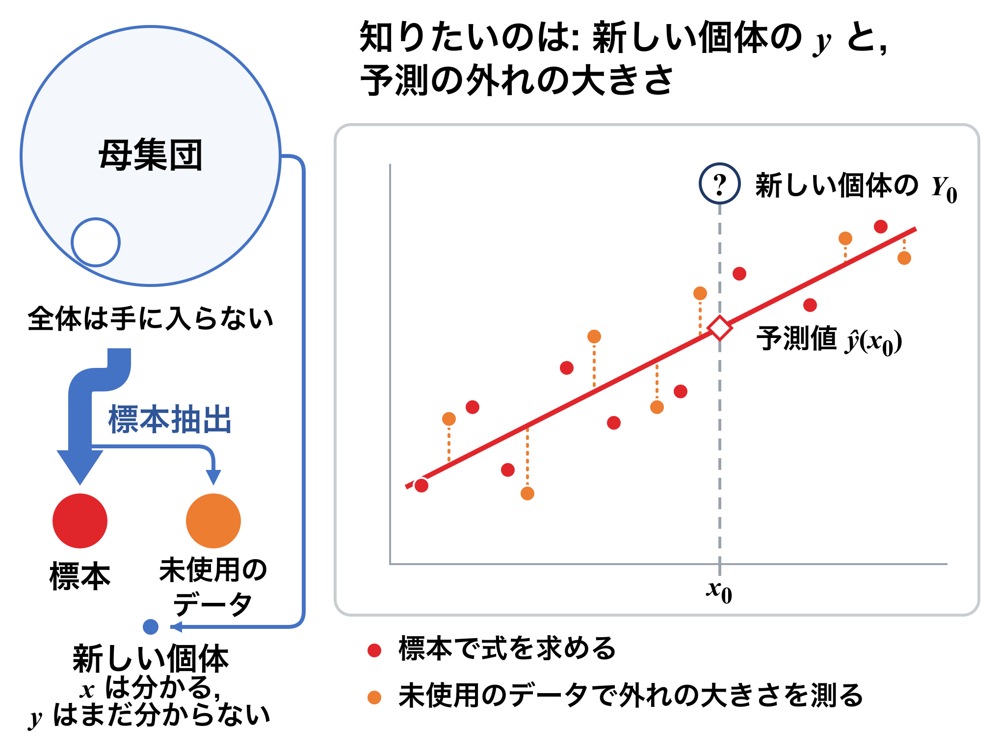
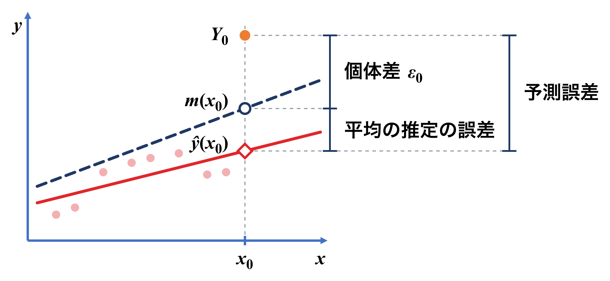
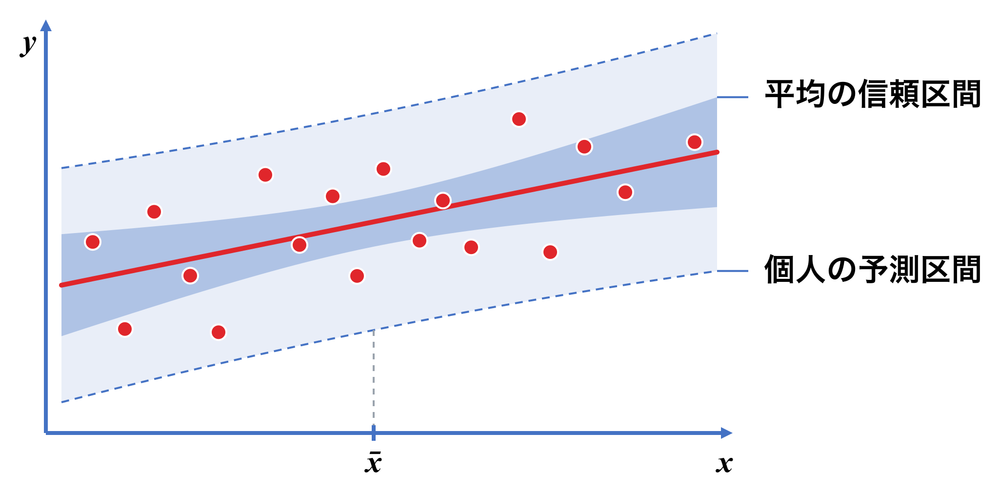
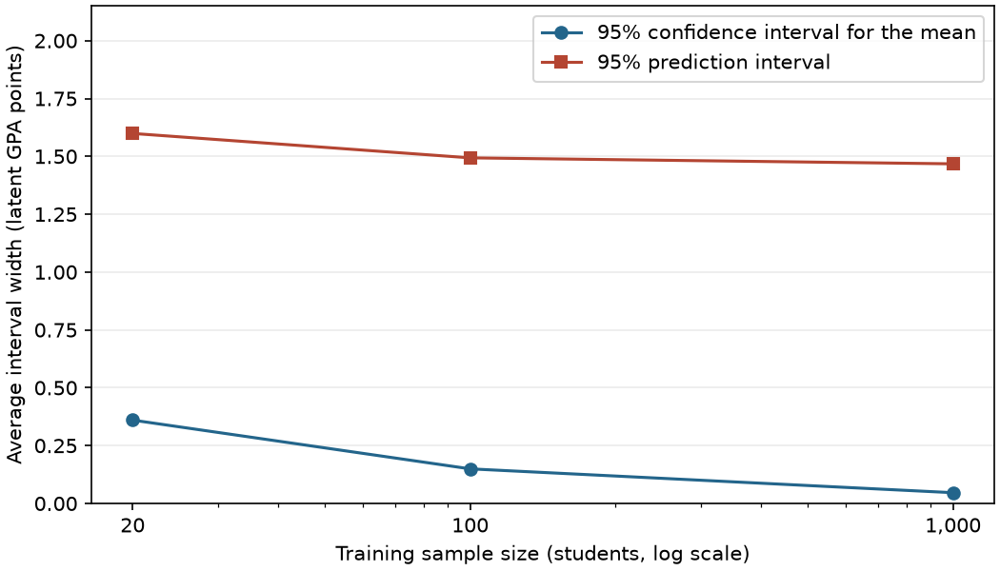
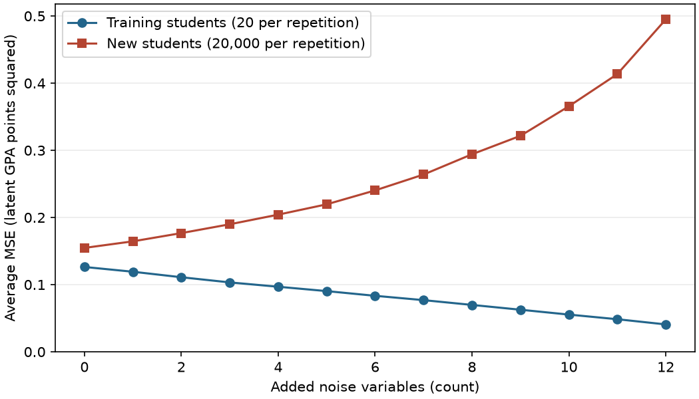
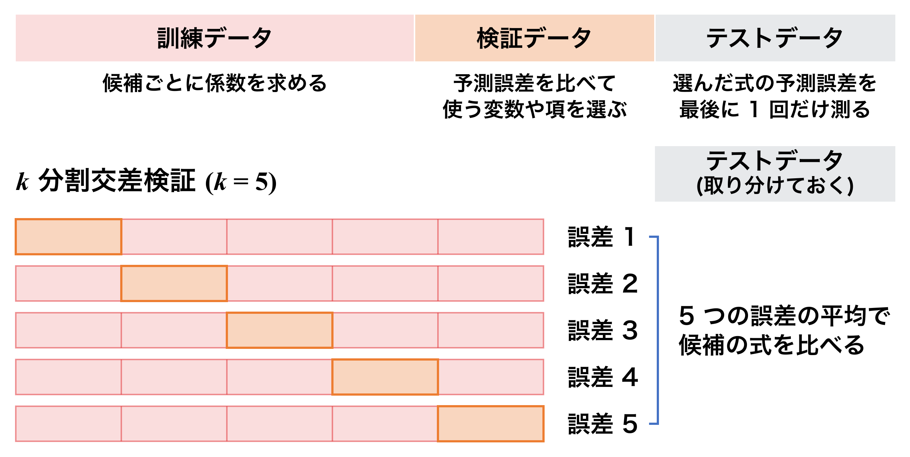

[決定係数](block:reg-simple#model-fit)は, 回帰式を求めたデータに式がどれだけ当てはまるかを表します.
回帰式を予測に使うときに知りたいのは, 式を求めるのに使っていない新しいデータに対して, 予測値が実測値からどれだけ外れるかです.
[重回帰分析](block:reg-gpa)で確かめたのは, 係数を求めた学習用の 70 人への当てはまりでした.

次に入学する学生の GPA をどれだけ正確に当てられるでしょうか.
[回帰分析の目的](block:reg-intro#regression-goals)の表の (b) では,
同じ母集団の新しい学生 1 人ずつの GPA と, 予測の誤差を問いました.
@hernan2019second は, データサイエンスの仕事を記述, 予測, 反事実の予測に分けています.
新しい学生の GPA を当てる課題は, 入力から別の値を当てるという意味で, この分類の「予測」にあたります.

新しい学生が標本と同じ分布から来て, 予測に使う変数を予測時に得られることが前提です.
例えば, 学期中に勉強時間を記録してから学期末の GPA を予測するなら, その勉強時間を使えます.
入学時に予測するなら, 入学後に記録する勉強時間はその時点では使えません.
@shmueli2010explain [§2.6.2] は, 当てはめに使ったデータで測ると予測の性能を高く見積もりやすいと述べています.
新しいデータへの予測の性能を測る方法として, 当てはめに使うデータとは別にデータを取り分ける方法と, 交差検証を挙げています.

予測値が実測値から外れる理由を個体差と平均の推定誤差に分け, それぞれが平均の信頼区間と個人の予測区間にどう表れるかを考えます.
次に, MSE と RMSE で誤差の大きさを測る方法を示し, 過学習を確かめるためにデータをどう分けるかを考えます.
架空の学生 100 人のデータで実際に誤差を測るのは, [未使用のデータで予測の誤差を測る](block:reg-evaluate)です.

# 新しい学生の GPA への予測誤差 {#regression-evaluation}

説明変数を $X$, 目的変数を $Y$ とし, $X=x$ を満たす個体の母集団での平均を
$m(x)=E(Y\mid X=x)$ とします.
説明変数の値が $x_0$ の新しい個体について, 実際に観測する前の目的変数を $Y_0$ と書きます.
標本から求めた予測値を $\hat y(x_0)$ とします.

次の図は, [回帰分析の目的](block:reg-intro#regression-goals)の (b) の予測での, 母集団, 標本, 新しい個体の関係を描いた模式図で, 点は実データではありません.
標本で回帰式を求め, 回帰式を決めるときに使わなかったデータ (図の未使用のデータ) で予測値の外れの大きさを測ります.
新しい個体については, $x_0$ は分かっていても $Y_0$ はまだ分かりません.

予測値が $Y_0$ からどれだけ外れるかを表す予測の誤差は, 次の 2 項に分けられます.

$$
Y_0-\hat y(x_0)
= \underbrace{Y_0-m(x_0)}_{\varepsilon_0}
 + \bigl(m(x_0)-\hat y(x_0)\bigr).
$$

- $\varepsilon_0$ は, 説明変数の値が同じでも残る個体差です. 新しい個体の $Y_0$ が, 説明変数の値をそろえた母集団の平均からどれだけずれるかを表します.
- $m(x_0)-\hat y(x_0)$ は, 平均の推定の誤差を表します. 母集団の平均と, 標本から求めた平均の差です.

次の図は, 2 つの項を $x_0$ の位置で縦に並べた模式図で, 点と直線は実データではありません.
紺の破線は母集団の平均 $m(x)$, 赤の実線は標本から求めた直線です.
新しい個体の $Y_0$ から $m(x_0)$ までが個体差 $\varepsilon_0$, $m(x_0)$ から $\hat y(x_0)$ までが平均の推定の誤差で, 2 つを合わせると予測誤差になります.

例えば, $X$ が勉強時間で $Y$ が GPA なら, 週 10 時間勉強する新しい学生の予測値として, 同じ勉強時間の学生の平均 GPA の推定値を使えます.
同じ勉強時間の学生にも GPA に個人差があり, 平均の推定値は回帰式を求めた標本によって変わります.

新しい個体を回帰式を求めた標本と独立に取ると, $x_0$ をそろえたときの個体差と平均の推定の誤差は独立です.
そのため, 予測の誤差の分散は, 個体差の分散と平均の推定値の分散を足して求められます.

# 平均の信頼区間と個人の予測区間 {#prediction-intervals}

## 単回帰の区間の計算

単回帰で, 母集団の条件つき平均が直線 $m(x)=\beta_0+\beta_1x$ で表され,
誤差は個体どうしで独立とします.
$\beta_0$ は切片, $\beta_1$ は傾きです. 誤差の分散は $X$ の値によらず一定で $\sigma^2$ とします.
回帰に使う記号の詳しい一覧は[記号表](block:reg-ols#notation)にあります.

標本の説明変数の値 $x_1,\ldots,x_n$ を固定し, その平均を $\bar x$,
平均との差の二乗和を $S_{xx}=\sum_{i=1}^{n}(x_i-\bar x)^2$ とします.
標本の大きさは $n>2$ とし, 説明変数の値にばらつきがあって $S_{xx}>0$ とします.
標本で観測した目的変数の値を $y_1,\ldots,y_n$, その平均を $\bar y$ とします.
最小二乗法で求めた直線は標本の平均点 $(\bar x,\bar y)$ を通るので,
$\hat y(x_0)=\bar y+\hat\beta_1(x_0-\bar x)$ と書けます.
$\bar y$ の分散は $\sigma^2/n$, 傾き $\hat\beta_1$ の分散は $\sigma^2/S_{xx}$ です.
$\bar y$ と傾きの共分散は 0 です.
傾きを求めるときに $y_i$ に掛ける重み $(x_i-\bar x)/S_{xx}$ の和が 0 になるためです.
よって標本の説明変数の値を固定したもとでの分散は次の式になります.

$$
\operatorname{Var}(\hat y(x_0))
=\sigma^2\left\{\frac{1}{n}+\frac{(x_0-\bar x)^2}{S_{xx}}\right\}.
$$

$x_0$ が標本の平均 $\bar x$ から離れると, 傾きの推定のばらつきが予測値に強く表れます.
新しい個体の $Y_0$ を予測する誤差の分散には, さらにその個体差の分散 $\sigma^2$ が加わります.

$$
\operatorname{Var}\bigl(Y_0-\hat y(x_0)\bigr)
=\sigma^2\left\{1+\frac{1}{n}+\frac{(x_0-\bar x)^2}{S_{xx}}\right\}.
$$

標本の $x_i$ での当てはめ値を $\hat y_i$ とし, 単回帰の残差を $e_i=y_i-\hat y_i$ とすると, 誤差分散の推定値は
$s^2=\frac{1}{n-2}\sum_{i=1}^{n}e_i^2$ です.
自由度 $n-2$ の t 分布の 97.5 パーセンタイルを $t_{n-2,\,0.975}$ とします.
条件つき平均が直線で, 独立で分散が一定という誤差の仮定に加え,
誤差が正規分布に従うとき, 次の区間が得られます.

- 説明変数の値が $x_0$ のときの母集団の平均 $m(x_0)$ に対する **95% 信頼区間**は

  $$
  \hat y(x_0) \ \pm\ t_{n-2,\,0.975}\,
  s\sqrt{\frac{1}{n}+\frac{(x_0-\bar x)^2}{S_{xx}}}.
  $$

  標本を取り直して区間を作ると, 長期的に区間の 95% が固定された母集団の平均 $m(x_0)$ を含みます.

- 説明変数の値が $x_0$ の新しい個体 1 つの目的変数 $Y_0$ に対する **95% 予測区間**は

  $$
  \hat y(x_0) \ \pm\ t_{n-2,\,0.975}\,
  s\sqrt{1+\frac{1}{n}+\frac{(x_0-\bar x)^2}{S_{xx}}}.
  $$

  勉強時間から GPA を予測する例では, $x_0$ に週あたりの勉強時間を指定します.
  標本を取り直すたびに区間を作り, その標本とは独立に同じ勉強時間の学生を 1 人取り出すと,
  長期的には 95% の回で区間が新しい学生の GPA を含みます.

どちらの区間も中心は $\hat y(x_0)$ です.
予測区間の平方根の中の $1$ は, 新しい個体の個体差の分散 $\sigma^2$ に対応します.

次の図は, 1 つの標本で求めた 2 つの区間を, $x_0$ を動かして帯として描いた模式図で, 点は実データではありません.
濃い帯が平均の信頼区間, 淡い帯が個人の予測区間です.
どちらの帯も $x_0=\bar x$ で最も狭く, $\bar x$ から離れるほど広がります.
予測区間には個体差の分散が加わるので, どの $x_0$ でも平均の信頼区間より広くなります.
標本の点の多くは平均の信頼区間の外にあり, 平均の信頼区間は一人ひとりの値が入る範囲を表していません.

重回帰でも, 説明変数の組を指定して得た平均の推定値を中心に, 個体差を加えて予測区間を作ります.
重回帰での計算は[未使用のデータで予測の誤差を測る](block:reg-evaluate#test-prediction-intervals)で statsmodels を使って行います.

## 合成データで標本の大きさを変えたときの区間幅

[偏回帰係数とそろえる条件](block:reg-multiple#partial-coefficients)で作った架空の学生の母集団では, 奨学生区分, 勉強時間, アルバイト時間の一次式に正規分布の乱数を足して潜在得点を作り, それを 0〜4 点で打ち切った値を観測 GPA としました.
この母集団から標本を取り, 勉強時間だけを使って打ち切り前の潜在得点に直線を当てはめます.
この生成の仕組みでは, 潜在得点の条件つき平均は直線で, 誤差の分散は勉強時間によらず一定です.
誤差には奨学生区分による差も含まれるので, t 分布を使う区間は正規近似にもとづきます.

標本の大きさを 20 人, 100 人, 1,000 人とし, 大きさごとに同じ母集団から独立に 200 回ずつ標本を取りました.
週 10 時間勉強する学生について, 標本ごとに平均の 95% 信頼区間と 1 人の 95% 予測区間を計算しました.
図の縦軸は区間の上端から下端を引いた幅を 200 回で平均した値です.
横軸は標本の大きさを対数目盛で示しています.

20 人から 1,000 人に増えると, 平均の信頼区間の平均幅は潜在得点で 0.360 点から 0.046 点に縮まりました.
予測区間の平均幅は 1.599 点から 1.468 点に縮まりました.
同じ分布から標本を増やすと, 平均を推定するばらつきは小さくなります.
予測区間の全幅は, 同じ $s$ と t 分布の値で個体差の項だけを使った $2t_{n-2,\,0.975}s$ 以上です.
標本を増やして平均を精密に推定できても, 個体差に対応する幅は残ります.

観測 GPA の上端や下端の近くでは, 打ち切りによって平均の形も個体差のばらつき方も変わるため, 予測の外れ方は勉強時間によって異なります.
直線を当てはめて作る区間は 0〜4 点の範囲をはみ出すこともあります.
配布した観測 GPA のデータでの確かめ方は[未使用のデータで予測の誤差を測る](block:reg-evaluate)にあります.

# 残差と平均二乗誤差 {#mse}

学生 $i$ の実測値を $y_i$, 回帰式にその学生の説明変数を入れた値を $\hat y_i$ とします.
式を当てはめた標本での差 $y_i-\hat y_i$ を**残差**と呼びます.
回帰式を求めるのに使っていない学生で同じ引き算をすると, その学生に対する**予測誤差**が得られます.

評価したいデータが $n$ 人分あるとき, 差を二乗して平均した値が
**平均二乗誤差** (Mean Squared Error, MSE) です.

$$
\mathrm{MSE}=\frac{1}{n}\sum_{i=1}^{n}(y_i-\hat y_i)^2.
$$

切片と傾きを求めた訓練標本では, この式の分子は最小二乗法で最小にした残差平方和です. [当てはまりの指標と F 検定](block:reg-simple#model-fit)で使った残差変動にあたります.
1 人あたりの二乗誤差を求めるときは人数 $n$ で割ります.
同じ残差平方和から単回帰の誤差分散を推定するときは, 切片と傾きの推定に使った自由度を引いて $n-2$ で割ります. 推定の詳細は[回帰係数の検定](block:reg-ols#coefficient-test)にあります.

二乗すると正と負の差が打ち消し合わず, 大きく外れた予測ほど MSE に強く反映されます.
MSE は 0 以上の値をとり, 予測が実測値に近いほど小さくなり, すべての予測値が実測値と一致すれば 0 になります.
MSE の単位は目的変数の単位の二乗です.
平方根を取った **平方根平均二乗誤差** (Root Mean Squared Error, RMSE) は元の GPA と同じ単位に戻ります.

$$
\mathrm{RMSE}=\sqrt{\mathrm{MSE}}.
$$

例えば, 新しい学生 4 人の GPA を予測してから実測値と照合すると, 次の結果が得られたとします.

| 学生 | 実測 GPA | 予測 GPA | 実測値 $-$ 予測値 | 差の二乗 |
|---|---:|---:|---:|---:|
| 1 | 3.0 | 2.7 | 0.3 | 0.09 |
| 2 | 2.0 | 2.5 | $-0.5$ | 0.25 |
| 3 | 1.5 | 1.4 | 0.1 | 0.01 |
| 4 | 3.5 | 3.4 | 0.1 | 0.01 |

差の二乗の合計は 0.36 で, そのうち約 7 割 (0.25) を学生 2 の予測誤差が占めます.
4 人で平均すると MSE は $0.36/4=0.09$, 平方根を取ると RMSE は 0.3 GPA 点です.
この例では, 予測が GPA でおよそ 0.3 点外れると読めます.
MSE と RMSE は [Exercise REG-PREDICTION-1](#exercise-reg-prediction-1) で計算します.

# 当てはまりと過学習 {#overfitting}

予測では, 個々の係数が表す比較を読み取る手順を経ずに, 式全体の予測値を使って評価できます.
[決定係数](block:reg-simple#model-fit)は回帰式を当てはめた標本での当てはまりの要約です.
新しい学生でどのくらい外れるかは, 未使用のデータで測ります.

同じ学生の GPA を予測する二つの式を比べてみます. 誤差の二乗和を $S$, 実測 GPA の平均との差の二乗和を $T$ とすると,
MSE は $S/n$, 決定係数は $1-S/T$ です. 学生も実測値も同じなら $n$ と $T$ は共通なので,
$T>0$ のときは MSE の小さい式ほど決定係数が大きくなります.
別の集団で比べると $T/n$ も変わり, 同じ MSE に対する決定係数は GPA の散らばり方によって異なります.

決定係数は単位を持たない比で, 当てはめたデータでは目的変数のばらつきのうち回帰式で表せた割合を表します.
一方, [MSE と RMSE](#mse) は単位を持ち, 誤差の大きさそのものを表します.
どちらの指標も, テストデータで計算すれば新しいデータへの当てはまりを表します.

最小二乗法では, 手元のデータの残差の二乗和が最も小さくなるように係数を決めます.
同じデータで誤差を測ると, そのデータにたまたま含まれていたばらつきにまで式を合わせた分だけ, 誤差は小さく出ます.
説明変数や項を加えても, 追加した係数をすべて 0 にすれば元の式に戻せるため, 同じデータでの MSE は下がるか, 同じ値のままです.
説明変数を増やすだけで決定係数が大きくなり得るため, 当てはまりの比較には[自由度調整済み決定係数](block:reg-simple#model-fit)も使います.

そこでデータを 2 つに分け, 式を求めるのに使う部分を**訓練データ**, 予測の良さを測るために取っておく部分を**テストデータ**と呼びます.
テストデータでの誤差は, 新しいデータに式を使ったときの誤差の見積もりになります.
訓練データでは誤差が小さいのにテストデータでは大きい状態を**過学習**と呼びます [@james2021introduction, §2.2.1].

独立な乱数の列を足すと何が起きるかを, [区間幅の比較](#prediction-intervals)と同じ仕組みで作った合成データで確かめます.
合成データから 20 人の訓練標本を独立に 200 回取り, 各回で潜在得点に回帰式を当てはめました.
勉強時間だけを使う式から始め, 潜在得点とも勉強時間とも独立な標準正規乱数の列を 1 列ずつ足しました.
残差の自由度を 6 以上に保つため, 追加する変数は最大 12 個にしました.
各回で同じ母集団から別に生成した 20,000 人に各式を適用しました. 追加した変数は新しい学生でも同じように独立な乱数で作りました.

横軸の 0 は勉強時間だけの式です. 縦軸は追加した変数の数ごとに 200 回の MSE を平均した値です.
追加する変数が 0 個から 12 個に増えると, 青い線が示す訓練データの平均 MSE は 0.126 から 0.041 に下がりました.
赤い線が示す新しい学生の平均 MSE は 0.155 から 0.495 に上がりました.

# 訓練データ・検証データ・テストデータ {#training-validation-test}

訓練データとテストデータに分ければ, 先に決めた式の予測誤差を測れます.
候補をデータで比べてから一つの式を選ぶときは, 比較に使う**検証データ**を加え, 最終評価のためにテストデータを取っておきます.
例えば, 勉強時間だけの式と, 奨学生区分も使う式を比べてから一方を採用するなら,
係数を求める作業, 式を選ぶ作業, 選んだ式の誤差を測る作業があります.
どの学生のデータをどの作業に使うかは, 候補を比べる前に決めます.

| データ | 役割 |
|---|---|
| **訓練データ** | 候補ごとに回帰式の係数を求めます. |
| **検証データ** | 候補の式の予測誤差を比べて, 使う変数や項を選びます. |
| **テストデータ** | 選んだ式の予測誤差を, 新しい学生の代わりとして最後に 1 回だけ測ります. |

検証用に一組のデータを取り分ける方法のほかに, **交差検証**で式を選ぶ方法があります [@james2021introduction, §5.1].
テストデータは先に取り分け, 残りをいくつかの組に分けます.
各組を順番に検証用にし, 他の組で当てはめた式の誤差を測ります.
候補の式ごとに組を入れ替えて測った誤差を集計すると, 一度の分け方に依存せずに候補を比べられます.
式が決まったら, テストデータを除いたデータで係数を求め直してから最終評価できます.
組の数を $k$ とした交差検証を, $k$ 分割交差検証と呼びます.
次の図は, 上段に 3 つのデータの役割を, 下段に 5 分割交差検証の分け方を示した模式図です.
下段の各行で, 橙の組が検証用, 淡い赤の組が当てはめ用で, 検証用の組は行ごとに 1 つずつずれます.
5 回で測った誤差の平均で候補の式を比べ, その間テストデータは使いません.

{.wide}

変数の選び方は[モデル選択](block:reg-selection)で扱います.

同じ大学でも, 来年度の新入生で勉強時間の分布や GPA の付け方が変われば,
以前のテストデータで測った誤差が来年度にも当てはまる保証はありません.
来年度の学生に予測を使うなら, その学生に相当するデータで誤差を確かめます.

分類でも, 係数やしきい値を決めるのに使うデータと, 正解率を測るデータを分けます.
予測したクラスと実際のクラスを照合する例は[分類の評価](block:ml-classification#classification-evaluation)にあります.

::: note
**ベイズ統計学での予測**

ベイズ統計学では, データを得た後の母数の不確かさを事後分布で表します.
母数ごとの新しい学生の GPA の分布を事後分布で重み付けしてまとめた**事後予測分布**には,
母数の不確かさと, 母数を固定したときの個体差が含まれます.
事前分布と事後分布の計算は[ベイズの定理](block:bayes-intro#ベイズの定理)にあります.
:::

[未使用のデータで予測の誤差を測る](block:reg-evaluate)では, [重回帰分析](block:reg-gpa)で取り分けた評価用の 30 人をテストデータとし, 学習用の 70 人で求めた式の MSE, RMSE, 予測区間を計算します.

# 演習 {#exercises}

## Exercise REG-PREDICTION-1 {#exercise-reg-prediction-1}

**MSE と RMSE の手計算**

3 人の学生について, GPA の実測値が 2.0, 3.5, 1.0, 回帰式による予測値が 2.4, 3.3, 1.2 でした.
残差, MSE, RMSE を手で計算し, RMSE の値を GPA の単位で説明してください.

回答

残差は $2.0-2.4=-0.4$, $3.5-3.3=0.2$, $1.0-1.2=-0.2$ で, その二乗は 0.16, 0.04, 0.04 です.

$$
\mathrm{MSE}=\frac{0.16+0.04+0.04}{3}=\frac{0.24}{3}=0.08, \qquad
\mathrm{RMSE}=\sqrt{0.08}\approx 0.283.
$$

この 3 人での予測の外れの大きさは, RMSE で約 0.28 GPA 点です.

## Exercise REG-PREDICTION-2 {#exercise-reg-prediction-2}

**週 10 時間勉強する学生の平均と個人の区間**

週 10 時間勉強する学生について, 次のそれぞれの場合に使う区間を選び, 理由を説明してください.

1. 母集団で週 10 時間勉強する学生の平均 GPA を知りたい場合.
2. 同じ母集団から新しく取り出す, 週 10 時間勉強する学生 1 人の GPA がどのあたりに入るか知りたい場合.

回答

1. 平均の信頼区間を使います. 標本によって, 同じ勉強時間の学生の母集団平均の推定値がどれだけばらつくかを反映します.
2. 予測区間を使います. 平均の推定の誤差に加え, 新しい学生の GPA が同じ勉強時間の学生の母集団平均からずれる分も含めます.

