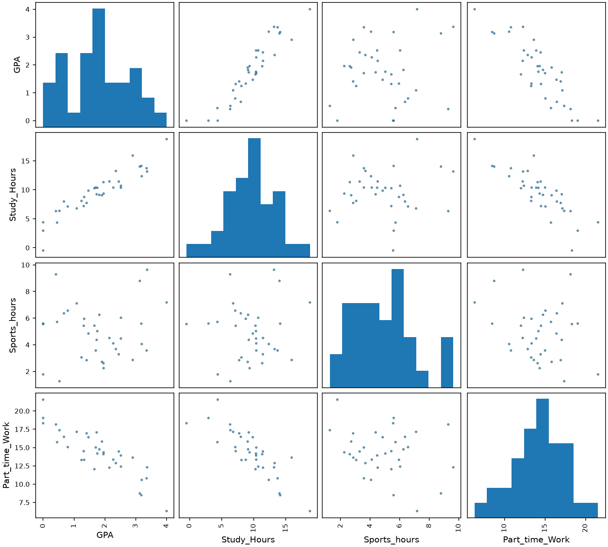
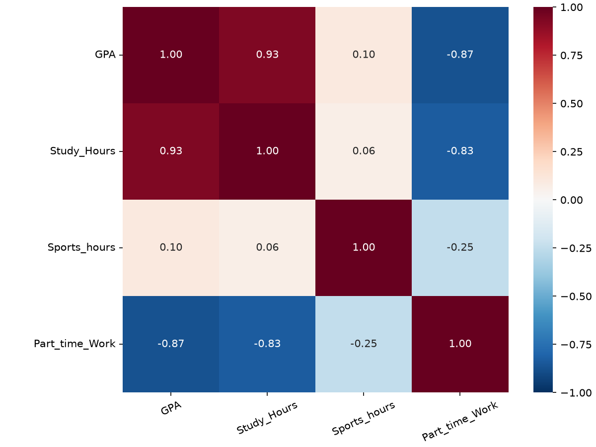

同じ合成 GPA データを使っても, どの変数を式に入れるかは分析の目的で変わります.
平均 GPA の差を求めるなら, どの条件をそろえて比べるかを先に決めます.
新しい学生の GPA を予測するなら, 候補の式を予測誤差で比べます.
探索では, データに見つけた関係から仮説を立てます. 各目的で何を基準に変数を選ぶかは[目的ごとの変数の選び方](block:reg-selection#model-selection)にまとめています.

## 合成 GPA データの準備 {#selection-gpa-data}

[`multiple_regression.csv`](https://github.com/yakagika/yakagika.github.io/blob/main/slds_data/ch11/multiple_regression.csv) には, 合成した 100 人分のデータが入っています.
CSV をダウンロードしてコードと同じフォルダに置き, そのフォルダからコードを実行してください.
先頭列には行番号が入っているので, `index_col=0` で行のインデックスとして読み込みます.

~~~ python
import matplotlib.pyplot as plt
import pandas as pd
import seaborn as sns
import statsmodels.formula.api as smf
from sklearn.metrics import mean_squared_error
from sklearn.model_selection import KFold, train_test_split

df = pd.read_csv("multiple_regression.csv", index_col=0)
train, test = train_test_split(df, test_size=0.3, random_state=0)
print(f"Training: {len(train)}, held out: {len(test)}")
~~~

~~~ text
Training: 70, held out: 30
~~~

GPA は 0〜4 点で, 勉強時間 (`Study_Hours`), アルバイト時間 (`Part_time_Work`), 運動時間 (`Sports_hours`) は週あたりの時間です.
`Scholarship` は奨学生なら `True`, それ以外なら `False` です. いずれも配布データの単位のまま使います.
読み込んだ直後に最終評価用の 30 人を取り分けます.
関係の定量化, 予測, 探索は, それぞれ別の分析例として学習用の 70 人から始めます.

# 関係の定量化: 式を問いで決める {#selection-quantification}

奨学生かどうかとアルバイト時間が同じ学生どうしで, 勉強時間が週 1 時間長い学生の平均 GPA は何点高いでしょうか.
データの値を見る前に, 問いでそろえる条件から式を決めます.
この場合は [GPA の重回帰分析](block:reg-gpa#gpa-coefficients)と同じ式になります.
[合成 GPA データの準備](#selection-gpa-data)を実行したセッションで, 学習用の 70 人について係数と 95% 信頼区間を求めます.

~~~ python
formula = "GPA ~ Scholarship + Study_Hours + Part_time_Work"
fit = smf.ols(formula, data=train).fit()
intervals = fit.conf_int(alpha=0.05)
coefficient_table = pd.DataFrame(
    {"Estimate": fit.params, "Lower": intervals[0], "Upper": intervals[1]}
)
print(coefficient_table.to_string(float_format=lambda value: f"{value:.3f}"))

without_work = smf.ols("GPA ~ Scholarship + Study_Hours", data=train).fit()
print(f"Study hours without part-time work: {without_work.params['Study_Hours']:.3f}")
~~~

~~~ text
                     Estimate  Lower  Upper
Intercept               0.836  0.194  1.479
Scholarship[T.True]     0.504  0.398  0.610
Study_Hours             0.209  0.185  0.233
Part_time_Work         -0.090 -0.121 -0.060
Study hours without part-time work: 0.267
~~~

奨学生区分とアルバイト時間が同じ学生どうしでは, 勉強時間が週 1 時間長い学生ほど, 平均 GPA が約 0.209 点高いと推定されます.
95% 信頼区間は 0.185〜0.233 点です.
各係数は, 推定値と信頼区間をそろえて報告します.

アルバイト時間を外した式でも, 勉強時間が週 1 時間違う学生を比べます.
ただし, こちらの式でそろえる条件は奨学生区分だけで, 推定した平均 GPA の差は約 0.267 点です.
P 値を基準に変数を外す手順では, 外れた変数が比較の条件からも外れます.
問いでそろえると決めた変数は, P 値の大小にかかわらず式に残します.
係数が表す比較の違いは, [偏回帰係数とそろえる条件](block:reg-multiple#partial-coefficients)で確かめられます.

運動時間もそろえて勉強時間と GPA の関係を比べる問いなら, 運動時間を加えた[式 B](#selection-prediction)を使います.
同じ学習用の 70 人で式 B を当てはめると, 運動時間の係数は約 0.002, P 値は 0.853 です.
奨学生区分, 勉強時間, アルバイト時間をそろえて運動時間が週 1 時間長い学生を比べると, 平均 GPA の差の 95% 信頼区間は -0.023〜0.028 点です.
区間は 0 をまたぎ, 幅は約 0.052 点です. 区間の両端も 0 から約 0.03 点以内です.

# 予測: 交差検証で選び, テストデータで 1 回だけ評価する {#selection-prediction}

新しい学生の GPA を予測する式を, 学習用の 70 人で比べます.
候補は [GPA の重回帰分析](block:reg-gpa#gpa-coefficients)の式 A, 運動時間を足した式 B, アルバイト時間を外した式 C です.

[合成 GPA データの準備](#selection-gpa-data)を実行してから, 学習用データを 14 人ずつの 5 組に分けます.
1 組を検証用とし, 他の 4 組の 56 人で係数を求めます.
検証用の組を入れ替えて 5 回予測し, 5 組の MSE の平均を交差検証の MSE (CV MSE) とします.
組の分け方はすべての候補で共通です. 各データの役割は[訓練データ・検証データ・テストデータ](block:reg-prediction#training-validation-test)で確認できます.

~~~ python
formulas = {
    "A": "GPA ~ Scholarship + Study_Hours + Part_time_Work",
    "B": "GPA ~ Scholarship + Study_Hours + Part_time_Work + Sports_hours",
    "C": "GPA ~ Scholarship + Study_Hours",
}
folds = KFold(n_splits=5, shuffle=True, random_state=0)
splits = list(folds.split(train))

scores = []
for name, formula in formulas.items():
    validation_errors = []
    for fit_indices, validation_indices in splits:
        fitting = train.iloc[fit_indices]
        validation = train.iloc[validation_indices]
        fit = smf.ols(formula, data=fitting).fit()
        predicted = fit.predict(validation)
        validation_errors.append(mean_squared_error(validation["GPA"], predicted))

    full_fit = smf.ols(formula, data=train).fit()
    scores.append(
        {
            "Model": name,
            "CV MSE": sum(validation_errors) / len(validation_errors),
            "AIC": full_fit.aic,
            "BIC": full_fit.bic,
        },
    )

scores = pd.DataFrame(scores)
print(scores.to_string(index=False, float_format=lambda value: f"{value:.5f}"))
~~~

~~~ text
Model  CV MSE      AIC      BIC
    A 0.06265 -9.05519 -0.06121
    B 0.06339 -7.09237  4.15010
    C 0.08188 18.55755 25.30303
~~~

`KFold` が返すのは行の位置なので, `iloc` で学習用データから行を取り出します.
AIC と BIC は, どちらも候補ごとに同じ 70 人で当てはめて計算します.
`statsmodels` の `aic` と `bic` はパラメータ数に誤差分散を含めません.
誤差分散を含めて $p=k+2$ とする[情報量規準](block:reg-selection#information-criteria)の式に比べ, AIC は 2, BIC は $\log 70$ 小さくなります.
どの候補でも同じ値だけ小さくなるため, 候補間の差や順位は変わりません.
式 B から運動時間を外した式 A では, AIC が約 1.96, BIC が約 4.21 下がります.

このデータでは, CV MSE, AIC, BIC のいずれでも式 A が最小です.
GPA の二乗誤差を測るのが目的なので, CV MSE を採用基準にします.
式を決めたら, 学習用の 70 人で係数を求め直し, テストデータの 30 人で MSE を 1 回だけ求めます.

~~~ python
best_name = scores.loc[scores["CV MSE"].idxmin(), "Model"]
best_fit = smf.ols(formulas[best_name], data=train).fit()
test_prediction = best_fit.predict(test)
test_mse = mean_squared_error(test["GPA"], test_prediction)
print(f"Selected model: {best_name}")
print(f"Test MSE: {test_mse:.5f}")
~~~

~~~ text
Selected model: A
Test MSE: 0.03363
~~~

式 A のテスト MSE は約 0.034 で, CV MSE の約 0.063 を下回りました (単位はいずれも GPA 点の二乗).
評価に使う学生が違い (テストは 30 人の 1 組), 係数を求めた人数も交差検証では 56 人, 最終評価では 70 人なので, 今回の大小関係だけから一般の傾向は判断できません.
式 A と B の CV MSE の差は約 0.00074 で, 式を選ぶときは表示のために丸める前の値を使います.
候補をさらに増やしたときに, 選択に使った誤差をどう読むかは [説明変数の組み合わせを交差検証で比べる](block:reg-selection-lab#variable-selection-test-mse)で扱います.

# 探索: 探索用で選び, 確認用で確かめる {#selection-exploration}

GPA と関係しそうな変数をデータから探します.
[合成 GPA データの準備](#selection-gpa-data)を実行したら, 学習用の 70 人を探索用 35 人と確認用 35 人に分けます.
図を作ること, 相関を求めること, 式に入れる候補を選ぶことに使うのは探索用の 35 人です.

~~~ python
explore, confirm = train_test_split(train, test_size=0.5, random_state=0)
print(f"Exploration: {len(explore)}, confirmation: {len(confirm)}")
~~~

~~~ text
Exploration: 35, confirmation: 35
~~~

## 散布図行列と相関

散布図行列では行の変数が縦軸, 列の変数が横軸です. 対角線上には各変数のヒストグラムが並びます.
奨学生区分はカテゴリなので, この図には 4 つの数値変数を使います.

~~~ python
numeric_columns = ["GPA", "Study_Hours", "Sports_hours", "Part_time_Work"]
fig, axes = plt.subplots(4, 4, figsize=(10, 9), layout="constrained")
pd.plotting.scatter_matrix(
    explore[numeric_columns],
    ax=axes,
    diagonal="hist",
    range_padding=0.12,
    color="#23658b",
    alpha=0.7,
)
plt.show()
plt.close(fig)
~~~

{.wide}

最上段では, 勉強時間が長い学生ほど GPA が高く, アルバイト時間が長い学生ほど GPA が低い傾向があります.
運動時間と GPA の点は, 広い範囲に散らばっています.
合成データには勉強時間が約 -0.48 時間の学生が 1 人います. 配布データの値をそのまま使います.

Pearson の相関係数を求めてヒートマップにします.
負の相関は青, 正の相関は赤に対応します.

~~~ python
correlations = explore[numeric_columns].corr()
fig, ax = plt.subplots(figsize=(8, 6), layout="constrained")
sns.heatmap(
    correlations,
    ax=ax,
    vmin=-1,
    vmax=1,
    center=0,
    cmap="RdBu_r",
    annot=True,
    fmt=".2f",
    square=True,
)
ax.tick_params(axis="x", labelrotation=25)
ax.tick_params(axis="y", labelrotation=0)
plt.show()
plt.close(fig)
~~~

GPA との相関係数は, 勉強時間が 0.93, アルバイト時間が -0.87, 運動時間が 0.10 です.
勉強時間とアルバイト時間の組にも -0.83 の相関があります.
重回帰で両方の時間を入れたときは, 他方の時間をそろえた比較になります.
説明変数どうしの関係が強いときは, [多重共線性と係数の精度](block:reg-multiple#multicollinearity)で見たように, 係数の精度を区間の広さで確かめます.

## P 値を使った後退消去

散布図と相関係数で見た GPA との関係の強さは, 時間の種類によって異なります.
変数を外すかは P 値を使った後退消去で決めるため, 3 種類の時間と奨学生区分の 4 変数すべてを候補にし, 探索用の 35 人で切片つきの式を当てはめます.
切片を除いた係数のうち, 最も大きな P 値が 0.05 以上なら, 対応する変数を 1 つ除いて係数を求め直します.
すべての P 値が 0.05 未満になるか, 候補をすべて除いた時点で止めます.
この手順は [ステップワイズ法](block:reg-selection#stepwise)のうち, 変数を順に除く**後退消去**です.

~~~ python
selected = ["Scholarship", "Study_Hours", "Part_time_Work", "Sports_hours"]
while selected:
    formula = "GPA ~ " + " + ".join(selected)
    fit = smf.ols(formula, data=explore).fit()
    p_values = fit.pvalues.drop("Intercept")
    p_values = p_values.rename({"Scholarship[T.True]": "Scholarship"})
    print(p_values.to_string(float_format=lambda value: f"{value:.3g}"))

    largest = p_values.idxmax()
    if p_values[largest] < 0.05:
        break
    selected.remove(largest)
    print(f"Remove: {largest}")
selected_formula = "GPA ~ " + (" + ".join(selected) if selected else "1")
print(f"Selected formula: {selected_formula}")
~~~

~~~ text
Scholarship      1.16e-05
Study_Hours      3.13e-09
Part_time_Work    0.00121
Sports_hours        0.715
Remove: Sports_hours
Scholarship      8.49e-06
Study_Hours      6.26e-10
Part_time_Work   0.000765
Selected formula: GPA ~ Scholarship + Study_Hours + Part_time_Work
~~~

奨学生区分は `False` が基準なので, `Scholarship[T.True]` の P 値を奨学生区分の P 値として使います.
`drop("Intercept")` で切片を除くと, 残った P 値から `idxmax()` が最大値を持つ変数名を返します.
その P 値が 0.05 以上なら, `selected.remove(largest)` で該当する変数を外します.
この標本では運動時間の P 値が 0.715 で最も大きく, 運動時間を除いた式で他の 3 変数が残りました.
候補がすべて除かれた場合の式は `GPA ~ 1` で, 切片だけが残ります.
探索用データで計算した P 値は変数を選ぶために使います.
同じデータで選び, その P 値で仮説を検定すると, 変数が選ばれた経緯が通常の検定の計算に入らず, P 値が小さく出やすくなります.
詳しくは [選んだ後の推論](block:reg-selection-more#post-selection)を参照してください.

## 確認用の 35 人で係数を求める

探索で選んだ `selected_formula` をそのまま `smf.ols` に渡し, 確認用の 35 人だけを指定して `fit()` で係数を求めます.
その当てはめ結果から 95% 信頼区間を計算します.

~~~ python
check = smf.ols(selected_formula, data=confirm).fit()
intervals = check.conf_int(alpha=0.05)
report = pd.DataFrame(
    {
        "Estimate": check.params,
        "Lower": intervals[0],
        "Upper": intervals[1],
        "Width": intervals[1] - intervals[0],
    },
)
print(report.to_string(float_format=lambda value: f"{value:.3f}"))
~~~

~~~ text
                     Estimate  Lower  Upper  Width
Intercept               0.728  0.103  1.354  1.251
Scholarship[T.True]     0.560  0.455  0.666  0.211
Study_Hours             0.226  0.203  0.249  0.046
Part_time_Work         -0.096 -0.127 -0.066  0.061
~~~

確認用データでは式を固定したまま全係数を報告します.
奨学生区分とアルバイト時間が同じ学生どうしでは, 勉強時間が週 1 時間長い学生ほど, 平均 GPA が約 0.226 点高いと推定されます.
その 95% 信頼区間は 0.203〜0.249 点で, 幅は約 0.046 点です.
奨学生区分についても, 平均 GPA の差には約 0.211 点の区間幅があります.

データを分けると, 係数の推定に使えるのは 35 人です.
一般に人数が少ないと信頼区間は広くなりやすく, 実際の幅は各標本の説明変数の散らばりや残差にも左右されます.
この分割で得た勉強時間の区間幅は, [問いで決めた式を 70 人で推定した区間](#selection-quantification)の幅と同程度です.
探索で選んだ関係は, 独立な確認用の標本から得た区間を添えて記録し, 新しいデータでも確かめる仮説として扱います.

# 演習 {#exercises}

## Exercise REG-SELECTION-GPA-1 {#exercise-reg-selection-gpa-1}

**運動時間が異なる学生の平均 GPA の差**

奨学生区分, 勉強時間, アルバイト時間が同じ学生どうしで, 運動時間が週 1 時間違うと平均 GPA はどれだけ違うでしょうか.
この問いを立ててから, 学習用の 70 人に運動時間も含む重回帰式を当てはめます.
運動時間の係数と 95% 信頼区間を報告し, 区間から差の向きについて何がいえるかを書いてください.

回答

~~~ python
import pandas as pd
import statsmodels.formula.api as smf
from sklearn.model_selection import train_test_split

df = pd.read_csv("multiple_regression.csv", index_col=0)
train, test = train_test_split(df, test_size=0.3, random_state=0)

formula = "GPA ~ Scholarship + Study_Hours + Part_time_Work + Sports_hours"
fit = smf.ols(formula, data=train).fit()
estimate = fit.params["Sports_hours"]
lower, upper = fit.conf_int(alpha=0.05).loc["Sports_hours"]
print(f"Sports hours: {estimate:.3f}, 95% CI [{lower:.3f}, {upper:.3f}]")
~~~

~~~ text
Sports hours: 0.002, 95% CI [-0.023, 0.028]
~~~

区間は 0 をまたぐため, このデータからは差の向きまで決められません.
運動時間の係数が答えるのは演習で先に立てた問いなので, 運動時間を式に含めて区間を報告します.

