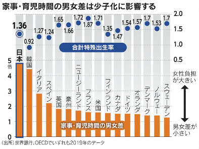
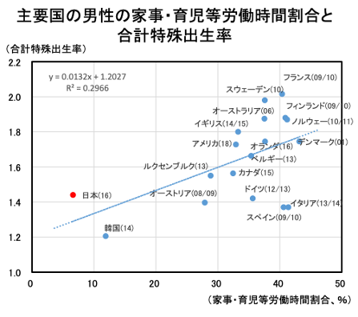
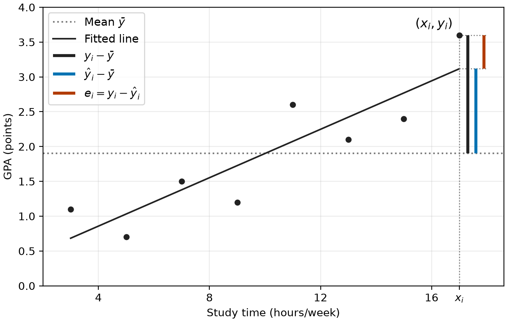
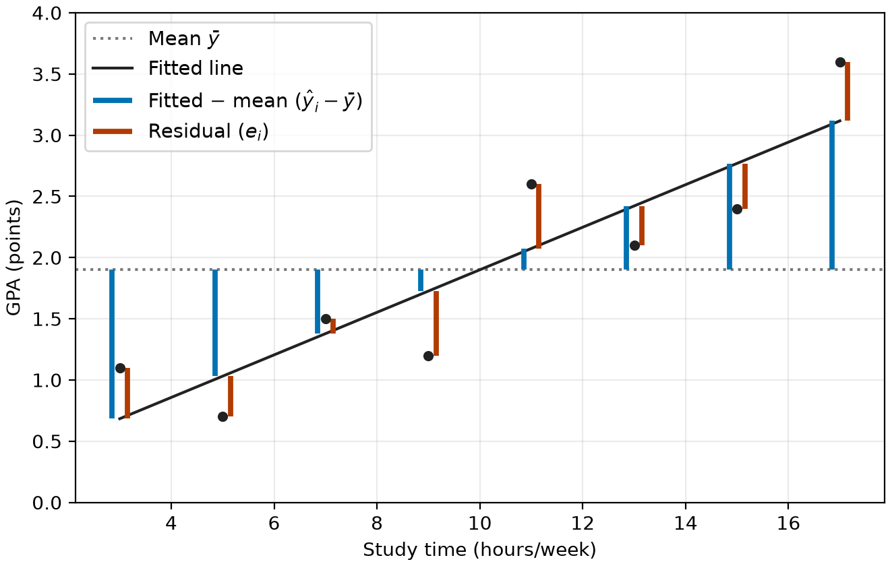
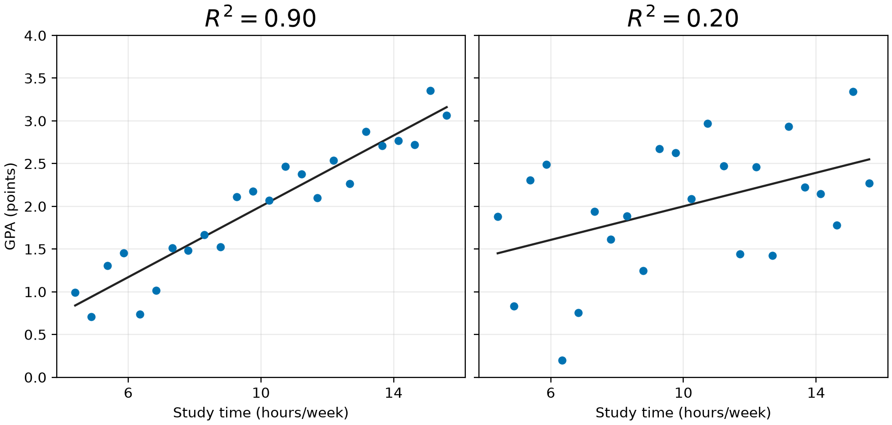
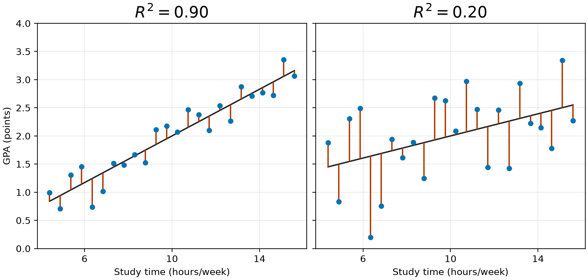

男性の家事・育児時間の割合が 1 パーセントポイント高い国では, 合計特殊出生率は平均でどれだけ違うでしょうか.
国ごとの値を散布図にし, 単回帰直線の傾きでこの関係を表します.

# 出生率と時間配分の表の結合 {#oecd-data}

日本経済新聞は, 家事・育児時間の男女差と少子化の関係を報じました.
記事の図は 16 か国を対象に, 国ごとに家事・育児時間の男女差を棒で, 合計特殊出生率を点で示しています.

{.wide}

出典 [日本経済新聞, 男性の育児・家事時間と出生率についての記事](https://www.nikkei.com/article/DGXZQOFE308UG0Q1A830C2000000/)

図に載った 16 か国はどのように選ばれたのでしょうか. 別の国を加えると, 2 つの指標の関係はどう見えるでしょうか.
図の横軸には国名が並ぶので, 各国の値を読み取れます. 2 つの量の関係を見るには, 片方の量を横軸に, もう片方を縦軸に置きます.

内閣府の図は, 横軸を男性の家事・育児等労働時間割合とし, 合計特殊出生率との関係を散布図と回帰直線で示しています.
直線の傾きは, 図に含まれる国どうしで, 男性の家事・育児等労働時間割合が違うときの出生率の平均的な差を表します.

{.wide}

出典 [内閣府 政策統括官（経済社会システム担当）第４回会議資料「選択する未来2.0」資料２ 参考資料②(事務局資料)](https://www5.cao.go.jp/keizai2/keizai-syakai/future2/20200409/shiryou2.pdf)

内閣府の図には回帰式 $y=0.0132x+1.2027$ と[決定係数](#model-fit) $R^2=0.2966$ が記載されています.
対象は 18 か国で, トルコは含まれません. 国名に添えた年は国によって異なります.
日本経済新聞の図は 2019 年のデータと注記しています. 配布表の値は 2019 年の出生率と, 国によって 1999 年から 2013 年の調査に基づく時間配分です.
配布表で求めた傾きと決定係数は, 内閣府の図の値とどれだけ違うでしょうか. 比較するには, 図の対象国と調査年も確かめます.

$x$ にあたる割合を原表からどう計算し, どの列で出生率の表と照合すればよいでしょうか.
コードを読む前に, 両方の値がそろう国の確かめ方も考えてみてください.

[`fertility_rates.csv`](https://github.com/yakagika/yakagika.github.io/blob/main/slds_data/ch11/fertility_rates.csv) と
[`time_used.csv`](https://github.com/yakagika/yakagika.github.io/blob/main/slds_data/ch11/time_used.csv) をダウンロードし, コードと同じフォルダに置いてください.
コードはそのフォルダから実行してください.

必要な Python パッケージは `pandas`, `numpy`, `matplotlib`, `statsmodels`, `adjustText` です.

~~~ python
import matplotlib.pyplot as plt
import numpy as np
import pandas as pd
import statsmodels.api as sm
from adjustText import adjust_text

fertility = pd.read_csv("fertility_rates.csv")
time_use = pd.read_csv("time_used.csv")
print(fertility.head(2).to_string(index=False))
print(time_use.head(2).to_string(index=False))
~~~

~~~ text
Country  Fertility
  Korea       0.92
  Spain       1.23
  Country  Paid  Unpaid  Care
Australia  20.3    10.5   2.2
  Austria  22.5     9.4   1.5
~~~

`Country` は国名, `Fertility` は合計特殊出生率です.
時間配分の表では, `Paid` が有償労働, `Unpaid` が無償の家事, `Care` が育児などのケアに対応します.
男性がこの 3 項目に使う時間のうち, 家事・育児に使う割合を百分率で計算し, `r` に格納します.

~~~ python
unpaid_and_care = time_use["Unpaid"] + time_use["Care"]
total_work = time_use["Paid"] + unpaid_and_care
time_use["r"] = 100 * unpaid_and_care / total_work
~~~

出生率の表ではトルコが `Türkiye`, 時間配分の表では `Turkey` と表記されています.
出生率の表の表記を `Turkey` にそろえてから, `Country` をキーに結合します.
`validate="one_to_one"` を指定すると, 同じキーが片方の表に複数回現れたときにエラーになります.
外部結合 (`how="outer"`) では, 片方の表にしかない行も残ります.
`indicator=True` で追加した `_merge` 列で, それぞれの行がどちらの表にあったかを確かめます.

~~~ python
fertility["Country"] = fertility["Country"].replace({"Türkiye": "Turkey"})
joined = fertility.merge(
    time_use[["Country", "r"]],
    on="Country",
    how="outer",
    validate="one_to_one",
    indicator=True,
)

unmatched = joined.loc[joined["_merge"] != "both", ["Country", "_merge"]]
print(unmatched.to_string(index=False))
~~~

~~~ text
        Country    _merge
          Chile left_only
       Colombia left_only
     Costa Rica left_only
 Czech Republic left_only
        Denmark left_only
         Greece left_only
        Hungary left_only
        Iceland left_only
        Ireland left_only
         Israel left_only
      Lithuania left_only
     Luxembourg left_only
    Netherlands left_only
   OECD average left_only
       Portugal left_only
Slovak Republic left_only
    Switzerland left_only
~~~

`left_only` の行には出生率だけがあります.
今回の表には, 時間配分の表にだけある `right_only` の行はありません.
`both` の行を残し, `dropna()` で数値が欠けている行を除きます.
両方の値がそろったのは 22 か国です.
内閣府の図にメキシコが含まれないので, メキシコを外した 21 か国に直線を当てはめます.
結合後の 21 か国にはトルコが入ります. 内閣府の図に載るオランダとデンマークは, 2 つの表を結合すると `left_only` になります.
メキシコを加えた場合は [Exercise REG-SIMPLE-1](#exercise-reg-simple-1) で確かめます.

~~~ python
matched = joined.loc[joined["_merge"] == "both", ["Country", "Fertility", "r"]]
countries = matched.set_index("Country").dropna()
analysis = countries.drop(index="Mexico")

print(f"Matched: {len(countries)}, used in the main example: {len(analysis)}")
print(analysis.head(2).to_string(float_format="{:.2f}".format))
~~~

~~~ text
Matched: 22, used in the main example: 21
           Fertility     r
Country
Australia       1.67 38.48
Austria         1.46 32.63
~~~

# 家事・育児時間の割合と出生率の散布図 {#oecd-scatter}

横軸は男性の家事・育児時間の割合 (%) で, 計算式は
$100 \times (\mathrm{Unpaid}+\mathrm{Care})/(\mathrm{Paid}+\mathrm{Unpaid}+\mathrm{Care})$ です.
縦軸は 2019 年の合計特殊出生率 (女性 1 人あたりの子どもの数) です.
時間配分は国によって 1999 年から 2013 年の調査に基づくため, 2 つの指標の年はそろっていません.
出典は [OECD Family Database](https://www.oecd.org/en/data/datasets/oecd-family-database.html) の SF2.1 (出生率) と LMF2.5 (時間配分) です.

~~~ python
def plot_countries(data):
    fig, ax = plt.subplots(figsize=(10, 6), layout="constrained")
    points = ax.scatter(data["r"], data["Fertility"], color="#23658b", zorder=3)
    ax.set(
        xlim=(8, 49),
        ylim=(0.82, 1.98),
        xlabel="Men's unpaid work and care (% of work time)",
        ylabel="Total fertility rate (children per woman)",
    )
    ax.grid(alpha=0.25)
    labels = [
        ax.text(row.r, row.Fertility, country, fontsize=9)
        for country, row in data.iterrows()
    ]
    return fig, ax, points, labels

fig, ax, points, labels = plot_countries(analysis)
adjust_text(
    labels,
    objects=points,
    ax=ax,
    iter_lim=300,
    min_arrow_len=4,
    arrowprops={"arrowstyle": "-", "color": "0.45", "linewidth": 0.6},
)
plt.show()
plt.close(fig)
~~~

1 点は 1 か国です. 日本と韓国はどちらの値も低く, 図の左下にあります.
トルコでは家事・育児時間の割合が約 23% で, 合計特殊出生率は 21 か国で最も高い 1.88 です.
右側では同程度の割合でも出生率にばらつきがあります.
日本経済新聞の図の棒は時間の男女差を示し, この散布図の横軸は男性の時間配分の割合です.
横軸の値が近い国を探し, 縦軸の出生率にどの程度の差があるかを点の位置から読み取ってください.

# 単回帰の係数と国の組み合わせ {#oecd-ols}

`sm.OLS` の OLS は Ordinary Least Squares (最小二乗法) の略です. `sm.OLS` に目的変数と説明変数の表を渡します.
`sm.add_constant` は切片を求めるために, 全行が 1 の列 `const` を追加します.

~~~ python
print(sm.add_constant(analysis[["r"]]).head(2).to_string(float_format="{:.2f}".format))
~~~

~~~ text
           const     r
Country
Australia   1.00 38.48
Austria     1.00 32.63
~~~

`fit()` で係数を求め, `summary().tables[1]` で係数の表を取り出します.

~~~ python
def fit_fertility(data):
    predictors = sm.add_constant(data[["r"]])
    return sm.OLS(data["Fertility"], predictors).fit()

result = fit_fertility(analysis)
print(result.summary().tables[1])
~~~

~~~ text
==============================================================================
                 coef    std err          t      P>|t|      [0.025      0.975]
------------------------------------------------------------------------------
const          1.2082      0.197      6.119      0.000       0.795       1.621
r              0.0093      0.006      1.687      0.108      -0.002       0.021
==============================================================================
~~~

| 列 | 読み方 |
|---|---|
| `coef` | 係数の推定値です. `const` は切片, `r` は傾きです. |
| `std err` | 係数の推定値の標準誤差です. |
| `t` | 係数の推定値を標準誤差で割った t 統計量です. |
| <code>P&gt;&#124;t&#124;</code> | 係数が 0 という帰無仮説に対する両側 P 値です. |
| `[0.025` と `0.975]` | 95% 信頼区間の下限と上限です. |

区間と検定の前提や計算は [回帰係数の区間と検定](block:reg-ols) で扱います.
切片の P 値は小数点以下 3 桁への丸めで `0.000` と表示されます.
傾きの 95% 信頼区間は 0 を含みます. 検定の前提が成り立つ場合, これは 5% 水準の両側検定で傾きが 0 という仮説を棄却しないことに対応します.
出力の P 値と区間は, 母集団から標本を無作為に取るなど, 標本のばらつきを確率で表せる前提のもとで解釈します.
この例の 21 か国はある母集団から偶然に取り出した標本ではないため, 表の P 値を母集団への推測には使いません.
母集団への推測は, 同じ仕組みから別の標本を作れる [合成 GPA の例](block:reg-gpa) で扱います.

21 か国に当てはめた式では, 男性の家事・育児時間の割合を $x$ として, 出生率の当てはめ値は $\hat y = 1.2082 + 0.0093x$ です.
直線では, 男性の家事・育児時間の割合が 1 パーセントポイント高い国ほど,
合計特殊出生率が平均で約 0.00931 高いと読みます.

日本経済新聞の図で挙がった対象国の選び方を検討するため, 国を入れ替えると傾きがどう変わるかを調べます.
表記をそろえずに結合するとトルコが落ちます.
その場合に相当する 20 か国, 本文の 21 か国, メキシコも含めた 22 か国で, 単回帰を当て直します.

~~~ python
comparisons = {
    "Without Turkey or Mexico": analysis.drop(index="Turkey"),
    "Main example": analysis,
    "Including Mexico": countries,
}
for label, data in comparisons.items():
    slope = fit_fertility(data).params["r"]
    print(f"{label:25s} {len(data):2d} {slope:.5f}")
~~~

当てはめた傾きの単位は, 家事・育児時間の割合 1 パーセントポイントあたりの合計特殊出生率の差です.

| 対象 | 国数 | 傾き |
|---|---:|---:|
| トルコとメキシコを除く | 20 | 0.01344 |
| この節の分析 (トルコを含み, メキシコを除く) | 21 | 0.00931 |
| トルコとメキシコを含む | 22 | 0.00517 |

トルコもメキシコも, 家事・育児時間の割合が約 20〜23% で, 合計特殊出生率が 1.88 以上です.
この 2 国を順に加えると, 当てはめた傾きは小さくなります.

# 回帰直線と出生率の当てはまり {#oecd-fit-plots}

家事・育児時間の割合の最小値から最大値までを `np.linspace` で 100 点に区切ります.
各点に対する出生率の当てはめ値を計算し, 散布図に直線を重ねます.

~~~ python
work_share = np.linspace(analysis["r"].min(), analysis["r"].max(), 100)
fitted_line = result.params["const"] + result.params["r"] * work_share

fig, ax, points, labels = plot_countries(analysis)
ax.plot(work_share, fitted_line, color="#b44532", label="OLS line")
ax.legend(loc="lower right")
adjust_text(
    labels,
    objects=points,
    ax=ax,
    iter_lim=300,
    min_arrow_len=4,
    arrowprops={"arrowstyle": "-", "color": "0.45", "linewidth": 0.6},
)
plt.show()
plt.close(fig)
~~~

直線の傾きは正です. トルコの点は直線より上にあり, トルコの実測の出生率は,
その家事・育児時間の割合に対応する当てはめ値より高くなっています.

[内閣府の図](#oecd-data) と回帰直線を比べるときは, 2 つの直線の算出に使った国と調査年を確かめてください.

国ごとの当てはめ値 (`result.fittedvalues`) を横軸に, 実測値を縦軸に置くと,
直線からのずれを国どうしで比べられます.
破線は実測値と当てはめ値が一致する場所です.

~~~ python
observed = analysis["Fertility"]
fitted = result.fittedvalues
limits = (0.85, 1.95)

fig, ax = plt.subplots(figsize=(6, 6), layout="constrained")
ax.scatter(fitted, observed, color="#23658b", alpha=0.8)
ax.plot(limits, limits, color="#b44532", linestyle="--", label="Exact fit")
ax.set(
    xlim=limits,
    ylim=limits,
    xlabel="Fitted total fertility rate",
    ylabel="Observed total fertility rate",
    aspect="equal",
)
ax.legend()
ax.grid(alpha=0.25)
plt.show()
plt.close(fig)
~~~

{.small}

破線より上の点では式が実測値を低く見積もり, 下の点では高く見積もっています.
この図で比べているのは, 式を求めるのに使った国の当てはめ値と実測値です.
このずれが全体としてどれだけ小さいかは, 次の[当てはまりの指標と F 検定](#model-fit)で 1 つの値に要約します.

# 当てはまりの指標と F 検定 {#model-fit}

[回帰直線と出生率の当てはまり](#oecd-fit-plots)の図では, 21 か国の実測値と当てはめ値のずれを国ごとに見ました.
回帰式全体の出力では, このずれを要約する決定係数と調整済み決定係数, F 統計量とその P 値を取り出せます.
まず 3 つの値の定義を確かめ, そのあと 21 か国の値を出力して読みます.

## 決定係数

第 $i$ 番目の観測値を $y_i$, その標本平均を $\bar y$, 回帰式の当てはめ値を $\hat y_i$, 残差を $e_i=y_i-\hat y_i$ と書きます.
切片を含む最小二乗回帰では, 標本における目的変数の散らばりを, 次の二乗和で表せます.

- **全変動**は $\sum_i(y_i-\bar y)^2$ です. 目的変数 (この節では出生率) が標本の平均からどれだけ散らばっているかを表します.
- **回帰変動**は $\sum_i(\hat y_i-\bar y)^2$ です. 回帰式が観測ごと (この節では国ごと) に与える当てはめ値の散らばりを表します.
- **残差変動**は $\sum_i(y_i-\hat y_i)^2$ です. 回帰式を当てはめた後に残る散らばりを表します.

次の 2 つの図は, 二乗和の分解を見るために作った模式図で, 架空の 8 人の学生の勉強時間と GPA を使っています.

図の 3 本の縦線は, 上の二乗和で使う 1 観測分の差を示します.

観測値の平均からの差は, $y_i-\bar y=(\hat y_i-\bar y)+e_i$ です.
二乗して足すと, 交差項の和は[正規方程式](block:reg-ols#least-squares)により 0 です.
したがって, 全変動は回帰変動と残差変動の和になります.

図では, 回帰式が表す差と残差が反対向きになる観測もあります. 二乗和の分解は, 標本全体で交差項を足したときに成り立ちます.

全変動が正のとき, 回帰変動が全変動に占める割合を**決定係数** $R^2$ と呼びます.

$$
R^2=\frac{\sum_i(\hat y_i-\bar y)^2}{\sum_i(y_i-\bar y)^2}
    =1-\frac{\sum_i e_i^2}{\sum_i(y_i-\bar y)^2}.
$$

標本に回帰式がよく当てはまるほど残差変動は小さく, $R^2$ は 1 に近づきます.

次の 2 つの図も模式図で, 全変動が同じになるように作った 2 組の合成データを比べています.

{.wide}

二つの標本の全変動を同じにして比べると, 点が直線の近くに集まる左の方が決定係数は大きくなります.

{.wide}

同じ散布図に残差を描くと, 右の方が長い縦線が多く, 残差の二乗和も大きくなります.

## 自由度調整済み決定係数

同じ標本で説明変数を追加すると,
追加した変数の係数を 0 として元と同じ式を選ぶこともできます.
そのため, 最小二乗法で求めた残差変動は増えず, $R^2$ は下がりません.
**自由度調整済み決定係数**では, 残差変動と全変動をそれぞれの自由度で割ってから比を取ります.

$$
R^2_{\mathrm{adj}}
=1-\frac{\sum_i e_i^2/(n-k-1)}{\sum_i(y_i-\bar y)^2/(n-1)}.
$$

$n$ は標本の大きさ (この節の例では 21), $k$ は説明変数の数で, 切片は含めません (単回帰では 1).

変数を追加したとき, 残差変動の減少が自由度の減少に見合わなければ, $R^2_{\mathrm{adj}}$ は下がります.
値が負になる場合もあります.
どちらの決定係数も, 回帰式を当てはめた標本についての指標です.
式を求めるのに使っていない国や年についての誤差は, [予測と予測誤差](block:reg-prediction)のように未使用のデータで測ります.

## F 検定

**F 検定**では, 切片だけの式に比べて, 説明変数を加えた式で残差変動がどの程度小さくなったかを調べます.
帰無仮説は $H_0:\beta_1=\cdots=\beta_k=0$ で, 対立仮説は少なくとも 1 つの傾きが 0 以外です.
切片だけの式の当てはめ値は $\bar y$ なので, 残差変動の減少分は回帰変動になります.
回帰変動と残差変動を自由度で割った値の比が **F 統計量**です.

$$
F=\frac{\sum_i(\hat y_i-\bar y)^2/k}{\sum_i e_i^2/(n-k-1)}.
$$

$k$ 個の説明変数の係数が一意に定まり,
線形の[母回帰式](block:reg-ols#population-model)と独立・等分散の正規誤差を仮定すると,
帰無仮説のもとで $F$ は自由度 $(k,n-k-1)$ の F 分布に従います.
F 検定の P 値は, その分布で観測した $F$ 以上となる確率です.
どの係数が 0 と整合するかは,
その係数の信頼区間や[係数ごとの t 検定](block:reg-ols#slope-test)で調べます.

## 21 か国の値を読む

~~~ python
print(f"R-squared: {result.rsquared:.3f}")
print(f"Adj. R-squared: {result.rsquared_adj:.3f}")
print(f"F-statistic: {result.fvalue:.3f}")
print(f"Prob (F-statistic): {result.f_pvalue:.3f}")
~~~

~~~ text
R-squared: 0.130
Adj. R-squared: 0.084
F-statistic: 2.845
Prob (F-statistic): 0.108
~~~

決定係数は 0.130 で, 手元の 21 か国の出生率のばらつきのうち, 当てはめた直線で表せた割合を示します.
[内閣府の図](#oecd-data)の決定係数 0.2966 とは値が異なります. 傾きと同じく, 比べるときは 2 つの式の算出に使った国と調査年を確かめます.
調整済み決定係数 0.084 も同じ 21 か国への当てはまりの指標で, 説明変数の数を考慮した値です.
切片を含む単回帰では, F 統計量が傾きの t 統計量の二乗 ($F=t^2$) になるため, F 検定と傾きの両側検定の P 値はともに 0.108 です.
ただし, [単回帰の係数と国の組み合わせ](#oecd-ols)で述べたとおり, 21 か国は母集団から無作為に取り出した標本ではないので, この P 値も母集団への推測には使いません.

国の間で観測された関連からは, 日本で男性の家事・育児時間を増やしたときに出生率がどう変わるかは分かりません.
介入した場合の出生率を考えるには, 家事・育児時間と出生率に関係する背景も含めて仮定を置く必要があります.
その考え方は [因果推論](block:reg-causal) で扱います.

# 演習 {#exercises}

## Exercise REG-SIMPLE-1 {#exercise-reg-simple-1}

**メキシコを含めた出生率の単回帰分析**

メキシコを含む 22 か国で単回帰を行い, 傾きを小数点以下 5 桁まで求めてください.
[単回帰の係数と国の組み合わせ](#oecd-ols) の 21 か国での傾きと比べ,
22 か国内の関連の要約として解釈してください.

回答

~~~ python
result_with_mexico = fit_fertility(countries)
print(f"n = {len(countries)}, slope = {result_with_mexico.params['r']:.5f}")
~~~

~~~ text
n = 22, slope = 0.00517
~~~

22 か国の直線では, 家事・育児時間の割合が 1 パーセントポイント高い国ほど,
合計特殊出生率が平均で約 0.00517 高いと読みます.
メキシコを加えると傾きは 0.00931 から 0.00517 に小さくなります.
どちらの傾きも, それぞれの当てはめに使った国の関連の要約です.

