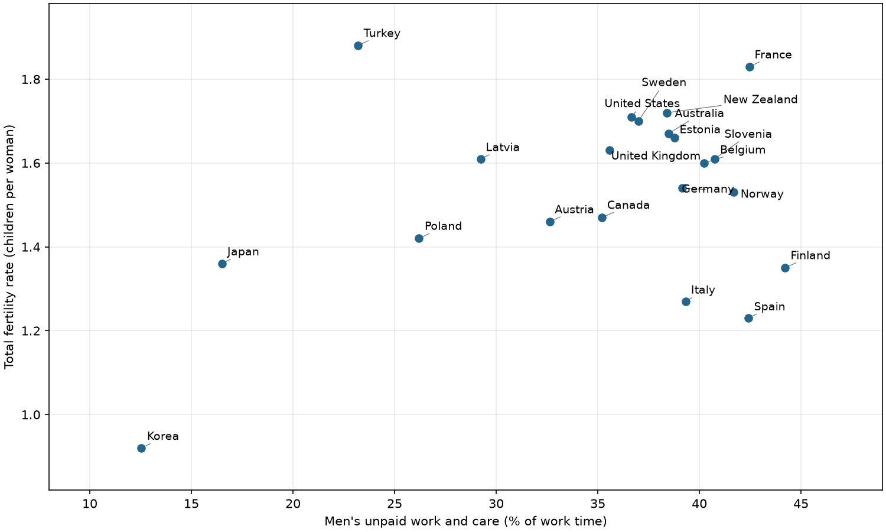
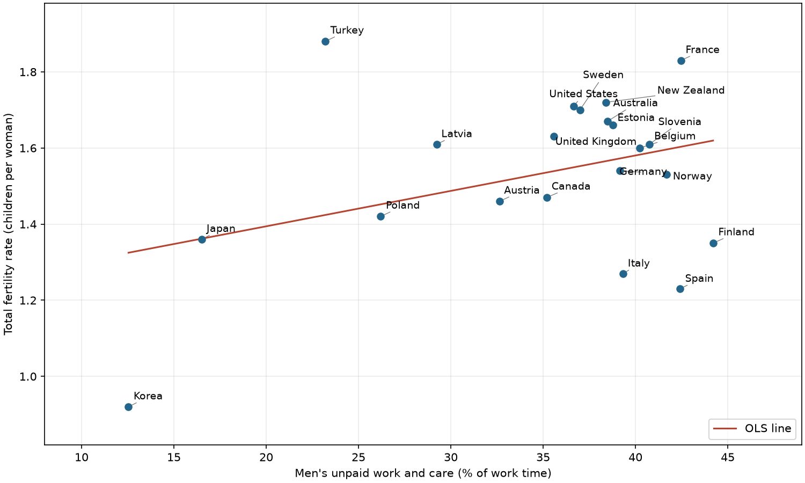
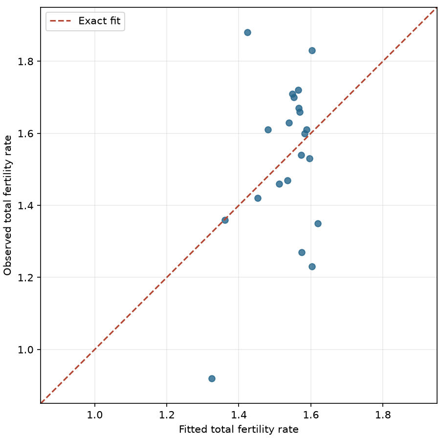

男性の家事・育児時間の割合が 1 パーセントポイント高い国では, 合計特殊出生率は平均でどれだけ違うでしょうか.
国ごとの値を散布図にし, 単回帰直線の傾きでこの関係を表します.

# 出生率と時間配分の表の結合 {#oecd-data}

[`fertility_rates.csv`](https://github.com/yakagika/yakagika.github.io/blob/main/slds_data/ch11/fertility_rates.csv) と
[`time_used.csv`](https://github.com/yakagika/yakagika.github.io/blob/main/slds_data/ch11/time_used.csv) をダウンロードし, コードと同じフォルダに置いてください.
コードはそのフォルダから実行してください.

~~~ python
import matplotlib.pyplot as plt
import numpy as np
import pandas as pd
import statsmodels.api as sm
from adjustText import adjust_text

fertility = pd.read_csv("fertility_rates.csv")
time_use = pd.read_csv("time_used.csv")
~~~

`Country` は国名, `Fertility` は合計特殊出生率です.
時間配分の表では, `Paid` が有償労働, `Unpaid` が無償の家事, `Care` が育児などのケアに対応します.
男性がこの 3 項目に使う時間のうち, 家事・育児に使う割合を百分率で計算し, `r` に格納します.

~~~ python
unpaid_and_care = time_use["Unpaid"] + time_use["Care"]
total_work = time_use["Paid"] + unpaid_and_care
time_use["r"] = 100 * unpaid_and_care / total_work
~~~

出生率の表ではトルコが `Türkiye`, 時間配分の表では `Turkey` と表記されています.
出生率の表の表記を `Turkey` にそろえてから, `Country` をキーに結合します.
`validate="one_to_one"` を指定すると, 同じキーが片方の表に複数回現れたときにエラーになります.
外部結合 (`how="outer"`) では, 片方の表にしかない行も残ります.
`indicator=True` で追加した `_merge` 列で, それぞれの行がどちらの表にあったかを確かめます.

~~~ python
fertility["Country"] = fertility["Country"].replace({"Türkiye": "Turkey"})
joined = fertility.merge(
    time_use[["Country", "r"]],
    on="Country",
    how="outer",
    validate="one_to_one",
    indicator=True,
)

unmatched = joined.loc[joined["_merge"] != "both", ["Country", "_merge"]]
print(unmatched.to_string(index=False))
~~~

~~~ text
        Country    _merge
          Chile left_only
       Colombia left_only
     Costa Rica left_only
 Czech Republic left_only
        Denmark left_only
         Greece left_only
        Hungary left_only
        Iceland left_only
        Ireland left_only
         Israel left_only
      Lithuania left_only
     Luxembourg left_only
    Netherlands left_only
   OECD average left_only
       Portugal left_only
Slovak Republic left_only
    Switzerland left_only
~~~

`left_only` の行には出生率だけがあります.
今回の表には, 時間配分の表にだけある `right_only` の行はありません.
`both` の行を残し, `dropna()` で数値が欠けている行を除きます.
両方の値がそろったのは 22 か国です.
本文では, 旧教材と同じくメキシコを外した 21 か国を使います.
メキシコを加えた場合は [Exercise REG-SIMPLE-1](#exercise-reg-simple-1) で確かめます.

~~~ python
matched = joined.loc[joined["_merge"] == "both", ["Country", "Fertility", "r"]]
countries = matched.set_index("Country").dropna()
analysis = countries.drop(index="Mexico")

print(f"Matched: {len(countries)}, used in the main example: {len(analysis)}")
~~~

~~~ text
Matched: 22, used in the main example: 21
~~~

# 家事・育児時間の割合と出生率の散布図 {#oecd-scatter}

横軸は男性の家事・育児時間の割合 (%) で, 計算式は
$100 \times (\mathrm{Unpaid}+\mathrm{Care})/(\mathrm{Paid}+\mathrm{Unpaid}+\mathrm{Care})$ です.
縦軸は 2019 年の合計特殊出生率 (女性 1 人あたりの子どもの数) です.
時間配分は国によって 1999 年から 2013 年の調査に基づくため, 2 つの指標の年はそろっていません.
出典は [OECD Family Database](https://www.oecd.org/en/data/datasets/oecd-family-database.html) の SF2.1 (出生率) と LMF2.5 (時間配分) です.

~~~ python
def plot_countries(data):
    fig, ax = plt.subplots(figsize=(10, 6), layout="constrained")
    points = ax.scatter(data["r"], data["Fertility"], color="#23658b", zorder=3)
    ax.set(
        xlim=(8, 49),
        ylim=(0.82, 1.98),
        xlabel="Men's unpaid work and care (% of work time)",
        ylabel="Total fertility rate (children per woman)",
    )
    ax.grid(alpha=0.25)
    labels = [
        ax.text(row.r, row.Fertility, country, fontsize=9)
        for country, row in data.iterrows()
    ]
    return fig, ax, points, labels

fig, ax, points, labels = plot_countries(analysis)
adjust_text(
    labels,
    objects=points,
    ax=ax,
    iter_lim=300,
    min_arrow_len=4,
    arrowprops={"arrowstyle": "-", "color": "0.45", "linewidth": 0.6},
)
plt.show()
plt.close(fig)
~~~

1 点は 1 か国です. 日本と韓国はどちらの値も低く, 図の左下にあります.
トルコでは家事・育児時間の割合が約 23% で, 合計特殊出生率は 21 か国で最も高い 1.88 です.
右側では同程度の割合でも出生率にばらつきがあります.

# 単回帰の係数と国の組み合わせ {#oecd-ols}

`sm.OLS` に目的変数と説明変数の表を渡します.
`sm.add_constant` は切片を求めるために, 全行が 1 の列 `const` を追加します.
`fit()` で係数を求め, `summary().tables[1]` で係数の表を取り出します.

~~~ python
def fit_fertility(data):
    predictors = sm.add_constant(data[["r"]])
    return sm.OLS(data["Fertility"], predictors).fit()

result = fit_fertility(analysis)
print(result.summary().tables[1])
print(f"R-squared: {result.rsquared:.3f}")
~~~

~~~ text
==============================================================================
                 coef    std err          t      P>|t|      [0.025      0.975]
------------------------------------------------------------------------------
const          1.2082      0.197      6.119      0.000       0.795       1.621
r              0.0093      0.006      1.687      0.108      -0.002       0.021
==============================================================================
R-squared: 0.130
~~~

| 列 | 読み方 |
|---|---|
| `coef` | 係数の推定値です. `const` は切片, `r` は傾きです. |
| `std err` | 係数の推定値の標準誤差です. |
| `t` | 係数の推定値を標準誤差で割った t 統計量です. |
| <code>P&gt;&#124;t&#124;</code> | 係数が 0 という帰無仮説に対する両側 P 値です. |
| `[0.025` と `0.975]` | 95% 信頼区間の下限と上限です. |

区間と検定の前提や計算は [回帰係数の区間と検定](block:reg-ols) で扱います.
出力の P 値と区間は, 母集団から標本を無作為に取るなど, 標本のばらつきを確率で表せる前提のもとで解釈します.
この例の 21 か国はある母集団から偶然に取り出した標本ではないため, 表の P 値を母集団への推測には使いません.
母集団への推測は, 同じ仕組みから別の標本を作れる [合成 GPA の例](block:reg-gpa) で扱います.

当てはめた直線では, 男性の家事・育児時間の割合が 1 パーセントポイント高い国ほど,
合計特殊出生率が平均で約 0.00931 高いと読みます.
決定係数は 0.130 で, 手元の 21 か国の出生率のばらつきのうち, 当てはめた直線で表せた割合を示します.

表記をそろえずに結合するとトルコが落ちます.
その場合に相当する 20 か国, 本文の 21 か国, メキシコも含めた 22 か国で, 単回帰を当て直します.

~~~ python
comparisons = {
    "Without Turkey or Mexico": analysis.drop(index="Turkey"),
    "Main example": analysis,
    "Including Mexico": countries,
}
for label, data in comparisons.items():
    slope = fit_fertility(data).params["r"]
    print(f"{label:25s} {len(data):2d} {slope:.5f}")
~~~

当てはめた傾きの単位は, 家事・育児時間の割合 1 パーセントポイントあたりの合計特殊出生率の差です.

| 対象 | 国数 | 傾き |
|---|---:|---:|
| トルコとメキシコを除く | 20 | 0.01344 |
| この節の分析 (トルコを含み, メキシコを除く) | 21 | 0.00931 |
| トルコとメキシコを含む | 22 | 0.00517 |

トルコもメキシコも, 家事・育児時間の割合が約 20〜23% で, 合計特殊出生率が 1.88 以上です.
この 2 国を順に加えると, 当てはめた傾きは小さくなります.

# 回帰直線と出生率の当てはまり {#oecd-fit-plots}

家事・育児時間の割合の最小値から最大値までを `np.linspace` で 100 点に区切ります.
各点に対する出生率の当てはめ値を計算し, 散布図に直線を重ねます.

~~~ python
work_share = np.linspace(analysis["r"].min(), analysis["r"].max(), 100)
fitted_line = result.params["const"] + result.params["r"] * work_share

fig, ax, points, labels = plot_countries(analysis)
ax.plot(work_share, fitted_line, color="#b44532", label="OLS line")
ax.legend(loc="lower right")
adjust_text(
    labels,
    objects=points,
    ax=ax,
    iter_lim=300,
    min_arrow_len=4,
    arrowprops={"arrowstyle": "-", "color": "0.45", "linewidth": 0.6},
)
plt.show()
plt.close(fig)
~~~

直線の傾きは正です. トルコの点は直線より上にあり, トルコの実測の出生率は,
その家事・育児時間の割合に対応する当てはめ値より高くなっています.

国ごとの当てはめ値 (`result.fittedvalues`) を横軸に, 実測値を縦軸に置くと,
直線からのずれを国どうしで比べられます.
破線は実測値と当てはめ値が一致する場所です.

~~~ python
observed = analysis["Fertility"]
fitted = result.fittedvalues
limits = (0.85, 1.95)

fig, ax = plt.subplots(figsize=(6, 6), layout="constrained")
ax.scatter(fitted, observed, color="#23658b", alpha=0.8)
ax.plot(limits, limits, color="#b44532", linestyle="--", label="Exact fit")
ax.set(
    xlim=limits,
    ylim=limits,
    xlabel="Fitted total fertility rate",
    ylabel="Observed total fertility rate",
    aspect="equal",
)
ax.legend()
ax.grid(alpha=0.25)
plt.show()
plt.close(fig)
~~~

{.small}

破線より上の点では式が実測値を低く見積もり, 下の点では高く見積もっています.
この図で比べているのは, 式を求めるのに使った国の当てはめ値と実測値です.
未使用のデータで予測の良さを測る方法は [予測と予測誤差](block:reg-prediction) で扱います.

国の間で観測された関連からは, 日本で男性の家事・育児時間を増やしたときに出生率がどう変わるかは分かりません.
介入した場合の出生率を考えるには, 家事・育児時間と出生率に関係する背景も含めて仮定を置く必要があります.
その考え方は [因果推論](block:reg-causal) で扱います.

# 演習 {#exercises}

## Exercise REG-SIMPLE-1 {#exercise-reg-simple-1}

**メキシコを含めた出生率の単回帰分析**

メキシコを含む 22 か国で単回帰を行い, 傾きを小数点以下 5 桁まで求めてください.
[単回帰の係数と国の組み合わせ](#oecd-ols) の 21 か国での傾きと比べ,
22 か国内の関連の要約として解釈してください.

回答

~~~ python
result_with_mexico = fit_fertility(countries)
print(f"n = {len(countries)}, slope = {result_with_mexico.params['r']:.5f}")
~~~

~~~ text
n = 22, slope = 0.00517
~~~

22 か国の直線では, 家事・育児時間の割合が 1 パーセントポイント高い国ほど,
合計特殊出生率が平均で約 0.00517 高いと読みます.
メキシコを加えると傾きは 0.00931 から 0.00517 に小さくなります.
どちらの傾きも, それぞれの当てはめに使った国の関連の要約です.

