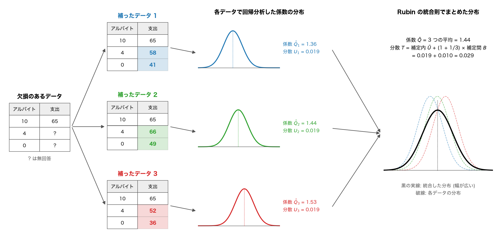

## 複数回補って結果を統合する方法 (多重代入法) {#multiple-imputation}

## 補った値の不確かさを推定に反映する {#補った値の不確かさを推定に反映する}

単一代入法で補った値は, 本当の値の推測にすぎません. それを観測した値と同じに扱って回帰分析をすると, 標準誤差が実際より小さく出て, 検定で差があると判定しやすくなります.

**多重代入法** (multiple imputation) は, 確率的回帰補完のように乱数を含む補定を m 回行い, 補った値の違う m 個のデータセットを作ります. 各データセットで同じ分析を行い, m 個の結果のばらつきを, 補った値の不確かさとして標準誤差に加えます. 手順は次の 3 段です.

1. 欠けた値を補ったデータセットを m 個作る.
2. m 個のデータセットそれぞれで, 同じ分析 (回帰分析など) を行う.
3. m 個の結果を, Rubin の統合則で 1 つにまとめる.

次の図は, m = 3 のときの 3 段の流れです. 無回答の支出に補う値はデータセットごとに違うので, 各データセットで推定したアルバイト時間の係数も少しずつずれます. [手順 3](#手順-3-rubin-の統合則で結果をまとめる)の Rubin の統合則は, 3 つの係数の平均を推定値とし, 各データセットでの分散 (補定内の分散) に係数のずれ (補定間の分散) を足して全体の分散とします. そのため, 統合した分布は各データセットの分布より幅が広くなります. 図の数値は説明のために作った例です.

手順 1 の補定には, **連鎖方程式による多重代入法** (MICE, Multivariate Imputation by Chained Equations) をよく使います. 欠けた変数が複数あるとき, 次の操作を繰り返します.

1. 欠けた値をいったん平均などで埋める.
2. 欠損のある変数を 1 つ選び, 他の変数から確率的回帰補完で補い直す.
3. 次の変数を選び, 補い直した値も使って同じように補い直す. すべての変数を補い直したら 1 周.
4. 補った値が安定するまで, 周を繰り返す.

支出を補うにはアルバイト時間が要り, アルバイト時間を補うには支出が要るという, 互いに欠けている変数を交互に補えます.

この節では, 支出をアルバイト時間と通学時間で説明する重回帰分析を, 多重代入法で行います. 例題では支出, アルバイト時間, 居住形態の 3 つが欠けています. 以下で使う scikit-learn の `IterativeImputer` は数値の変数しか補えないので, カテゴリー変数の居住形態は使いません. カテゴリー変数も含めて補いたいときは, R の `mice` パッケージなどを使います.

## 手順 1: 補ったデータセットを m 個作る {#手順-1-補ったデータセットを-m-個作る}

scikit-learn の `IterativeImputer` は, 連鎖方程式の考え方で欠けた値を補います. `sample_posterior=True` を指定すると, 予測値そのものではなく, 予測の不確かさに応じた乱数を含む値で補います. `random_state` を変えて m 回実行すると, m 個の違うデータセットができます. `IterativeImputer` は scikit-learn で試験的な機能の扱いなので, 1 行目の `enable_iterative_imputer` を先に読み込む必要があります.

~~~ py
from sklearn.experimental import enable_iterative_imputer  # noqa: F401
from sklearn.impute import IterativeImputer

num_cols = ['grade', 'commute_min', 'work_hours', 'spending', 'sleep_hours']
m = 20  # 作るデータセットの数

imputed = []
for i in range(m):
    imputer = IterativeImputer(sample_posterior=True, max_iter=20, random_state=i)
    values = imputer.fit_transform(df[num_cols])
    imputed.append(pd.DataFrame(values, columns=num_cols))

# 1 人目の無回答の学生について, データセットごとに補った支出を見る
first = df.index[df['spending'].isna()][0]
print([round(float(d.loc[first, 'spending']), 1) for d in imputed[:5]])
"""
[73.5, 89.9, 100.3, 41.6, 69.3]
"""
~~~

同じ学生の支出が, データセットによって 41.6 千円から 100.3 千円まで違う値で補われています. この違いが, その学生の支出についての不確かさを表します. 回答のある値は, どのデータセットでも同じです. 多重代入法では, この 20 個の値を平均して 1 つのデータにまとめることはしません. 20 個のデータセットのまま分析し, 分析の結果をまとめます.

## 手順 2: 各データセットで分析する {#手順-2-各データセットで分析する}

20 個のデータセットそれぞれで, [第5章](/lectures/dsp5.html)と同じ statsmodels の重回帰分析を行い, 係数と標準誤差を集めます. 標準誤差は 2 乗して分散にしておきます (統合則が分散で計算するためです).

~~~ py
import statsmodels.formula.api as smf

formula = 'spending ~ work_hours + commute_min'
estimates, variances = [], []
for data in imputed:
    result = smf.ols(formula, data=data).fit()
    estimates.append(result.params)
    variances.append(result.bse**2)

estimates = pd.DataFrame(estimates)
variances = pd.DataFrame(variances)
print(estimates.head().round(3))
"""
   Intercept  work_hours  commute_min
0     74.082       1.410       -0.475
1     75.832       1.297       -0.488
2     76.095       1.401       -0.504
3     74.467       1.366       -0.485
4     74.008       1.525       -0.479
"""
~~~

アルバイト時間の係数は, 最初の 5 個のデータセットだけでも 1.297 から 1.525 まで違います.

## 手順 3: Rubin の統合則で結果をまとめる {#手順-3-rubin-の統合則で結果をまとめる}

m 個の推定値 $\hat{Q}_1, \dots, \hat{Q}_m$ と, その分散 (標準誤差の 2 乗) $U_1, \dots, U_m$ を, 次の式で 1 つにまとめます. これを **Rubin の統合則** (Rubin's rules) といいます.

::: note
- **Rubin の統合則**

$$ \bar{Q} = \frac{1}{m} \sum_{i=1}^{m} \hat{Q}_i \qquad \bar{U} = \frac{1}{m} \sum_{i=1}^{m} U_i \qquad B = \frac{1}{m-1} \sum_{i=1}^{m} \left( \hat{Q}_i - \bar{Q} \right)^2 $$

$$ T = \bar{U} + \left( 1 + \frac{1}{m} \right) B $$

$\bar{Q}$: 統合した推定値, $\bar{U}$: 補定内の分散, $B$: 補定間の分散, $T$: 全体の分散 (統合した標準誤差は $\sqrt{T}$).

:::

点推定 $\bar{Q}$ は m 個の推定値の平均です. 分散 $T$ は 2 つの部分からなります.

- **補定内の分散** $\bar{U}$: 各データセットでの推定の分散の平均. 欠損が無かったとしても残る, 標本から推定することによる不確かさです.
- **補定間の分散** $B$: m 個の推定値のばらつき. 補った値が分からないことによる不確かさです. 補った値の違いで推定値が大きく変わるほど大きくなります.

$B$ に掛かる $(1 + 1/m)$ は, m が有限であることによる補正です. 単一代入法は $B$ に当たる不確かさを入れないので, 標準誤差が小さく出ます.

式をそのまま関数にします. 最後の列は, 全体の分散 $T$ のうち補定間の分散による部分の割合です.

~~~ py
def pool(estimates, variances):
    """Rubin の統合則で, m 個の推定値と分散を 1 つにまとめる."""
    m = len(estimates)
    q_bar = estimates.mean()  # 点推定: 推定値の平均
    w = variances.mean()  # 補定内の分散
    b = estimates.var(ddof=1)  # 補定間の分散
    t = w + (1 + 1 / m) * b  # 全体の分散
    return pd.DataFrame({
        '推定値': q_bar,
        '標準誤差': np.sqrt(t),
        '補定内': w,
        '補定間': b,
        '補定間の割合': (1 + 1 / m) * b / t,
    })

print(pool(estimates, variances).round(3))
"""
                推定値   標準誤差    補定内    補定間  補定間の割合
Intercept    74.545  2.404  4.835  0.900   0.164
work_hours    1.442  0.162  0.019  0.007   0.277
commute_min  -0.488  0.034  0.001  0.000   0.205
"""
~~~

アルバイト時間の係数は 1.442, 標準誤差は 0.162 です. 全体の分散のうち 27.7% が補定間の分散で, その分は補った値が分からないことによる不確かさです.

statsmodels にも, 連鎖方程式による多重代入法と統合までを行う `statsmodels.imputation.mice` があります. 本章では, 統合則の式と計算の対応が見えるように, 統合を自分で書きました.

m をいくつにするかの目安として, 欠損のある行の割合 (%) と同じくらいの数がよく挙げられます. 例題で使った 5 つの変数では, 支出かアルバイト時間が欠けている行が 31% なので, 30 程度です. m が小さいと, 乱数の種を変えただけで統合した結果が変わります.

この節に対応する演習は, 章末の[Exercise DSP15-4](#exercise-dsp15-4)です.

# 補定方法の評価 {#evaluation}

## 本当の値が分かるデータで比べる {#本当の値が分かるデータで比べる}

例題では本当の値が分かっているので, 補定の方法ごとに, 回帰分析の結果と支出の平均を本当の値と比べられます. 完全ケース分析は, 回帰に使う 3 つの変数 (支出, アルバイト時間, 通学時間) が揃った 275 人で行います. 居住形態は回帰に使わないので, 欠けていても除きません. そのため, [欠損のある行を削除する方法](block:missing-basics#deletion)の 249 行とは人数と平均が違います.

~~~ py
def fit(data):
    result = smf.ols(formula, data=data).fit()
    return result.params['work_hours'], result.bse['work_hours']

rows = {
    '本当の値': fit(true),
    '完全ケース分析': fit(df.dropna(subset=['spending', 'work_hours'])),
    '平均値補完': fit(df.assign(spending=spending_mean).dropna(subset=['work_hours'])),
    '回帰補完': fit(df.assign(spending=spending_reg).dropna(subset=['work_hours'])),
}
pooled = pool(estimates, variances).loc['work_hours']
rows['多重代入法'] = (pooled['推定値'], pooled['標準誤差'])

means = [d['spending'].mean() for d in imputed]
spending_means = {
    '本当の値': true['spending'].mean(),
    '完全ケース分析': df.dropna(subset=['spending', 'work_hours'])['spending'].mean(),
    '平均値補完': spending_mean.mean(),
    '回帰補完': spending_reg.mean(),
    '多重代入法': np.mean(means),
}
for name, (coef, se) in rows.items():
    mean = spending_means[name]
    print(f'{name:8s} 係数 {coef:.3f}  標準誤差 {se:.3f}  支出の平均 {mean:.2f}')
"""
本当の値     係数 1.408  標準誤差 0.139  支出の平均 71.69
完全ケース分析  係数 1.384  標準誤差 0.183  支出の平均 67.07
平均値補完    係数 0.839  標準誤差 0.136  支出の平均 69.00
回帰補完     係数 1.384  標準誤差 0.122  支出の平均 71.42
多重代入法    係数 1.442  標準誤差 0.162  支出の平均 71.68
"""
~~~

| 方法 | アルバイト時間の係数 | 支出の平均 |
|---|---|---|
| 完全ケース分析 | 本当の値に近いが, 標準誤差が最も大きい (行が 3 割減ったため) | 4.6 千円小さい |
| 平均値補完 | 0.839 で, 本当の値 (1.408) の 6 割程度に弱まる | 2.7 千円小さい |
| 回帰補完 | 本当の値に近いが, 標準誤差 (0.122) が本当の値 (0.139) より小さい | ほぼ本当の値 |
| 多重代入法 | 本当の値に近く, 標準誤差は補った値の不確かさの分だけ大きい | ほぼ本当の値 |

支出の欠け方は, 回帰式の説明変数であるアルバイト時間で決まっています. 目的変数 (支出) の欠け方が説明変数 (アルバイト時間) だけで決まる場合, 欠損のある行を削除しても回帰係数は偏りません. アルバイト時間の欠け方は支出に左右されていますが, 欠けているのは 28 人と少なく, このデータでは係数への影響は小さく出ました. 一方, 支出の平均は削除で偏ります. 平均値補完は, 補った 97 人の支出をアルバイト時間と無関係な値にしたので, 係数を弱めます. 回帰補完は係数と平均を本当の値に近づけますが, 補った値を確かな値として扱うので, 標準誤差を小さく見積もります.

多重代入法の標準誤差 (0.162) は, 欠損の無い本当のデータでの標準誤差 (0.139) より大きくなっています. 欠損で失った情報の分だけ推定は不確かになるので, 標準誤差が大きくなるのが正しい結果です. 多重代入法は, その不確かさを標準誤差に入れています.

## 本当の値が分からないデータで比べる {#本当の値が分からないデータで比べる}

実際のデータでは本当の値が分かりません. その場合は, 回答のある値の一部をわざと隠して補い, 隠した値との誤差で方法を比べます. 誤差の大きさには[回帰の評価](/lectures/dsp5.html#regression-evaluation)と同じ RMSE (平方根平均二乗誤差) を使います.

~~~ py
# 回答のある支出の 20% をわざと隠し, 補った値と隠した値の誤差を求める
rng = np.random.default_rng(1)
observed = df.dropna(subset=['spending', 'work_hours']).index
hidden = rng.choice(observed, size=len(observed) // 5, replace=False)

masked = df.copy()
masked.loc[hidden, 'spending'] = np.nan
train_masked = masked.dropna(subset=['spending', 'work_hours'])

reg_masked = LinearRegression().fit(train_masked[features], train_masked['spending'])
pred = reg_masked.predict(df.loc[hidden, features])
mean_value = train_masked['spending'].mean()

def rmse(pred):
    return np.sqrt(np.mean((df.loc[hidden, 'spending'] - pred) ** 2))

print('平均値補完の RMSE:', round(rmse(mean_value), 2))
print('回帰補完の RMSE:', round(rmse(pred), 2))
"""
平均値補完の RMSE: 22.83
回帰補完の RMSE: 17.98
"""
~~~

回帰補完の RMSE (17.98 千円) は, 平均値補完 (22.83 千円) より 5 千円ほど小さくなっています. この方法で比べられるのは, 回答のある値の中での当たり方です. 隠すのは無作為に選んだ値なので, 欠け方が MCAR でない場合, 本当に欠けている値での当たり方とは違うことがあります. また, RMSE は 1 人ずつの値の当たり方なので, 標準誤差を正しく見積もれるかどうか (多重代入法の利点) は RMSE では比べられません.

補定の前後で, 平均, 標準偏差, 相関, 回帰係数がどう変わるかも並べて確かめます. 補定で大きく変わる統計量があれば, その統計量は補定の方法に左右されやすいので, 報告で補定前の値も示します.

## 訓練データとテストデータに分けるときの補定 {#訓練データとテストデータに分けるときの補定}

予測モデルを作るためにデータを訓練データとテストデータに分ける場合 ([第6章](block:ml-classification#訓練データとテストデータ)), 補定に使う値 (平均, 回帰式など) は訓練データだけから求めます. 分ける前のデータ全体で平均を求めて補うと, テストデータの値が補定を通じて訓練に入り, テストデータでの性能が実際より良く見えます. scikit-learn では, 補定の手順 (`SimpleImputer` など) を訓練データで `fit` し, テストデータには `transform` だけを使います.

# []{#演習}演習 {#exercises}

## Exercise DSP15-4 {#exercise-dsp15-4}

**多重代入法のデータセットの数 m を変える**

対応する節: [多重代入法](#multiple-imputation)

本文の多重代入法を, m = 5, 20, 50 で行ってください. それぞれの m について, 乱数の種を 3 通り変えて (`random_state` を `seed * 1000 + i` とし, `seed` を 0, 1, 2 とする) 実行し, 統合したアルバイト時間の係数と標準誤差を求めてください. 結果から, m を大きくすると統合した結果がどう変わるかを説明してください.

提出ファイル名: `dsp15-4.py`

    
 回答例 

~~~ py
import numpy as np
import pandas as pd
import statsmodels.formula.api as smf
from sklearn.experimental import enable_iterative_imputer  # noqa: F401
from sklearn.impute import IterativeImputer

df = pd.read_csv('data/student_survey.csv', encoding='utf-8-sig')
num_cols = ['grade', 'commute_min', 'work_hours', 'spending', 'sleep_hours']
formula = 'spending ~ work_hours + commute_min'

def multiple_imputation(m, seed):
    """m 個のデータセットで回帰し, Rubin の統合則で work_hours の係数をまとめる."""
    estimates, variances = [], []
    for i in range(m):
        imputer = IterativeImputer(sample_posterior=True, max_iter=20,
                                   random_state=seed * 1000 + i)
        data = pd.DataFrame(imputer.fit_transform(df[num_cols]), columns=num_cols)
        result = smf.ols(formula, data=data).fit()
        estimates.append(result.params['work_hours'])
        variances.append(result.bse['work_hours'] ** 2)
    q_bar = np.mean(estimates)
    b = np.var(estimates, ddof=1)
    t = np.mean(variances) + (1 + 1 / m) * b
    return q_bar, np.sqrt(t)

for m in [5, 20, 50]:
    results = [multiple_imputation(m, seed) for seed in range(3)]
    text = ', '.join(f'{q:.3f} ({se:.3f})' for q, se in results)
    print(f'm = {m:2d}: {text}')
~~~

~~~ sh
m =  5: 1.400 (0.166), 1.419 (0.177), 1.515 (0.147)
m = 20: 1.442 (0.162), 1.420 (0.163), 1.446 (0.174)
m = 50: 1.446 (0.165), 1.450 (0.161), 1.445 (0.172)
~~~

括弧の中が統合した標準誤差です. m = 5 では, 乱数の種によって係数が 1.400 から 1.515 まで違います. m = 50 では 1.445 から 1.450 で, 種を変えてもほぼ同じ値になります. m が小さいと, 推定値の平均が, どの 5 個のデータセットを引いたかに左右されるためです. m を大きくすると統合した結果は安定しますが, 計算時間は m に比例して増えます. このデータでは, m = 20 で係数の違いが 0.03 程度に収まっています.

