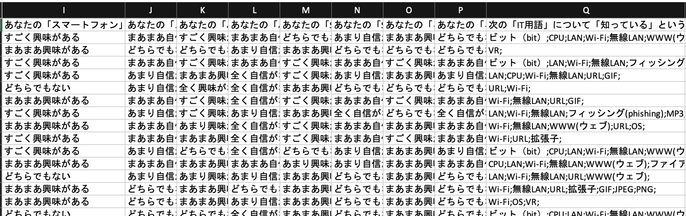
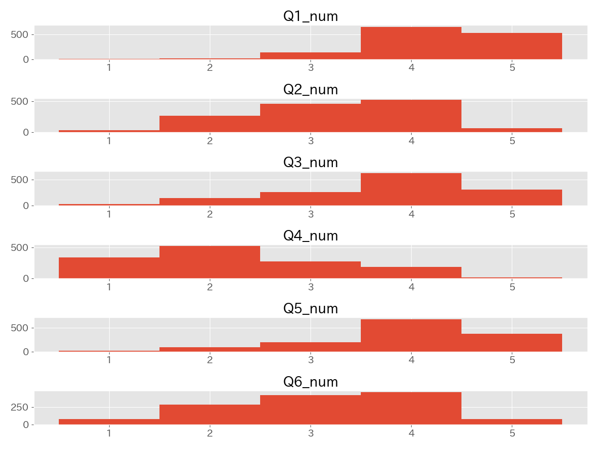
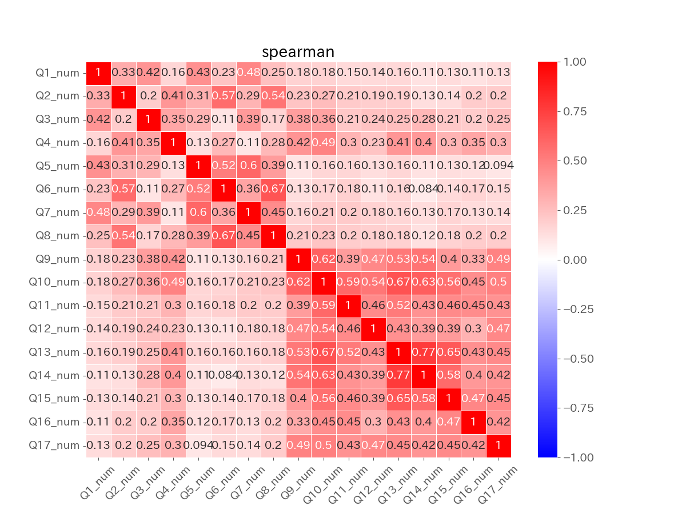
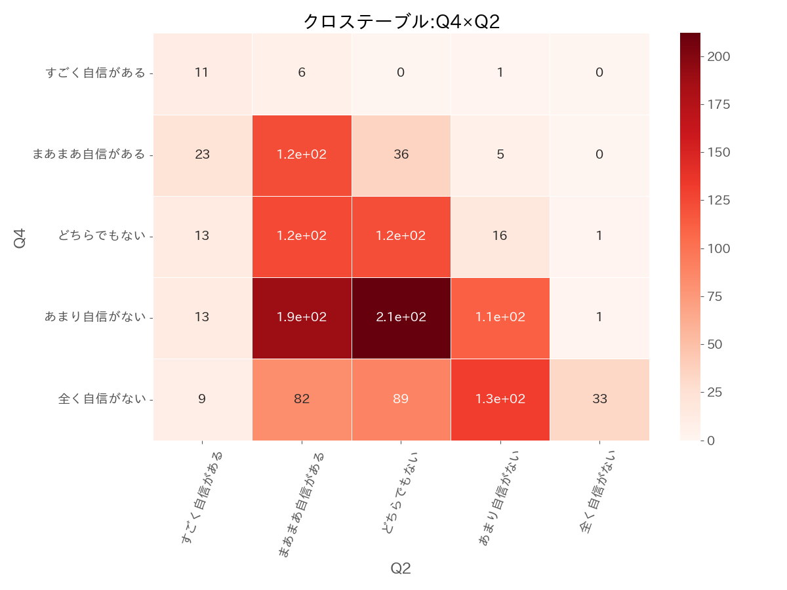
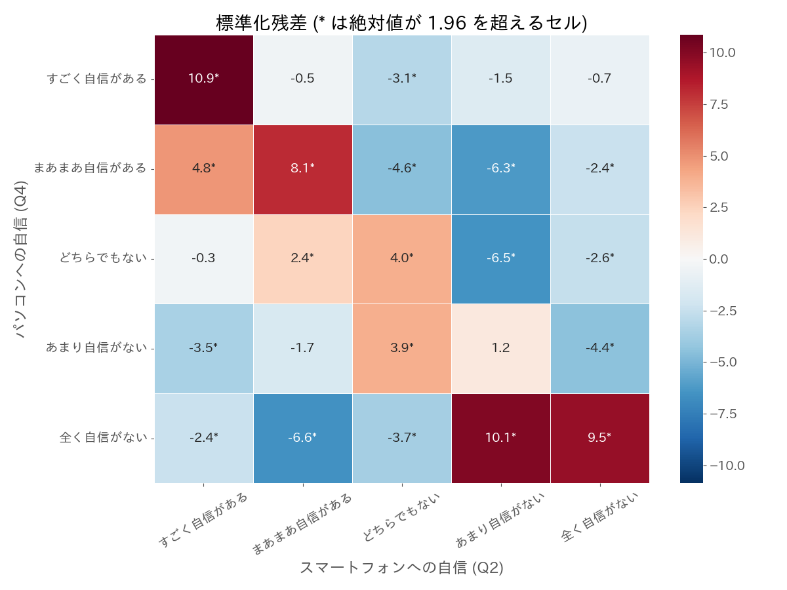
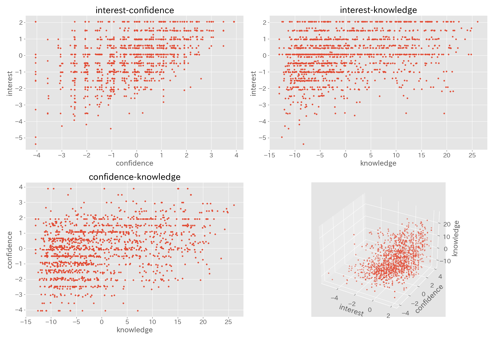
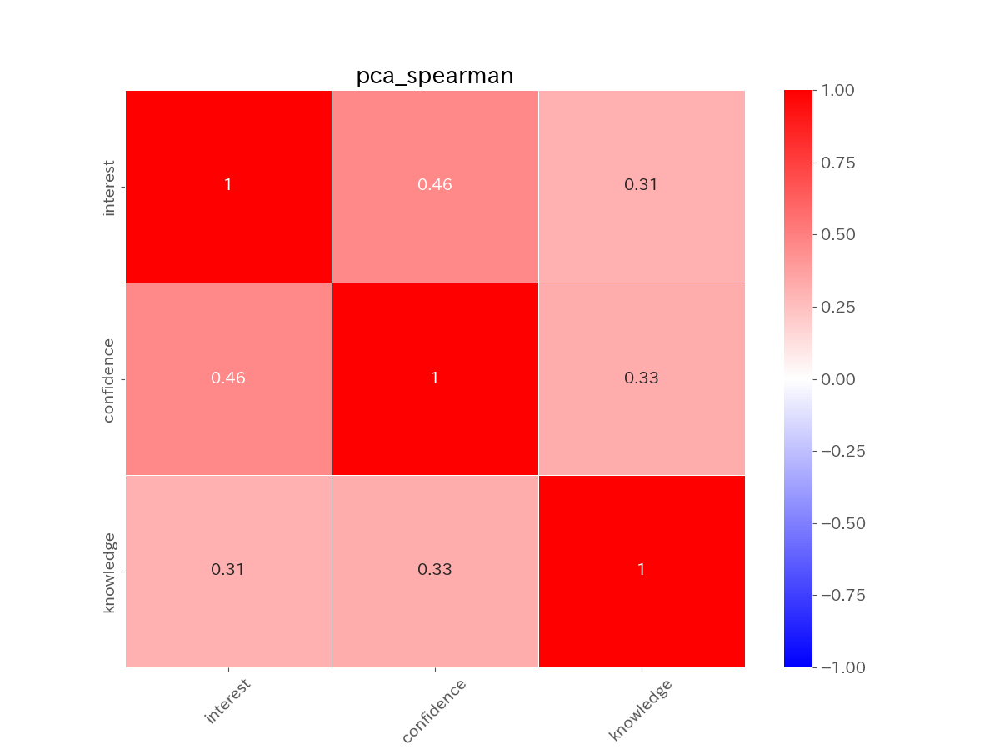

## データ処理 {#データ処理}
Microsoft Forms によるデータは, 複数選択可能な質問項目への回答が一つのセルに「`;`」を用いて区切られて記入されるなどの特徴があります.

{.wide}

図は, データを表計算ソフトで開いたものの一部です. 列 I から P は 5 段階で答える選択式の質問で, 選んだ選択肢の文字列がそのまま入っています. 列 Q は複数選択式の質問で, 選んだ選択肢が「`;`」で区切られて 1 つのセルに入っています.

分析の際には, これらの情報を利用しやすいように変形する必要があります. ここでは, 練習も兼ねて一通りの処理を体験してみましょう.

[データ処理](block:survey-analysis#データ処理)の手順はコード例で再現できます. 内容を確認して自力でできると感じた方はデータ処理の解説を飛ばして構いません.

まずはデータの形式を確認してみましょう.

~~~ py
import pandas as pd
import matplotlib.pyplot as plt
import matplotlib_fontja
import seaborn as sns
import scipy.stats as st
import numpy as np

#グラフの保存場所
dir_fig = './result/fig/'

#グラフの設定
plt.style.use('ggplot') #グラフスタイル
plt.rcParams['figure.figsize'] = [12, 9] #グラフサイズ
plt.rcParams['font.size'] = 14 #フォントサイズ

#------------------------------------------------------------------
#データの読み込み
#------------------------------------------------------------------

df = pd.read_csv('./data/questionnaire_sample_original.csv')
print(df.columns)

"""
Index(['あなたの「スマートフォン」に対する印象について、どれくらいあてはまるかを教えてください。',
       'あなたの「スマートフォン」に対する操作や知識について、どれくらい自信があるかを教えてください。',
       'あなたの「パソコン」に対する印象について、どれくらいあてはまるかを教えてください。',
       'あなたの「パソコン」に対する操作や知識について、どれくらい自信があるかを教えてください。',
       'あなたの「SNS（FacebookやInstagramなど）」に対する印象について、どれくらいあてはまるかを教えてください。',
       'あなたの「SNS（FacebookやInstagramなど）」に対する操作や知識について、どれくらい自信があるかを教えてください。',
       'あなたの「ネットを使ったコミュニケーション（LINEやTwitterなど）」に対する印象について、どれくらいあてはまるかを教えてください。',
       'あなたの「ネットを使ったコミュニケーション（LINEやTwitterなど）」に対する操作や知識について、どれくらい自信があるかを教えてください。',
       '次の「IT用語」について「知っている」という言葉にチェックをしてください（知っているものすべてにチェック）。',
       'Windowsの操作や事柄について「身に付いている」ものにチェックをしてください（身に付いているものすべてにチェック）。',
       '電子メールの操作や事柄について「身に付いている」ものにチェックをしてください（身に付いているものすべてにチェック）。',
       'WWW(ウェブ)の操作や事柄について「身に付いている」ものにチェックをしてください（身に付いているものすべてにチェック）。',
       'Wordの操作や事柄について「身に付いている」ものにチェックをしてください（身に付いているものすべてにチェック）。',
       'Excelの操作や事柄について「身に付いている」ものにチェックをしてください（身に付いているものすべてにチェック）。',
       'PowerPointの操作や事柄について「身に付いている」ものにチェックをしてください（身に付いているものすべてにチェック）。',
       'Officeの応用的な操作や事柄について「身に付いている」ものにチェックをしてください（身に付いているものすべてにチェック）。',
       '情報倫理について「身に付いている」ものにチェックをしてください（身に付いているものすべてにチェック）。'],
      dtype='object')
"""
~~~

このままでは列名が長すぎてプログラムが書きにくいので, 列名を順に `Q1~Q17` の連番に変更します.
今回は辞書型で連番を作成するために, 組み込み関数の `enumerate()` を利用しています.

~~~ py
new_columns = dict([(t,'Q'+str(n + 1))for (n,t) in  enumerate(df.columns)])

"""
一つ一つ手書きすると以下のようになる.
new_columns = {'あなたの「スマートフォン」に対する印象について、どれくらいあてはまるかを教えてください。':'Q1'
              ,'あなたの「スマートフォン」に対する操作や知識について、どれくらい自信があるかを教えてください。':'Q2'
              ,'あなたの「パソコン」に対する印象について、どれくらいあてはまるかを教えてください。':'Q3'
              ,'あなたの「パソコン」に対する操作や知識について、どれくらい自信があるかを教えてください。':'Q4'
              ,'あなたの「SNS（FacebookやInstagramなど）」に対する印象について、どれくらいあてはまるかを教えてください。':'Q5'
              ,'あなたの「SNS（FacebookやInstagramなど）」に対する操作や知識について、どれくらい自信があるかを教えてください。':'Q6'
              ,'あなたの「ネットを使ったコミュニケーション（LINEやTwitterなど）」に対する印象について、どれくらいあてはまるかを教えてください。':'Q7'
              ,'あなたの「ネットを使ったコミュニケーション（LINEやTwitterなど）」に対する操作や知識について、どれくらい自信があるかを教えてください。':'Q8'
              ,'次の「IT用語」について「知っている」という言葉にチェックをしてください（知っているものすべてにチェック）。':'Q9'
              ,'Windowsの操作や事柄について「身に付いている」ものにチェックをしてください（身に付いているものすべてにチェック）。':'Q10'
              ,'電子メールの操作や事柄について「身に付いている」ものにチェックをしてください（身に付いているものすべてにチェック）。':'Q11'
              ,'WWW(ウェブ)の操作や事柄について「身に付いている」ものにチェックをしてください（身に付いているものすべてにチェック）。':'Q12'
              ,'Wordの操作や事柄について「身に付いている」ものにチェックをしてください（身に付いているものすべてにチェック）。':'Q13'
              ,'Excelの操作や事柄について「身に付いている」ものにチェックをしてください（身に付いているものすべてにチェック）。':'Q14'
              ,'PowerPointの操作や事柄について「身に付いている」ものにチェックをしてください（身に付いているものすべてにチェック）。':'Q15'
              ,'Officeの応用的な操作や事柄について「身に付いている」ものにチェックをしてください（身に付いているものすべてにチェック）。':'Q16'
              ,'情報倫理について「身に付いている」ものにチェックをしてください（身に付いているものすべてにチェック）。':'Q17'}
"""
print(new_columns)

"""
{'あなたの「スマートフォン」に対する印象について、どれくらいあてはまるかを教えてください。': 'Q1'
, 'あなたの「スマートフォン」に対する操作や知識について、どれくらい自信があるかを教えてください。': 'Q2'
, 'あなたの「パソコン」に対する印象について、どれくらいあてはまるかを教えてください。': 'Q3'
, 'あなたの「パソコン」に対する操作や知識について、どれくらい自信があるかを教えてください。': 'Q4'
, 'あなたの「SNS（FacebookやInstagramなど）」に対する印象について、どれくらいあてはまるかを教えてください。': 'Q5'
, 'あなたの「SNS（FacebookやInstagramなど）」に対する操作や知識について、どれくらい自信があるかを教えてください。': 'Q6'
, 'あなたの「ネットを使ったコミュニケーション（LINEやTwitterなど）」に対する印象について、どれくらいあてはまるかを教えてください。': 'Q7'
, 'あなたの「ネットを使ったコミュニケーション（LINEやTwitterなど）」に対する操作や知識について、どれくらい自信があるかを教えてください。': 'Q8'
, '次の「IT用語」について「知っている」という言葉にチェックをしてください（知っているものすべてにチェック）。': 'Q9'
, 'Windowsの操作や事柄について「身に付いている」ものにチェックをしてください（身に付いているものすべてにチェック）。': 'Q10'
, '電子メールの操作や事柄について「身に付いている」ものにチェックをしてください（身に付いているものすべてにチェック）。': 'Q11'
, 'WWW(ウェブ)の操作や事柄について「身に付いている」ものにチェックをしてください（身に付いているものすべてにチェック）。': 'Q12'
, 'Wordの操作や事柄について「身に付いている」ものにチェックをしてください（身に付いているものすべてにチェック）。': 'Q13'
, 'Excelの操作や事柄について「身に付いている」ものにチェックをしてください（身に付いているものすべてにチェック）。': 'Q14'
, 'PowerPointの操作や事柄について「身に付いている」ものにチェックをしてください（身に付いているものすべてにチェック）。': 'Q15'
, 'Officeの応用的な操作や事柄について「身に付いている」ものにチェックをしてください（身に付いているものすべてにチェック）。': 'Q16'
, '情報倫理について「身に付いている」ものにチェックをしてください（身に付いているものすべてにチェック）。': 'Q17'}
"""

df.rename(new_columns, inplace=True,axis='columns')
print(df)
"""
             Q1         Q2         Q3  ...                                                Q15                         Q16                                                Q17
0     まあまあ興味がある    どちらでもない    どちらでもない  ...           スライドマスターを活用することができる;SmartArtを挿入することができる;  学内PCで作成したファイルを自宅のPCに持ち運べる;                                       どれも身についていない;
1      すごく興味がある  まあまあ自信がある   すごく興味がある  ...                                新しいスライドを追加することができる;    学術的文章の規則を踏まえてレポートを作成できる;  学内PCでログアウトせずに帰る危険性を理解している;マルウェア（不正ソフト）について理解して...
2      すごく興味がある   あまり自信がない  まあまあ興味がある  ...                                       どれも身についていない;                どれも身に付いていない;                                       どれも身についていない;
3       どちらでもない   あまり自信がない    全く興味がない  ...                                新しいスライドを追加することができる;                どれも身に付いていない;                         学内PCでログアウトせずに帰る危険性を理解している;
4     まあまあ興味がある  まあまあ自信がある   すごく興味がある  ...                                新しいスライドを追加することができる;                どれも身に付いていない;                                       どれも身についていない;
...         ...        ...        ...  ...                                                ...                         ...                                                ...
1347  まあまあ興味がある   あまり自信がない  まあまあ興味がある  ...  新しいスライドを追加することができる;スライドにページ番号を挿入することができる;スライドマ...                どれも身に付いていない;  学内PCでログアウトせずに帰る危険性を理解している;フィッシング詐欺について理解している;ウ...
1348  まあまあ興味がある   あまり自信がない  まあまあ興味がある  ...                                新しいスライドを追加することができる;                どれも身に付いていない;                         学内PCでログアウトせずに帰る危険性を理解している;
1349  まあまあ興味がある    全く自信がない    全く興味がない  ...                                新しいスライドを追加することができる;                どれも身に付いていない;                                       どれも身についていない;
1350  まあまあ興味がある  まあまあ自信がある  まあまあ興味がある  ...             アニメーション機能を使うことができる;新しいスライドを追加することができる;                どれも身に付いていない;  学内PCでログアウトせずに帰る危険性を理解している;ウェブ上の画像に関する著作権について理解...
1351  まあまあ興味がある   あまり自信がない  まあまあ興味がある  ...          新しいスライドを追加することができる;スライドにページ番号を挿入することができる;                どれも身に付いていない;  フィッシング詐欺について理解している;ウェブ上の画像に関する著作権について理解している;学内...
"""

~~~

続いて, 質問項目を利用しやすいように変換します. このアンケートでは, `Q1~Q8` では, IT に関連する事柄に関する興味の強さと自信を 5 段階評価で聞いています. そのままでも使えますが, 後の処理のために整数に変換します.
もとの列も残しておくために, 数値変換した列は `QX_num` の形で新しい列を作成しています.

~~~ py
kyomi = {'すごく興味がある':5
        ,'まあまあ興味がある':4
        ,'どちらでもない':3
        ,'あまり興味がない':2
        ,'全く興味がない':1}

zishin = {'すごく自信がある':5
         ,'まあまあ自信がある':4
         ,'どちらでもない':3
         ,'あまり自信がない':2
         ,'全く自信がない':1}

for i in [1,3,5,7]:
    df['Q' + str(i) + '_num'] = df['Q' + str(i)].apply(lambda x : kyomi[x])

for i in [2,4,6,8]:
    df['Q' + str(i) + '_num'] = df['Q' + str(i)].apply(lambda x : zishin[x])
~~~

`Q9~Q17` では, 身についているスキルを複数選択形式で尋ねています. 複数選択された項目は, セミコロン (`;`) で区切られています. 各質問項目で選択されたスキルの数に変換してみます. なお, 「どれも身についていない」にあたる回答は, 質問によって「どれも身に付いていない」「どれもしらない」と表記が揺れています. 表記を 1 つに決め打ちすると, 揺れた表記の回答が 1 個と数えられるので, 「どれも」で始まる回答をまとめて 0 個として扱います.

~~~ py
#｢身についているもの｣の数の列を作る
#------------------------------------------------------------------

def to_list(x):
    # ';'で区切ったリストにする
    # 'どれも' で始まる回答 ('どれも身についていない' など) がある場合は空のリストを返す
    xs = x.split(';')[0:-1]
    if any(t.startswith('どれも') for t in xs):
        return []
    else:
        return xs

#テスト
print(df.at[100,'Q13'])
print(to_list(df.at[100,'Q13']))
# >>> フォントの種類やサイズを変更することができる;中央揃えや右揃えを設定することができる;
# >>> ['フォントの種類やサイズを変更することができる', '中央揃えや右揃えを設定することができる']

for i in range(9,18,1):
    df['Q' + str(i) + '_num'] = df['Q' + str(i)].apply(lambda x : len(to_list(x)))

print(df['Q17_num'])
"""
0       0
1       3
2       0
3       1
4       0
       ..
1347    3
1348    1
1349    0
1350    2
1351    3
Name: Q17_num, Length: 1352, dtype: int64
"""
num_columns = ['Q' + str(x) + '_num' for x in range(1,18,1)]
print(num_columns)
"""
['Q1_num', 'Q2_num', 'Q3_num', 'Q4_num', 'Q5_num', 'Q6_num', 'Q7_num', 'Q8_num', 'Q9_num', 'Q10_num', 'Q11_num', 'Q12_num', 'Q13_num', 'Q14_num', 'Q15_num', 'Q16_num', 'Q17_num']
"""
~~~

# []{#ヒストグラム}ヒストグラム {#questionnaire-histograms}

**データ分析のファーストステップ**であるヒストグラムを作成して**個別の質問項目ごとのデータの特徴を**みてみましょう. ヒストグラムの作成方法などに関しては, [度数分布表とヒストグラム](block:vis-distribution#histogram)を参照してください.

~~~ py
#ヒストグラムを作る
#------------------------------------------------------------------
## Q1~Q6
fig, ax = plt.subplots(nrows = 6
                      ,ncols = 1
                      ,tight_layout=True)
for i in range(6):
    col = 'Q' + str(i + 1) + '_num'
    xs = df[col].value_counts().sort_index()
    ax[i].bar(xs.index,xs.values, width = 1)
    ax[i].set_title(col)

plt.savefig(dir_fig + 'Q1_6_histgram.png')
plt.close(fig)

##Q7~Q12
fig, ax = plt.subplots(nrows = 6
                      ,ncols = 1
                      ,tight_layout=True)
for i in range(6):
    col = 'Q' + str(i + 7) + '_num'
    xs = df[col].value_counts().sort_index()
    ax[i].bar(xs.index,xs.values, width = 1)
    ax[i].set_title(col)

plt.savefig(dir_fig + 'Q7_12_histgram.png')
plt.close(fig)

##Q13~Q17
fig, ax = plt.subplots(nrows = 5
                      ,ncols = 1
                      ,tight_layout=True)
for i in range(5):
    col = 'Q' + str(i + 13) + '_num'
    xs = df[col].value_counts().sort_index()
    ax[i].bar(xs.index,xs.values, width = 1)
    ax[i].set_title(col)

plt.savefig(dir_fig + 'Q13_17_histgram.png')
plt.close(fig)
~~~

以下のようなグラフが[データ処理](block:survey-analysis#データ処理)で設定したグラフの保存場所 `./result/fig` に保存されているはずです. 図は `Q1` から `Q6` のヒストグラムです.

ここでは, ヒストグラムの分析の仕方については細かく扱いませんが, 多くの示唆が得られます. 例えば, 興味を尋ねた `Q1` (スマートフォン), `Q3` (パソコン), `Q5` (SNS) は, いずれも 4 (まあまあ興味がある) 以上に回答が集まっています. 自信を尋ねた質問では, `Q2` (スマートフォン) と `Q6` (SNS) が 3 から 4 に集まるのに対し, `Q4` (パソコン) は 1 (全く自信がない) と 2 (あまり自信がない) に集まっています. パソコンには興味を持つ学生が多い一方で, 自信を持つ学生は少ないことが分かります.

# []{#相関係数}相関係数 {#survey-rank-correlation}

ヒストグラムで質問項目ごとのデータの特徴を把握したので, 相関係数を求めて, データ間の関係性を可視化してみましょう. 今回のデータは**順序尺度**なので, **スピアマンの順位相関係数**を利用します. 相関に関する説明は, [相関の解説](block:num-correlation#correlation)を参照してください.

~~~py
#順位相関係数を求める
#------------------------------------------------------------------
sns.heatmap(df[num_columns].corr(method='spearman')
           ,cmap=plt.get_cmap('bwr')
           ,vmax=1.0
           ,center =0
           ,vmin=-1.0
           ,xticklabels=1
           ,yticklabels=1
           ,linewidths=.5
           ,annot=True)

plt.title('spearman')
plt.xticks(rotation=45)
plt.savefig(dir_fig + 'spearman.png')
plt.close()
~~~

以下のような相関係数のヒートマップが作成されます. 細かな分析は行いませんが, `Q1~Q8` までの興味関心に関する質問項目間, `Q9~Q17` のスキルに関する質問間の相関が強いことなどが視覚的に表現されています.

この相関係数は, [**共分散構造分析 (SEM)**](block:survey-sem#共分散構造分析) におけるモデル作成のためにも利用されます.

# []{#同時度数分布表}同時度数分布表 {#survey-contingency-tables}

相関係数によって相関が高い質問項目の組み合わせがいくつか把握されましたが, これは質問項目全体の関係性です. 解釈を行うには, 相関係数の高い質問項目の組み合わせごとに更に詳細に, どの回答とどの回答がどのような関係にあるのか, といった分析が必要になります. **質的データ**についてそのような分析に利用できるのが**同時度数分布表**です. 詳細は[同時度数分布表](block:vis-more#同時度数分布表)を参照してください.

~~~ py
#クロス表
#------------------------------------------------------------------
#質問項目の区分間にどのような関係があるのかを検定する
#今回はスマホの自信(Q2)と,PCの自信(Q4)だけ(自分の仮説に応じて色々ためす)
# 作業手順
## クロス表を作成する
## 独立性の検定(お互いに影響があるか)を検定する
## 検定が有意であれば,どの項目が具体的にどの項目に影響しているかを残差分析で明らかにする.

#クロス表の作成
## 列と行に指定する質問項目
target_row = 'Q4'
target_col = 'Q2'
## 選択肢の順序(指定しないとデータの出てきた順になる)
order = {target_row:['すごく自信がある'
                    ,'まあまあ自信がある'
                    ,'どちらでもない'
                    ,'あまり自信がない'
                    ,'全く自信がない']
        ,target_col:['すごく自信がある'
                    ,'まあまあ自信がある'
                    ,'どちらでもない'
                    ,'あまり自信がない'
                    ,'全く自信がない']}
## 図の軸に表示する質問の内容
labels = {'Q2':'スマートフォンへの自信 (Q2)'
         ,'Q4':'パソコンへの自信 (Q4)'}

crosstab = pd.crosstab(df[target_row],df[target_col])
crosstab = crosstab.reindex(order[target_row],axis='index')
crosstab = crosstab.reindex(order[target_col],axis='columns')

sns.heatmap( crosstab
           , cmap=plt.get_cmap('Reds')
           , yticklabels=1
           , xticklabels=1
           , linewidths=.5
           , annot=True
           , fmt='d')

plt.title('同時度数分布表 (人数)')
plt.ylabel(labels[target_row])
plt.xlabel(labels[target_col])
plt.xticks(rotation=30)
plt.tight_layout()
plt.savefig(dir_fig + 'cross_table_'+ target_row + '_' + target_col +'.png')
plt.close()
~~~

作成された度数分布表を確認すると, 表の左上から右下への対角線の付近に度数が集まっています. 行 (`Q4`, パソコンへの自信) と列 (`Q2`, スマートフォンへの自信) はどちらも自信の強い順に並んでいるので, この偏りは, スマートフォンに自信がある学生ほどパソコンにも自信があるという傾向を表しています. また, パソコンは「あまり自信がない」と「全く自信がない」に, スマートフォンは「まあまあ自信がある」と「どちらでもない」に回答が多く, パソコンに自信がない学生の方が多いことも分かります. 今回は一つの組み合わせに注目しましたが, 分析の目的や仮説に応じて, 様々な組み合わせについて分析してみましょう.

# []{#独立性の検定}独立性の検定 {#chi-square-independence}

同時度数分布表によって, 質問項目間の細かな関係性が分析されましたが, 実際に 2 つの変数間に関係があるとは判断できていません. そのような判断のためには, **検定**を行う必要がありますが, 質的データの場合にしばしば用いられるのが, **独立性の検定 (カイ二乗検定)** です. 詳細は[カイ二乗統計量](block:num-correlation#chi2-統計量)を参照してください.

~~~ py
#独立性の検定
x2, p, dof, e = st.chi2_contingency(crosstab,correction=False)

print(p)
# >>> 2.2871064452593352e-84

if p <= 0.05:
    print('有意')
else:
    print('有意でない')
# >>> 有意
~~~

# []{#残差分析}残差分析 {#contingency-residuals}

2 つの質問項目間に期待値に対する偏りがあることが分かりました. 偏りが確認された場合には, 相関係数の場合と同様に, 質問項目のどの回答同士が偏っているのかを把握するためには**残差分析**が利用できます. 各セルの観測度数と期待度数の差を標準化した標準化残差を計算し, その絶対値がおよそ 2 (1.96) を超えるセルに偏りがあるとみます. 残差分析の理論の詳細は「データ活用の統計学実践」で扱います.

~~~ py
#有意であれば,残差分析を行う
##期待値表の計算
expect = pd.DataFrame(e)
expect.columns = crosstab.columns
expect.index   = crosstab.index

#残差の計算
residual = crosstab - expect

#標準化残差の計算
col_sum = crosstab.sum()
row_sum = crosstab.transpose().sum()
total   = col_sum.sum()
stdres  = residual.copy()

for c in stdres.columns:
    for r in stdres.index:
        stdres.at[r,c]    = stdres.at[r,c] \
                         / np.sqrt( expect.at[r,c]
                                  * (1 - col_sum[c] / total)
                                  * (1 - row_sum[r] / total))

#ヒートマップの作成
## 色の範囲は絶対値の最大に合わせ, 絶対値が 1.96 を超えるセルに * を付ける
lim   = np.abs(stdres.values).max()
annot = stdres.apply(lambda col: col.map(lambda v: f'{v:.1f}' + ('*' if abs(v) > 1.96 else '')))
sns.heatmap(stdres
           ,cmap=plt.get_cmap('RdBu_r')
           ,vmax=lim
           ,vmin=-lim
           ,center=0
           ,xticklabels=1
           ,linewidths=.5
           ,annot=annot
           ,fmt='')
plt.title('標準化残差 (* は絶対値が 1.96 を超えるセル)')
plt.ylabel(labels[target_row])
plt.xlabel(labels[target_col])
plt.xticks(rotation=30)
plt.tight_layout()
plt.savefig(dir_fig + 'stdres_' + target_row + '_' + target_col + '.png')
plt.close()
~~~

作成された標準化残差を確認すると, 対角線上のセル (2 つの質問に同じ程度の自信を答えた組み合わせ) の多くが正の大きな値になっています. 例えば, 両方に「すごく自信がある」と答えた組み合わせは 10.9, 両方に「全く自信がない」と答えた組み合わせは 9.5 です. 反対に, 対角線から離れたセルは負の値になっています. 標準化残差の絶対値が 1.96 を超えるセルは, 5% 水準で期待度数から有意に偏っていると判断でき, 図では値に「*」を付けています. 「*」の付いていないセル (例えば, パソコンに「あまり自信がない」, スマートフォンに「あまり自信がない」の 1.2) は, 期待度数との差が偶然の範囲を超えるとはいえません. したがって, スマートフォンに自信がある学生ほどパソコンにも自信があるという偏りが, 統計的に確かめられました.

# []{#次元削減}次元削減 {#survey-dimension-reduction}

[ヒストグラム](block:survey-analysis#ヒストグラム)や[相関係数](block:survey-analysis#相関係数)の例では一つ一つの質問項目及び質問項目間の関係に注目してきましたが, いくつかの質問項目をまとめてどのような関係があるのか, あるいは全体の質問をまとめてどのようなことが言えるのかという着眼点もあります.
そのような場合に使える手法の一つが, **次元削減**です. 次元削減は, 多数の変数がある場合にいくつかの変数を要約した一つの**合成変数**を作成する手法になります.

例えば, 以下のような各科目の成績データを考えた場合に, 個別の科目の成績を見ると, 国語は高いが, 数学は低い人と社会は高いが, 英語は低い人のどちらが学力が高いのかというような判断は困難です.

| id | 国語 (x₁) | 英語 (x₂) | 社会 (x₃) | 物理 (x₄) | 化学 (x₅) | 数学 (x₆) |
| --- | --------- | --------- | --------- | --------- | --------- | --------- |
| 1 | 78 | 80 | 49 | 76 | 70 | 35 |
| 2 | 66 | 90 | 68 | 47 | 60 | 55 |
| 3 | 55 | 89 | 90 | 88 | 82 | 78 |
| ... | ... | ... | ... | ... | ... | ... |

そこで, 以下のように文系の科目をまとめた文系力やすべての科目を合成した総合学力のような変数を作成することで全体的な傾向が判断できます.
$$
z_1 = \beta_{11}u_1 + \beta_{12}u_2 + \beta_{13}u_3 + \beta_{14}u_4 + \beta_{15}u_5 + \beta_{16}u_6 \implies 総合学力
$$
$$
z_2 = \beta_{21}u_1 + \beta_{22}u_2 + \beta_{23}u_3  \implies 文系力
$$
$$
z_3 =  \beta_{34}u_4 + \beta_{35}u_5 + \beta_{36}u_6 \implies 理系力
$$

ここで, $u_i$ は $x_i$ を標準化したものです.

このようにそれぞれの点数をまとめて, 要約した変数に変換することで, 文系力が高いグループを文系に分類するなど全体的な解釈を行うことが可能になります. 変数の要約は, 上のように回帰式を用いて分析者が独自に設計することも可能ですが, まとめる前の情報をできるだけ損なわずに自動的に合成変数を作成する**次元削減**手法を利用することが一般的です.

次元削減手法にはいくつかありますが, ここでは代表的な手法である**主成分分析 (PCA: Principal Component Analysis)** を利用します. 主成分分析は, データのばらつき (分散) が最も大きい方向を第 1 主成分とし, それに直交する方向のうち分散が最大のものを第 2 主成分というように順に選んで, 多数の変数を少数の主成分得点にまとめる手法です. 考え方 (射影の図と式), 寄与率, 係数の読み方は[次元削減: 主成分分析](block:ml-clustering#pca)で説明しています. この例では, 質問項目をまとめた合成変数を作るために, 第 1 主成分の得点だけを使います.

ここでは, アンケートデータの興味に関する質問 `Q1,Q3,Q5,Q7`, 自信に関する質問 `Q2,Q4,Q6,Q8`, 知識に関する質問 `Q9~Q17` をそれぞれ要約して合成変数を作成してみます.

~~~ py
#次元削減
#------------------------------------------------------------------
#興味,自信,知識を統合して3変数にする

interest    = df[['Q' + str(x) + '_num' for x in [1,3,5,7]]]
confidence  = df[['Q' + str(x) + '_num' for x in [2,4,6,8]]]
knowledge   =  df[['Q' + str(x) + '_num' for x in range(9,18,1)]]

"""
#普通に平均値を出して,正規化するパターン
def min_max_scaling(x):
    return (x - x.min())/(x.max() - x.min())
interest = min_max_scaling(interest.mean(axis=1))
confidence = min_max_scaling(confidence.mean(axis=1))
knowledge = min_max_scaling(knowledge.mean(axis=1))

print(interest)
"""
#PCAやt-sneでやってみるパターン(ただし,解釈が難しい)
from sklearn.decomposition  import PCA

pca = PCA()

pca.fit(interest)
interest = pca.transform(interest)[:,0]
print('interest:', pca.explained_variance_ratio_[0])

pca.fit(confidence)
confidence = pca.transform(confidence)[:,0]
print('confidence:', pca.explained_variance_ratio_[0])

pca.fit(knowledge)
knowledge = pca.transform(knowledge)[:,0]
print('knowledge:', pca.explained_variance_ratio_[0])

#図示してみる

## interest-confidence
plt.scatter(y=interest,x=confidence)
plt.title('interest-confidence')
plt.ylabel('interest')
plt.xlabel('confidence')
plt.savefig(dir_fig + 'interest-confidence.png')
plt.close()

## interest-knowledge
plt.scatter(y=interest,x=knowledge)
plt.title('interest-knowledge')
plt.ylabel('interest')
plt.xlabel('knowledge')
plt.savefig(dir_fig + 'interest-knowledge.png')
plt.close()

## confidence-knowledge
plt.scatter(y=confidence,x=knowledge)
plt.title('confidence-knowledge')
plt.ylabel('confidence')
plt.xlabel('knowledge')
plt.savefig(dir_fig + 'confidence-knowledge.png')
plt.close()

##3変数
fig = plt.figure()
ax = fig.add_subplot(projection='3d')
ax.scatter(interest,confidence,knowledge)
plt.savefig(dir_fig + 'pca3d.png')
plt.close(fig)

#それぞれの相関係数を確認する
df['interest']      = interest
df['confidence']    = confidence
df['knowledge']     = knowledge

sns.heatmap(df[['interest','confidence','knowledge']].corr(method='spearman')
           ,cmap=plt.get_cmap('bwr')
           ,vmax=1.0
           ,center =0
           ,vmin=-1.0
           ,xticklabels=1
           ,yticklabels=1
           ,linewidths=.5
           ,annot=True)

plt.title('pca_spearman')
plt.xticks(rotation=45)
plt.savefig(dir_fig + 'pca_spearman.png')
plt.close()

#このあとクラスタリングしてみることで,学生の分類ができるかもしれない
#(けど今回はやらない)
~~~

PCA による合成変数の関係を散布図で確認し, それぞれの合成変数間の関係性を見てみることで個別にはわからなかった特徴が見えることがあります. 今回は, これ以上は扱いませんが, 可視化によって特徴が見えた場合にはこのあと作成した変数を利用した解析, クラスタリングなどでデータの解釈を進めることになります.

散布図を見ると, 3 つの合成変数のどの組み合わせでも, はっきりとしたまとまり (クラスタ) は見られません. このような場合でも, t-SNE など別の次元削減手法を試すと結果が変わることがあります.

合成変数どうしの相関係数は, 興味と自信が 0.46, 興味と知識が 0.31, 自信と知識が 0.33 で, 中程度から弱い正の相関です. なお, 主成分の向き (符号) は計算の都合で決まるので, 実行する環境によっては相関係数の符号が反転することがあります.

