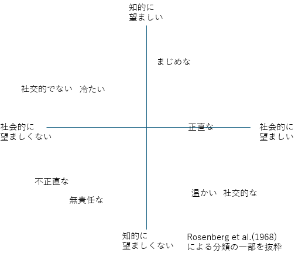
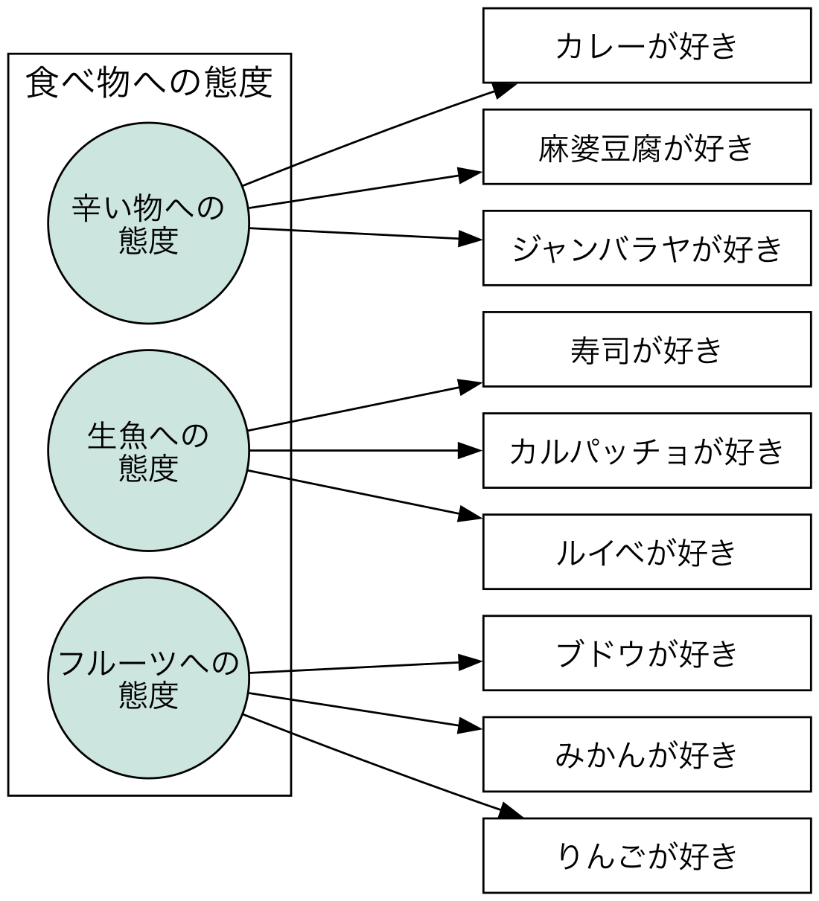
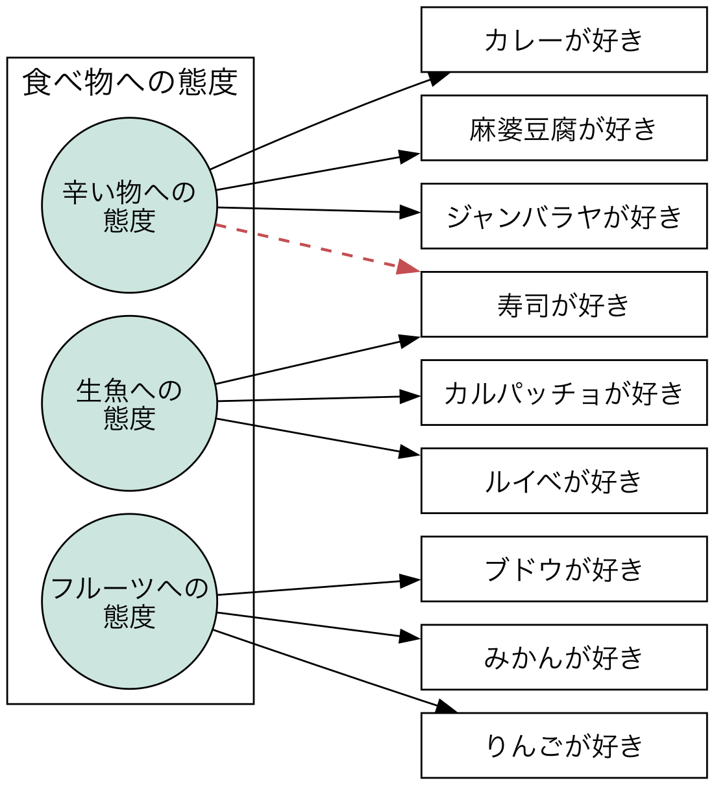
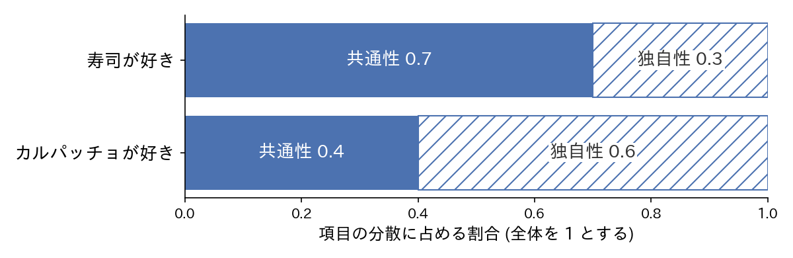
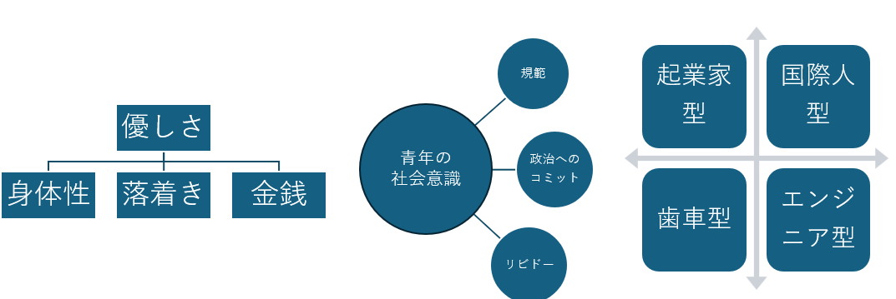

本章は, カテゴリーデータの処理手法に関するまとめの章となります. 学生の研究ではアンケートデータがよく利用されます. アンケートでは 5 段階評価などの質問項目が多いため, 得られたデータの大部分がカテゴリーデータとなります. この章では, アンケートデータを事例に, よく行われる分析手法をいくつか紹介・実践してみます.
なお, 本章で紹介する手法は既にほかの章で説明されているものも含まれており, 内容の重複があります.

# []{#質問紙調査}質問紙調査 {#questionnaire-surveys}

本章はアンケート調査, 質問紙調査によって集められるデータを分析するための事例を紹介することを目的としています. 質問紙調査によるデータの収集は, 質問紙の設計や倫理面などで留意すべき点がいくつもあります. 本講義では学生自身が, データを収集することになるので, まずはそれらの内容に関して学習してみましょう. なお, 本節の内容は, 教育・心理分野がご専門の江草遼平先生に監修いただきましたが, 資料に含まれる誤りは筆者の責任によるものです.

## 社会的態度の操作的な定義 {#社会的態度の操作的な定義}

質問紙調査を行う研究では, 人の行動を説明・予測するための概念として, 人の行動の背後に**社会的態度**があると仮定します. **社会的態度**とはオールポートの定義によれば,

- 経験によって構築された心理・神経生理的な準備状態
- 人が関わる対象に対する行動を, 方向づけたり変えたりするもの

とされています.

これらの態度は直接観察することができません. そこで, 態度の測定には, 行動の測定を行い類推する手法を用います.

## 心理尺度 (Psychological scale) {#心理尺度-psychological-scale}

実際の行動を測定するのには実験環境, 参加者などの制約があり難しいことがあります. そこで, 心理尺度による測定方法がよく用いられます. 心理尺度とは態度に関する質問によって行動を測るもので, 普段目にするアンケートで用いられている手法がそれに当たります (英語で検索する際には "Questionnaire" や "Scale" のキーワードを含めるとヒットしやすくなります).

厳密な心理尺度の構成は, それだけで 1 つの研究となるものです. 「心理尺度を使って何かを明らかにしたい」が目的の場合には, 可能であれば先行研究から心理尺度を援用して用いるか, そこに 1 つ 2 つ測定可能な指標を持ち込んで, それについて分析するのが望ましいです. 例えば, 共に先行研究がある"自尊感情の評価"と"大学生の恋愛観"の関係, あるいは"自尊感情の評価"と容易に測定可能な"100 ます計算でケアレスミスが何回起こるか"の関係などが挙げられます.

既存の尺度を援用する際には, ものによって使用料金や著者の許諾を必要とする場合があるので, これらのチェックを忘れないようにする必要があります.

心理尺度における質問手法にはいくつかの種類がありますが, ここでは代表的なものを 2 つ見てみましょう.

::: note
- ### リッカート法 (Likert scale method) {#リッカート法-likert-scale-method}

リッカート法は質問項目について「とても当てはまる」, 「やや当てはまる」, 「どちらとも言えない」, 「ほとんど当てはまらない」, 「全く当てはまらない」などの段階化された回答を得る手法です.

各回答の間は等間隔とは限らず, 測定が粗いため同じことについて複数の質問を集めることで測定誤差を小さくすることを試みます.

例えば, 「授業における英語への関心」を測定するために, 「分からないときでも英語を聞こうとする」, 「分からないときでも英語を読もうとする」, 「英語で話すのが楽しい」など複数の項目を立てます.

::: warn
リッカート法で得られたデータは厳密には順序尺度にあたりますが, 心理学分野では便宜的に間隔尺度として扱うことがあります. これは, 複数の項目の得点の合計や平均点を用いるための処置ですが, 他分野からは批判もあるので, その後の統計検定手法の選択などには注意する必要があります.
:::

:::

::: note
- ### SD 法 (Semantic Differential Scale Method) {#sd-法-semantic-differential-scale-method}

SD 法は, 文章での質問ではなく形容詞対を用いる方法です. 例えば, ステンレスのコップを見たときの印象について, 「温かい」-「冷たい」, 「硬い」-「柔らかい」といった項目のどちらにより近いかを 5 段階, 7 段階の尺度で尋ねます. SD 法は感情や印象に関する評価に向いており, デザインやサービスなどの評価によく用いられます.

SD 法は適当な形容詞対をリストアップするのに苦労があるので, リッカート法と比べると作成が難しいですが, 質問紙では異なる文章を用いる必要がありそうな複数の対象でも, 同じ質問紙で評価ができる場合があり, 比較が容易になるメリットがあります.
:::

## 因子 (潜在変数) {#因子-潜在変数}

ある態度を説明する際に, 複数の側面を必要とする場合があります. 例えば, 対人認知 (人に対する印象, ある人が好ましいかどうか) に関する研究では[Rosenberg et al.(1968)](https://doi.org/10.1037/h0026086 "https://doi.org/10.1037/h0026086")が, 対人的な印象を形成する認知次元として**社会的望ましさ**と**知的望ましさ**の 2 次元を見出しています.

この説に基づけば, 対人認知の傾向を問うアンケートを行うには「社会的望ましさ」と「知的望ましさ」のどちらか一方でなく, 2 つの次元を持つ尺度が望ましいこととなります.
このような概念構成の構造を知るには, 構成する因子 (上の例でいえば 2 つの望ましさ) を探索する必要があります.
そのような複数の変数の中から少数の次元を探索する分析手法として**因子分析**があります.
10 項目の 7 段階であるリッカート尺度によるアンケートがあったとしたとき, このアンケートの 10 個の項目がすべて 1 つのことについて測定しているのであれば, ある項目への回答が中間の「4: どちらでもない」であったとき, ほかの回答も「4: どちらでもない」かそれに近い回答が選ばれる傾向がみられるはずです. そうなっていないなら, その質問は他のことについて尋ねている可能性が高いとみなされます.
アンケートの 10 個の項目が複数の次元について訊ねるものであるとき, いくつかの項目がほかの項目とは関係なく, まとまって高く反応する, 反対に低く反応するなどのケースが見受けられます. このまとまった項目が共通して持つ部分を因子とみなします.

図では, 直接観測できない因子を丸, 質問項目を四角で表し, 因子から質問項目への矢印で「その因子が回答に影響する」ことを表しています.

因子分析では直接観測できる質問項目 (下位尺度) への反応から, 直接観測できない「食べ物への態度」を構成する因子を測定し, それによって全体の概念を説明します.
各質問項目が因子につながる共通の部分を持っているかどうかは, 質問項目間の相関係数から求められます.
質問項目によっては, 2 つ以上の因子にかかわることがあります. 例えば, わさびが寿司につきものであるなら, 多少は辛い物への態度が影響している可能性が考えられます. このようなケースでは, 下位尺度のグループ化において, 相関係数をもとに判断をする必要があります.

図の赤い破線の矢印は, 「寿司が好き」という項目が, 生魚への態度だけでなく辛い物への態度からも影響を受けている場合を表しています.

質問項目には, 尺度の全体に関わる部分があります. これを**共通性**といい, 逆に, 尺度に関わらない質問項目独自の要素を**独自性**と呼びます.
例えば寿司が好きという行動は尺度全体における「食べ物への態度」と高く関わっているかもしれません. この場合にはこれが共通性とみなされます.
しかし寿司が好きな人の中には「形がかわいいから好き」など食べ物に直接かかわらない要素があるかもしれません.
このような時, 寿司が好きかという質問項目には独自性があるといえます.
共通性と独自性は足して 1 になるようになっており, 共通性があまりに低い項目がある場合は共通因子を探るのに役に立たないことがあります. このような場合, その質問項目を除外して考えることもあります. 一方で, そのような質問項目から新しい因子が作成されたり, 回答者グループの属性に影響を受けているなど, データ全体の解釈において有用である場合もあるので慎重に考える必要があります.

図は, 各項目の回答のばらつき (分散) を 1 としたときに, 共通性と独自性がそれぞれどれだけを占めるかを表したイメージです. 「寿司が好き」の方が「カルパッチョが好き」より共通性の割合が大きく, 食べ物への態度全体とより強く関わっている項目だといえます.

各項目が因子から受ける影響の強さを因子負荷量と呼び, これが大きい項目が因子を解釈する際の中心となります.

この授業では因子分析の手法そのもの (因子の数や項目のまとまりをデータから探す方法) は扱いませんが, 本章の最後の[共分散構造分析](block:survey-sem#共分散構造分析)で因子分析のモデルを使います. これらの概念は解釈に必要なので, 忘れたら戻ってきてください.

::: warn
- ### 信頼性と妥当性 {#信頼性と妥当性}

尺度は態度を測るためのものさしにあたるものです. よって, 測るたびに大きく数値が変わったり, 対象を測るのに十分な長さがないとなれば役に立ちません.

そのような尺度の有用度を判断する基準として**信頼性**があります. 信頼性は, 尺度の測定誤差について吟味することです. 一貫性の測定として, クロンバッハのα係数がよく用いられますが, ここでは深く扱いません. 興味のある方は調べるか, 教員に質問してみましょう.

作成者の意図通りに尺度を測定できているかを表す**妥当性**という概念もよく利用されます. 妥当性の判断としては, より詳細には基準関連妥当性, 内容的妥当性, 構成概念妥当性を吟味することが求められますが, これも詳細は割愛します.
:::

## 質問紙の構成 {#質問紙の構成}

### 測りたい態度について設定する {#測りたい態度について設定する}

質問紙を構成する目的は, **ある態度について類推することができる行動を計測すること**です. したがって, まずその**態度**について明確化する必要があります.

例えば「人の一生」のような巨大すぎる概念を対象にするのは相当無理があります. 「寝起き時の感情について」だとより限定されていて望ましいですが, 例えば少年と老人, 日本人と外国人では大きく異なるかもしれません. これらを比較することも一つの研究テーマとして面白いですが, まずは手におえる範囲までそれを訊ねる対象と扱う概念について小さくすることをおすすめします.

このようなときに重要なのは先行研究です. これまで研究されてこなかった概念を 1 から作るにしても, 類似の研究について追試するにあたっても, 先行研究から大きなヒントを得ることが近道となります. 先行研究の調べ方に関しては, 講義で別の機会に扱いますので, 参考にして先行研究を集めてみましょう.

### 概念の構造を考える {#概念の構造を考える}

概念を構成する下位概念について, 事前にイメージすることも重要です. これらは, アンケートを回収した結果修正を要することもありますが, ひとまず質問項目をまんべんなくそろえるために重要なステップです.

概念の構造には多様な種類がありますが, やはり先行研究から自分の知りたい概念についてどのような構造が適当であるかを吟味する必要があります.

### 項目の作成 {#項目の作成}

心理尺度の項で先駆けてリッカート法と SD 法については示しています. これらの方法は得点化して計算することを考慮したものですが, それ以外の方法でもデータを補強したり, 集めることができます. いくつかの方法に関して概観してみましょう.

::: note
- ### 順位法 {#順位法}
順位法は提示された選択肢に順位をつけさせるものです. 例えば, 「カレー, ラーメン, とんかつの 3 つについて好きな順番をつけてください」のような質問項目が考えられます. この方法では, 順序尺度のデータを得ることができます.
:::

::: note
- ### 多肢選択法 {#多肢選択法}
多肢選択法は質問項目について, 複数の回答選択をさせるものです. 「以下の中から, 好きな授業名を 1 つ選べ」という質問では 1 つしか回答が得られませんが, 「好きなだけ選べ」とすれば複数の情報が手に入ります. 十分に設計された選択肢があれば傾向を得ることができます.
:::

::: note
- ### 自由記述法 {#自由記述法}
自由記述法は質問に対して, 自由に文章を書かせる方法です. 構造化されたデータを手に入れることはできませんが, 見逃していた要素, 想像もしていない要素が情報として得られる可能性があります. カテゴリー分類や自然言語処理によって解釈に寄与するデータを得ることができるかもしれません. 自然言語処理に関しては[第9章](/lectures/dsp9.html)で扱っていますので, 参考にしてください.
:::

::: warn
- ### 項目作成の際の注意 {#項目作成の際の注意}
いずれの方法でも, 質問項目の作成においては以下の点に注意を払う必要があります. それぞれの詳細に関しては, 実際に質問紙を構成する中で, 個別に解説しますので, 必要に応じて対応していきましょう.

1) 項目が適切に構成概念を反映していること

2) 項目がわかりやすいこと

3) 回答を誘導しないこと

4) 項目数が適切であること

5) 選択肢が適切であること

6) 逆転項目をいれるかどうか

7) 回答者に社会通念上許されない負担を与えないこと
:::

# []{#利用データ}利用データ {#questionnaire-data}

本章では, 仮想のアンケートデータとして, 情報入門で利用されている理解度アンケートを利用します. なお, このアンケートの質問形式は実際に利用しているものですが, 回答は仮想のものであり, 得られた結果も実際の講義とは無関係です.

データは[アンケートデータの CSV](https://github.com/yakagika/yakagika.github.io/blob/main/slds_data/ch16/questionnaire_sample_original.csv)からダウンロードできます.

このデータは, Microsoft Forms で取得したアンケートデータになります. 自由回答や量的データを回答する質問項目はなく, 5 段階の順序尺度及び複数選択式の質問項目からなります.

質問項目は以下のとおりです.

::: note

- あなたの「スマートフォン」に対する印象について、どれくらいあてはまるかを教えてください。
- あなたの「スマートフォン」に対する操作や知識について、どれくらい自信があるかを教えてください。
- あなたの「パソコン」に対する印象について、どれくらいあてはまるかを教えてください。
- あなたの「パソコン」に対する操作や知識について、どれくらい自信があるかを教えてください。
- あなたの「SNS（FacebookやInstagramなど）」に対する印象について、どれくらいあてはまるかを教えてください。
- あなたの「SNS（FacebookやInstagramなど）」に対する操作や知識について、どれくらい自信があるかを教えてください。
- あなたの「ネットを使ったコミュニケーション（LINEやTwitterなど）」に対する印象について、どれくらいあてはまるかを教えてください。
- あなたの「ネットを使ったコミュニケーション（LINEやTwitterなど）」に対する操作や知識について、どれくらい自信があるかを教えてください。
- 次の「IT用語」について「知っている」という言葉にチェックをしてください（知っているものすべてにチェック）。
- Windowsの操作や事柄について「身に付いている」ものにチェックをしてください（身に付いているものすべてにチェック）。
- 電子メールの操作や事柄について「身に付いている」ものにチェックをしてください（身に付いているものすべてにチェック）。
- WWW(ウェブ)の操作や事柄について「身に付いている」ものにチェックをしてください（身に付いているものすべてにチェック）。
- Wordの操作や事柄について「身に付いている」ものにチェックをしてください（身に付いているものすべてにチェック）。
- Excelの操作や事柄について「身に付いている」ものにチェックをしてください（身に付いているものすべてにチェック）。
- PowerPointの操作や事柄について「身に付いている」ものにチェックをしてください（身に付いているものすべてにチェック）。
- Officeの応用的な操作や事柄について「身に付いている」ものにチェックをしてください（身に付いているものすべてにチェック）。
- 情報倫理について「身に付いている」ものにチェックをしてください（身に付いているものすべてにチェック）。

:::

# 分析手法の選び方 {#choose-analysis}

本章の分析は, 質問紙の回答を集計できる形に直してから, 何を調べたいかに応じて手法を選ぶ順に進みます. 下の樹形図を上から順にたどって, 使う手法を選んでください. 手法の名前をクリックすると, 本章の対応する解説に移動します.

::: choice-tree

- [質問紙の回答]{.ct-root}
    - [回答を集計できる形に直す]{.ct-dim} → [データ処理](block:survey-analysis#データ処理)
        - [段階評価 (リッカート法)]{.ct-type} → 選択肢の文字列を 1〜5 の整数に直す
        - [複数選択]{.ct-type} → 選んだ選択肢の数に直す
    - [何を調べたいか]{.ct-dim}
        - 1 つの項目の回答の分布 → [ヒストグラム](block:survey-analysis#ヒストグラム)
        - 2 つの項目の関係の強さ → [スピアマンの順位相関係数](block:survey-analysis#相関係数)
        - 2 つの項目で, どの回答の組み合わせが多いか → [同時度数分布表](block:survey-analysis#同時度数分布表)
            - 組み合わせの偏りが偶然か → [独立性の検定](block:survey-analysis#独立性の検定)
                - [有意なら]{.ct-type} どの組み合わせが偏っているか → [残差分析](block:survey-analysis#残差分析)
        - 多数の項目を, 少数の変数にまとめる → [次元削減](block:survey-analysis#次元削減)
        - 項目の背後にある態度どうしの関係を, 仮説として確かめる → [共分散構造分析](block:survey-sem#共分散構造分析)

:::

