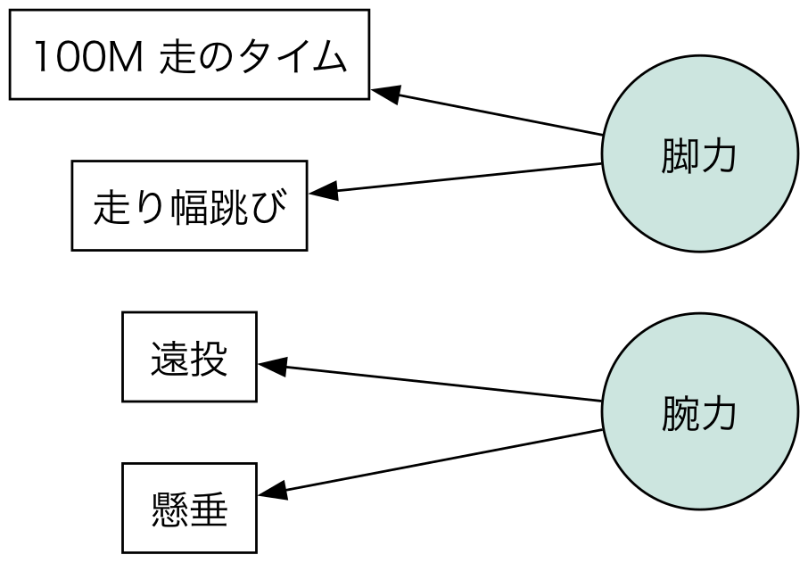
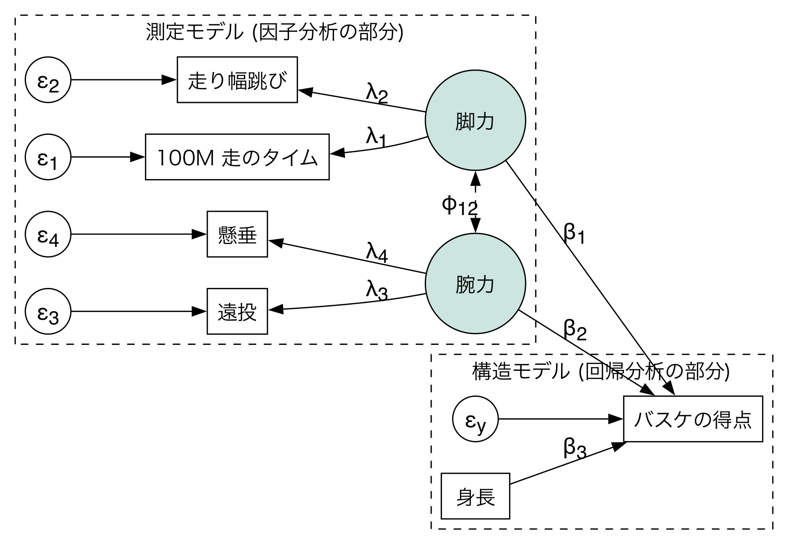
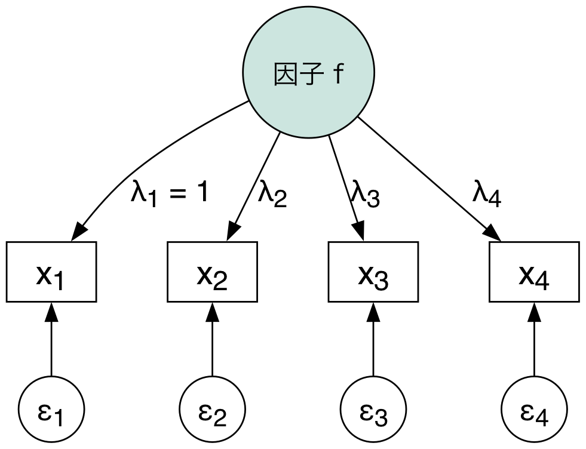
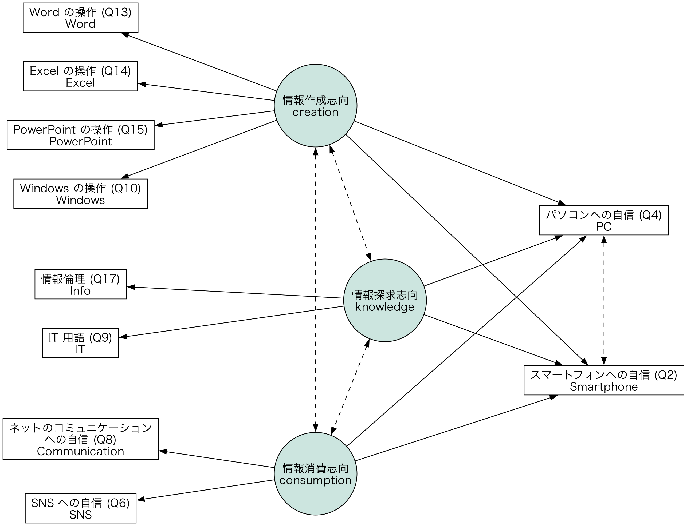
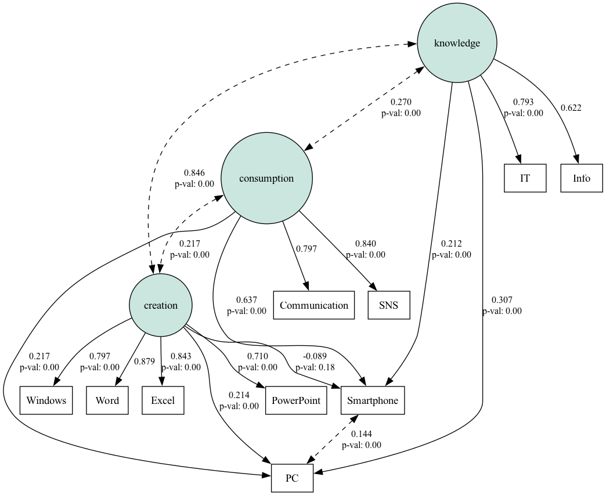
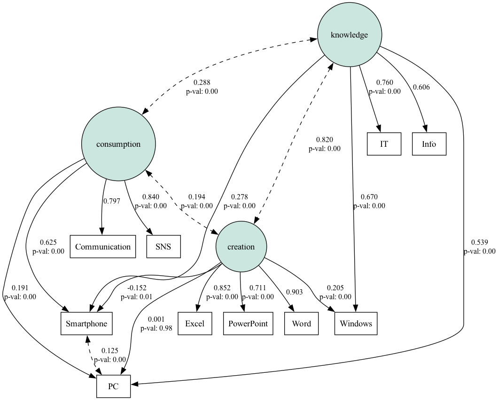

## 共分散構造分析 {#共分散構造分析}

これまでに残差分析などで 2 変数間の関係を確かめてきました. しかし, アンケート調査のように項目が多い場合には, 多数の変数の間の関係をまとめて調べたいことがあります.
そのような場合に利用できるのが**共分散構造分析 (SEM; Covariance Structure Analysis, Structural Equation Modeling)** です. SEM は社会科学, 心理学, マーケティング, 教育研究などの分野でよく用いられます.

相関係数は 2 つの変数の関係を対等に測りますが, SEM では, どの変数がどの変数に影響するかという向きを分析者が仮説として決め, 変数間の関係を式の集まり (モデル) として書き下します. そのうえで, モデルがデータと矛盾しないかを確かめます. 分析の前に理論や仮説からモデルを組み立てる必要があることが, SEM を使う際の難しさです.

SEM は, 因子分析のモデルと回帰分析のモデルを 1 つにまとめたものです. 以下では, 2 つのモデルの式, 2 つを合わせたモデルが共分散について何を予言するか, 予言とデータの食い違いの評価の仕方, の順に説明し, 最後にアンケートデータで実践します.

# []{#因子分析のモデル}因子分析のモデル {#factor-analysis-model}

学生ごとの「100M 走のタイム」と「走り幅跳びの飛距離」には, データとして観測されていない「脚力」という共通の要因が影響していると考えられます. このような観測されない共通の要因を**潜在変数** (因子) と呼び, 直接測定される変数を**観測変数**と呼びます. 本章の前半の[因子 (潜在変数)](block:survey-design#因子-潜在変数)で説明した因子は, この潜在変数のことです.

| ID | 100M | 走り幅跳び | 遠投 | 懸垂 |
| :---: | :---:| :---:      | :---:|:---: |
| 1 | 14.5 | 2.2 | 20 | 12 |
| 2 | 15.2 | 1.7 | 18 | 7 |
| ... | ... | ... | ... | ... |

図では, 観測変数を四角, 潜在変数を丸で表しています. 矢印は, 潜在変数が観測変数の値に影響するという仮定を表します.

**因子分析**では, 観測変数の値が潜在変数から生み出されると考えて, 観測変数ごとに次のような式を立てます. 定数 (切片) は分散や共分散に影響しないので, ここでは各変数の平均からのずれを考えて切片を省略します.

$$
\begin{aligned}
x_1 &= \lambda_1 f + \varepsilon_1 \quad (\text{100M 走のタイム}) \\
x_2 &= \lambda_2 f + \varepsilon_2 \quad (\text{走り幅跳びの飛距離})
\end{aligned}
$$

- **$f$**: 潜在変数 (脚力) です. 学生ごとに値を持ちますが, 観測できません.
- **$\lambda_i$ (ラムダ)**: **因子負荷量**です. 潜在変数が 1 増えたときに, 観測変数がどれだけ変わるかを表します. 100M 走はタイムなので, 脚力が高いほど値が小さくなり, $\lambda_1$ は負になると予想されます.
- **$\varepsilon_i$ (イプシロン)**: **独自因子**です. その項目にだけ影響する要因と測定誤差をまとめたもので, 独自因子どうし, および独自因子と潜在変数は無相関だと仮定します.

この式は, 観測変数 $x_i$ を潜在変数 $f$ で回帰した式と同じ形です. 因子負荷量 $\lambda_i$ は回帰係数に, 独自因子 $\varepsilon_i$ は誤差項にあたります. 通常の回帰分析との違いは, 説明変数 $f$ が観測できない点です.

式の向きに注意してください. 因子分析では潜在変数が観測変数を生み出すので, 式の左辺は観測変数で, 図の矢印は潜在変数から観測変数へ向かいます. [次元削減](block:survey-analysis#次元削減)で扱った主成分分析はこれとは逆に, 観測変数に重みをかけて足し合わせ, 合成変数を作ります.

観測変数を標準化し, 潜在変数の分散を 1 とすると, 観測変数の分散 1 は, 潜在変数に由来する部分 $\lambda_i^2$ と独自因子の分散に分かれます. $\lambda_i^2$ が本章の前半で説明した**共通性**, 独自因子の分散が**独自性**にあたり, 両者を足すと 1 になります.

# []{#回帰分析のモデル}回帰分析のモデル {#regression-model}

次に, 脚力と腕力がバスケットボールの得点にどう影響するかを考えます. これは[第5章](/lectures/dsp5.html#multiple-regression)の重回帰分析と同じ形の式で表せます.

$$
y = \beta_1 f_1 + \beta_2 f_2 + \beta_3 x_5 + \varepsilon_y
$$

ここで, $y$ はバスケットボールの得点, $f_1$ と $f_2$ は脚力と腕力 (潜在変数), $x_5$ は身長 (観測変数) です. $\beta_j$ は**パス係数**と呼ばれ, 重回帰分析の偏回帰係数と同じく, 他の説明変数を一定にしたときの影響の大きさを表します. $\varepsilon_y$ は説明変数で説明できない部分で, 回帰分析の誤差項にあたり, 説明変数とは無相関だと仮定します. 重回帰分析との違いは, 説明変数と目的変数に潜在変数を使える点です.

# []{#測定モデルと構造モデル}測定モデルと構造モデル {#measurement-and-structural-models}

SEM のモデルは, 次の 2 つの部分からなります.

- **測定モデル**: 潜在変数と観測変数の関係です. 因子分析のモデルにあたります.
- **構造モデル**: 変数どうしの影響の仮説です. 回帰分析のモデルにあたり, 潜在変数と観測変数のどちらも使えます.

「SEM は回帰分析と因子分析を同時に行う」とは, この 2 つの部分に含まれる係数をすべて, 1 つの基準でまとめて推定するという意味です.

先に 100M 走と走り幅跳びの値を標準化し, 100M 走は符号を反転して向きを揃えてから平均し (本章の[次元削減](block:survey-analysis#次元削減)で作った合成変数と同じ考え方です), それを脚力とみなして回帰分析をしても, SEM と同じ結果にはなりません. 合成した値には独自因子 (測定誤差) が混ざっており, 誤差を含む変数を説明変数にすると係数が偏って推定されるからです. 説明変数が 1 つで, 測定誤差が真の値や目的変数の誤差と無相関なら, 係数は真の値を使った場合より 0 に近くなります. 説明変数が複数あると, 偏りの向きは一定ではありません. SEM は潜在変数どうしの関係を直接推定するので, モデルが正しければ, 測定誤差を分けて取り除いた係数が得られます.

モデルの全体像を図にしたものを**パス図**といいます. パス図は次の約束で描きます.

- 四角は観測変数, 大きな丸は潜在変数を表します.
- 片方向の矢印は, 矢印の元の変数が先の変数に影響するという仮説を表し, 因子負荷量かパス係数が付きます.
- 両方向の矢印は, 向きを仮定しない関係 (共分散) を表します. 下の図の $\phi_{12}$ (ファイ) は脚力と腕力の共分散です.
- 小さな丸は独自因子と誤差 ($\varepsilon$) を表します.

::: note
- ### 記号について {#記号について}

本章では, [第5章](/lectures/dsp5.html#multiple-regression)の回帰分析と読み比べやすいように, 回帰係数を $\beta$, 誤差を $\varepsilon$ で表しています. SEM の専門書や論文では, 次のように役割ごとに別の文字を使う記法 (開発されたソフトウェアの名前から LISREL 記法と呼ばれます) がよく使われます.

| 本章の記号 | よく使われる記号 | 意味 |
|---|---|---|
| $f$ | $\xi$ (グザイ), $\eta$ (イータ) | 潜在変数 (説明する側が $\xi$, 説明される側が $\eta$) |
| $\lambda$ | $\lambda$ (ラムダ) | 因子負荷量 |
| $\beta$ | $\gamma$ (ガンマ), $\beta$ (ベータ) | パス係数 ($\xi$ から $\eta$ へは $\gamma$, $\eta$ どうしは $\beta$) |
| 観測変数の $\varepsilon_i$ | $\delta$ (デルタ), $\varepsilon$ (イプシロン) | 独自因子 (測定誤差) |
| 構造モデルの $\varepsilon$ | $\zeta$ (ゼータ) | 構造モデルの誤差 |
| $\phi$, $\psi_i$ | $\Phi$, $\Theta$ | 潜在変数の分散と共分散, 独自因子の分散 |
:::

SEM を利用するには, 分析の前にこのようなパス図を仮説として描く必要があります. 推定すると, 矢印ごとに係数とその p 値が求まり, 仮説の各部分の影響の大きさと有意性がわかります.

# []{#モデルが予言する共分散行列}モデルが予言する共分散行列 {#model-implied-covariance}

SEM がモデルをデータとどう照らし合わせるのかを, 1 つの因子と 4 つの観測変数からなる小さなモデルで確かめます.

各観測変数は $x_i = \lambda_i f + \varepsilon_i$ で, 因子の分散を $\phi$, 独自因子 $\varepsilon_i$ の分散を $\psi_i$ (プサイ) とします. 独自因子が互いに, また因子と無相関であることを使うと, 観測変数の分散と共分散は次のようにパラメータで表せます.

$$
\begin{aligned}
\mathrm{Var}(x_i) &= \lambda_i^2 \phi + \psi_i \\
\mathrm{Cov}(x_i, x_j) &= \mathrm{Cov}(\lambda_i f + \varepsilon_i,\ \lambda_j f + \varepsilon_j) = \lambda_i \lambda_j \phi \quad (i \neq j)
\end{aligned}
$$

パラメータの値を決めると, 観測変数の分散と共分散がすべて決まります. パラメータをまとめて $\theta$ と書き, これらの分散と共分散を並べた行列を, モデルが予言する共分散行列 $\Sigma(\theta)$ と呼びます. 対称行列なので, 下半分は省略します.

$$
\Sigma(\theta) = \begin{pmatrix}
\lambda_1^2\phi + \psi_1 & \lambda_1\lambda_2\phi & \lambda_1\lambda_3\phi & \lambda_1\lambda_4\phi \\
 & \lambda_2^2\phi + \psi_2 & \lambda_2\lambda_3\phi & \lambda_2\lambda_4\phi \\
 & & \lambda_3^2\phi + \psi_3 & \lambda_3\lambda_4\phi \\
 & & & \lambda_4^2\phi + \psi_4
\end{pmatrix}
$$

共分散がどのような構造を持つかをモデルで表し, データと比べることが, 共分散構造分析という名前の由来です.

パラメータに具体的な値を入れて $\Sigma(\theta)$ を計算し, 同じモデルに従う仮想の回答者 1000 人のデータから計算した共分散行列と比べてみます.

~~~ py
import numpy as np

# 1 因子 4 指標のモデルのパラメータ
lam = np.array([1.0, 0.8, 0.6, 0.7])  # 因子負荷量 (1 つ目は 1 に固定)
phi = 0.5                              # 因子の分散
psi = np.array([0.3, 0.4, 0.5, 0.4])   # 独自因子の分散

# モデルが予言する共分散行列
Sigma = phi * np.outer(lam, lam) + np.diag(psi)
print(Sigma.round(3))
"""
[[0.8   0.4   0.3   0.35 ]
 [0.4   0.72  0.24  0.28 ]
 [0.3   0.24  0.68  0.21 ]
 [0.35  0.28  0.21  0.645]]
"""

# このモデルに従う仮想の回答者を 1000 人つくり, 共分散行列を計算する
rng = np.random.default_rng(0)
n = 1000
f = rng.normal(0, np.sqrt(phi), n)            # 因子の値 (観測できない)
eps = rng.normal(0, np.sqrt(psi), (n, 4))     # 独自因子
X = f[:, None] * lam + eps                    # 観測される 4 項目
print(np.cov(X, rowvar=False).round(3))
"""
[[0.735 0.348 0.288 0.324]
 [0.348 0.694 0.25  0.282]
 [0.288 0.25  0.683 0.195]
 [0.324 0.282 0.195 0.66 ]]
"""
~~~

データから計算した共分散行列は, 標本のばらつきの分だけずれますが, モデルが予言した $\Sigma(\theta)$ に近い値になります. SEM の推定はこの逆向きの計算です. データから共分散行列 $S$ を計算し, $\Sigma(\theta)$ が $S$ にできるだけ近くなるパラメータ $\theta$ を探します.

構造モデルのパス係数も, 同じように共分散の式に入ります. 例えば $x = \lambda f + \varepsilon_x$ と $y = \beta f + \varepsilon_y$ で, 誤差どうしと, 誤差と $f$ が無相関なら,

$$
\mathrm{Cov}(x, y) = \lambda \beta \phi
$$

です. 因子負荷量 $\lambda$ とパス係数 $\beta$ が同じ $\Sigma(\theta)$ の中に現れるので, 両方を 1 つの共分散行列から同時に推定できます.

このモデルは, 共分散の値の間に制約を課しています. 例えば $\Sigma(\theta)$ の式から

$$
\mathrm{Cov}(x_1, x_2)\,\mathrm{Cov}(x_3, x_4) = \mathrm{Cov}(x_1, x_3)\,\mathrm{Cov}(x_2, x_4) = \lambda_1\lambda_2\lambda_3\lambda_4\phi^2
$$

が成り立ちます. 上の数値でも $0.4 \times 0.21 = 0.3 \times 0.28 = 0.084$ です. データの共分散がこのような関係から大きく外れていれば, 「4 つの項目が 1 つの因子で説明できる」という仮説は疑わしくなります. モデルが共分散にこうした制約を課しているので, SEM はモデルがデータと矛盾するかどうかを検証できます.

# []{#識別と自由度}識別と自由度 {#sem-identification}

上のモデルのパラメータは $\lambda_1, \dots, \lambda_4, \phi, \psi_1, \dots, \psi_4$ の 9 個ですが, このままでは値が 1 つに決まりません. 因子 $f$ を 2 倍の値で測り直す (分散 $\phi$ は 4 倍になる) と同時に, すべての $\lambda_i$ を半分にすると, $\lambda_i \lambda_j \phi$ も $\lambda_i^2 \phi$ も変わらないからです. 潜在変数には決まった単位がないので, 分析者が単位を決める必要があります. よく使われるのは, 潜在変数ごとに因子負荷量を 1 つだけ 1 に固定する方法です (図の $\lambda_1 = 1$). こうすると, 潜在変数の単位はその観測変数の単位に揃います. パラメータの値が 1 つに決まることを, モデルが**識別される**といいます. 単位の固定は識別に必要な条件ですが, それだけで識別されるとは限りません. 例えば 1 つの因子に観測変数が 2 つしかないモデルは, 単位を固定しても値が 1 つに決まりません.

観測変数が $p$ 個あるとき, データから得られる分散と共分散は $p(p+1)/2$ 個です. 推定するパラメータの数を $q$ とすると,

$$
\text{自由度} = \frac{p(p+1)}{2} - q
$$

がモデルの**自由度**です. 上の例では $p = 4$ なので分散と共分散は 10 個あり, $\lambda_1 = 1$ と固定すると推定するパラメータは 8 個なので, 自由度は 2 です. 自由度は, モデルが共分散に課している制約の数にあたります. 自由度が負のモデルは, パラメータの値が 1 つに決まりません. 自由度が 0 以上であることは識別の必要条件であって, 十分条件ではありません. 識別されていて自由度が 0 のモデルは, 通常データの共分散行列を完全に再現するので, 適合度でモデルを検証することはできません.

# []{#推定の方法}推定の方法 {#sem-estimation}

推定では, $S$ と $\Sigma(\theta)$ の食い違いを測る関数を決め, その値が最小になる $\theta$ を探します. 最もよく使われるのは**最尤法**で, 観測変数が多変量正規分布に従うと仮定し, 食い違いを次の関数で測ります.

$$
F_{\mathrm{ML}}(\theta) = \log|\Sigma(\theta)| + \mathrm{tr}\left(S\,\Sigma(\theta)^{-1}\right) - \log|S| - p
$$

$|\cdot|$ は行列式, $\mathrm{tr}$ は対角成分の和を表します. 式の細部を覚える必要はありませんが, $\Sigma(\theta) = S$ のときに 0 になり, 食い違いが大きいほど大きくなる量だということは押さえておいてください. 最小値 $F_{\min}$ にデータ数 $N$ (ソフトウェアによっては $N - 1$) をかけた値が, 次の節で説明する $\chi^2$ 統計量です.

本章のデータの 5 段階評価や, チェックした選択肢の個数は, 正規分布の仮定から外れます. 選択肢が 5 つ以上あり, 分布の偏りが大きくなければ, 推定値への影響は比較的小さいとされています. ただし $\chi^2$ 統計量や p 値は不正確になりやすいため, 研究で使うときは順序尺度向けの推定法や頑健な補正も検討します.

# []{#適合度の読み方}適合度の読み方 {#sem-fit-indices}

推定したモデルがデータにどれだけ合っているかを表す指標を**適合度指標**といいます. 1 つの指標だけで判断せず, 複数の指標を合わせて評価します.

| 評価指標 | 何を測るか | 目安 |
|---|---|---|
| カイ二乗検定 ($\chi^2$) | 「モデルが予言する共分散行列は母集団の共分散行列に一致する」を帰無仮説とする検定. 統計量は $N F_{\min}$ で, 自由度はモデルの自由度 | p 値 > 0.05 (モデルが棄却されない) |
| RMSEA (Root Mean Square Error of Approximation) | 自由度 1 あたりの食い違いの大きさ. $\sqrt{\max(\chi^2 - df,\ 0) / (df\,(N-1))}$ | 0.05 以下で良い, 0.08 以下で許容範囲, 0.1 以上で悪い |
| SRMR (Standardized Root Mean Square Residual) | $S$ と $\Sigma(\hat\theta)$ の差を相関の尺度にした残差の, 二乗平均の平方根 | 0.08 以下 |
| CFI (Comparative Fit Index) | すべての観測変数が無相関だとする独立モデルと比べて, 食い違いがどれだけ減ったか | 0.95 以上で良い, 0.90 以上で可 |
| TLI (Tucker-Lewis Index) | CFI と同じ比較を自由度 1 あたりの食い違いで行い, パラメータの多いモデルを割り引いたもの | 0.95 以上で良い, 0.90 以上で可 |
| GFI (Goodness of Fit Index) | データの分散と共分散のうち, モデルが再現できた割合 (ただし `semopy` 2.3 の出力は NFI と同じ式で計算されている) | 0.95 以上で良い, 0.90 以上で可 |
| AGFI (Adjusted GFI) | GFI をパラメータの数で補正したもの | 0.95 以上で良い, 0.90 以上で可 |
| NFI (Normed Fit Index) | 独立モデルと比べて $\chi^2$ がどれだけ減ったかの割合 | 0.95 以上で良い, 0.90 以上で可 |

$\chi^2$ 検定は, モデルが母集団に完全に合っているかを調べる検定です. データ数が多いと, 母集団での実質的に問題にならない小さな食い違いでも検出して棄却します. そのため, 食い違いの大きさを RMSEA, SRMR, CFI などでも評価します. GFI と AGFI はデータ数やモデルの大きさの影響を受けやすいため, 最近は $\chi^2$, RMSEA, SRMR, CFI (TLI) を報告することが多くなっています. `semopy` 2.3 は GFI を NFI と同じ式で計算していて, 出力の GFI と NFI は常に同じ値になるので, 本章では判断材料に使いません. なお, 目安の値は慣習であり, 目安を満たせば正しいモデルだと保証されるわけではありません.

::: warn
- ### SEM で確かめられること {#sem-で確かめられること}

SEM が確かめるのは, 仮定したモデルとデータが矛盾しないかどうかです. 適合度が良くても, モデルが正しいことや, 矢印の向きの因果関係があることの証明にはなりません. 1 時点の調査 (横断データ) では, 矢印の向きを逆にしたモデルがまったく同じ適合度になることがあります (同値モデル). 矢印の向きは, 理論や, 時間の前後関係がわかる調査設計で根拠づける必要があります.
:::

# []{#アンケートデータによる実践}アンケートデータによる実践 {#questionnaire-sem-example}

それでは, アンケートデータを利用して SEM を実際に行ってみましょう. 今回は以下のパス図で表されるモデルを検証します.

今回はあくまで仮想データを利用した練習なので, このモデルは深く考えられたものではありませんが, 実際に SEM を利用する場合には事前に仮説を立てて, アンケートの質問の設計自体を仮説が検証できるような形にしておく必要があります.

このモデルでは, 次の 3 つの潜在変数が, パソコンとスマートフォンに対する自信に影響すると考えます.

- **情報作成志向 (creation)**: Word, Excel, PowerPoint, Windows の操作のうち, 身に付いているものの個数から測ります.
- **情報探求志向 (knowledge)**: 情報倫理の事柄のうち身に付いているものの個数と, 知っている IT 用語の個数から測ります.
- **情報消費志向 (consumption)**: ネットを使ったコミュニケーションと SNS に対する自信 (5 段階) から測ります.

質問が直接尋ねているのは技能や知識や自信であり, 「志向」は練習のために付けた仮の名前です. これらの質問が本当に志向を測っているかは, 別に検討する必要があります.

パソコンへの自信とスマートフォンへの自信は, 3 つの志向以外の共通の要因 (例えば, 自分の能力を評価するときの甘さや厳しさ) の影響も受けると考えられます. そこで, 2 つの誤差 $\varepsilon$ の間に共分散を置きます. 3 つの潜在変数の間の共分散は, `semopy` が既定で推定します. 図では独自因子と誤差を省略しています.

Python では, 共分散構造分析用のライブラリ `semopy` を利用して SEM を実施できます.
`semopy` では, モデルを文字列で指定します. 潜在変数, 影響の向きのある関係, 共分散は, 記号を用いてそれぞれ以下のように表現されます.

- **測定モデル (潜在変数の定義)**

`潜在変数 =~ 観測変数1 + 観測変数2 + ...`

- **構造モデル (影響の向きのある関係)**

`目的変数 ~ 説明変数1 + 説明変数2 + ...`

- **共分散 (向きを仮定しない関係)**

`変数 ~~ 変数`

目的変数どうしを `~~` で結ぶと, それらの誤差 $\varepsilon$ の共分散を推定します.

それでは, モデルを構築し, 実際のデータで検証してみましょう.
観測変数には, チェックした選択肢の個数と 5 段階評価が混ざっていて単位が揃っていないので, 標準化しておきます. ただし, 観測変数を標準化しても潜在変数の分散は 1 にならないので, 係数の大きさを比べるときには後で説明する標準化推定値を使います.

~~~ py
#共分散構造分析
#------------------------------------------------------------------
#変数間の関係の仮説をモデルにして, データと矛盾しないかを確かめる.
import semopy
from semopy import Model

#データ型の変換 (すべて float でないといけない)
df_sem = df[num_columns].astype('float64')

#標準化する
df_sem = (df_sem - df_sem.mean()) / df_sem.std(ddof=0)

#わかりにくいから名前を変える
df_sem.rename({'Q2_num':'Smartphone'
              ,'Q4_num':'PC'
              ,'Q13_num':'Word'
              ,'Q14_num':'Excel'
              ,'Q15_num':'PowerPoint'
              ,'Q10_num':'Windows'
              ,'Q17_num':'Info'
              ,'Q9_num':'IT'
              ,'Q8_num':'Communication'
              ,'Q6_num':'SNS'}
              ,inplace=True
              ,axis='columns')

# 仮説 (文字列で指定する)
desc = '''
    # (測定モデル) 潜在変数 =~ 観測変数
    creation =~ Word + Excel + PowerPoint + Windows
    knowledge =~ Info + IT
    consumption =~ Communication + SNS

    # (構造モデル) 目的変数 ~ 説明変数
    PC ~ creation + knowledge + consumption
    Smartphone ~ creation + knowledge + consumption

    # (誤差の共分散) 変数 ~~ 変数
    PC ~~ Smartphone
    '''

# モデルを用意して推定する
mod = Model(desc)
res = mod.fit(df_sem)
print(res)
"""
Name of objective: MLW
Optimization method: SLSQP
Optimization successful.
Optimization terminated successfully
Objective value: 0.254
Number of iterations: 43
Params: 0.959 0.808 0.907 1.276 1.054 0.244 0.495 0.273 -0.102 0.341 0.800 0.144 0.645 0.365 0.290 0.371 0.614 0.496 0.295 0.525 0.364 0.228 0.635 0.134 0.772 0.152 0.462 0.386
"""

# 推定されたパラメータの一覧 (std_est=True で標準化推定値の列が付く)
estimates = mod.inspect(std_est=True)
print(estimates[['lval', 'op', 'rval', 'Estimate', 'Est. Std', 'p-value']])
"""
             lval  op           rval  Estimate  Est. Std   p-value
0            Word   ~       creation  1.000000  0.878675         -
1           Excel   ~       creation  0.959228  0.842957       0.0
2      PowerPoint   ~       creation  0.808264  0.710333       0.0
3         Windows   ~       creation  0.907300  0.797326       0.0
4            Info   ~      knowledge  1.000000  0.621641         -
5              IT   ~      knowledge  1.276020  0.793006       0.0
6   Communication   ~    consumption  1.000000  0.796807         -
7             SNS   ~    consumption  1.054072  0.839821       0.0
8              PC   ~       creation  0.243879  0.214321  0.002827
9              PC   ~      knowledge  0.494677  0.307485  0.000087
10             PC   ~    consumption  0.272566  0.217144       0.0
11     Smartphone   ~       creation -0.101796 -0.089464  0.182332
12     Smartphone   ~      knowledge  0.340858  0.211889  0.003632
13     Smartphone   ~    consumption  0.799502  0.636981       0.0
14    consumption  ~~    consumption  0.634833  1.000000       0.0
15    consumption  ~~      knowledge  0.133671  0.269868       0.0
16       creation  ~~       creation  0.772483  1.000000       0.0
17       creation  ~~    consumption  0.151833  0.216817       0.0
18       creation  ~~      knowledge  0.462311  0.846120       0.0
19      knowledge  ~~      knowledge  0.386469  1.000000       0.0
20             PC  ~~     Smartphone  0.143877  0.143851       0.0
21             PC  ~~             PC  0.644794  0.644631       0.0
22  Communication  ~~  Communication  0.365059  0.365098       0.0
23          Excel  ~~          Excel  0.289505  0.289424       0.0
24             IT  ~~             IT  0.371377  0.371141       0.0
25           Info  ~~           Info  0.613612  0.613562       0.0
26     PowerPoint  ~~     PowerPoint  0.495509  0.495427       0.0
27            SNS  ~~            SNS  0.294719  0.294701       0.0
28     Smartphone  ~~     Smartphone  0.525353  0.525298       0.0
29        Windows  ~~        Windows  0.364371  0.364271       0.0
30           Word  ~~           Word  0.228052  0.227930       0.0
"""

# 適合度の指標 (本章で説明した指標だけを表示する)
cols = ['DoF', 'chi2', 'chi2 p-value', 'CFI', 'TLI', 'RMSEA']
fit_stats = semopy.calc_stats(mod)
print(fit_stats.T.loc[cols])
"""
                   Value
DoF            27.000000
chi2          343.794134
chi2 p-value    0.000000
CFI             0.951725
TLI             0.919542
RMSEA           0.093192
"""

#パス図を描く (標準化推定値を表示する)
#plot_covs=True で共分散も表示する
semopy.semplot(mod
              ,dir_fig + 'SEM.png'
              ,plot_covs=True
              ,std_ests=True
              ,engine='dot')
~~~

`print(res)` の `Objective value: 0.254` は, 最小化した食い違い $F_{\min}$ です. これにデータ数 1352 をかけた $0.254 \times 1352 \approx 343.8$ が, 適合度の表の `chi2` になっています. なお, p 値の `0.0` は p 値がちょうど 0 という意味ではなく, 表示できる桁より小さいことを表します.

## パラメータの一覧の読み方 {#パラメータの一覧の読み方}

`inspect()` の出力は, パラメータ 1 つにつき 1 行です. `semopy` は測定モデルの行を `観測変数 ~ 潜在変数` の形で表示します.

- **0〜7 行目 (`観測変数 ~ 潜在変数`)**: 測定モデルの因子負荷量 $\lambda$ です. `Estimate` が 1 で p 値が `-` の行は, 識別のために 1 に固定した因子負荷量です.
- **8〜13 行目 (`PC ~ ...` と `Smartphone ~ ...`)**: 構造モデルのパス係数 $\beta$ です.
- **左右が異なる `~~` の行 (15, 17, 18, 20 行目)**: 潜在変数どうしの共分散と, PC と Smartphone の誤差 $\varepsilon$ の共分散です.
- **左右が同じ `~~` の行**: 分散です. 潜在変数の行 (14, 16, 19 行目) は潜在変数の分散 $\phi$, 観測変数の行は独自因子 $\varepsilon$ の分散です. PC と Smartphone の行は誤差 $\varepsilon$ の分散です.

推定するパラメータは, 固定していない因子負荷量 5 個, パス係数 6 個, 潜在変数の分散と共分散 6 個, 観測変数の独自因子と誤差の分散 10 個, PC と Smartphone の誤差の共分散 1 個の計 28 個です. 観測変数は 10 個なので分散と共分散は $10 \times 11 / 2 = 55$ 個あり, 自由度は $55 - 28 = 27$ となって, 出力の `DoF` と一致します.

`Estimate` は, 観測変数の単位で表した推定値 (非標準化推定値) です. 観測変数は標準化してありますが, 潜在変数の単位は 1 に固定した観測変数の単位に揃えただけなので, 分散は 1 になっていません. 例えば IT の因子負荷量 `Estimate` は 1.276 で, 1 を超えています. `Est. Std` は潜在変数も含めたすべての変数の分散を 1 に揃えたときの推定値 (**標準化推定値**) で, 係数の大きさを比べるときにはこちらを使います.

このモデルでは各観測変数が 1 つの潜在変数だけにつながっているので, 標準化した因子負荷量の二乗が共通性にあたります (Word なら $0.879^2 \approx 0.77$). 後で扱う修正モデルの Windows のように 2 つの潜在変数につながる場合は, 潜在変数どうしの相関も含めて計算する必要があり, 負荷量の二乗の和にはなりません. PC の行の 0.645 は PC の分散のうち 3 つの志向で説明できなかった割合で, 3 つの志向は PC への自信のばらつきの約 35% を説明しています.

## 結果の解釈 {#結果の解釈}

`semopy.semplot()` で描いたパス図は次のようになります. 矢印に付いた数値は標準化推定値です.

測定モデルの標準化した因子負荷量は 0.62〜0.88 です. 自由に推定した 5 個の因子負荷量はいずれも有意で, 残る 3 個は単位を決めるために 1 に固定したので有意性を検定していません. 各観測変数は, 同じ潜在変数につながる他の観測変数と強く関係しています.

構造モデルでは, パソコンへの自信に対して, 情報探求志向 (0.31), 情報消費志向 (0.22), 情報作成志向 (0.21) の順に影響が大きく, いずれも有意です. スマートフォンへの自信には情報消費志向の影響が最も大きく (0.64), 情報探求志向 (0.21) が続きます. 情報作成志向からスマートフォンへのパス (-0.09) は有意ではありません (p = 0.18).

適合度は判断が分かれます. $\chi^2$ 検定では, モデルが完全に合っているという仮説が棄却されています ($\chi^2(27) = 343.8$, p < 0.001). データ数が 1352 と多いので小さな食い違いも検出されやすく, 回答が正規分布に従わない影響もあるので, 食い違いの大きさを他の指標で確かめます. CFI (0.952) は目安の 0.95 を上回り, 後で計算する SRMR (0.040) も目安の範囲内です. 一方で, RMSEA (0.093) は許容範囲の 0.08 を超え, TLI (0.920) も 0.95 に届いていません. したがって, このモデルは大きく外れてはいないものの, データに合っていない部分を含んでいます.

# []{#残差からモデルの合わない箇所を探す}残差からモデルの合わない箇所を探す {#sem-residual-diagnostics}

モデルのどこがデータに合っていないかは, データの共分散行列 $S$ と, モデルが予言した共分散行列 $\Sigma(\hat\theta)$ の差 (残差) を見るとわかります. 残差を相関の尺度に揃えておくと, 変数の組どうしで大きさを比べられます. 残差の二乗平均の平方根が, 適合度の表の SRMR です (`semopy.calc_stats()` は SRMR を出力しないので, ここで計算します).

~~~ py
#残差を確かめる
#------------------------------------------------------------------
#データの共分散行列とモデルが予言した共分散行列の差を, 相関の尺度で見る
import numpy as np

obs = mod.vars['observed']                               # モデルに含まれる観測変数
S = np.cov(df_sem[obs].values, rowvar=False, bias=True)  # データの共分散行列
Sigma = mod.calc_sigma()[0]                              # モデルが予言した共分散行列
sd = np.sqrt(np.diag(S))
resid = pd.DataFrame((S - Sigma) / np.outer(sd, sd), index=obs, columns=obs)
print(resid.round(2))
"""
               Communication  Excel    IT  Info    PC  PowerPoint   SNS  Smartphone  Windows  Word
Communication           0.00  -0.03  0.03  0.07  0.02        0.06  0.00       -0.00     0.09  0.02
Excel                  -0.03  -0.00  0.01 -0.04 -0.02       -0.03 -0.08       -0.06    -0.04  0.03
IT                      0.03   0.01 -0.00 -0.00  0.01       -0.07 -0.05       -0.00     0.09 -0.04
Info                    0.07  -0.04 -0.00 -0.00 -0.03        0.06  0.01        0.01     0.08 -0.03
PC                      0.02  -0.02  0.01 -0.03 -0.00       -0.05 -0.01       -0.00     0.11 -0.03
PowerPoint              0.06  -0.03 -0.07  0.06 -0.05       -0.00  0.02        0.01     0.02  0.02
SNS                     0.00  -0.08 -0.05  0.01 -0.01        0.02 -0.00        0.00     0.03 -0.01
Smartphone             -0.00  -0.06 -0.00  0.01 -0.00        0.01  0.00       -0.00     0.09 -0.01
Windows                 0.09  -0.04  0.09  0.08  0.11        0.02  0.03        0.09    -0.00 -0.03
Word                    0.02   0.03 -0.04 -0.03 -0.03        0.02 -0.01       -0.01    -0.03 -0.00
"""

#SRMR (残差の二乗平均の平方根. 対角と下三角の要素を使う)
srmr = np.sqrt((resid.values[np.tril_indices(len(obs))] ** 2).mean())
print('SRMR:', srmr)
"""
SRMR: 0.04042660130885509
"""
~~~

残差が正の組は, データでの関係がモデルの予言より強い組です. Windows の行が目立ち, PC (0.11), IT (0.09), Smartphone (0.09), Communication (0.09), Info (0.08) との残差が大きくなっています. モデルでは Windows を情報作成志向だけにつないでいますが, データの Windows は IT 用語や情報倫理とも, モデルが説明できる以上に強く関係しています.

Windows の設問の選択肢には, ファイルの検索やコピー, ファイルサイズの確認, ZIP ファイルの展開など, パソコンの基本的な仕組みに関わる操作が多く含まれます. IT 用語の設問にも「OS」「拡張子」「CPU」などがあるので, Windows の操作は IT 用語や情報倫理の知識とも共通する部分を持つと考えられます. そこで, Windows を情報探求志向にも結びつけたモデルを推定してみます. 残差の大きい箇所を直す方法は他にもあり, これは候補の 1 つです.

~~~ py
#修正したモデル
#------------------------------------------------------------------
desc2 = '''
    creation =~ Word + Excel + PowerPoint + Windows
    knowledge =~ Info + IT + Windows
    consumption =~ Communication + SNS

    PC ~ creation + knowledge + consumption
    Smartphone ~ creation + knowledge + consumption

    PC ~~ Smartphone
    '''
mod2 = Model(desc2)
mod2.fit(df_sem)

estimates2 = mod2.inspect(std_est=True)
print(estimates2[['lval', 'op', 'rval', 'Estimate', 'Est. Std', 'p-value']])
"""
             lval  op           rval  Estimate  Est. Std   p-value
0            Word   ~       creation  1.000000  0.902817         -
1           Excel   ~       creation  0.943159  0.851513       0.0
2      PowerPoint   ~       creation  0.787335  0.710805       0.0
3         Windows   ~       creation  0.226744  0.204725  0.000354
4         Windows   ~      knowledge  1.106513  0.670206       0.0
5            Info   ~      knowledge  1.000000  0.605709         -
6              IT   ~      knowledge  1.255615  0.760449       0.0
7   Communication   ~    consumption  1.000000  0.797009         -
8             SNS   ~    consumption  1.053600  0.839756       0.0
9              PC   ~       creation  0.001609  0.001452  0.981641
10             PC   ~      knowledge  0.890435  0.539311       0.0
11             PC   ~    consumption  0.239828  0.191169       0.0
12     Smartphone   ~       creation -0.168782 -0.152384  0.007119
13     Smartphone   ~      knowledge  0.458509  0.277699  0.000006
14     Smartphone   ~    consumption  0.783506  0.624525       0.0
15    consumption  ~~    consumption  0.635361  1.000000       0.0
16       creation  ~~       creation  0.815135  1.000000       0.0
17       creation  ~~    consumption  0.139921  0.194428       0.0
18      knowledge  ~~      knowledge  0.366825  1.000000       0.0
19      knowledge  ~~    consumption  0.138980  0.287881       0.0
20      knowledge  ~~       creation  0.448629  0.820432       0.0
21             PC  ~~     Smartphone  0.125249  0.125250       0.0
22             PC  ~~             PC  0.611823  0.611842       0.0
23  Communication  ~~  Communication  0.364856  0.364777       0.0
24          Excel  ~~          Excel  0.274935  0.274925       0.0
25             IT  ~~             IT  0.421749  0.421717       0.0
26           Info  ~~           Info  0.633018  0.633117       0.0
27     PowerPoint  ~~     PowerPoint  0.494811  0.494757       0.0
28            SNS  ~~            SNS  0.294856  0.294811       0.0
29     Smartphone  ~~     Smartphone  0.516227  0.516219       0.0
30        Windows  ~~        Windows  0.283743  0.283772       0.0
31           Word  ~~           Word  0.184933  0.184921       0.0
"""
print(semopy.calc_stats(mod2).T.loc[cols])
"""
                   Value
DoF            26.000000
chi2          174.089440
chi2 p-value    0.000000
CFI             0.977433
TLI             0.960942
RMSEA           0.064930
"""

semopy.semplot(mod2
              ,dir_fig + 'SEM2.png'
              ,plot_covs=True
              ,std_ests=True
              ,engine='dot')
~~~

パラメータが 1 つ増えたので, 自由度は 26 になりました. 適合度は, CFI が 0.952 から 0.977 へ, TLI が 0.920 から 0.961 へ, RMSEA が 0.093 から 0.065 へ改善し, いずれも目安を満たしています (SRMR は同じ計算で 0.028 です). $\chi^2$ 検定は依然として棄却されるので, 完全に合ったモデルではありません.

修正によって, 構造モデルの結論も変わりました. 最初のモデルでは情報作成志向からパソコンへの自信へのパスが有意 (0.21) でしたが, 修正したモデルでは 0.00 (p = 0.98) になり, パソコンへの自信は主に情報探求志向 (0.54) で説明されるようになりました. これは影響が 0 だと証明されたのではなく, 0 と区別できる証拠が得られなかったということです. 交差させた 1 本の矢印を足すと, 測定モデルと構造モデルのパラメータがまとめて推定し直されます. この係数の値は, Windows をどの潜在変数の観測変数とするかに大きく左右されます. 最初のモデルは, Windows と情報探求志向の関係を, 情報作成志向の因子負荷量やパス係数で補っていた可能性があります.

また, スマートフォンへの自信に対する情報作成志向のパスは -0.15 で, 有意な負の値になりました. 情報作成志向と情報探求志向の相関は 0.82 と高く, 2 つを同時に説明変数に入れると, [第5章](/lectures/dsp5.html#weak-multicollinearity)で扱った多重共線性と同じ問題が起こります. 係数は「情報探求志向と情報消費志向が同じ学生どうしで比べたときの関係」を表すので, 「Office の操作ができる学生ほどスマートフォンに自信がない」と読むことはできません. 説明変数どうしの相関が高いことだけでは負の符号の理由は決まりませんが, 相関の高い変数を同時に入れると, 係数の符号や大きさは不安定になりやすくなります.

データを見てモデルを修正するときは, 次の 2 点を守ります.

- **同じデータで評価した適合度は甘くなる**: 修正後のモデルは, 修正に使ったデータにたまたま合う方向へ変えられています. 修正したモデルは, 修正に使っていないデータで確かめます. 分析の前にデータを探索用と検証用に分けておき, 検証用はモデルの修正に使わないようにします. 本章のように全データを修正に使った場合は, 新しい調査などで確かめます.
- **修正には理論的な理由が要る**: 残差が大きい箇所に矢印を足し続ければ適合度はいくらでも上がりますが, 意味のないモデルになります. 今回は, Windows の選択肢の内容という, 数値以外の理由で修正しました. `semopy` 以外のソフトウェアでは, 0 に固定していたパラメータを 1 つ自由にしたときの $\chi^2$ の減少量の見込み (修正指数) を出力して, 修正の候補を示すものもあります.

同じデータでも, モデルの立て方によって「何が何に影響するか」の結論は変わります. SEM の結果を報告するときは, 最終的なモデルだけでなく, どのような仮説から出発し, どのような理由でモデルを修正したかも合わせて示すことが大切です.
