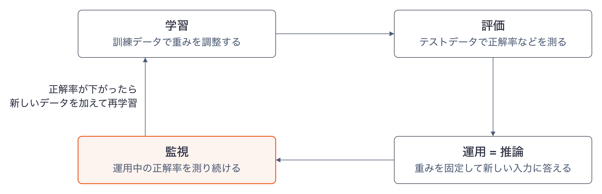
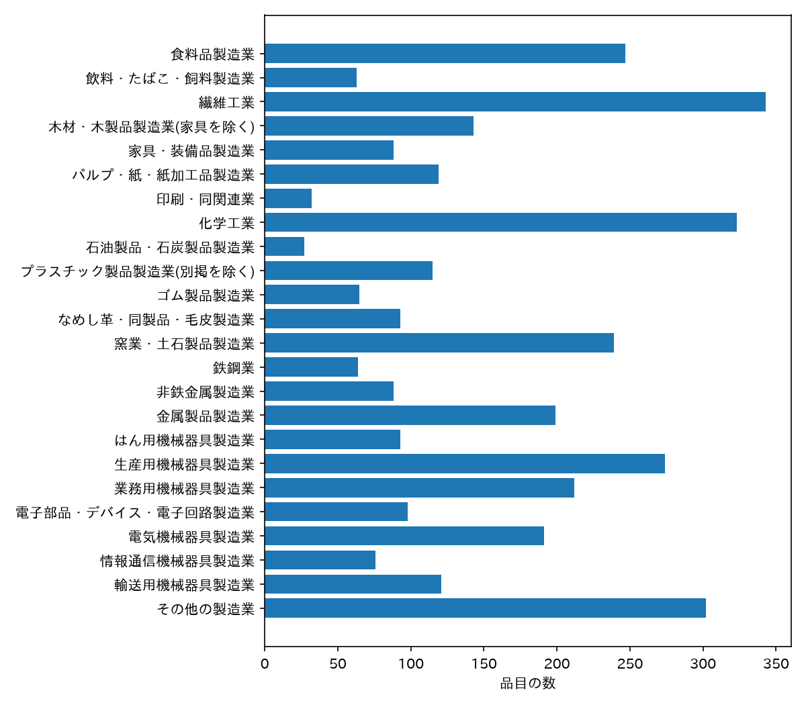
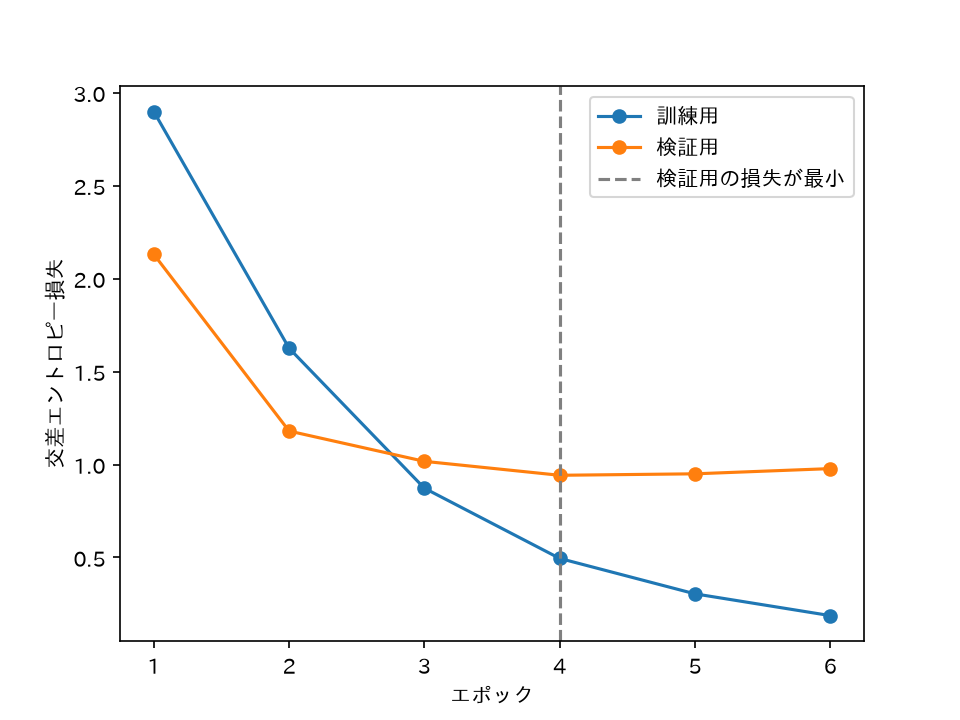
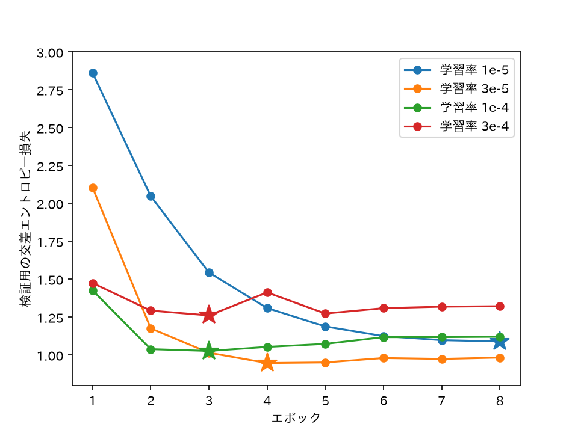
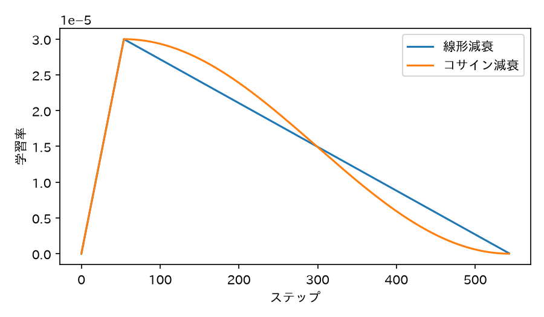
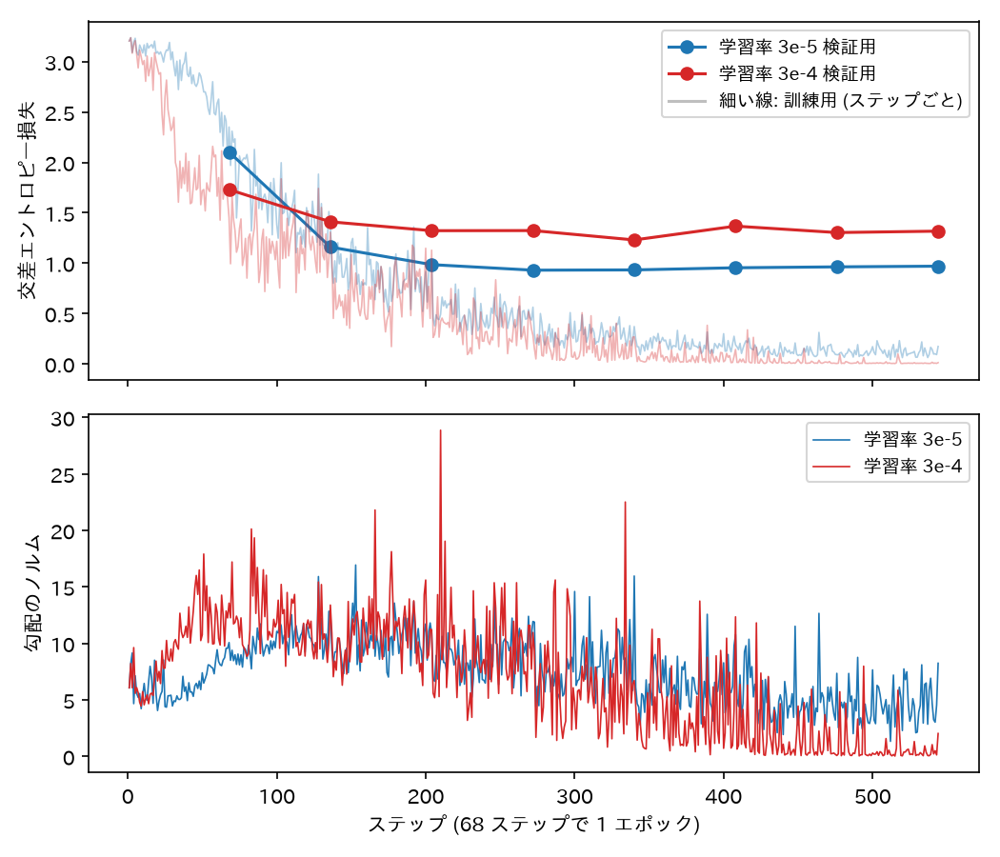

::: warn

この章は作成中です. [事例: 自然言語の Transformer を学習する](#事例-自然言語の-transformer-を学習する)の節は, 見出しと扱う内容の予定だけを載せています. それ以外の節は書き終えています.

:::

::: note

本章のうち[AI の学習と推論, 評価, 再学習](#ai-の学習と推論-評価-再学習)の節は, 第 8 回の授業で[第8章](dsp8.html)とあわせて扱います. この節は第8章までの内容で読めます. それ以外の節は授業では扱いません (発展).

:::

本章は, Transformer を学習する過程を扱う章です. [第8章](dsp8.html)では Transformer の仕組みを, [第9章](dsp9.html)では事前学習済みの BERT を使う方法を扱い, 学習の中身は扱いませんでした. 本章では, 学習と推論の区別と, 学習したモデルの評価と再学習を説明したうえで, Transformer を学習する手順を実装して実行します. 学習の手順の事例には自然言語 (文章) を使います. 最初の事例は, 製品の名前 (品目名) から, その製品を作る産業の分類を当てる多クラス分類です. 第9章の BERT を追加学習し, 学習率の選び方, 損失の推移の監視, 学習を止める時期の決め方を, 実際に学習を走らせて確かめます. 画像を扱う Vision Transformer ([第11章](dsp11.html#vision-transformer)) も, 入力をトークンの並びにする方法と学習で解かせる問題が違うだけで, 学習率の決め方や学習の監視の手順は共通です.

# 前提となる章

- [第8章](dsp8.html): [ニューラルネットワークの学習](dsp8.html#ニューラルネットワークの学習) (損失関数, 勾配降下法, 学習率, エポック, ミニバッチ), [自己注意と Transformer の構成](dsp8.html#自己注意と-transformer-の構成), [自己教師あり学習](dsp8.html#自己教師あり学習) (マスク予測と次トークン予測).
- [第9章](dsp9.html): [ニューラル言語モデル](dsp9.html#ニューラル言語モデル)としての BERT, 事前学習とファインチューニングの区別, [マルチラベル分類](dsp9.html#マルチラベル分類)でのファインチューニング. 発展の節の[生成 AI の仕組み: 事前学習と生成](dsp9.html#pretraining-and-generation)は, 本章で学習する対象の全体像にあたります.
- [第6章](dsp6.html): [訓練データとテストデータ](dsp6.html#訓練データとテストデータ)の分け方と過学習. 学習の途中経過の見方に使います.

# AI の学習と推論, 評価, 再学習

ニューラルネットワークの重みをデータから決める作業を**学習**, 学習が終わったモデルで新しい入力に答えることを**推論 (inference)** といいます. [第8章](dsp8.html)で例にした手書き数字の認識なら, 学習はたくさんの数字の画像と正解から重みを決める作業, 推論は学習済みのモデルに新しい数字の画像を入れて「これは 7」と答えさせる作業です.

| | 学習 | 推論 |
|---|---|---|
| 目的 | 重みを決める | 新しい入力に答える |
| 使うデータ | 正解付きの訓練データ | 正解の分からない新しい入力 |
| 重み | 更新する | 固定したまま使う |
| 計算 | 順伝播, 損失の計算, 逆伝播, 重みの更新を繰り返す | 順伝播を 1 回 |
| 計算量 | 大きい (大規模なモデルでは多数の GPU で数週間以上) | 小さい (1 回の入力ごとに順伝播だけ) |

推論では重みを固定しているので, 学習の後に起きたことはモデルに反映されません. 対話型の生成 AI が, 検索などの外部の仕組みを使わない限り, 学習に使ったデータより後の出来事を知らないのはこのためです.

## モデルの評価

学習したモデルを使ってよいかは, 学習に使っていないデータで確かめます. [第6章](dsp6.html)と同じく, 正解付きのデータを**訓練データ**と**テストデータ**に分け, 訓練データだけで学習し, テストデータで性能を測ります.

学習に使ったデータで性能を測らないのは, モデルが訓練データの細かい癖まで覚え込み, 新しいデータには通用しないことがあるからです. 訓練データでは正解率が高いのに, テストデータでは低くなる状態を, [第6章](dsp6.html#訓練データとテストデータ)と同じく**過学習**といいます. テストデータは, 学習の間は一度も使わずに取っておく「初めて見る問題」の役割をします.

分類の性能は, [第6章](dsp6.html#混同行列)と同じく, テストデータの正解と予測を数えた**混同行列**で確かめます. 正解のクラスを行, 予測したクラスを列にとり, 該当するデータの数を並べた表です. 手書き数字のうち「1」「4」「9」の 3 種類だけを分類するモデルを, テストデータ 300 枚で評価したとします.

| 正解 \\ 予測 | 1 | 4 | 9 |
|---|---|---|---|
| 1 | 98 | 1 | 1 |
| 4 | 1 | 90 | 9 |
| 9 | 0 | 12 | 88 |

対角線上の数が正しく分類できた枚数です. **正解率** (全体のうち正しく分類できた割合) は次のようになります.

$$
\text{正解率} = \frac{98 + 90 + 88}{300} = \frac{276}{300} = 0.92
$$

正解率だけでなく表の中身を見ると, 「4」と「9」の取り違えが誤りの大部分 (24 枚中 21 枚) を占めていると分かります. 形の似た数字の区別が, このモデルの弱点です. 回帰のモデルなら, 予測と実測の差の 2 乗の平均 ([第8章](dsp8.html)の[ニューラルネットワークの学習](dsp8.html#ニューラルネットワークの学習)の平均二乗誤差 MSE) で評価します.

## 運用中の監視と再学習

テストデータで十分な性能を確かめたモデルも, 使い続けるうちに性能が下がることがあります. 手書き数字の例で, モデルを紙の申込書に書かれた数字で学習し, テストデータでも正解率 0.92 を確かめたとします. その後, 申込みの多くがタブレットでのペン入力に変わると, 細い線や崩れた形の数字が増えます. モデルは学習したことのない書き方の数字にも答え続けますが, 誤りが増え, 正解率が例えば 0.80 まで下がります.

このように, 運用中に入ってくるデータの傾向が学習時と変わることを**データの分布の変化 (データドリフト)** といいます. 推論では重みが固定されているので, モデルが自分で新しい書き方に合わせることはありません. そこで, 次の流れで運用します.

1. **監視**: 運用中のデータの一部に正解を付け, 正解率を定期的に測ります.
2. **再学習**: 正解率が基準を下回ったら, 新しい傾向のデータ (ペン入力の数字) に正解を付けて訓練データに加え, 学習をやり直します.
3. **再評価**: 再学習したモデルを, 新しい傾向のデータを含むテストデータで評価し, 前のモデルより良いことを確かめてから入れ替えます.

再学習では, 事前学習済みのモデルを新しいデータでファインチューニングすることもよくあります. 大規模なモデルを最初から学習し直すより, 必要な計算がずっと少なくて済むからです.

この節に対応する演習は, 章末の[Exercise DSP10-1](#exercise-dsp10-1)です.

# 事例: 品目名から製造業の中分類を当てる

企業の取引記録や製品の一覧を産業ごとに集計するには, 品目の名前 (「バター」「ピアノ線」など) を, その品目を作る産業の分類に振り分ける必要があります. 品目の数が多いと人手では振り分けきれないので, 品目名を入力にして分類を答える AI を作ります. 本節では, [第9章](dsp9.html#マルチラベル分類)の日本語 BERT を追加学習 (ファインチューニング) して, 品目名から製造業の分類を当てます.

## データ: 日本標準産業分類の内容例示

**日本標準産業分類**は, 統計を産業ごとに集計するために総務省が定めた分類です. 大分類, 中分類, 小分類, 細分類の 4 段階があり, 製造業 (大分類 E) は 24 の中分類に分かれます. 総務省は分類ごとに, その分類に含まれる事業の例 (内容例示) も公開しています. 例えば細分類「伸線業」の内容例示には, 「鉄線製造業」「ピアノ線製造業」などが並んでいます.

[こちら](https://github.com/yakagika/yakagika.github.io/blob/main/slds_data/dsp10/manufacturing_items.csv)のデータは, 製造業の内容例示から事業の名前を抜き出し, 末尾の「製造業」を落として品目名にしたものです (「バター製造業」→「バター」). 1 行が 1 品目で, 3,615 品目あります. 総務省「日本標準産業分類 (令和5年7月告示) 分類項目名, 説明及び内容例示」の[製造業の資料](https://www.soumu.go.jp/main_content/000935526.pdf)を加工して作成しました. 総務省が作成したデータではありません. ダウンロードして, プログラムを置くディレクトリの `data` ディレクトリに保存してください.

| 列 | 内容 |
|:---|:---|
| `item` | 品目名 |
| `mid_code` | 中分類の番号 (09〜32) |
| `mid_name` | 中分類の名前 |
| `small_code` | 小分類の番号 (3 桁) |
| `fine_code` | 細分類の番号 (4 桁) |

本節では, `item` から `mid_name` (24 クラス) を当てます. 1 つの品目は 1 つの中分類にだけ属するので, [第9章](dsp9.html#マルチラベル分類)のマルチラベル分類と違い, 24 クラスから 1 つを選ぶ多クラス分類になります.

次のライブラリを使います. `uv add` しておいてください.

~~~ sh
uv add torch transformers fugashi unidic-lite pandas scikit-learn matplotlib matplotlib-fontja
~~~

まず, データを読み込み, 中分類ごとの品目の数を確かめます.

~~~ py
import matplotlib.pyplot as plt
import matplotlib_fontja
import pandas as pd

# 番号の先頭の 0 を残すため, すべての列を文字列として読む
df = pd.read_csv('data/manufacturing_items.csv', dtype=str)
print(df.head())
print(f'品目の数: {len(df)}')

# 中分類の番号の順に, 中分類の名前を並べる
classes = df.drop_duplicates('mid_code').sort_values('mid_code')['mid_name'].tolist()
counts = df['mid_name'].value_counts()[classes]

fig, ax = plt.subplots(figsize=(8, 7))
ax.barh(classes[::-1], counts[::-1])
ax.set_xlabel('品目の数')
fig.tight_layout()
plt.show()
plt.close(fig)

"""
    item mid_code mid_name small_code fine_code
0  ブロック肉       09   食料品製造業        091      0911
1   冷凍食肉       09   食料品製造業        091      0911
2    部分肉       09   食料品製造業        091      0911
3  ソーセージ       09   食料品製造業        091      0912
4     ハム       09   食料品製造業        091      0912
品目の数: 3615
"""
~~~

品目の数は中分類によって大きく違います. 最も多い繊維工業は 343 品目, 最も少ない石油製品・石炭製品製造業は 27 品目です. [第6章](dsp6.html#accuracy-precision-recall)で見たとおり, クラスの数に偏りがあると, Accuracy だけでは少ないクラスを見逃していても気づけません. そこで, 評価では中分類ごとの Recall も確かめます.

## モデル: BERT に softmax の出力層を付ける

モデルは[第9章](dsp9.html#マルチラベル分類)と同じ形で, BERT の出力を平均した品目名のベクトルを, 線形変換で 24 クラスのスコアに変えます. 第9章との違いは, スコアを確率に変える関数と損失関数です.

| | マルチラベル分類 ([第9章](dsp9.html#マルチラベル分類)) | 多クラス分類 (本節) |
|:---|:---|:---|
| 1 つの入力に付く正解 | 0 個以上 (ネガティブとポジティブの両方もある) | ちょうど 1 個 |
| スコアを確率に変える関数 | ラベルごとに sigmoid 関数 | 24 クラスまとめて softmax 関数 |
| 確率の合計 | 決まらない (ラベルごとに 0 から 1) | 1 |
| 損失関数 | `BCEWithLogitsLoss` | `CrossEntropyLoss` |

softmax 関数と交差エントロピー損失は, [第8章](dsp8.html#ニューラルネットワークの構成)の出力層と[ニューラルネットワークの学習](dsp8.html#ニューラルネットワークの学習)で説明したものです. PyTorch の `CrossEntropyLoss` は, 線形変換の出力 (スコア) を受け取り, 内部で softmax を計算してから交差エントロピーを求めます. そのため, モデル自体は softmax を通す前のスコアを返します.

学習の設定とモデルを用意します. 設定の値の意味は, [学習の手順を実行する](#学習の手順を実行する)で説明します.

~~~ py
import copy
import random
import time

import numpy as np
import torch
from sklearn.model_selection import train_test_split
from transformers import AutoTokenizer, BertModel, get_linear_schedule_with_warmup

# 日本語の学習済みモデル (第9章と同じ)
MODEL_NAME = 'tohoku-nlp/bert-base-japanese-whole-word-masking'

EPOCHS = 8  # 訓練データを繰り返して学習する最大の回数
PATIENCE = 2  # 検証用の損失が何エポック続けて最小を更新しなければ止めるか
MAX_LENGTH = 32  # 1 品目から読み込む最大のトークン数
LEARNING_RATE = 3e-5
WARMUP_RATIO = 0.1  # 学習率を 0 から上げていく期間 (全ステップに対する割合)
BATCH_SIZE = 32

# 使うデバイスの選択
if torch.backends.mps.is_available():
    device = torch.device('mps')  # Mac GPU
elif torch.cuda.is_available():
    device = torch.device('cuda:0')  # Win GPU
else:
    device = torch.device('cpu')  # CPU
print(f'Using device: {device}')

# 多クラス分類用のモデル
class BertForClassification(torch.nn.Module):
    def __init__(self, model_name, num_classes):
        super().__init__()
        # 学習済みの BERT を読み込む
        self.bert = BertModel.from_pretrained(model_name)
        # BERT の出力を各クラスのスコアに変える線形変換
        self.linear = torch.nn.Linear(self.bert.config.hidden_size, num_classes)

    def forward(self, input_ids, attention_mask, token_type_ids=None):
        output = self.bert(
            input_ids=input_ids,
            attention_mask=attention_mask,
            token_type_ids=token_type_ids,
        )
        # [PAD] 以外のトークンの出力を平均して, 品目名のベクトルにする
        mask = attention_mask.unsqueeze(-1)
        sentence_vector = (output.last_hidden_state * mask).sum(1) / mask.sum(1)
        return self.linear(sentence_vector)

random.seed(0)
torch.manual_seed(0)  # 線形変換の初期値を固定する
tokenizer = AutoTokenizer.from_pretrained(MODEL_NAME)
model = BertForClassification(MODEL_NAME, num_classes=len(classes)).to(device)
~~~

品目名は短く, 9 割の品目は `[CLS]` と `[SEP]` を含めて 12 トークン以下です. 最も長い品目名でも 75 トークンなので, `MAX_LENGTH` を 32 にしても切り捨てられるのは 19 品目だけです.

データを学習用 (60%), 検証用 (20%), テスト用 (20%) に分けます. [第6章](dsp6.html#訓練データとテストデータ)と同じく `train_test_split` の `stratify` を指定して, 3 つのデータで中分類の割合をそろえます. 割合をそろえないと, 27 品目しかない中分類がテスト用にほとんど入らないことがあります.

~~~ py
texts = df['item'].tolist()
labels = df['mid_name'].map({name: k for k, name in enumerate(classes)}).to_numpy()

# 学習用 (60%), 検証用 (20%), テスト用 (20%) に分ける. 中分類の割合を 3 つでそろえる
index = np.arange(len(df))
train_index, rest_index = train_test_split(
    index, test_size=0.4, stratify=labels, random_state=0
)
val_index, test_index = train_test_split(
    rest_index, test_size=0.5, stratify=labels[rest_index], random_state=0
)
train_index = list(train_index)
print(f'学習: {len(train_index)}, 検証: {len(val_index)}, テスト: {len(test_index)}')

def make_batch(batch_index):
    """品目名を BERT への入力に変え, device へ送る."""
    encoding = tokenizer(
        [texts[i] for i in batch_index],
        max_length=MAX_LENGTH,
        padding='longest',
        truncation=True,
        return_tensors='pt',
    )
    encoding = {key: value.to(device) for key, value in encoding.items()}
    y = torch.tensor(labels[batch_index]).to(device)
    return encoding, y

loss_function = torch.nn.CrossEntropyLoss()

def evaluate(data_index):
    """損失と, 予測したクラスの番号を返す."""
    model.eval()
    total_loss, predicted = 0.0, []
    with torch.no_grad():
        for i in range(0, len(data_index), 128):
            encoding, y = make_batch(data_index[i : i + 128])
            scores = model(**encoding)
            total_loss += loss_function(scores, y).item() * len(y)
            predicted += scores.argmax(dim=1).tolist()
    return total_loss / len(data_index), np.array(predicted)

"""
学習: 2169, 検証: 723, テスト: 723
"""
~~~

予測するクラスは, スコアが最大のクラス (`argmax`) です. softmax は大小の順を変えないので, 確率が最大のクラスと同じになります.

## 学習の手順を実行する

学習のループは[第9章](dsp9.html#マルチラベル分類)とほぼ同じですが, 次の 3 点を加えています.

- **AdamW**: 重みを更新する方法 (最適化手法) です. [第8章](dsp8.html#ニューラルネットワークの学習)の勾配降下法は, すべての重みを同じ学習率で動かします. 第9章で使った Adam は, 重みごとに過去の勾配の大きさを覚えておき, 勾配が大きく揺れる重みは小さく, 安定した重みは大きく動かすように更新の幅を調整します. AdamW は Adam に, 毎回の更新で重みを 0 の方へ少しだけ縮める操作 (重み減衰, weight decay) を加えたものです. 重みが極端な値になるのを防ぎ, 過学習を抑える効果があります. Transformer の学習では AdamW が標準的に使われます.
- **ウォームアップと学習率の減衰**: 学習率を一定にせず, ステップごとに変えます. 最初の 1 割のステップ (`WARMUP_RATIO`) では学習率を 0 から `LEARNING_RATE` まで少しずつ上げ (**ウォームアップ**), その後は最後のステップで 0 になるように直線的に下げます (**線形減衰**). 学習の初めは, 新しく付けた線形変換の重みがでたらめな値なので, 勾配が大きく不安定です. その段階で大きな学習率で更新すると, 事前学習で得た BERT の重みまで大きく崩れることがあります. ウォームアップは, この段階の更新を小さくするための工夫です. 学習の終わりに学習率を下げるのは, 損失の小さい所の周りで重みが行き来し続けないようにするためです. `get_linear_schedule_with_warmup` がこの学習率の変え方を作り, `scheduler.step()` を呼ぶたびに学習率を 1 ステップ分進めます.
- **早期終了 (early stopping)**: エポックごとに検証用の損失を測り, 損失が最小になったときの重みを取っておきます. 検証用の損失が `PATIENCE` エポック続けて最小を更新しなければ, それ以上学習しても過学習が進むだけと判断して学習を止め, 取っておいた重みに戻します. 何エポック学習するかを, 検証用のデータで決めることになります.

~~~ py
optimizer = torch.optim.AdamW(model.parameters(), lr=LEARNING_RATE)
total_steps = EPOCHS * ((len(train_index) + BATCH_SIZE - 1) // BATCH_SIZE)
scheduler = get_linear_schedule_with_warmup(
    optimizer,
    num_warmup_steps=int(WARMUP_RATIO * total_steps),
    num_training_steps=total_steps,
)

history = []
best_loss, best_state, best_epoch = float('inf'), None, 0
start = time.time()
for epoch in range(EPOCHS):
    model.train()
    random.shuffle(train_index)
    train_loss = 0.0
    for i in range(0, len(train_index), BATCH_SIZE):
        encoding, y = make_batch(train_index[i : i + BATCH_SIZE])
        loss = loss_function(model(**encoding), y)
        loss.backward()
        optimizer.step()
        scheduler.step()  # 学習率を 1 ステップ分変える
        optimizer.zero_grad()
        train_loss += loss.item() * len(y)
    train_loss /= len(train_index)
    val_loss, val_predicted = evaluate(val_index)
    val_accuracy = (val_predicted == labels[val_index]).mean()
    history.append((train_loss, val_loss))
    print(f'Epoch {epoch + 1}/{EPOCHS}', end=' ')
    print(f'train_loss: {train_loss:.3f} val_loss: {val_loss:.3f}', end=' ')
    print(f'val_accuracy: {val_accuracy:.3f}')
    # 検証用の損失が最小のときの重みを取っておく
    if val_loss < best_loss:
        best_loss, best_epoch = val_loss, epoch + 1
        best_state = copy.deepcopy(model.state_dict())
    elif epoch + 1 - best_epoch >= PATIENCE:
        print(f'{PATIENCE} エポック続けて検証用の損失が下がらないので止めます')
        break
print(f'学習時間: {time.time() - start:.0f} 秒')

model.load_state_dict(best_state)  # 検証用の損失が最小だったエポックの重みに戻す
print(f'{best_epoch} エポック目の重みを使います')

"""
Using device: mps
Epoch 1/8 train_loss: 2.899 val_loss: 2.131 val_accuracy: 0.368
Epoch 2/8 train_loss: 1.626 val_loss: 1.180 val_accuracy: 0.678
Epoch 3/8 train_loss: 0.873 val_loss: 1.017 val_accuracy: 0.707
Epoch 4/8 train_loss: 0.495 val_loss: 0.942 val_accuracy: 0.732
Epoch 5/8 train_loss: 0.305 val_loss: 0.950 val_accuracy: 0.739
Epoch 6/8 train_loss: 0.187 val_loss: 0.978 val_accuracy: 0.743
2 エポック続けて検証用の損失が下がらないので止めます
学習時間: 34 秒
4 エポック目の重みを使います
"""
~~~

学習の時間は, Apple M5 Max の Mac で MPS を使って 34 秒, 同じ Mac で CPU だけを使って 228 秒でした. 損失と正解率の値は, PC や環境によって少し変わります. 一般的な PC の CPU ではこれより長くかかるので, 時間がかかりすぎる場合は, 共通資料の[Google Colaboratory による GPU 計算](colab.html)の手順で Colab の GPU を使ってください.

訓練用と検証用の損失の推移を図にします.

~~~ py
fig, ax = plt.subplots()
epochs = range(1, len(history) + 1)
ax.plot(epochs, [h[0] for h in history], marker='o', label='訓練用')
ax.plot(epochs, [h[1] for h in history], marker='o', label='検証用')
ax.axvline(best_epoch, color='gray', linestyle='--', label='検証用の損失が最小')
ax.set_xlabel('エポック')
ax.set_ylabel('交差エントロピー損失')
ax.legend()
plt.show()
plt.close(fig)
~~~

訓練用の損失はエポックごとに下がり続け, 6 エポック目には 0.19 になります. 一方, 検証用の損失は 4 エポック目の 0.94 が最小で, その後は少しずつ上がります. 4 エポック目より後は, 訓練用の品目名への当てはまりだけが良くなり, 初めて見る品目名への当てはまりは良くならない状態で, [モデルの評価](#モデルの評価)で説明した過学習が始まっています. 早期終了は, この 4 エポック目の重みを選びます.

1 エポック目で訓練用の損失 (2.90) が検証用の損失 (2.13) より大きいのは, 訓練用の損失が 1 エポックの間の平均だからです. エポックの初めのでたらめな予測の損失も平均に入るので, エポックの終わりに測る検証用の損失より大きくなります. 24 クラスにでたらめな確率を付けたときの交差エントロピーは, $-\log (1/24) \approx 3.18$ です.

### 学習率を変えて比べる

`LEARNING_RATE` を 1e-5 ($10^{-5}$), 3e-5, 1e-4, 3e-4 に変えて, 検証用の損失の推移を比べました. 比べやすいように早期終了を外し, どの学習率でも 8 エポックすべて学習しています. 上の学習とは別に走らせたので, 3e-5 の値も上の出力と少し違います. 星印は, 検証用の損失が最小になったエポックです.

- **1e-5**: 損失は 8 エポック目まで下がり続け, 最小値は 1.09 です. 学習率が小さく重みの変化が遅いので, 8 エポックでは学習が終わっていません.
- **3e-5**: 4 エポック目に最小値 0.95 に達し, その後はほぼ横ばいです.
- **1e-4**: 3 エポック目に最小値 1.03 に達しますが, その後は上がっていきます. 重みの変化が速く, 早い段階で過学習が始まります.
- **3e-4**: 3 エポック目の 1.26 が最小で, それより下がりません. 学習率が大きすぎて, 事前学習で得た重みが大きく崩れたと考えられます.

この比較から, 3e-5 か 1e-4 の付近が適切な学習率だと分かります. ただし, 学習の結果は乱数の種 (線形変換の重みの初期値と, 訓練データを並べる順) によっても変わります. 3e-5 と 1e-4 で種を 3 通りに変えると, 検証用の損失の最小値は 3e-5 で 0.93〜0.98, 1e-4 で 0.97〜1.07 でした. 3e-5 の方が損失が小さく, 種による揺れも小さいので, この事例では 3e-5 を使います.

ウォームアップの有無も, 3e-5 と 1e-4 でそれぞれ種を 3 通りに変えて比べました. ウォームアップを外したときの検証用の損失の最小値は, 3e-5 で 0.94〜0.99, 1e-4 で 0.97〜1.03 で, ウォームアップを入れたときと範囲が重なります. この事例では, ウォームアップの有無による差は, 種による揺れより小さく, 効果は確かめられませんでした. 本節の追加学習は, 学習するデータが 2,169 品目と少なく, ステップの数も 1 エポックあたり 68 回と少ないためと考えられます. ウォームアップは, 大きな学習率で大量のデータを学習する事前学習で, 学習の初めに損失が発散するのを防ぐために使われてきた方法です. 本節のコードでは, Transformer の学習の標準的な書き方として入れています.

学習率のように, 学習の前に人が決める値を**ハイパーパラメータ**といいます. ハイパーパラメータは検証用のデータで比べて決め, テストデータは最後の評価にだけ使います. テストデータで比べて選ぶと, テストデータに合う値を選んだことになり, 初めて見るデータでの性能を正しく測れなくなるからです.

## テストデータでの評価

検証用の損失が最小だった重みで, テストデータを評価します. 中分類ごとの Recall は, その中分類の品目のうち, 正しくその中分類と予測できた割合です. 24 個の Recall の平均 (macro 平均) は, 品目の少ない中分類も多い中分類も同じ重みで扱うので, 少ない中分類を見逃しているかどうかが Accuracy より表れやすい指標です.

~~~ py
from sklearn.metrics import accuracy_score, confusion_matrix, recall_score

test_loss, test_predicted = evaluate(test_index)
y_test = labels[test_index]
recall = recall_score(y_test, test_predicted, average=None)  # 中分類ごとの Recall
print(f'Accuracy: {accuracy_score(y_test, test_predicted):.3f}')
print(f'Recall の平均: {recall.mean():.3f}')
# Recall の低い中分類を 5 つ表示する
for k in np.argsort(recall)[:5]:
    print(f'{recall[k]:.2f} {classes[k]} ({(y_test == k).sum()} 品目)')
~~~

テストデータでの Accuracy は 0.732, Recall の平均は 0.699 で, Recall の平均の方が低くなりました. Recall の低い 5 つの中分類は次のとおりです.

| 中分類 | テスト用の品目の数 | Recall |
|:---|---:|---:|
| 家具・装備品製造業 | 18 | 0.50 |
| 石油製品・石炭製品製造業 | 6 | 0.50 |
| 飲料・たばこ・飼料製造業 | 13 | 0.54 |
| 鉄鋼業 | 13 | 0.54 |
| ゴム製品製造業 | 13 | 0.54 |

Recall の低い中分類は, 石油製品・石炭製品製造業 (テスト用に 6 品目) や鉄鋼業 (13 品目) のように, 品目の少ないものが並びます. 学習に使える例が少ないクラスほど, 予測が難しくなります. ただし, テスト用の品目が 6〜18 しかないので, 1 品目の当たり外れで Recall が 0.05〜0.17 変わります. 品目の少ない中分類の Recall は, 細かい値の差を比べるのでなく, 目安として読みます.

次に, [モデルの評価](#モデルの評価)と同じく混同行列を作り, 取り違えの多い組を調べます. 24 × 24 の表は見渡しにくいので, 対角線の外 (誤り) の数が多い組を 6 つ表示します.

~~~ py
matrix = confusion_matrix(y_test, test_predicted)  # 行が正解, 列が予測
pairs = []
for i in range(len(classes)):
    for j in range(len(classes)):
        if i != j and matrix[i, j] > 0:
            pairs.append((matrix[i, j], classes[i], classes[j]))
for n, true_name, predicted_name in sorted(pairs, reverse=True)[:6]:
    print(f'{n} 件: 正解 {true_name} → 予測 {predicted_name}')
~~~

| 正解 | 予測 | 件数 |
|:---|:---|---:|
| 家具・装備品製造業 | その他の製造業 | 5 |
| 化学工業 | 食料品製造業 | 5 |
| 電気機械器具製造業 | 情報通信機械器具製造業 | 4 |
| 金属製品製造業 | その他の製造業 | 4 |
| 繊維工業 | その他の製造業 | 4 |
| 窯業・土石製品製造業 | その他の製造業 | 4 |

6 組のうち 4 組は, 予測が「その他の製造業」です. その他の製造業は, 貴金属製品, 時計, 楽器, がん具, 事務用品, 生活雑貨のほか, 他の中分類に入らない品目を集めた分類なので, 品目の種類がばらばらです. そのため, ほかの中分類の品目のうち典型から外れたものが, この分類と予測されやすいと考えられます.

最後に, 誤分類した品目の例を見ます.

~~~ py
wrong = [
    (texts[i], classes[t], classes[p])
    for i, t, p in zip(test_index, y_test, test_predicted)
    if t != p
]
print(f'誤り: {len(wrong)} / {len(test_index)}')
random.seed(1)
for item, true_name, predicted_name in random.sample(wrong, 8):
    print(f'{item}: 正解 {true_name}, 予測 {predicted_name}')
~~~

テスト用の 723 品目のうち, 誤分類は 194 品目でした. そこから選んだ 8 品目は次のとおりです.

| 品目名 | 正解 | 予測 |
|:---|:---|:---|
| 魔法瓶 | その他の製造業 | 窯業・土石製品製造業 |
| 自動入場機 | 業務用機械器具製造業 | 情報通信機械器具製造業 |
| ルームユニット | その他の製造業 | 家具・装備品製造業 |
| 鉄線 | 鉄鋼業 | 金属製品製造業 |
| 大豆グルー | 化学工業 | 食料品製造業 |
| びょうぶ | 家具・装備品製造業 | その他の製造業 |
| エアコンユニット | 電子部品・デバイス・電子回路製造業 | はん用機械器具製造業 |
| 真珠核 | その他の製造業 | 窯業・土石製品製造業 |

誤りの中には, 品目名だけでは正しい分類を決められないものが含まれます. 産業分類は, 品目が何であるかだけでなく, 何を材料にどの工程で作るかで分類を分けているからです.

- **鉄線**: 線材 (鋼を細長く延ばした素材) から線を引いて鉄線を作る事業 (伸線業) は鉄鋼業です. 一方, 他から受け入れた鉄線で作るビニル被覆鉄線や有刺鉄線は金属製品製造業です. くぎも, 線材から一貫して作るもの (「くぎ (線材から一貫作業によるもの)」) は鉄鋼業, 受け入れた鉄線から作るもの (「鉄くぎ (受け入れた鉄線によるもの)」) は金属製品製造業に分かれます. 品目名「鉄線」だけでは, 鉄鋼業の製品なのか, 金属製品の材料なのかが決まりません. モデルは金属製品製造業を選びました.
- **大豆グルー**: グルーは接着剤のことで, 接着剤の製造は化学工業です. モデルは「大豆」から食料品製造業を選びました. 用途を表す語 (グルー) より, 材料を表す語 (大豆) に引きずられた誤りです.
- **魔法瓶**: 魔法瓶は生活雑貨としてその他の製造業に入りますが, 魔法瓶の中のガラス製の瓶は窯業・土石製品製造業, 電子式の保温ジャーは電気機械器具製造業です. 同じ「魔法瓶」の周りの品目が, 材料と仕組みで 3 つの中分類に分かれています.

研究や実務で品目を分類するときは, 品目名に加えて, 材料や工程が分かる情報 (製品の説明文, 売り手の業種など) を入力に加えると, この種の誤りを減らせます.

### 新しい品目を分類する

学習したモデルで, データにない品目名を分類します. softmax で 24 クラスの確率を求め, 確率の高い 3 つを表示します.

~~~ py
items = ['ノンアルコールビール', 'スマートフォン', '電動アシスト自転車', '猫用おもちゃ', '木製まな板']
encoding = tokenizer(
    items, max_length=MAX_LENGTH, padding='longest', truncation=True, return_tensors='pt'
)
encoding = {key: value.to(device) for key, value in encoding.items()}
model.eval()
with torch.no_grad():
    probability = torch.softmax(model(**encoding), dim=1).cpu().numpy()
for item, p in zip(items, probability):
    top = np.argsort(p)[::-1][:3]  # 確率の高い 3 つのクラス
    print(item, ' / '.join(f'{classes[k]} {p[k]:.2f}' for k in top))
~~~

結果は次のとおりです. 括弧の中は確率です.

| 品目名 | 1 位 | 2 位 | 3 位 |
|:---|:---|:---|:---|
| ノンアルコールビール | 飲料・たばこ・飼料製造業 (0.67) | 化学工業 (0.18) | 食料品製造業 (0.04) |
| スマートフォン | 情報通信機械器具製造業 (0.72) | 電気機械器具製造業 (0.11) | その他の製造業 (0.05) |
| 電動アシスト自転車 | 輸送用機械器具製造業 (0.54) | 電気機械器具製造業 (0.22) | はん用機械器具製造業 (0.14) |
| 猫用おもちゃ | その他の製造業 (0.96) | 化学工業 (0.01) | 木材・木製品製造業(家具を除く) (0.01) |
| 木製まな板 | 木材・木製品製造業(家具を除く) (0.78) | 家具・装備品製造業 (0.17) | その他の製造業 (0.02) |

5 品目とも, 確率が最も高いクラスはもっともらしい中分類です. 確率の大きさにも情報があります. 猫用おもちゃには 0.96 を付けていますが, 電動アシスト自転車は輸送用機械器具製造業に 0.54, 電気機械器具製造業に 0.22 と分かれています. 実務では, 最も高い確率が基準 (例えば 0.5) を下回る品目だけを人が確かめるようにすると, 確かめる手間を減らせます.

## 発展: 追加学習しない分類と比べる

[第9章](dsp9.html#自然言語ベクトル抽出によるデータ可視化と類似度評価)では, BERT が出力するベクトルの cosine 類似度で文の近さを測りました. 追加学習をしなくても, このベクトルで分類できるかを確かめます. 次の 2 つの方法を比べます. どちらも重みは更新しません.

1. **中分類の名前と比べる**: 品目名と 24 個の中分類の名前をそれぞれベクトルにし, cosine 類似度が最も大きい中分類を予測とします. 訓練データを使いません.
2. **訓練データの平均と比べる**: 訓練用の品目名のベクトルを中分類ごとに平均し, その平均との cosine 類似度が最も大きい中分類を予測とします.

前の節までのコードを実行したあとに, 続けて実行します. `MODEL_NAME`, `MAX_LENGTH`, `device`, `tokenizer`, `texts`, `labels`, `classes`, `train_index`, `test_index`, `y_test` をそのまま使います.

~~~ py
# 追加学習していない BERT
bert = BertModel.from_pretrained(MODEL_NAME).to(device)
bert.eval()

def embed(strings):
    """文字列ごとに, [PAD] 以外のトークンの出力の平均を長さ 1 にしたベクトルを返す."""
    vectors = []
    with torch.no_grad():
        for i in range(0, len(strings), 128):
            encoding = tokenizer(
                strings[i : i + 128],
                max_length=MAX_LENGTH,
                padding='longest',
                truncation=True,
                return_tensors='pt',
            )
            encoding = {key: value.to(device) for key, value in encoding.items()}
            hidden = bert(**encoding).last_hidden_state
            mask = encoding['attention_mask'].unsqueeze(-1)
            vectors.append(((hidden * mask).sum(1) / mask.sum(1)).cpu().numpy())
    vectors = np.concatenate(vectors)
    return vectors / np.linalg.norm(vectors, axis=1, keepdims=True)

item_vectors = embed(texts)

# (1) 中分類の名前のベクトルと比べる
class_vectors = embed(classes)
predicted = (item_vectors[test_index] @ class_vectors.T).argmax(axis=1)
print('中分類の名前', end=' ')
print(f'Accuracy: {accuracy_score(y_test, predicted):.3f}', end=' ')
print(f'Recall の平均: {recall_score(y_test, predicted, average=None).mean():.3f}')

# (2) 訓練データの品目のベクトルを中分類ごとに平均したものと比べる
train_labels = labels[train_index]
class_vectors = np.stack(
    [item_vectors[train_index][train_labels == k].mean(axis=0) for k in range(len(classes))]
)
class_vectors /= np.linalg.norm(class_vectors, axis=1, keepdims=True)
predicted = (item_vectors[test_index] @ class_vectors.T).argmax(axis=1)
print('訓練データの平均', end=' ')
print(f'Accuracy: {accuracy_score(y_test, predicted):.3f}', end=' ')
print(f'Recall の平均: {recall_score(y_test, predicted, average=None).mean():.3f}')
~~~

ベクトルを長さ 1 にそろえておくと, 内積 (`@`) がそのまま cosine 類似度になります. 2 つの方法の結果を, 追加学習の結果と並べます.

| 方法 | 重みの更新 | 訓練データ | Accuracy | Recall の平均 |
|:---|:---|:---|---:|---:|
| 中分類の名前と比べる | なし | 使わない | 0.160 | 0.197 |
| 訓練データの平均と比べる | なし | 使う | 0.516 | 0.544 |
| 追加学習 (本節) | あり | 使う | 0.732 | 0.699 |

中分類の名前と比べる方法は, 24 クラスなのででたらめに選んだとき (約 0.04) よりは当たりますが, Accuracy は 0.16 にとどまります. 事前学習した BERT のベクトルは, 文の中での語の使われ方を予測するために作られたもので, 「バター」と「食料品製造業」が近くなるようには作られていないからです. 訓練データの平均と比べると 0.52 まで上がり, 重みを更新する追加学習で 0.73 まで上がります. 品目と中分類の対応をデータから学ぶほど, 分類が正確になります.

品目の少ない中分類に限って Recall を比べると, 訓練データの平均と比べる方法が追加学習を上回る中分類もあります. 例えば印刷・同関連業 (全体で 32 品目) では, 学習率 3e-5 で種とウォームアップの有無を変えた追加学習 6 回のどれでも, 平均と比べる方法の Recall (0.86) が追加学習 (0.71) を上回りました. ただし, この差はテスト用の 7 品目のうち 1 品目の違いです. 鉄鋼業やゴム製品製造業では, どちらが上回るかが種によって入れ替わりました. 平均と比べる方法は, 品目の数によらず 1 つの中分類を 1 つの平均ベクトルで表すので, 品目の多い中分類に予測が偏りにくい性質があります. 品目の少ない中分類での性能をこれ以上比べるには, テスト用の品目の数が足りません.

# Transformer の学習の手順

[事例: 品目名から製造業の中分類を当てる](#事例-品目名から製造業の中分類を当てる)では, 交差エントロピー損失, AdamW, ウォームアップと線形減衰, 損失の推移の監視と早期終了を使って BERT を追加学習しました. 本節では, これらを事前学習を含む Transformer の学習一般に広げて説明します. 本節のコードは, 品目名の事例のコードを実行したあとに続けて実行する前提です.

## 学習の目的関数

学習で小さくする関数を**目的関数**といいます. Transformer の学習では, 事前学習でも追加学習でも, 目的関数は予測した確率に対する交差エントロピー損失です. 違うのは, 1 つの文から作る問題の数と, クラスの数と, 正解の作り方です.

品目名の事例では, 1 つの品目名から「24 の中分類のどれか」を当てる問題を 1 つ作り, 正解の中分類に付けた確率 $p$ から損失 $-\log p$ を求めました. [第8章](dsp8.html#自己教師あり学習)の次トークン予測では, 文のトークンの並び $x_1, x_2, \dots, x_n$ の各位置で, それまでのトークンから次のトークンを当てる問題を作ります. クラスは語彙 (モデルが扱うトークンの一覧) のすべてのトークンです. 1 つの文から $n-1$ 個の問題ができるので, 損失はその平均です.

$$
L = -\frac{1}{n-1} \sum_{t=1}^{n-1} \log p(x_{t+1} \mid x_1, \dots, x_t)
$$

$p(x_{t+1} \mid x_1, \dots, x_t)$ は, $x_1$ から $x_t$ までを読んだモデルが, 実際の次のトークン $x_{t+1}$ に付けた確率です. マスク予測では, `[MASK]` に置き換えた位置だけで, 元のトークンに付けた確率の対数を平均します.

| | 追加学習 (品目名の事例) | 事前学習 (次トークン予測) | 事前学習 (マスク予測) |
|:---|:---|:---|:---|
| 1 つの文から作る問題の数 | 1 | トークンの数 - 1 | `[MASK]` にしたトークンの数 |
| クラスの数 | 24 | 語彙の大きさ (第9章の BERT では 32,000) | 語彙の大きさ |
| 正解 | 人が付けた中分類 | 文の次のトークン | 隠した元のトークン |

事前学習は正解を文そのものから作るので, 人が正解を付けなくても大量の文章で学習できます. 追加学習には人が付けた正解が必要ですが, 事前学習で語の使われ方を学んだ重みから始めるので, 品目名の事例のように 2,000 件程度の例でも学習できます.

## 学習率とスケジューラ

学習率をステップごとに変える仕組みを**スケジューラ**といいます. 品目名の事例では, ウォームアップの後に学習率を直線的に下げる線形減衰を使いました. 事前学習では, **コサイン減衰**もよく使われます. ウォームアップが終わったステップを $t_w$, 最後のステップを $T$, 学習率の最大値を $\eta_{\max}$ とすると, ステップ $t$ の学習率 $\eta_t$ は次の式で決まります.

$$
\eta_t = \frac{\eta_{\max}}{2} \left( 1 + \cos \left( \pi \frac{t - t_w}{T - t_w} \right) \right)
$$

$t = t_w$ で $\cos 0 = 1$ なので $\eta_t = \eta_{\max}$, $t = T$ で $\cos \pi = -1$ なので $\eta_t = 0$ になります. 品目名の事例と同じ 544 ステップ (8 エポック) で, 2 つの減衰の仕方を比べます.

~~~ py
from transformers import get_cosine_schedule_with_warmup

def learning_rates(make_scheduler, total_steps=544):
    """スケジューラを total_steps 回進め, 各ステップの学習率を返す."""
    parameter = torch.nn.Parameter(torch.zeros(1))  # 学習率の変化を見るためだけの重み
    optimizer = torch.optim.AdamW([parameter], lr=LEARNING_RATE)
    scheduler = make_scheduler(optimizer, int(WARMUP_RATIO * total_steps), total_steps)
    rates = []
    for _ in range(total_steps):
        rates.append(scheduler.get_last_lr()[0])
        optimizer.step()
        scheduler.step()
    return rates

fig, ax = plt.subplots(figsize=(6, 3.5))
ax.plot(learning_rates(get_linear_schedule_with_warmup), label='線形減衰')
ax.plot(learning_rates(get_cosine_schedule_with_warmup), label='コサイン減衰')
ax.set_xlabel('ステップ')
ax.set_ylabel('学習率')
ax.legend()
fig.tight_layout()
plt.show()
plt.close(fig)
~~~

コサイン減衰は, ウォームアップの直後は線形減衰よりゆっくり下がり, 大きな学習率を長く保ちます. 終わりに近づくと線形減衰より速く下がり, 最後は 0 になだらかに近づきます. どちらが良いかは問題によって変わるので, 学習率の値と同じく, 検証用のデータで比べて選びます. [事例: 自然言語の Transformer を学習する](#事例-自然言語の-transformer-を学習する)では, コサイン減衰を使います.

### 勾配のクリッピング

学習の途中で, あるバッチの勾配だけが急に大きくなることがあります. その勾配でそのまま更新すると, 重みが一度に大きく動き, 損失が跳ね上がって元に戻らなくなることがあります. これを学習の**発散**といいます. **勾配のクリッピング (gradient clipping)** は, 発散を防ぐための方法です. すべての重みの勾配を並べて 1 つのベクトルとみなし, その長さ (**勾配のノルム**) が上限 $c$ を超えたときは, 向きを変えずに長さを $c$ まで縮めます. 勾配のベクトルを $g$, その長さを $\|g\|$ とすると, 次の式になります.

$$
g \leftarrow g \cdot \min \left( 1, \frac{c}{\|g\|} \right)
$$

PyTorch では, `loss.backward()` と `optimizer.step()` の間に 1 行加えます. 上限には 1.0 がよく使われます.

~~~ py
loss.backward()
norm = torch.nn.utils.clip_grad_norm_(model.parameters(), max_norm=1.0)
optimizer.step()
~~~

`clip_grad_norm_` は, 縮める前の勾配のノルムを返します. この値は[学習の監視](#学習の監視)にも使います.

### バッチサイズと勾配の蓄積

1 回の更新に使う例の数 (バッチサイズ) を大きくすると, 勾配の平均をとる例が増えるので, 勾配の揺れが小さくなります. その代わり, 1 回の順伝播と逆伝播で一度に計算する量が増え, 必要なメモリも増えます. メモリが足りず大きなバッチを一度に計算できないときは, **勾配の蓄積 (gradient accumulation)** を使います. 小さなバッチで逆伝播を何回か行って勾配を足し合わせ, 決めた回数ごとに 1 回だけ重みを更新する方法です.

PyTorch では, `loss.backward()` を呼ぶたびに, 各重みの勾配が前の値に足されます. `optimizer.zero_grad()` を呼ぶまで勾配は消えないので, 勾配の蓄積は次のように書けます. 損失を `ACCUMULATION` で割るのは, 足し合わせた勾配を, 大きなバッチ全体の損失の平均に対する勾配に合わせるためです.

~~~ py
ACCUMULATION = 4  # 何回分の勾配を足してから更新するか
SMALL_BATCH_SIZE = BATCH_SIZE // ACCUMULATION  # 一度に計算する数 (32 / 4 = 8)

for step, i in enumerate(range(0, len(train_index), SMALL_BATCH_SIZE)):
    encoding, y = make_batch(train_index[i : i + SMALL_BATCH_SIZE])
    loss = loss_function(model(**encoding), y) / ACCUMULATION
    loss.backward()  # 勾配は前の値に足される
    if (step + 1) % ACCUMULATION == 0:
        optimizer.step()  # 4 回分の勾配で 1 回だけ更新する
        scheduler.step()
        optimizer.zero_grad()
~~~

ドロップアウトを外した状態 (`model.eval()`) で, 32 個の品目名の勾配を一度に求めた場合と, 8 個ずつ 4 回に分けて足し合わせた場合を比べると, 勾配の値の最大は 8.37, 2 つの差の最大は $9.5 \times 10^{-7}$ でした. 差は計算の丸めの誤差の大きさで, 2 つの方法は同じ勾配を求めています. 学習の途中ではドロップアウトの乱数が変わるので, 結果は完全には一致しません.

## 学習の監視

品目名の事例では, エポックごとに訓練用と検証用の損失を記録しました. 学習が長くなるほど, エポックの途中で起きた問題に早く気づく必要があります. そこで, ステップごとの訓練用の損失と勾配のノルムも記録します. 品目名の事例の学習のループで, `loss.backward()` の後を次のように書き換えます. 上限を無限大 (`float('inf')`) にすると, 勾配を縮めずにノルムだけを測れます.

~~~ py
step_history = []  # ステップごとの (訓練用の損失, 勾配のノルム)

# 学習のループの中で, loss.backward() の後に次を加える
norm = torch.nn.utils.clip_grad_norm_(model.parameters(), max_norm=float('inf'))
step_history.append((loss.item(), norm.item()))
~~~

次の図は, 品目名の事例で学習率を 3e-5 と 3e-4 にして, 早期終了をせずに 8 エポック学習したときの記録です. 細い線がステップごとの訓練用の損失, 丸がエポックの終わりの検証用の損失です.

学習率 3e-4 では, 最初のエポックで損失が 3e-5 より速く下がり, 1 エポック目の検証用の損失も 3e-5 より小さくなります (3e-4 が 1.73, 3e-5 が 2.10). しかし, 検証用の損失はその後 1.2〜1.4 で止まり, 訓練用の損失だけが 0.01 まで下がります. 勾配のノルムも 3e-5 より大きく揺れ, 最大は 28.9 です (3e-5 は 16.9). 学習率 3e-4 に上限 1.0 の勾配のクリッピングを加えても, 検証用の損失の最小は 1.24 で, クリッピングなし (1.23) と変わりませんでした. この学習率で起きているのは発散ではないからです. 訓練用の損失は下がり続けており, 大きな学習率で重みが大きく動いたため, 事前学習で得た語の使われ方が崩れ, 訓練用の品目名だけに合わせた状態になったと考えられます. 対処は学習率を下げることです.

監視の記録に表れる症状と, 考えられる原因と対処を表にまとめます.

| 症状 | 考えられる原因 | 対処 |
|:---|:---|:---|
| 訓練用の損失が急に跳ね上がり, 元に戻らない. 損失が `nan` (計算できない値) になる | 学習率が大きい. あるバッチの勾配が急に大きくなった | 学習率を下げる. ウォームアップを長くする. 勾配のクリッピング |
| 訓練用の損失は下がるのに, 検証用の損失が早い段階で下がらなくなる | 学習率が大きい. 過学習 | 学習率を下げる. 早期終了 |
| 訓練用の損失も検証用の損失もゆっくりしか下がらない | 学習率が小さい. 学習が短い | 学習率を上げる. エポックを増やす |

### チェックポイントの保存と再開

品目名の事例では, 検証用の損失が最小のときの重みをメモリ上に取っておきました. 学習が長くなると, 途中で PC が止まったり, Colab の接続が切れたりすることがあります. そこで, 学習の途中の状態を**チェックポイント**としてファイルに保存しておき, 止まったときはそこから再開します. 再開するには, モデルの重みだけでなく, AdamW が重みごとに覚えている過去の勾配の情報と, スケジューラが進めたステップの数も必要です.

~~~ py
# 保存する (例えば, エポックの終わりごとに)
torch.save(
    {
        'epoch': epoch + 1,
        'model': model.state_dict(),
        'optimizer': optimizer.state_dict(),
        'scheduler': scheduler.state_dict(),
    },
    'checkpoint.pt',
)

# 再開する (モデル, optimizer, scheduler を同じ設定で作り直した後に)
checkpoint = torch.load('checkpoint.pt')
model.load_state_dict(checkpoint['model'])
optimizer.load_state_dict(checkpoint['optimizer'])
scheduler.load_state_dict(checkpoint['scheduler'])
start_epoch = checkpoint['epoch']  # for epoch in range(start_epoch, EPOCHS): で続ける
~~~

## 計算量とモデルの規模

### 自己注意の計算量

[第8章](dsp8.html#自己注意と-transformer-の構成)の自己注意では, 系列のトークンのすべての組について注意の重みを計算します. 系列の長さを $n$ とすると, 注意の重みは $n \times n$ の表になるので, 計算量と必要なメモリは $n^2$ に比例します. 一方, 各トークンに同じ変換を施す全結合層の計算量は $n$ に比例します. BERT base と同じ大きさ (ベクトルの次元 768, ヘッド 12 個) で, 系列の長さを変えて計算時間を測ります.

~~~ py
import time

torch.manual_seed(0)
torch.set_num_threads(4)  # 測るたびに使う CPU の数が変わらないように固定する

D_MODEL, N_HEADS = 768, 12  # BERT base と同じ大きさ
D_HEAD = D_MODEL // N_HEADS
ffn = torch.nn.Sequential(  # Transformer の全結合層 (768 → 3072 → 768)
    torch.nn.Linear(D_MODEL, 4 * D_MODEL), torch.nn.GELU(), torch.nn.Linear(4 * D_MODEL, D_MODEL)
)

def attention(q, k, v):
    """ヘッドごとに softmax(QK^T / sqrt(d)) V を計算する."""
    scores = q @ k.transpose(-2, -1) / D_HEAD**0.5  # (ヘッド, n, n) の注意の重み
    return torch.softmax(scores, dim=-1) @ v

def measure(f, *args, repeat=5):
    """f を repeat 回実行し, かかった時間の中央値 (ミリ秒) を返す."""
    times = []
    for _ in range(repeat):
        start = time.perf_counter()
        f(*args)
        times.append((time.perf_counter() - start) * 1000)
    return sorted(times)[repeat // 2]

with torch.no_grad():
    for n in [256, 512, 1024, 2048, 4096]:
        x = torch.randn(n, D_MODEL)
        q, k, v = (torch.randn(N_HEADS, n, D_HEAD) for _ in range(3))
        t_attention = measure(attention, q, k, v)
        t_ffn = measure(ffn, x)
        memory = N_HEADS * n * n * 4 / 2**20  # 注意の重みの表 (32 ビットの数) の大きさ
        print(f'n={n:5d}  自己注意 {t_attention:7.1f} ms  全結合層 {t_ffn:6.1f} ms  注意の重み {memory:6.0f} MB')
~~~

Apple M5 Max の Mac の CPU で測った結果は次のとおりです.

| 系列の長さ $n$ | 自己注意 | 全結合層 | 注意の重みの表の大きさ |
|---:|---:|---:|---:|
| 256 | 7.3 ミリ秒 | 24.4 ミリ秒 | 3 MB |
| 512 | 12.1 ミリ秒 | 34.7 ミリ秒 | 12 MB |
| 1,024 | 37.6 ミリ秒 | 60.4 ミリ秒 | 48 MB |
| 2,048 | 131.9 ミリ秒 | 108.4 ミリ秒 | 192 MB |
| 4,096 | 515.6 ミリ秒 | 206.6 ミリ秒 | 768 MB |

系列の長さが 2 倍になると, 長い系列では, 自己注意の時間はおよそ 4 倍 (2,048 から 4,096 で 3.9 倍), 全結合層の時間はおよそ 2 倍 (1.9 倍) になります. 短い系列では全結合層の方が時間がかかりますが, 2,048 で逆転します. 注意の重みの表は, 1 つの層の 1 つの文だけで, 4,096 トークンでは 768 MB になります. BERT が読める長さを 512 トークンまでにしているのも, 計算量とメモリを抑えるためです. 長い文書を扱うモデルでは, 注意を計算するトークンの組を減らす方法や, 表をメモリに一度に置かずに計算する方法が使われています.

### パラメータ数と必要なメモリ

第9章の BERT のパラメータ (重み) の数は約 1.1 億 (110,617,344) です. 1 つの重みを 32 ビット (4 バイト) の浮動小数点数で持つと, 重みだけで約 0.44 GB になります. 学習では, 重みと同じ数の勾配と, AdamW が重みごとに覚えておく 2 つの値 (過去の勾配の平均と, 勾配の 2 乗の平均) も必要です.

| 学習で必要なもの | 1 つの重みあたり | BERT base 全体 |
|:---|---:|---:|
| 重み | 4 バイト | 0.44 GB |
| 勾配 | 4 バイト | 0.44 GB |
| AdamW の 2 つの値 | 8 バイト | 0.88 GB |
| 合計 | 16 バイト | 1.77 GB |

これに加えて, 逆伝播のために順伝播の途中の値 (各層の出力や注意の重み) を保存しておくメモリが, バッチサイズと系列の長さに比例して必要になります. 推論では勾配と AdamW の値は要らないので, 重みの 0.44 GB と途中の値だけで済みます. [AI の学習と推論, 評価, 再学習](#ai-の学習と推論-評価-再学習)で, 学習の計算量が推論よりずっと大きいと説明したのは, このためです.

**混合精度 (mixed precision)** による学習は, 順伝播と逆伝播の計算の多くを 16 ビットの浮動小数点数で行い, メモリと計算時間を減らす方法です. 16 ビットの数は 32 ビットの数の半分のメモリで済み, 対応した GPU では計算も速くなります. 16 ビットの数は表せる桁数が少ないので, 重みの更新は 32 ビットのまま行います. PyTorch では, 順伝播と損失の計算を `torch.autocast` の中に書きます. `bfloat16` は, 表せる値の範囲が 32 ビットの数と同じ 16 ビットの形式です.

~~~ py
with torch.autocast(device_type=device.type, dtype=torch.bfloat16):
    loss = loss_function(model(**encoding), y)
loss.backward()  # 逆伝播と重みの更新は autocast の外で行う
optimizer.step()
~~~

品目名の事例の 1 エポックの学習時間は, Apple M5 Max の Mac の MPS で, 32 ビットの 9.1 秒に対し, 混合精度で 6.2 秒でした (それぞれ 2 回目の計測). 1 回目の計測では準備の時間が入り, 混合精度の方が遅くなりました. 速くなるかどうかは GPU によるので, 使う環境で確かめてから使います.

### モデルの大きさ, データの量, 計算量

言語モデルでは, モデルを大きくするほど, 学習に使うデータを増やすほど, 学習に使う計算量を増やすほど, 交差エントロピー損失が下がることが知られています. Kaplan らは, 損失がモデルの大きさ, データの量, 計算量のそれぞれのべき乗 (累乗) に従って下がる関係を, 多数の言語モデルを学習して確かめました ([Kaplan et al., 2020](https://arxiv.org/abs/2001.08361)). この関係を**スケーリング則**といいます.

使える計算量が決まっているときに, モデルの大きさとデータの量をどう配分すればよいかを調べたのが Hoffmann らです ([Hoffmann et al., 2022](https://arxiv.org/abs/2203.15556)). 400 以上のモデルを学習した結果, モデルの大きさを 2 倍にするなら, 学習に使うトークンの数も 2 倍にするのがよいと報告しました. 当時の大きな言語モデルの多くは, 約 3,000 億トークンで学習されていました. 例えば Gopher は 2,800 億パラメータを 3,000 億トークンで学習しています. これに対し, 同じ程度の計算量で 700 億パラメータのモデル (Chinchilla) を 1.4 兆トークンで学習すると, Gopher より高い性能が得られました. 1 パラメータあたり 20 トークンほどです.

この比で考えると, 1.1 億パラメータの BERT base には約 22 億トークンの文章が必要です. 本章の事例で扱う文章はこれよりずっと少ないので, 大規模なモデルを一から学習するには足りません. そのため, [事例: 自然言語の Transformer を学習する](#事例-自然言語の-transformer-を学習する)では数百万パラメータの小さなモデルを一から学習し, 実務では事前学習済みのモデルを追加学習して使います.

## 事前学習済みモデルの追加学習

品目名の事例では, BERT のすべての重みと, 出力の線形変換を更新しました. 本節では, 更新する範囲, 元の能力への影響, 訓練データの量を変えて, 追加学習の性質を確かめます.

### 追加学習で元の能力が失われる

追加学習では, 品目名を分類しやすいように BERT の重みも変わります. その結果, 事前学習で身に付けたマスク予測の能力がどう変わるかを確かめます. 事前学習済みの BERT にマスク予測の出力層を付けたモデル (`BertForMaskedLM`) を読み込み, `[MASK]` に入るトークンの候補を表示します. 次に, その BERT の部分を, 品目名の事例で追加学習した重みに入れ替えて, 同じ文で比べます. 出力層は事前学習のときのままです.

~~~ py
from transformers import BertForMaskedLM

mlm = BertForMaskedLM.from_pretrained(MODEL_NAME).to(device)
mlm.eval()

def fill_mask(sentence, top=5):
    """[MASK] の位置に入るトークンの候補を, 確率の高い順に返す."""
    encoding = tokenizer(sentence, return_tensors='pt').to(device)
    position = (encoding['input_ids'][0] == tokenizer.mask_token_id).nonzero()[0, 0]
    with torch.no_grad():
        probability = torch.softmax(mlm(**encoding).logits[0, position], dim=-1)
    best = probability.topk(top)
    return [
        (tokenizer.convert_ids_to_tokens(int(i)), round(float(p), 2))
        for p, i in zip(best.values, best.indices)
    ]

sentences = ['東京は日本の[MASK]です。', '私は毎朝[MASK]を飲みます。']
for sentence in sentences:
    print(sentence, fill_mask(sentence))

# BERT の部分を, 品目名の事例で追加学習した重みに入れ替える
mlm.bert.load_state_dict(model.bert.state_dict(), strict=False)
for sentence in sentences:
    print(sentence, fill_mask(sentence))
~~~

`strict=False` は, 品目名のモデルにだけある重み (`[CLS]` の出力を変換する層) を無視して読み込む指定です. 結果は次のとおりです. 括弧の中は確率です.

| 文 | 追加学習の前 | 追加学習の後 |
|:---|:---|:---|
| `東京は日本の[MASK]です。` | 地名 (0.16), 首都 (0.14), 中学校 (0.08), 大学 (0.07), 小学校 (0.06) | 小学校 (0.44), 中学校 (0.14), 首都 (0.06), 大学 (0.05), 都 (0.03) |
| `私は毎朝[MASK]を飲みます。` | コーヒー (0.35), 酒 (0.16), ビール (0.11), ワイン (0.08), お茶 (0.06) | `[UNK]` (0.12), `、` (0.11), お (0.05), コーヒー (0.04), 水 (0.03) |

追加学習の前は, 2 つの文とも文脈に合う語が上位に並びます. 追加学習の後は, 「飲みます」の前に入る語の候補に, 未知のトークン `[UNK]` や読点が上位に来ます. 品目名の分類に合わせて重みが動いたため, 事前学習で身に付けた語の予測の能力の一部が失われたのです. この現象を**破滅的忘却 (catastrophic forgetting)** といいます.

2 文だけでなく, 後の事例で使う夏目漱石の『こころ』の 300 行で, 15% のトークンを `[MASK]` にしてマスク予測の損失を測りました. 追加学習の前は 2.68, 追加学習の後は 2.92〜2.97 でした (種を 3 通りに変えた範囲). 1 つの課題に合わせて追加学習したモデルは, 別の課題では事前学習済みのモデルより性能が下がることがあります. 別の課題に使うときは, 元の事前学習済みのモデルから追加学習をやり直します.

### 更新する範囲を変える

BERT の重みの一部を固定し (更新しないようにし), 残りだけを学習することもできます. 固定する重みは `requires_grad` を `False` にして, 勾配を計算しないようにします. 次のコードは, BERT の 12 層のうち上位 2 層と出力の線形変換だけを学習する設定です.

~~~ py
model = BertForClassification(MODEL_NAME, num_classes=len(classes)).to(device)
model.bert.set_attn_implementation('eager')  # 重みを固定した層でもドロップアウトを使えるようにする

# BERT の重みをすべて固定する
for parameter in model.bert.parameters():
    parameter.requires_grad = False
# 上位 2 層だけ固定を外す (線形変換だけを学習するときは, この 3 行を消す)
for layer in model.bert.encoder.layer[-2:]:
    for parameter in layer.parameters():
        parameter.requires_grad = True

n_trainable = sum(p.numel() for p in model.parameters() if p.requires_grad)
n_total = sum(p.numel() for p in model.parameters())
print(f'学習する重み: {n_trainable:,} / {n_total:,}')

# 固定していない重みだけを AdamW に渡す
optimizer = torch.optim.AdamW(
    [p for p in model.parameters() if p.requires_grad], lr=LEARNING_RATE
)

"""
学習する重み: 14,194,200 / 110,635,800
"""
~~~

2 行目の `set_attn_implementation('eager')` は, 注意の計算を PyTorch の基本的な演算で行う指定です. これがないと, MPS では, 重みを固定した層でドロップアウトを使う計算がエラーになる場合があります. この後の学習のループ (スケジューラの作成を含む) は, 品目名の事例と同じです.

更新する範囲を 3 通りに変え, それぞれ学習率を検証用の損失で選んで比べました. 線形変換だけを学習する場合は, 更新する重みが少なく学習が進みにくいので, `EPOCHS` を 20 にしています. 時間を公平に比べるため, 3 通りとも `set_attn_implementation('eager')` を指定しました. 種を 3 通りに変えた範囲を示します.

| 更新する範囲 | 学習する重み | 学習率 | 1 エポックの時間 | 検証用の損失 | Accuracy | Recall の平均 | マスク予測の損失 |
|:---|---:|---:|---:|---:|---:|---:|---:|
| 全部 | 110,635,800 | 3e-5 | 10〜11 秒 | 0.93〜0.99 | 0.72〜0.76 | 0.69〜0.75 | 2.92〜2.97 |
| 上位 2 層と線形変換 | 14,194,200 | 1e-4 | 6〜7 秒 | 1.01〜1.03 | 0.72〜0.74 | 0.70〜0.72 | 3.07〜3.09 |
| 線形変換だけ | 18,456 | 3e-3 | 5 秒 | 1.17〜1.19 | 0.65〜0.67 | 0.64〜0.66 | 2.68 |

学習率の候補は, 上位 2 層では 3e-5, 1e-4, 3e-4, 線形変換だけでは 1e-3, 3e-3, 1e-2 で, 検証用の損失が最も小さいものを選びました. 更新する範囲が狭いほど, 大きな学習率が合います.

- **上位 2 層と線形変換**: 学習する重みは全体の 13% ですが, Accuracy と Recall の平均は全部を更新した場合と重なる範囲に入ります. 1 エポックの時間は 6 割ほどです. 逆伝播で下位の 10 層の勾配を計算しなくて済むからです. 一方, マスク予測の損失は, 全部を更新した場合より大きくなりました. マスク予測の出力層が読むのは最上位の層の出力なので, 上位の層だけを大きな学習率で動かすと, その出力が大きく変わるためと考えられます.
- **線形変換だけ**: BERT の重みは変わらないので, マスク予測の損失も変わりません. Accuracy は 0.65〜0.67 で, BERT を更新する場合より低くなります. それでも, [発展: 追加学習しない分類と比べる](#発展-追加学習しない分類と比べる)で訓練データの平均と比べた方法 (0.52) よりは高くなります.

元の能力を保つことを重視するなら一部だけを更新し, 課題の性能を重視するなら全部を更新する, というように目的に合わせて選びます. 大規模な言語モデルでは, 全部を更新するとメモリが足りないことが多いので, 一部の重みだけを更新する方法が広く使われています.

### 訓練データの量を変える

訓練データの量を変えると, 性能がどう変わるかを確かめます. 学習用のデータから, 中分類の割合をそろえて 10% と 30% を抜き出します.

~~~ py
FRACTION = 0.1  # 学習用のデータのうち使う割合
train_index, _ = train_test_split(
    train_index, train_size=FRACTION, stratify=labels[train_index], random_state=0
)
train_index = list(train_index)
~~~

データを減らすと, 1 エポックのステップの数も減ります. 8 エポックでは学習が足りなかったので, `EPOCHS` を 10% では 50, 30% では 30 にし, 早期終了で止めました. 検証用とテスト用のデータは同じです. 全部を更新し, 種を 3 通りに変えた範囲を示します.

| 訓練データ | 品目の数 | Accuracy | Recall の平均 |
|:---|---:|---:|---:|
| 10% | 216 | 0.47〜0.49 | 0.39〜0.42 |
| 30% | 650 | 0.64〜0.65 | 0.59〜0.62 |
| 100% | 2,169 | 0.72〜0.76 | 0.69〜0.75 |

10% の 216 品目は, 1 つの中分類あたり 9 品目ほどです. この量では, 学習を長くしても Accuracy は 0.5 に届きません. Recall の平均はさらに低く, 品目の少ない中分類はほとんど当たらなくなります. [第9章](dsp9.html#マルチラベル分類)の感情の分類では, 640 文で正解率 0.73〜0.75, 1,929 文で 0.87 でした. ただし, 第9章は 3 つのラベルの分類で, 24 クラスの品目名の分類とは課題の難しさが違うので, 数字をそのまま比べることはできません. 追加学習に必要なデータの量は, 課題ごとに, データの量を変えて確かめます.

# 事例: 自然言語の Transformer を学習する

## 文章を数値の列にする: トークナイザ

- トークンの単位: 単語, 文字, サブワード
- サブワードの分割方法: BPE, WordPiece, SentencePiece (Unigram)
- 語彙の大きさと, 日本語の分割の難しさ ([第9章](dsp9.html#トークン化と形態素解析)の形態素解析との違い)
- 特別なトークン (`[MASK]`, `[CLS]` など)
- 学習用のデータでトークナイザ自体を学習する手順

## 文章の事前学習で解かせる問題

- マスク予測 (masked language modeling): BERT の事前学習
- 次トークン予測 (自己回帰): GPT などの事前学習
- 評価指標としてのパープレキシティ (検証データでの値の推移を学習の監視に使う)
- 事前学習に使うコーパスの集め方と前処理 (重複の除去など)

## 小さな Transformer を一から学習する

- モデルの構成要素の実装: 埋め込み層, 位置エンコーディング, 自己注意, マルチヘッド注意, 全結合層, 残差接続, 層正規化
- 次トークン予測用の因果マスク
- 小さなコーパスで学習し, 損失が下がる様子を確認する
- 学習したモデルで文章を生成する (貪欲法, 温度, サンプリングの方法)

# 演習

### Exercise DSP10-1

**学習と推論, 評価, 再学習**

対応する節: [AI の学習と推論, 評価, 再学習](#ai-の学習と推論-評価-再学習)

1. 次の (a) から (d) を, 「学習」と「推論」に分けてください.
    - (a) 手書き数字の画像 6 万枚と正解から, 重みを決める.
    - (b) 郵便物に書かれた数字をカメラで読み取り, 学習済みのモデルで数字を答える.
    - (c) 大量の文章で次トークン予測の問題を解かせ, 重みを更新する.
    - (d) 対話型の生成 AI に質問を入力し, 回答を得る.
2. 訓練データでの正解率は 0.99 なのに, テストデータでの正解率は 0.70 でした. この状態を何といいますか. また, テストデータを学習に使わない理由を答えてください.
3. 本文の混同行列で, 正解率 0.92 だけからは分からず, 表の中身から分かることを答えてください.
4. 運用を始めて半年後, 手書き数字のモデルの正解率が 0.92 から 0.80 に下がりました. 考えられる原因と, 取るべき対応の流れを答えてください.

    
 回答例 

1. 学習は (a) と (c), 推論は (b) と (d) です. 重みを更新するのが学習, 重みを固定したまま新しい入力に答えるのが推論です.
2. 過学習です. テストデータは, モデルが初めて見るデータでどれだけ正しく答えられるかを測るために取っておくものです. 学習に使うと, モデルがテストデータの癖まで覚え込み, 新しいデータでの性能より高い値が出るので, 性能を正しく測れなくなります.
3. 誤りの大部分が「4」と「9」の取り違えであることです. 同じ正解率 0.92 でも, 誤りが特定のクラスの組に集中しているのか, 全体に散らばっているのかは表を見ないと分かりません.
4. 運用中に入ってくる数字の書き方が, 学習時と変わった (データの分布の変化) ことが考えられます. 運用中のデータの一部に正解を付けて正解率を監視し, 新しい書き方のデータを訓練データに加えて再学習します. 再学習したモデルは, 新しい書き方のデータを含むテストデータで前のモデルより良いことを確かめてから入れ替えます.

### Exercise DSP10-2

**学習率を変えて検証用の損失を比べる**

対応する節: [学習の手順を実行する](#学習の手順を実行する), [学習率を変えて比べる](#学習率を変えて比べる)

[事例: 品目名から製造業の中分類を当てる](#事例-品目名から製造業の中分類を当てる)のプログラムで, `LEARNING_RATE` を 1e-5 と 1e-4 に変えて学習し, 次の問いに答えてください. 提出ファイルは `dsp10-2.py` です.

1. それぞれの学習率で, 検証用の損失が最小になったエポックと, その値を答えてください.
2. それぞれの学習率で, 早期終了が働いたかどうかを答えてください. 働かなかった場合, 学習を続ければ検証用の損失はさらに下がると考えられますか. 理由とあわせて答えてください.
3. 本文の 3e-5 と比べて, どの学習率を使うのがよいかを, 検証用の損失をもとに答えてください. また, テストデータの Accuracy で学習率を選ばない理由を答えてください.

    
 回答例 

`LEARNING_RATE` の行だけを書き換えて実行します. Apple M5 Max の Mac (MPS) では次のようになりました. 値は PC や環境によって少し変わります.

~~~ py
LEARNING_RATE = 1e-5  # 1e-4 も同じように試す

"""
1e-5 の場合
Epoch 1/8 train_loss: 3.067 val_loss: 2.861 val_accuracy: 0.199
Epoch 2/8 train_loss: 2.568 val_loss: 2.051 val_accuracy: 0.433
Epoch 3/8 train_loss: 1.852 val_loss: 1.547 val_accuracy: 0.539
Epoch 4/8 train_loss: 1.434 val_loss: 1.309 val_accuracy: 0.632
Epoch 5/8 train_loss: 1.166 val_loss: 1.191 val_accuracy: 0.668
Epoch 6/8 train_loss: 1.007 val_loss: 1.127 val_accuracy: 0.687
Epoch 7/8 train_loss: 0.926 val_loss: 1.100 val_accuracy: 0.696
Epoch 8/8 train_loss: 0.869 val_loss: 1.091 val_accuracy: 0.697
学習時間: 39 秒
8 エポック目の重みを使います

1e-4 の場合
Epoch 1/8 train_loss: 2.500 val_loss: 1.427 val_accuracy: 0.588
Epoch 2/8 train_loss: 1.059 val_loss: 1.039 val_accuracy: 0.707
Epoch 3/8 train_loss: 0.370 val_loss: 1.030 val_accuracy: 0.726
Epoch 4/8 train_loss: 0.135 val_loss: 1.065 val_accuracy: 0.741
Epoch 5/8 train_loss: 0.052 val_loss: 1.072 val_accuracy: 0.752
2 エポック続けて検証用の損失が下がらないので止めます
学習時間: 26 秒
3 エポック目の重みを使います
"""
~~~

1. 1e-5 では 8 エポック目の 1.09, 1e-4 では 3 エポック目の 1.03 が最小でした.
2. 1e-4 では, 3 エポック目の後 2 エポック続けて損失が最小を更新しなかったので, 5 エポック目で止まりました. 1e-5 では, 損失が 8 エポック目まで毎回下がったので, 早期終了は働かず `EPOCHS` の回数だけ学習しました. 8 エポック目でもまだ下がっているので, `EPOCHS` を増やせば損失はさらに下がると考えられます. ただし, 学習率の減衰は `EPOCHS` から計算した全ステップで 0 になるように決まるので, `EPOCHS` を変えると学習率の変え方も変わります.
3. 検証用の損失の最小値は, 3e-5 が 0.94, 1e-4 が 1.03, 1e-5 が 1.09 なので, 3e-5 を使います. テストデータは, 選んだモデルが初めて見るデータでどれだけ正しく答えられるかを最後に測るために取っておくものです. テストデータの Accuracy で学習率を選ぶと, テストデータに合う学習率を選んだことになり, Accuracy が初めて見るデータでの性能より高く出るので, 性能を正しく測れなくなります.

### Exercise DSP10-3

**誤分類の原因を調べる**

対応する節: [テストデータでの評価](#テストデータでの評価)

1. 本文の評価では, Accuracy (0.732) より Recall の平均 (0.699) の方が低くなりました. 2 つの指標がどう違うかをもとに, この理由を答えてください.
2. 本文の誤分類の例から, 「自動入場機」と「エアコンユニット」を選び, [製造業の内容例示](https://www.soumu.go.jp/main_content/000935526.pdf)でそれぞれの細分類 (番号はデータの `fine_code` の列にあります) の説明を読んでください. 品目名だけで正しい中分類を決められるかを考え, 誤りの原因を答えてください.
3. 自分で学習したモデルの誤分類の例を 10 個表示し, (a) 品目名だけでは正しい中分類を決められないもの, (b) 品目名から決められるのにモデルが誤ったもの, に分けてください. (a) の誤りを減らすには, 入力にどのような情報を加えればよいかを答えてください.

    
 回答例 

1. Accuracy は全品目のうち正しく分類できた割合なので, 品目の多い中分類の結果が大きく効きます. Recall の平均は, 24 個の中分類の Recall を同じ重みで平均するので, 品目の少ない中分類の結果も同じだけ効きます. 本文の結果では, Recall の低い中分類 (石油製品・石炭製品製造業, 鉄鋼業など) に品目の少ないものが多く, 品目の多い繊維工業や食料品製造業の Recall は高かったので, Recall の平均の方が低くなりました.
2. 自動入場機は細分類 2729 (その他のサービス用・娯楽用機械器具製造業) で, 自動改札機や両替機と同じく, サービス業で使う機械として業務用機械器具製造業に入ります. モデルは情報通信機械器具製造業を選びました. 品目名からは, 入場を管理する装置が電子的な通信を行う機器 (情報通信機械器具) なのか, サービス用の機械なのかを見分けられません. エアコンユニットは細分類 2851 (電源ユニット・高周波ユニット・コントロールユニット製造業) で, 他の機器に組み込む電子回路の部品 (ユニット) として電子部品・デバイス・電子回路製造業に入ります. モデルは, 冷凍機や空調装置を含むはん用機械器具製造業を選びました. 「エアコン」という語から空調装置そのものと読んだためで, 品目名だけでは, 装置全体を作るのか, 装置に組み込む電子部品を作るのかが決まりません.
3. **(回答: 個別解説)** 分け方の例: 「鉄線」「魔法瓶」のように, 同じ名前の品目が材料や工程で別の中分類に分かれるものは (a) です. (a) の誤りを減らすには, 製品の説明文 (材料, 用途, 製法), 売り手の業種, 取引の相手など, 材料や工程が分かる情報を入力に加えます.

