# クラスタリングとパターン発見

[第6章](dsp6.html)では, 正解ラベルの付いたデータから予測規則を学ぶ教師あり学習を扱いました. 本章では正解ラベルを使わずにデータの構造を見つける教師なし学習のうち, 似たデータをまとめる**クラスタリング**, 多数の項目を少数の項目にまとめる**次元削減**, 同時に起こりやすい項目の組を見つける**アソシエーション分析**を扱います. 本章では, 1 つの購買記録を, 見る単位を変えながらそれぞれの手法に適用します (発展の節の一部では, 生成したデータも使います).

::: warn
本章では次のライブラリを使います. `uv add` しておいてください.

~~~ sh
uv add pandas matplotlib matplotlib-fontja scikit-learn scipy mlxtend
~~~

:::

# 例題のデータ: 大学の売店の購買記録

[こちら](https://github.com/yakagika/yakagika.github.io/blob/main/slds_data/dsp7/store_log.csv)のデータは, [第6章](dsp6.html)で会員の退会を予測した大学の売店の, 1 学期分 (4 月から 7 月) の会員の購買記録です (練習用に作成した架空のデータです). 第6章のデータは, この記録を会員ごとに集計したものでした. 1 行がレシート 1 枚に載った 1 品目を表します.

| 列 | 内容 |
|---|---|
| `receipt_id` | レシート番号 (1 回の買い物ごとに 1 つ) |
| `member_id` | 会員番号 |
| `date`, `time` | 買い物をした日付と時刻 |
| `item` | 品目 (弁当, おにぎり, コーヒー, ノートなど 15 種類) |
| `category` | 品目のカテゴリ (食事, 飲料, 菓子, 文具) |
| `price` | 価格 (円) |

~~~ py
import pandas as pd

log = pd.read_csv('data/store_log.csv', encoding='utf-8-sig')
print(log.head())
"""
   receipt_id  member_id        date   time  item category  price
0           1       1056  2026-04-13  11:02    お茶       飲料    130
1           1       1056  2026-04-13  11:02    弁当       食事    500
2           2       1065  2026-04-13  11:11  ジュース       飲料    140
3           2       1065  2026-04-13  11:11    弁当       食事    500
4           3       1041  2026-04-13  11:13  おにぎり       食事    150
"""
print(len(log), log['receipt_id'].nunique(), log['member_id'].nunique())
"""
12640 5877 200
"""
~~~

200 人の会員が 5877 回の買い物をし, 合わせて 12640 行の記録があります.

この記録は, 見る単位を変えると 2 通りの分析に使えます.

- **会員単位**: 会員ごとに記録を集計すると, 「この会員はどれくらいの頻度で来て, 1 回にいくら使うか」という数値の組になります. 何を買うか (品目ごとの購入額の割合) も加えられます. 似た買い方をする会員をまとめるのがクラスタリングです ([クラスタリング](#クラスタリング)).
- **レシート単位**: レシートごとに品目をまとめると, 1 回の買い物で一緒に買われた品目の集合になります. 一緒に買われやすい品目の組を見つけるのがアソシエーション分析です ([パターン発見: アソシエーション分析](#パターン発見-アソシエーション分析)).

## 会員ごとの集計

会員ごとに, 来店回数 (レシートの枚数) と 1 回あたりの購入額を求めます. `groupby` で会員ごとにまとめ, `nunique()` で重複を除いたレシート番号の数を数えます. 1 回あたりの購入額は, 価格の合計を来店回数で割って求めます.

~~~ py
g = log.groupby('member_id')
member = pd.DataFrame({
    'visits': g['receipt_id'].nunique(),                               # 来店回数
    'amount_per_visit': g['price'].sum() / g['receipt_id'].nunique(),  # 1回あたりの購入額
})
print(member.head().round(1))
"""
           visits  amount_per_visit
member_id
1001           27             468.5
1002           38             438.4
1003           32             451.2
1004           32             415.0
1005           28             440.4
"""
~~~

来店回数と 1 回あたりの購入額の散布図を描いてみます.

~~~ py
import matplotlib.pyplot as plt
import matplotlib_fontja

plt.scatter(member['visits'], member['amount_per_visit'], s=15)
plt.xlabel('来店回数')
plt.ylabel('1 回あたりの購入額 (円)')
plt.show()
plt.close()
~~~

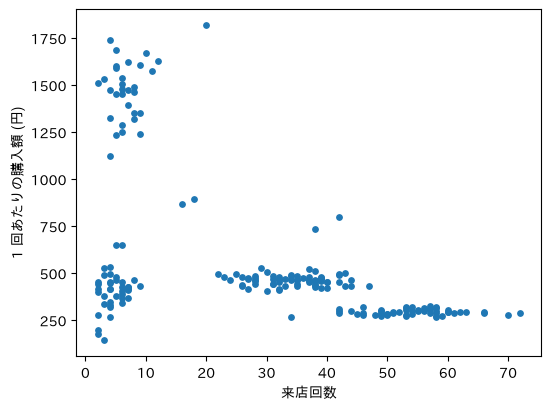

散布図には, 点が密に集まった塊がいくつか見えます. 来店回数が少なく 1 回に 1500 円前後を使う会員, 来店回数が少なく 1 回あたり 400 円前後の会員, 30 回前後来て 1 回あたり 450 円前後の会員, 50 回以上来て 1 回あたり 300 円前後の会員です. 塊のどれにも入らない位置にも, 数人の会員がいます. 項目が 2 つなら塊を目で数えられますが, 項目が増えると散布図には描けないので, 塊を計算で求める手法が要ります.

# クラスタリング

観測対象を, 互いに似たもの同士が同じグループに入るように分ける手法を**クラスタリング**といい, 分けられた各グループを**クラスタ**といいます.

クラスタリングと[第6章](dsp6.html)の分類は, どちらもデータをグループに分けます. 違いは正解の有無です. 分類では正解ラベルの付いたデータから分け方の規則を学び, 正解率で評価できます. クラスタリングには正解ラベルがありません. そのため, 何をもって「似ている」とするか, いくつのクラスタに分けるかを分析者が決め, 得られたクラスタが何を表すかも分析者が解釈します. 売店の会員にも「昼食を買う会員」のような正解ラベルは付いていません.

「似ている」の尺度には, [第4章](dsp4.html#距離と類似度)の「距離と類似度」で扱ったユークリッド距離を使います. 来店回数 (回) と購入額 (円) は単位も散らばりも違うので, 第4章と同じく標準化してから距離を計算します.

~~~ py
# 項目ごとに標準化する (平均0, 標準偏差1)
z = (member - member.mean()) / member.std(ddof=0)
~~~

クラスタリングの手法は, 大きく 2 種類に分かれます.

- **非階層クラスタリング**: クラスタの数を先に決め, データをその数のクラスタに分割します. 代表例は k-means 法です.
- **階層クラスタリング**: 近いデータ同士を順に併合していき, 併合の過程を樹形図として得ます. クラスタの数は樹形図を見てから決めます.

## 非階層クラスタリング: k-means 法

**k-means 法**は, クラスタの数 $K$ を決めたうえで, 各データを最も近い**重心** (クラスタに属するデータの平均の位置) のクラスタに割り当てる手法です. 重心は割り当てが決まらないと計算できず, 割り当ては重心が決まらないと決められません. そこで, 次の手順で両者を交互に更新します.

1. $K$ 個の重心の初期値を置きます.
2. 各データを, 最も近い重心のクラスタに割り当てます.
3. 各クラスタに属するデータの平均を計算し, 新しい重心とします.
4. 割り当てが変わらなくなるまで, 2 と 3 を繰り返します.

次の図は, 標準化した会員のデータに $K = 4$ で k-means 法を適用したときの途中経過です. 赤い × が重心, 点の色が割り当てられたクラスタを表します. 初期値では重心が塊から外れていますが, 更新のたびに重心が塊の中心へ移ります. 4 回目の更新では, 4 つの重心がそれぞれ 1 つの塊の中心に来ています.

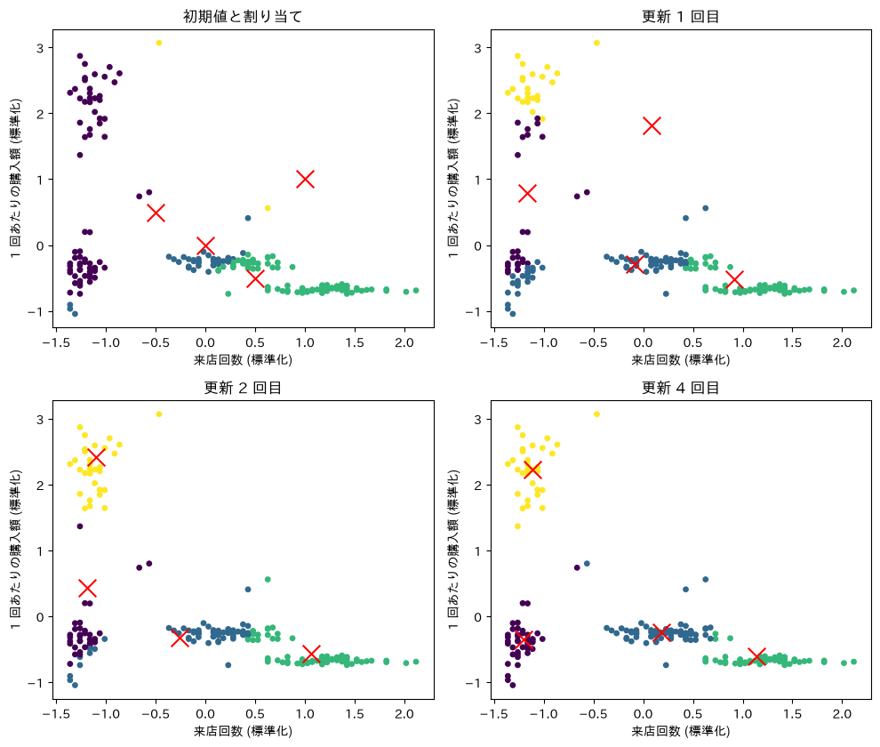

k-means 法は, 各データと所属クラスタの重心との距離の 2 乗の総和 (**クラスタ内誤差平方和**) を小さくする手法です. クラスタ $c$ に属するデータの集合を $C_c$, その重心を $\boldsymbol{\mu}_c$ とすると, クラスタ内誤差平方和は次の式で表されます.

$$ W = \sum_{c=1}^{K} \sum_{i \in C_c} d(\boldsymbol{x}_i, \boldsymbol{\mu}_c)^2 $$

手順 2 (最も近い重心への割り当て) も手順 3 (平均への重心の移動) も $W$ を増やさないので, 更新を繰り返すと $W$ はいずれ減らなくなり, 割り当てが止まります.

### scikit-learn による k-means 法

`scikit-learn` の `KMeans` で, 標準化した会員のデータを 4 つのクラスタに分けます.

~~~ py
from sklearn.cluster import KMeans

# クラスタ数4, 初期値を変えて10回実行し最良の結果を採用する
km = KMeans(n_clusters=4, random_state=0, n_init=10)
member['cluster'] = km.fit_predict(z)  # 各会員のクラスタ番号

print(member['cluster'].value_counts().sort_index())
"""
cluster
0    52
1    31
2    42
3    75
"""
# クラスタごとに, もとの単位での平均を求める
print(member.groupby('cluster')[['visits', 'amount_per_visit']].mean().round(1))
"""
         visits  amount_per_visit
cluster
0          54.8             296.9
1           6.9            1476.9
2           5.2             427.6
3          34.6             461.2
"""

plt.scatter(member['visits'], member['amount_per_visit'], c=member['cluster'], cmap='viridis', s=15)
plt.xlabel('来店回数')
plt.ylabel('1 回あたりの購入額 (円)')
plt.show()
plt.close()
~~~

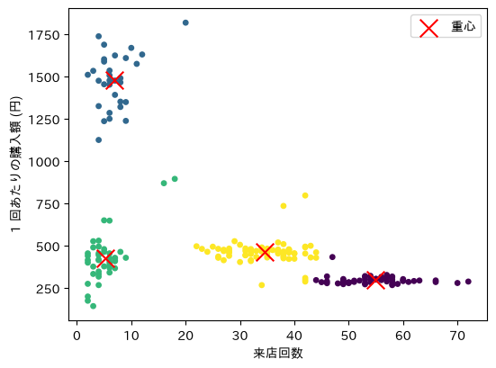

k-means 法は, 散布図で見えた 4 つの塊をそれぞれ 1 つのクラスタとして取り出しました. 塊から離れた数人の会員も, いずれかのクラスタに割り当てられています. k-means 法では, どのデータも必ずどれか 1 つのクラスタに属します.

クラスタ番号はクラスタを区別する記号にすぎず, 番号の大小に意味はありません. 実行する環境によって番号が入れ替わることもあるので, 番号ではなくクラスタの平均を見て, どのクラスタかを判断してください.

クラスタが何を表すかは, 集計に使わなかった情報も合わせて見ると分かりやすくなります. 会員ごとに, 購入額のうち各カテゴリが占める割合を求め, クラスタごとに平均します.

~~~ py
# 会員×カテゴリの購入額の表を作り, 行の合計で割って割合にする
share = log.pivot_table(index='member_id', columns='category', values='price',
                        aggfunc='sum', fill_value=0)
share = share.div(share.sum(axis=1), axis=0)
print(share.join(member['cluster']).groupby('cluster').mean().round(2))
"""
category    文具    菓子    食事    飲料
cluster
0        0.00  0.40  0.07  0.53
1        0.15  0.12  0.55  0.19
2        0.85  0.00  0.02  0.13
3        0.00  0.04  0.73  0.23
"""
~~~

`pivot_table` は, 行 (`index`) と列 (`columns`) に指定した項目の組み合わせごとに値を集計し, 表の形に並べるメソッドです. 2 つの表を合わせると, 4 つのクラスタに次のような名前を付けられます.

| クラスタ | 来店回数 | 1 回あたりの購入額 | 多いカテゴリ | 名前 |
|---|---|---|---|---|
| 0 | 約 55 回 | 約 300 円 | 飲料, 菓子 | カフェ利用の会員 |
| 1 | 約 7 回 | 約 1480 円 | 全カテゴリ | まとめ買いの会員 |
| 2 | 約 5 回 | 約 430 円 | 文具 | 文具を買う会員 |
| 3 | 約 35 回 | 約 460 円 | 食事 | 昼食を買う会員 |

名前はデータが付けたものではなく, 分析者が平均を読んで付けたものです. このように, クラスタごとの特徴を言葉にするところまでが, クラスタリングによる分析です.

### 初期値への依存

k-means 法の結果は重心の初期値に左右されます. 次の図は, `n_init=1` (初期値を 1 通りだけ試す) で, 別の乱数から初期値を選んだときの結果です. 昼食の会員とカフェ利用の会員が 1 つのクラスタにまとめられ, 塊から離れた 2 人の会員だけの小さなクラスタができています.

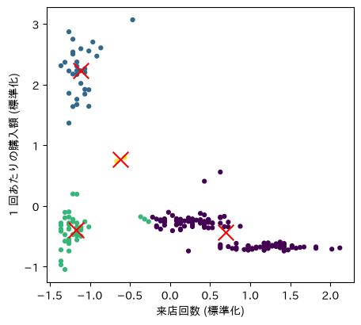

この状態でも, どのデータも最も近い重心に割り当てられているので, 手順 2 と 3 を繰り返しても変化しません. クラスタ内誤差平方和は 56.7 で, 先ほどの結果 (24.7) の 2 倍以上あります. k-means 法の更新は $W$ を減らす方向にしか進まないので, 最初に悪い位置から始めると, より良い分け方があっても抜け出せません.

`KMeans` の `n_init=10` は, 初期値を変えて 10 回実行し, クラスタ内誤差平方和が最も小さい結果を採用する指定です. `random_state=0` は初期値の乱数を固定し, 何度実行しても同じ結果が得られるようにする指定です.

この節に対応する演習は, 章末の[Exercise DSP7-1](#exercise-dsp7-1)と[Exercise DSP7-3](#exercise-dsp7-3)です.

## 次元削減: 主成分分析 {#pca}

ここまでのクラスタリングには, 来店回数と 1 回あたりの購入額の 2 項目だけを使いました. 購買記録には, 会員が何を買ったか (15 品目) も記録されています. 品目ごとの購入額の割合を加えると, 会員 1 人を 17 項目で表せます.

~~~ py
# 会員×品目の購入額の表を作り, 行の合計で割って割合にする
item_share = log.pivot_table(index='member_id', columns='item', values='price',
                             aggfunc='sum', fill_value=0)
item_share = item_share.div(item_share.sum(axis=1), axis=0)

# 来店回数と1回あたりの購入額に, 15品目の割合を横に並べる
feat = member[['visits', 'amount_per_visit']].join(item_share)
print(feat.shape)
"""
(200, 17)
"""
z17 = (feat - feat.mean()) / feat.std(ddof=0)  # 項目ごとに標準化する
~~~

17 項目の散布図は描けません. 2 項目ずつの散布図なら描けますが, 組み合わせは 136 通りあり, どの組み合わせの図にも全体の構造が現れるとは限りません. そこで, 多数の項目が持つ情報をできるだけ失わずに, 少数の項目にまとめます. データを表す項目の数を**次元**といい, 次元を減らす手法を**次元削減**といいます. 次元削減の代表的な手法が**主成分分析 (PCA: Principal Component Analysis)** です.

### 主成分分析の考え方

2 項目のデータで考えます. 次の図の (a) は, 標準化した 2 つの変数 $x, y$ の散布図です. 点は右上がりの直線の周りに集まっています. 点のばらつき (分散) が最も大きい方向を**第 1 主成分**といい, 図の赤い直線がその方向です. 各点から赤い直線へ垂線を下ろし, 垂線の足の位置 (原点からの符号付きの距離) だけを残すと, (b) のように各点を 1 つの数値で表せます. この数値を**主成分得点**といいます.

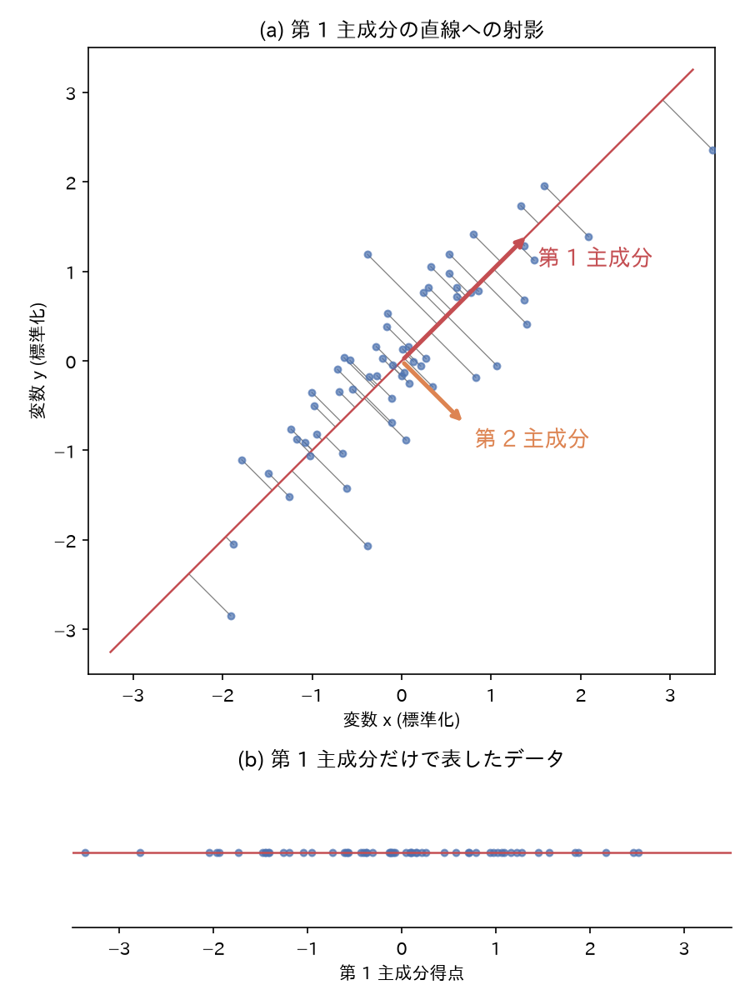{.small}

1 次元で表すと, 垂線の長さ (第 1 主成分に直交する方向の位置) の情報が失われます. 第 1 主成分は分散が最も大きい方向なので, 1 本の直線に射影する方法のうちで, 失われる情報が最も少なくなります. 失われた方向のばらつきは, 第 1 主成分に直交する方向 (図のオレンジの矢印) が表します. これを**第 2 主成分**といいます. 項目が $n$ 個あるときは, それまでの主成分のすべてに直交する方向のうち分散が最大の方向を順に選び, 第 $n$ 主成分まで求めます.

式で書くと次のようになります. 標準化した $i$ 番目のデータを, $n$ 個の項目の値を並べた行ベクトル $\boldsymbol{x}_i = [x_{i1}, \dots, x_{in}]$ で表します. 長さ 1 の列ベクトル $\boldsymbol{w} = [w_1, \dots, w_n]^\top$ について, $\boldsymbol{x}_i \boldsymbol{w} = w_1 x_{i1} + \dots + w_n x_{in}$ は, データ $i$ を $\boldsymbol{w}$ の方向の直線に射影した位置です. 第 1 主成分の方向 $\boldsymbol{w}_1$ は, データ $N$ 個の $\boldsymbol{x}_i \boldsymbol{w}$ の分散を最大にする $\boldsymbol{w}$ です.

$$ \boldsymbol{w}_1 = \mathop{\mathrm{arg\,max}}_{\|\boldsymbol{w}\| = 1} \frac{1}{N} \sum_{i=1}^{N} (\boldsymbol{x}_i \boldsymbol{w})^2 $$

各項目を標準化して平均を 0 にしたので, $\boldsymbol{x}_i \boldsymbol{w}$ の平均も 0 になり, 2 乗の平均がそのまま分散になります. 第 2 主成分の方向 $\boldsymbol{w}_2$ は, $\boldsymbol{w}_1$ に直交する $\boldsymbol{w}$ のうちで同じ分散を最大にするものです. $\boldsymbol{w}_k$ の各成分は, 第 $k$ 主成分の得点を計算するときに各項目に掛ける重みで, 主成分の**係数**と呼ばれます. 上の図のデータでは $\boldsymbol{w}_1 = [0.71, 0.71]^\top$ なので, 第 1 主成分得点は $0.71x + 0.71y$ です.

各主成分の得点の分散が, もとの全項目の分散の合計に占める割合を**寄与率**といいます. 寄与率は, その主成分が, もとのデータのばらつきのうちどれだけを表しているかを示します. 上の図のデータでは第 1 主成分の寄与率が 0.91 なので, 1 次元にしてもばらつきの 91% が残ります.

### scikit-learn による主成分分析

17 項目を標準化したデータに, `scikit-learn` の `PCA` を適用します.

~~~ py
from sklearn.decomposition import PCA

pca = PCA()
score = pca.fit_transform(z17)  # 各会員の主成分得点 (200行×17列)
print(pca.explained_variance_ratio_[:5].round(3))  # 寄与率
"""
[0.357 0.291 0.125 0.05  0.031]
"""
print(pca.explained_variance_ratio_.cumsum()[:5].round(3))  # 累積寄与率
"""
[0.357 0.648 0.773 0.823 0.855]
"""
~~~

`fit_transform` は, 主成分を求め (fit), 各データの主成分得点を計算 (transform) します. 戻り値の 0 列目が第 1 主成分の得点, 1 列目が第 2 主成分の得点です. `explained_variance_ratio_` に各主成分の寄与率が入っています. 寄与率を第 1 主成分から順に足したものを**累積寄与率**といいます. 寄与率と累積寄与率をグラフにします.

~~~ py
import numpy as np

ratio = pca.explained_variance_ratio_
k = np.arange(1, len(ratio) + 1)  # 主成分の番号 1, 2, ..., 17

fig, ax = plt.subplots()
ax.bar(k, ratio, label='寄与率')
ax.plot(k, ratio.cumsum(), marker='o', color='tab:red', label='累積寄与率')
ax.set_xticks(k)
ax.set_xlabel('主成分')
ax.set_ylabel('割合')
ax.legend()
plt.show()
plt.close(fig)
~~~

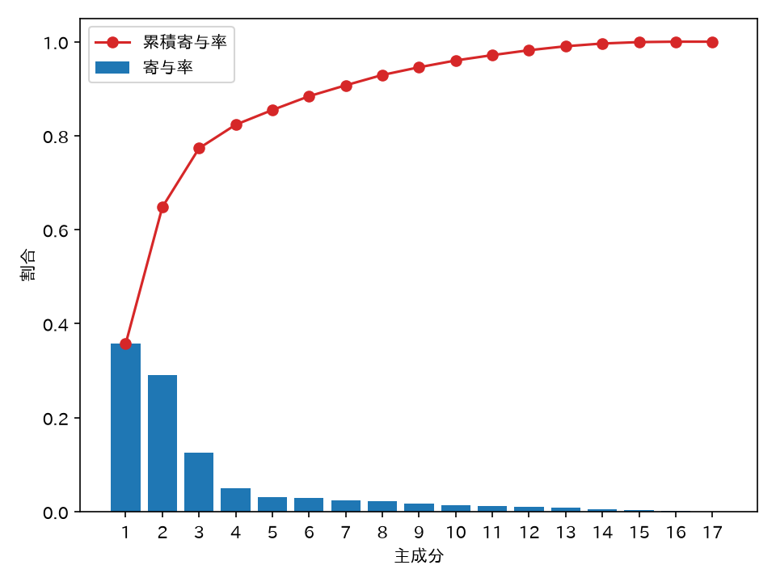

累積寄与率は第 3 主成分までで 0.773 になり, 第 4 主成分からは 1 つ増やしても 0.05 以下しか増えません. 17 項目のばらつきの 77% を 3 つの主成分で表せるので, 以下では第 3 主成分までを使います. 使う主成分の数は, このように寄与率が急に小さくなる位置で決めるか, 累積寄与率が目安の値 (70% や 80% がよく使われます) を超える位置で決めます.

主成分が何を表すかは, 係数 (`pca.components_`) を見て判断します. `components_` の $k-1$ 行目が第 $k$ 主成分の係数です.

~~~ py
coef = pd.DataFrame(pca.components_[:3].T, index=feat.columns,
                    columns=['PC1', 'PC2', 'PC3'])
print(coef.round(2))
"""
                   PC1   PC2   PC3
visits            0.32  0.10 -0.36
amount_per_visit -0.10  0.18  0.57
おにぎり             -0.17  0.35 -0.23
お茶               -0.28  0.12 -0.34
カップ麺             -0.14  0.33  0.28
ガム                0.35 -0.02  0.21
クッキー              0.39 -0.08  0.02
コーヒー              0.39 -0.08 -0.01
サンドイッチ           -0.14  0.31  0.25
ジュース              0.13  0.29  0.28
チョコレート            0.35  0.06  0.08
ノート              -0.17 -0.31  0.09
パン                0.18  0.30  0.00
ボールペン            -0.17 -0.27  0.14
ルーズリーフ           -0.18 -0.31  0.15
弁当               -0.18  0.35 -0.22
消しゴム             -0.13 -0.20  0.04
"""
~~~

- **第 1 主成分**: コーヒー, クッキー (0.39), ガム, チョコレート (0.35) と来店回数 (0.32) の係数が正で大きく, お茶 (-0.28) が負です. コーヒーと菓子をよく買い, よく来る会員ほど得点が高くなります.
- **第 2 主成分**: 弁当, おにぎり (0.35), カップ麺, サンドイッチ, パンの係数が正, ノート, ルーズリーフ (-0.31), ボールペンが負です. 食事の品目を買う会員ほど高く, 文具を買う会員ほど低くなります.
- **第 3 主成分**: 1 回あたりの購入額 (0.57) が正, 来店回数 (-0.36) が負です. たまに来て 1 回に多く買う会員ほど高くなります.

主成分の向き (係数の符号) は, 実行する環境によって反転することがあります. 反転しても主成分得点の正負が入れ替わるだけなので, 読み取れる内容は変わりません.

第 1 主成分と第 2 主成分, 第 1 主成分と第 3 主成分の得点で散布図を描きます.

~~~ py
fig, (ax1, ax2) = plt.subplots(1, 2, figsize=(10, 4.5))
ax1.scatter(score[:, 0], score[:, 1], s=15)
ax1.set_xlabel('第 1 主成分')
ax1.set_ylabel('第 2 主成分')
ax2.scatter(score[:, 0], score[:, 2], s=15)
ax2.set_xlabel('第 1 主成分')
ax2.set_ylabel('第 3 主成分')
plt.show()
plt.close(fig)
~~~

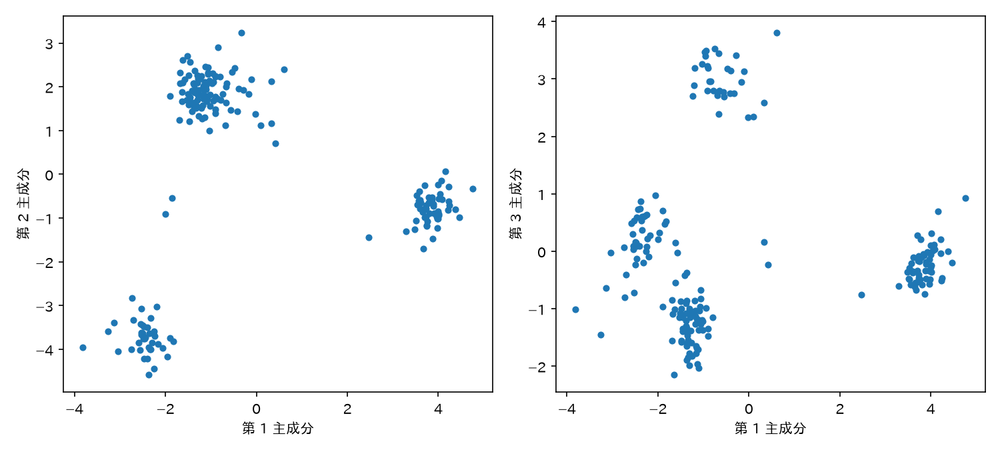

左の図には塊が 3 つ見えます. 第 1 主成分が大きい右の塊はコーヒーと菓子を買う会員, 第 2 主成分が小さい左下の塊は文具を買う会員, 第 2 主成分が大きい左上の塊は食事の品目を買う会員です. 右の図で第 1 主成分と第 3 主成分の組にすると, 左上にあった食事の会員が, 第 3 主成分が 3 付近の塊と -1 付近の塊に分かれます. 第 3 主成分は 1 回あたりの購入額が大きい会員ほど高いので, 上の塊は 1 回に多く買う会員, 下の塊は来店回数の多い会員です. 第 2 主成分までの散布図では重なっていた 2 つの塊が, 第 3 主成分では分かれています.

この節に対応する演習は, 章末の[Exercise DSP7-4](#exercise-dsp7-4)です.

## 階層クラスタリングとデンドログラム

**階層クラスタリング**は, 近いもの同士を順に併合してクラスタを大きくしていく手法です.

1. 各データを, それぞれ 1 つのデータだけを含むクラスタとします.
2. 最も近い 2 つのクラスタを併合します.
3. 全体が 1 つのクラスタになるまで 2 を繰り返します.

手順 2 では, データ同士でなく, クラスタ同士の距離が要ります. クラスタ同士の距離の定め方を**連結法**といい, 次のようなものがあります.

- **最短距離法 (単連結法)**: 2 つのクラスタから 1 つずつデータを選んだ組のうち, 最も近い組の距離.
- **最長距離法 (完全連結法)**: 同じく, 最も遠い組の距離.
- **群平均法**: すべての組の距離の平均.
- **ウォード法**: 2 つのクラスタを併合したときの, クラスタ内誤差平方和の増加量. 増加量が最も小さい組から併合します.

次の図は, 青とオレンジの 2 つのクラスタについて, 各連結法が使う距離を赤い線で示したものです. 最短距離法と最長距離法は 1 組の距離だけを, 群平均法は 25 組すべての距離を使います. ウォード法の図の × は重心です. 併合後の重心までの距離 (赤い実線) の 2 乗の和から, 併合前のそれぞれの重心までの距離 (点線) の 2 乗の和を引いた値が, クラスタ内誤差平方和の増加量です.

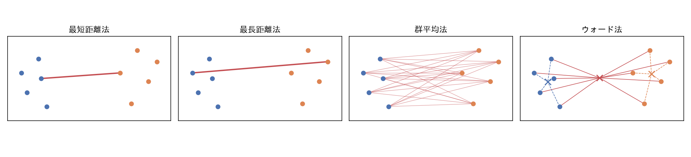{.wide}

併合の過程を樹形図で表したものを**デンドログラム**といいます. 横軸にデータが並び, 縦軸は併合したときのクラスタ間の距離を表します. 低い位置でつながっているデータほど似ています. デンドログラムを好きな高さで水平に切ると, 切り口より下でつながっているデータが 1 つのクラスタになります. 切る高さを変えればクラスタの数が変わるので, 数を決める前に全体の構造を見られます.

### scipy による階層クラスタリング

[次元削減: 主成分分析](#pca)で求めた, 第 3 主成分までの主成分得点をウォード法でクラスタリングします. 200 人分をすべて横軸に並べると読めないので, `truncate_mode='lastp'` で最後の 20 回の併合だけを描きます.

~~~ py
from scipy.cluster.hierarchy import linkage, dendrogram, fcluster

# 第3主成分までの得点について, ウォード法で併合の過程を計算する
Z = linkage(score[:, :3], method='ward')

fig, ax = plt.subplots(figsize=(10, 4.5))
dendrogram(Z, truncate_mode='lastp', p=20, leaf_rotation=90, ax=ax)
ax.set_ylabel('距離')
plt.show()
plt.close(fig)
~~~

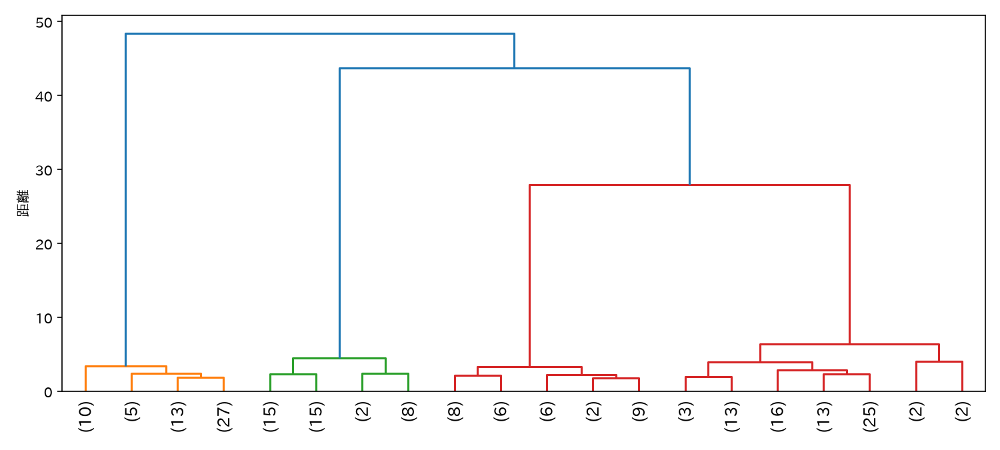

横軸の括弧付きの数字は, その枝の下にまとめられた会員の人数です. 高さ 48 と 44 の併合で全体が 3 つに分かれ, 高さ 28 の併合でさらに 2 つに分かれます. その下の併合はすべて高さ 7 以下です. 併合の高さが 28 から 7 以下へ大きく下がるので, 高さ 10 から 25 の間で切って 4 つのクラスタにするのが自然です.

指定した数のクラスタに切るには `fcluster` を使います. 4 つに切り, 2 項目で求めた k-means 法の結果とクロス表で比べます.

~~~ py
member['hcluster'] = fcluster(Z, t=4, criterion='maxclust')  # 4つのクラスタに切る
print(pd.crosstab(member['cluster'], member['hcluster']))
"""
hcluster   1   2   3   4
cluster
0         51   0   0   1
1          0   0  31   0
2          0  40   0   2
3          4   0   0  71
"""
cols = ['visits', 'amount_per_visit', '弁当', 'コーヒー', 'ルーズリーフ']
print(feat.groupby(member['hcluster'])[cols].mean().round(2))
"""
          visits  amount_per_visit    弁当  コーヒー  ルーズリーフ
hcluster
1          53.89            293.97  0.00  0.46    0.00
2           4.58            404.87  0.00  0.00    0.39
3           6.94           1476.89  0.23  0.05    0.07
4          33.99            481.45  0.47  0.01    0.00
"""
~~~

各行の度数がほぼ 1 つの列に集まっているので, 17 項目を 3 つの主成分にまとめてから階層クラスタリングした結果は, 2 項目の k-means 法とほぼ同じ 4 つのクラスタになります. クラスタごとの平均から, 1 はカフェ利用 (コーヒーの割合 0.46), 2 は文具 (ルーズリーフの割合 0.39), 3 はまとめ買い (1 回あたり約 1480 円), 4 は昼食 (弁当の割合 0.47) の会員と読めます. 2 つの手法で所属が違う会員は 7 人で, 2 項目の散布図で塊の境界付近か塊と塊の間にいた会員です. 来店回数と購入額だけでは決めにくかった所属を, 何を買ったかの情報で決めています.

主成分得点の散布図を, 階層クラスタリングの結果で色分けします.

~~~ py
fig, (ax1, ax2) = plt.subplots(1, 2, figsize=(10, 4.5))
ax1.scatter(score[:, 0], score[:, 1], c=member['hcluster'], cmap='viridis', s=15)
ax1.set_xlabel('第 1 主成分')
ax1.set_ylabel('第 2 主成分')
ax2.scatter(score[:, 0], score[:, 2], c=member['hcluster'], cmap='viridis', s=15)
ax2.set_xlabel('第 1 主成分')
ax2.set_ylabel('第 3 主成分')
plt.show()
plt.close(fig)
~~~

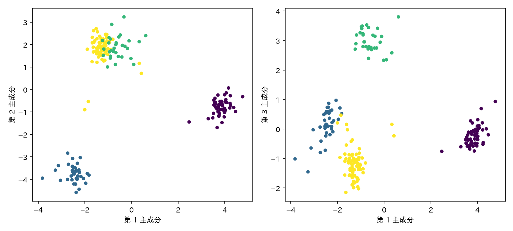

左の図の左上の塊には, 2 つのクラスタ (まとめ買いと昼食の会員) の点が混ざっています. 右の図では, この 2 つのクラスタが第 3 主成分の方向に分かれています.

使う主成分を第 2 主成分までに減らすと, この 2 つのクラスタを分けられなくなります.

~~~ py
# 第2主成分までの得点で, 同じように4つに切る
h2 = fcluster(linkage(score[:, :2], method='ward'), t=4, criterion='maxclust')
print(pd.crosstab(member['cluster'], h2))
"""
col_0     1   2   3   4
cluster
0        51   0   0   1
1         0   0  14  17
2         0  40   0   2
3         4   0   2  69
"""
~~~

まとめ買いの会員 (k-means 法のクラスタ 1) の 31 人のうち 17 人が, 昼食の会員と同じクラスタ 4 に入ります. クラスタ 3 の 16 人は, 残るまとめ買いの会員 14 人と昼食の会員 2 人です. 寄与率の小さい主成分を捨てると, その主成分の方向にしか表れない違いも失われます. 使う主成分の数を寄与率で決めるのは, 失う情報の量を確かめるためです.

連結法を変えると結果も変わります. 最短距離法は, 最も近い 1 組の距離だけでクラスタ同士をつなぐので, 塊の間に点が並んでいると別々の塊まで 1 つにつながります. データを同程度の大きさのグループに分ける目的なら, ウォード法か群平均法をまず試します.

この節に対応する演習は, 章末の[Exercise DSP7-2](#exercise-dsp7-2)です.

## クラスタリング結果の評価: エルボー法とシルエット係数

クラスタリングには正解ラベルが無いので, [第6章](dsp6.html)の正解率は計算できません. 代わりに, クラスタ内のデータがまとまっているか, 他のクラスタと離れているかを数値にします. この数値は主に, クラスタの数 $K$ を決めるときに使います. [非階層クラスタリング: k-means 法](#非階層クラスタリング-k-means-法)では散布図を見て $K = 4$ としましたが, 項目が 3 つ以上あると散布図 1 枚では塊を数えられません.

### エルボー法

k-means 法のクラスタ内誤差平方和 $W$ は, $K$ を増やすほど小さくなります. データの数だけクラスタを作れば $W = 0$ になるので, $W$ が最小になる $K$ を選ぶわけにはいきません. そこで, $K$ を 1 から順に増やして $W$ をグラフにし, 減り方が急に緩やかになる $K$ を選びます. グラフが肘 (エルボー) のように折れ曲がる点を探すので, **エルボー法**と呼ばれます.

~~~ py
X = z[['visits', 'amount_per_visit']]

inertias = []
for k in range(1, 9):
    km = KMeans(n_clusters=k, random_state=0, n_init=10).fit(X)
    inertias.append(km.inertia_)  # クラスタ内誤差平方和

plt.plot(range(1, 9), inertias, marker='o')
plt.xlabel('クラスタ数 k')
plt.ylabel('クラスタ内誤差平方和')
plt.show()
plt.close()
~~~

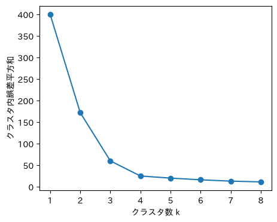

$K = 4$ までは $W$ が大きく減り (400 → 172 → 60 → 25), $K = 5$ 以降はほとんど減りません. 4 つ目のクラスタを加えると塊が 1 つずつに分かれますが, 5 つ目以降は同じ塊を割るだけだからです. この図からは $K = 4$ を選びます.

### シルエット係数

折れ曲がりがはっきりしないグラフでは, エルボー法で $K$ を決められません. そのようなときは, データ 1 つずつについて「自分のクラスタにどれだけ馴染んでいるか」を測る**シルエット係数**を使います. データ $i$ について,

- $a(i)$: 同じクラスタに属する他のデータとの距離の平均
- $b(i)$: 最も近い別のクラスタに属するデータとの距離の平均

とすると, シルエット係数は次の式で表されます.

$$ s(i) = \frac{b(i) - a(i)}{\max(a(i), b(i))} $$

$s(i)$ は $-1$ から $1$ の値をとります. $1$ に近いほど, 自分のクラスタの中では近く, 別のクラスタからは遠い位置にあります. $0$ 付近は 2 つのクラスタの境界にあるデータ, 負の値は別のクラスタに割り当てた方が近いデータです. 全データの $s(i)$ の平均を, クラスタリング全体の評価に使います.

~~~ py
from sklearn.metrics import silhouette_score

scores = []
for k in range(2, 9):  # クラスタが2つ以上ないと b(i) が定義できない
    labels = KMeans(n_clusters=k, random_state=0, n_init=10).fit_predict(X)
    scores.append(silhouette_score(X, labels))

plt.plot(range(2, 9), scores, marker='o')
plt.xlabel('クラスタ数 k')
plt.ylabel('シルエット係数の平均')
plt.show()
plt.close()
~~~

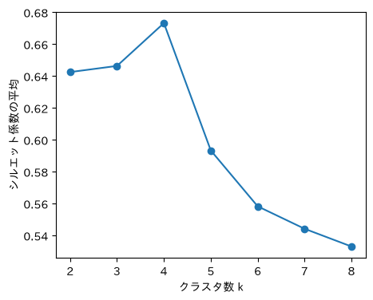

シルエット係数の平均は $K = 4$ で最大 (0.673) になり, エルボー法と同じ $K$ を支持します. ただし $K = 2$ (0.643) や $K = 3$ (0.646) との差は小さく, 指標だけで $K$ がはっきり決まるわけではありません. 指標の差が小さいときは, 候補の $K$ ごとにクラスタの平均を求め, 特徴を言葉で説明できる分け方を選びます ([Exercise DSP7-1](#exercise-dsp7-1)).

## 非線形の次元削減: t-SNE (発展) {#t-sne}

主成分分析の主成分得点は, 各項目に係数を掛けて足した値 (線形な式) です. そのため, データが曲がった面の上に並んでいるときは, 2 次元に射影すると面の離れた部分が重なります. 次の図の (a) は, 巻いた布のような面の上に並べた 3 次元の点で, 色は面に沿った位置を表します. (b) の主成分分析では, 巻いた形のまま平面に映るので, 面に沿って遠い点 (色が大きく違う点) 同士が, 巻きの内側と外側で近くに並びます. (c) の t-SNE では, 色の近い点同士が近くに集まります. ただし, 面を 1 枚の帯に広げるのでなく, いくつかの塊に分けて並べています.

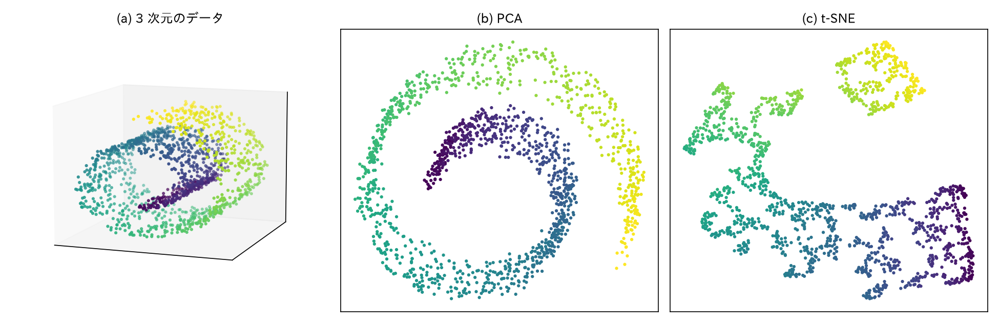{.wide}

**t-SNE (t-distributed Stochastic Neighbor Embedding)** は, 高い次元で近くにある点同士が, 低い次元でも近くに来るように点を配置する手法です. 手順は次のとおりです.

1. 高い次元での点 $i$ と点 $j$ の近さを, 確率 $p_{ij}$ で表します. 点 $i$ を中心とする正規分布の密度を使うので, 近い点ほど確率が大きくなります. 正規分布の幅は点ごとに決め, その目安を **perplexity** (近くの点として扱うおおよその個数) で指定します.
2. 低い次元 (2 次元) での点の近さを, 確率 $q_{ij}$ で表します. ここでは正規分布の代わりに, 裾の広い t 分布 (自由度 1) の密度を使います. 裾が広いので, 高い次元で少し離れた点同士を, 2 次元ではより遠くに置けます. 2 次元の狭い平面に点が押し込まれて塊が潰れることを, これで防ぎます.
3. 2 つの確率の違いを **KL ダイバージェンス** $\sum_{i \ne j} p_{ij} \log (p_{ij} / q_{ij})$ で測り, これが小さくなるように 2 次元の点の位置を少しずつ動かします.

KL ダイバージェンスは, $p_{ij}$ が大きい組 (高い次元で近い組) を 2 次元で離すと大きな値になります. 一方, $p_{ij}$ が小さい組 (高い次元で遠い組) を 2 次元で近くに置いても, 値はあまり増えません. そのため t-SNE は近くの点同士の関係 (局所的な構造) を保ちますが, 離れた塊同士の距離や位置関係は保ちません. t-SNE の図では, 塊の間の距離や塊の広がりを比べても意味がなく, 軸にも主成分のような意味はありません.

| | 主成分分析 | t-SNE |
|---|---|---|
| 変換 | 線形 (係数を掛けて足す) | 非線形 |
| 保つ構造 | 全体のばらつき (大局的な構造) | 近くの点同士の関係 (局所的な構造) |
| 軸の意味 | 係数から読み取れる | 無い |
| 結果の再現 | 同じデータなら同じ結果 | 乱数と perplexity で変わる |
| 新しいデータ | 同じ係数で得点を計算できる | 全体を配置し直す |

データ全体の構造を見るには主成分分析を, まとまり (クラスタ) があるかを見るには t-SNE を使います. 売店の会員の 17 項目を t-SNE で 2 次元に配置し, その座標をウォード法で 4 つのクラスタに切ります.

~~~ py
from sklearn.manifold import TSNE

# 標準化した17項目を2次元に配置する (乱数を固定する. perplexity は既定値の30)
emb = TSNE(n_components=2, random_state=0).fit_transform(z17)
tcluster = fcluster(linkage(emb, method='ward'), t=4, criterion='maxclust')
print(pd.crosstab(member['cluster'], tcluster))
"""
col_0     1   2   3   4
cluster
0        51   0   0   1
1         0   0  31   0
2         0  42   0   0
3         4   0   0  71
"""

fig, ax = plt.subplots()
ax.scatter(emb[:, 0], emb[:, 1], c=tcluster, cmap='viridis', s=15)
ax.set_xlabel('t-SNE 1')
ax.set_ylabel('t-SNE 2')
plt.show()
plt.close(fig)
~~~

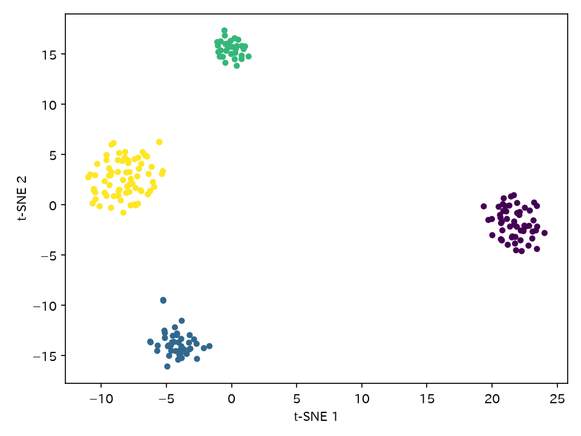

2 次元の配置に 4 つの塊がはっきり分かれ, ウォード法で 4 つに切ったクラスタも k-means 法の結果とほぼ一致します. 主成分分析では, まとめ買いと昼食の会員を分けるのに第 3 主成分まで要りました. t-SNE では 2 次元でこの 2 つが分かれています. ただし, 図の塊同士の距離 (たとえばカフェ利用の会員の塊が右に離れていること) は, 会員同士の違いの大きさを表しません. perplexity を 5 や 50 に変えても, 同じ 4 つのクラスタが得られます (k-means 法と所属が違う会員は 5 人から 7 人). 結果が乱数と perplexity に左右されるので, t-SNE の図から結論を出すときは, 値を変えても同じ塊が現れるかを確かめます.

[第9章](dsp9.html#自然言語ベクトル抽出によるデータ可視化と類似度評価)では文章のベクトルを, [第11章](dsp11.html#feature-embedding)では画像認識のモデルが出力した特徴量を, 主成分分析と t-SNE で 2 次元にして比べます.

## 密度と確率モデルに基づくクラスタリング (発展) {#密度と確率モデルに基づくクラスタリング}

k-means 法には 2 つの制約があります. 1 つは, 各データを最も近い重心のクラスタに割り当てるので, 重心のまわりに丸くまとまったクラスタしか取り出せないことです. もう 1 つは, 各データがどれか 1 つのクラスタに必ず属し, どの塊にも当てはまらないデータや, 塊と塊の境界にあるデータも, どこかのクラスタに割り当てられることです. DBSCAN はどちらの制約も持たず, 混合ガウスモデルは各データの所属を確率で表すことで 2 つ目の制約を緩めます.

### DBSCAN

**DBSCAN** (Density-Based Spatial Clustering of Applications with Noise) は, データが密に集まっている領域をクラスタとみなす手法です. 半径 `eps` と個数 `min_samples` を決め, 次のようにクラスタを作ります.

1. 半径 `eps` の範囲に (自分を含めて) `min_samples` 個以上のデータがある点を**コア点**とします.
2. 互いに `eps` 以内にあるコア点をつなぎ, つながったコア点とその `eps` 以内にあるデータを 1 つのクラスタとします.
3. どのコア点からも `eps` 以内にないデータは, どのクラスタにも属さない**ノイズ**とします.

密な領域がつながっている限り 1 つのクラスタになるので, 形が丸くないクラスタも見つけられます. クラスタの数を先に決める必要もありません.

売店の会員のデータに DBSCAN を適用し, k-means 法の結果と比べます.

~~~ py
from sklearn.cluster import DBSCAN

# 標準化した2項目に適用する. ノイズのクラスタ番号は -1
member['db'] = DBSCAN(eps=0.25, min_samples=5).fit_predict(z[['visits', 'amount_per_visit']])
print(member['db'].value_counts().sort_index())
"""
db
-1    10
 0    70
 1    53
 2    38
 3    29
"""

fig, axes = plt.subplots(1, 2, figsize=(11, 4.3))
axes[0].scatter(member['visits'], member['amount_per_visit'], c=member['cluster'], cmap='viridis', s=15)
axes[0].set_title('k-means (k=4)')
ok = member['db'] != -1  # ノイズでない会員
axes[1].scatter(member.loc[ok, 'visits'], member.loc[ok, 'amount_per_visit'],
                c=member.loc[ok, 'db'], cmap='viridis', s=15)
axes[1].scatter(member.loc[~ok, 'visits'], member.loc[~ok, 'amount_per_visit'],
                c='gray', marker='x', s=50, label='ノイズ')
axes[1].set_title('DBSCAN (eps=0.25, min_samples=5)')
axes[1].legend()
plt.show()
plt.close()
~~~

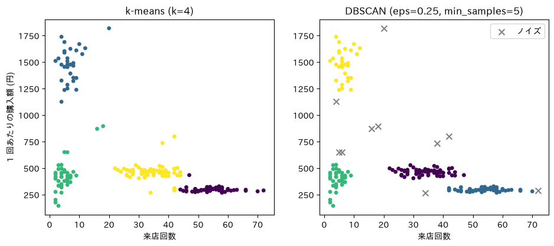

DBSCAN も 4 つの塊を 4 つのクラスタとして取り出しましたが, 10 人の会員をノイズとして, どのクラスタにも入れていません. ノイズになったのは, 塊と塊の間のまばらな位置にいる会員と, 塊の端にいる会員です. k-means 法ではこれらの会員もいずれかのクラスタに入り, そのクラスタの平均を動かします. どの層にも当てはまらない会員を別に扱いたいときは, DBSCAN が向いています.

ただし, 結果は `eps` と `min_samples` に大きく左右されます. このデータで `eps` を 0.3 に広げると, 昼食の会員とカフェ利用の会員の塊が, 間にいる会員を伝って 1 つのクラスタにつながります. 逆に `eps` を小さくしすぎると, ノイズになる会員が増えます.

### 混合ガウスモデル

**混合ガウスモデル** (Gaussian Mixture Model) は, データが $K$ 個の正規分布を重ね合わせた分布から生成されたと考え, 各正規分布の平均, 広がり (分散と共分散), 混ざり具合 (混合比) をデータから推定する手法です. 推定した分布を使うと, 各データがそれぞれのクラスタ (正規分布) から生成された確率を計算できます. k-means 法が各データを 1 つのクラスタに割り当てるのに対し, 混合ガウスモデルはどのクラスタにどれだけの確率で属するかを出力します.

売店の会員のデータに適用し, 所属の確率が最も低い会員を見てみます.

~~~ py
from sklearn.mixture import GaussianMixture

X = z[['visits', 'amount_per_visit']]
gm = GaussianMixture(n_components=4, random_state=0).fit(X)
prob = gm.predict_proba(X)            # 会員ごとの, 各クラスタに属する確率
member['max_prob'] = prob.max(axis=1)  # 最も確率の高いクラスタの確率
print(member.sort_values('max_prob').head(3)[['visits', 'amount_per_visit', 'cluster', 'max_prob']].round(2))
"""
           visits  amount_per_visit  cluster  max_prob
member_id
1074           34            267.35        3      0.85
1096           42            309.76        3      0.98
1117           46            318.70        0      0.99
"""
~~~

ほとんどの会員は, いずれか 1 つのクラスタに確率 0.99 以上で属します. このデータでは 4 つの塊が互いに離れているためです. 最も確率が低いのは会員 1074 で, カフェ利用の会員のクラスタに 0.85, 昼食の会員のクラスタに 0.15 の確率で属します. 来店回数 (34 回) は昼食の会員に近く, 1 回あたりの購入額 (267 円) はカフェ利用の会員に近い会員です. k-means 法はこの会員を昼食のクラスタ (3) に割り当てましたが, 混合ガウスモデルはどちらとも言い切れないことを確率で表しています.

塊同士が重なり合っているデータでは, 各データを 1 つのクラスタに決める k-means 法と, 所属を確率で表す混合ガウスモデルの違いがはっきり現れます. 次の例は, 中心が (0, 0) と (3, 0) の 2 つの塊を, 重なるように生成したデータです.

~~~ py
from sklearn.datasets import make_blobs

# 中心が (0, 0) と (3, 0) の2つの塊を, 重なるように生成する
Xb, _ = make_blobs(n_samples=300, centers=[[0, 0], [3, 0]], cluster_std=1.0, random_state=0)

gb = GaussianMixture(n_components=2, random_state=0).fit(Xb)
print(gb.means_.round(2))  # 推定した正規分布の平均
"""
[[-0.09  0.08]
 [ 2.91 -0.13]]
"""
pb = gb.predict_proba(Xb)

sc = plt.scatter(Xb[:, 0], Xb[:, 1], c=pb[:, 1], cmap='coolwarm', s=20)
plt.colorbar(sc, label='右側のクラスタに属する確率')
plt.show()
plt.close()
~~~

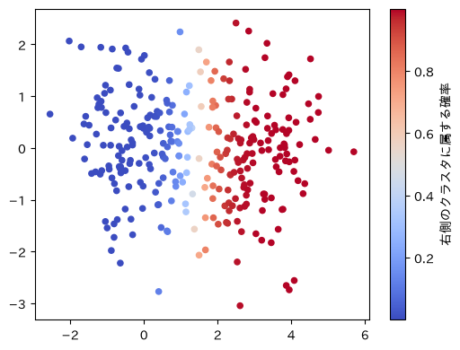

推定した 2 つの平均は, データを生成したときの中心 (0, 0) と (3, 0) に近い値です. 塊から離れた点の確率は 0 か 1 に近く, 2 つの塊の間にある点は 0.5 前後になります. 境界付近のデータを無理にどちらかへ割り当てず, 所属の不確かさとして扱えます.

# パターン発見: アソシエーション分析

**アソシエーション分析**は, 大量の取引の記録から「おにぎりを買う人はお茶も買う」のような, 同時に起こりやすい項目の組み合わせを取り出す手法です. 買い物かごの中身を分析する用途から, **バスケット分析**とも呼ばれます. 取り出した組み合わせは, 「$X$ を含む取引は $Y$ も含む」という**ルール** $X \Rightarrow Y$ の形で表します. $X$ を条件部, $Y$ を結論部といいます.

売店の購買記録をレシート単位にまとめ, 1 回の買い物で買われた品目のリストにします.

~~~ py
baskets = log.groupby('receipt_id')['item'].apply(list).to_list()
print(len(baskets))
print(baskets[:3])
"""
5877
[['お茶', '弁当'], ['ジュース', '弁当'], ['おにぎり', 'お茶', 'パン']]
"""
~~~

## 支持度・確信度・リフト値

ルール $X \Rightarrow Y$ の良さは, 次の 3 つの指標で測ります. 取引 (レシート) の総数を $N$ とします.

::: note
- **支持度 (support)**: $X$ と $Y$ を両方含む取引の割合. ルールがどれだけ頻繁に現れるかを表す.

$$ \text{support}(X \Rightarrow Y) = \frac{X \text{と} Y \text{を両方含む取引の数}}{N} $$

- **確信度 (confidence)**: $X$ を含む取引のうち, $Y$ も含む取引の割合. $X$ を条件とする $Y$ の条件付き確率 $P(Y \mid X)$ にあたる.

$$ \text{confidence}(X \Rightarrow Y) = \frac{X \text{と} Y \text{を両方含む取引の数}}{X \text{を含む取引の数}} $$

- **リフト値 (lift)**: 確信度を, $Y$ を含む取引の割合 $P(Y)$ で割った値.

$$ \text{lift}(X \Rightarrow Y) = \frac{\text{confidence}(X \Rightarrow Y)}{P(Y)} = \frac{P(Y \mid X)}{P(Y)} $$

:::

ルール「おにぎり $\Rightarrow$ お茶」の 3 つの指標を計算してみましょう. レシート 5877 枚のうち, おにぎりを含むものは 989 枚, お茶を含むものは 2071 枚, 両方を含むものは 791 枚です.

- 支持度: $791 / 5877 \approx 0.135$
- 確信度: $791 / 989 \approx 0.80$
- リフト値: $0.80 / (2071 / 5877) \approx 0.80 / 0.352 \approx 2.27$

リフト値は, $X$ を含むことで $Y$ の起こりやすさが何倍になるかを表します. 全体ではお茶を含むレシートは 35% ですが, おにぎりを含むレシートに限ると 80% になるので, リフト値は約 2.3 です. リフト値が 1 なら $X$ の有無は $Y$ の起こりやすさに関係せず, 1 未満なら $X$ を含む取引ではかえって $Y$ が起こりにくくなっています.

確信度だけでなくリフト値も見る理由を, ルール「パン $\Rightarrow$ コーヒー」で確かめます. パンを含むレシートは 760 枚, コーヒーを含むレシートは 2706 枚, 両方を含むレシートは 322 枚です.

- 確信度: $322 / 760 \approx 0.42$
- リフト値: $0.42 / (2706 / 5877) \approx 0.42 / 0.460 \approx 0.92$

確信度 0.42 は, パンを買ったレシートの 4 割がコーヒーも含むという意味です. しかしコーヒーはもともと全レシートの 46% に含まれるので, パンを買ったレシートでは, コーヒーを含む割合がむしろ少し下がっています. 確信度は結論部の品目がもともとどれだけ買われているかを考慮しないので, 結論部がよく買われる品目なら, 関係が無くても確信度は高くなります.

アソシエーション分析で得られるのは, 同時に起こりやすいという関係であって, 一方が他方の原因であることは示しません ([第4章](dsp4.html#因果関係と相関)の「因果関係と相関」と同じ注意です).

### mlxtend によるアソシエーション分析

品目の種類が増えると, 調べる組み合わせの数は急激に増えます. **Apriori アルゴリズム**は, 支持度が小さい組み合わせを先に除くことで, 調べる組み合わせを減らします. 組み合わせに品目を 1 つ付け加えると, 付け加えた後の組み合わせを含む取引は, 元の組み合わせを含む取引より多くはなりません. したがって, 支持度が基準に届かない組み合わせは, 品目をいくつ付け加えても基準に届かないので, 調べる前に除けます.

`mlxtend` の `apriori` で支持度が 0.02 以上の品目の組み合わせを求め, `association_rules` でリフト値が 1 以上のルールを取り出します.

~~~ py
from mlxtend.preprocessing import TransactionEncoder
from mlxtend.frequent_patterns import apriori, association_rules

# レシート×品目の表 (買った品目が True) に変換する
te = TransactionEncoder()
onehot = pd.DataFrame(te.fit_transform(baskets), columns=te.columns_)

# 支持度が0.02以上の品目の組み合わせを求める
freq = apriori(onehot, min_support=0.02, use_colnames=True)

# リフト値が1以上のルールを取り出し, リフト値の大きい順に10件表示する
rules = association_rules(freq, metric='lift', min_threshold=1.0)
print(rules[['antecedents', 'consequents', 'support', 'confidence', 'lift']]
      .sort_values('lift', ascending=False).head(10).round(2))
"""
              antecedents            consequents  support  confidence  lift
32    frozenset({パン, お茶})      frozenset({おにぎり})     0.06        0.82  4.90
37      frozenset({おにぎり})    frozenset({パン, お茶})     0.06        0.34  4.90
34  frozenset({お茶, おにぎり})        frozenset({パン})     0.06        0.42  3.25
35        frozenset({パン})  frozenset({お茶, おにぎり})     0.06        0.44  3.25
4         frozenset({パン})      frozenset({おにぎり})     0.07        0.53  3.17
5       frozenset({おにぎり})        frozenset({パン})     0.07        0.41  3.17
14      frozenset({ジュース})      frozenset({カップ麺})     0.02        0.19  2.71
15      frozenset({カップ麺})      frozenset({ジュース})     0.02        0.29  2.71
33  frozenset({パン, おにぎり})        frozenset({お茶})     0.06        0.82  2.32
36        frozenset({お茶})  frozenset({パン, おにぎり})     0.06        0.16  2.32
"""
~~~

`antecedents` が条件部, `consequents` が結論部です. リフト値が同じ行の並び順と, 各部に含まれる品目の並び順は, 実行するたびに変わることがあります. 上位には「パンとお茶を買うレシートはおにぎりも含む」(確信度 0.82) のような, 昼食の組み合わせが並びます.

支持度の基準は結果を大きく左右します. 例えば「ノート $\Rightarrow$ ボールペン」は, ノートを含むレシート 187 枚のうち 78 枚がボールペンも含み, リフト値は約 16 で, 強い関係があります. しかし文具を買うレシート自体が少ないので, 支持度は $78 / 5877 \approx 0.013$ で, 基準の 0.02 に届かず上の表には出てきません. 基準を低くするとこのような, まれだが強い関係を拾えます. 一方で, 偶然いくつか重なっただけの組み合わせもルールとして大量に出てきます. 基準は, 得られるルールの数と中身を見ながら調整します.

この節に対応する演習は, 章末の[Exercise DSP7-3](#exercise-dsp7-3)です.

# 演習

### Exercise DSP7-1

**カテゴリの割合を加えた k-means 法とクラスタ数の選択**

対応する節: [非階層クラスタリング: k-means 法](#非階層クラスタリング-k-means-法), [クラスタリング結果の評価: エルボー法とシルエット係数](#クラスタリング結果の評価-エルボー法とシルエット係数)

会員ごとの来店回数と 1 回あたりの購入額に, カテゴリ (食事, 飲料, 菓子, 文具) ごとの購入額の割合を加えた 6 項目を標準化し, k-means 法 (`random_state=0, n_init=10`) でクラスタリングしてください.

1. $K = 2, \dots, 8$ のシルエット係数の平均を求め, $K$ を選んでください. 本文の 2 項目での値 ($K = 4$ で 0.673) とも比べてください.
2. 選んだ $K$ でクラスタごとに 6 項目の平均を求め, 本文の 2 項目での k-means 法の結果とクロス表で比べてください.

提出ファイル名: `dsp7-1.py`

    
 回答例 

~~~ py
import pandas as pd
from sklearn.cluster import KMeans
from sklearn.metrics import silhouette_score

log = pd.read_csv('data/store_log.csv', encoding='utf-8-sig')
g = log.groupby('member_id')
member = pd.DataFrame({
    'visits': g['receipt_id'].nunique(),
    'amount_per_visit': g['price'].sum() / g['receipt_id'].nunique(),
})
share = log.pivot_table(index='member_id', columns='category', values='price',
                        aggfunc='sum', fill_value=0)
share = share.div(share.sum(axis=1), axis=0)

# 本文の2項目での結果
z2 = (member - member.mean()) / member.std(ddof=0)
member['cluster'] = KMeans(n_clusters=4, random_state=0, n_init=10).fit_predict(z2)

# 問1: 6項目
feat = member[['visits', 'amount_per_visit']].join(share)
z6 = (feat - feat.mean()) / feat.std(ddof=0)
for k in range(2, 9):
    labels = KMeans(n_clusters=k, random_state=0, n_init=10).fit_predict(z6)
    print(k, round(silhouette_score(z6, labels), 3))
"""
2 0.561
3 0.694
4 0.809
5 0.731
6 0.729
7 0.6
8 0.563
"""

# 問2
labels6 = KMeans(n_clusters=4, random_state=0, n_init=10).fit_predict(z6)
print(feat.groupby(labels6).mean().round(2))
"""
   visits  amount_per_visit    文具    菓子    食事    飲料
0   53.89            293.97  0.00  0.41  0.06  0.53
1    4.58            404.87  0.87  0.00  0.00  0.13
2   34.46            470.32  0.00  0.02  0.76  0.21
3    7.55           1440.85  0.16  0.11  0.54  0.18
"""
print(pd.crosstab(member['cluster'], labels6))
"""
col_0     0   1   2   3
cluster
0        51   0   1   0
1         0   0   0  31
2         0  40   0   2
3         4   0  71   0
"""
~~~

**問 1**: $K = 4$ で最大 (0.809) になります. 2 項目のとき (0.673) より大きく, $K = 3$ や $K = 5$ との差も広がります. 来店回数と購入額だけでは近かった会員も, 何を買うか (カテゴリの割合) が違えば離れるので, クラスタ同士の間隔が広がったためです.

**問 2**: 4 つのクラスタは, 本文と同じくカフェ利用 (0), 文具 (1), 昼食 (2), まとめ買い (3) の会員に対応します (番号は実行環境によって入れ替わることがあります). 2 項目の結果と所属が変わったのは 7 人で, いずれも本文の散布図で塊の境界付近か, 塊と塊の間にいた会員です. 例えば, 2 項目では昼食のクラスタに入っていた会員のうち 4 人は, カテゴリの割合を加えるとカフェ利用のクラスタに移ります. 何を買ったかの情報が, 来店回数と購入額だけでは決めにくかった所属を決めています.

### Exercise DSP7-2

**連結法による階層クラスタリングの違い**

対応する節: [階層クラスタリングとデンドログラム](#階層クラスタリングとデンドログラム)

[非階層クラスタリング: k-means 法](#非階層クラスタリング-k-means-法)と同じ, 標準化した 2 項目 (来店回数と 1 回あたりの購入額) について, 連結法 (`method`) を `'single'` (最短距離法), `'complete'` (最長距離法), `'average'` (群平均法), `'ward'` (ウォード法) の 4 通りに変えて階層クラスタリングを行ってください. それぞれ `fcluster` で 4 つのクラスタに切り, 各クラスタの人数と, 来店回数と 1 回あたりの購入額の平均を求めて, 連結法による違いを説明してください.

提出ファイル名: `dsp7-2.py`

    
 回答例 

~~~ py
import pandas as pd
from scipy.cluster.hierarchy import linkage, fcluster

log = pd.read_csv('data/store_log.csv', encoding='utf-8-sig')
g = log.groupby('member_id')
member = pd.DataFrame({
    'visits': g['receipt_id'].nunique(),
    'amount_per_visit': g['price'].sum() / g['receipt_id'].nunique(),
})
z = (member - member.mean()) / member.std(ddof=0)

for method in ['single', 'complete', 'average', 'ward']:
    cl = fcluster(linkage(z, method=method), t=4, criterion='maxclust')
    print(method)
    print(member.groupby(cl).agg(人数=('visits', 'size'),
                                 来店回数=('visits', 'mean'),
                                 購入額=('amount_per_visit', 'mean')).round(0))
~~~

出力をまとめると次のようになります (クラスタの並び順は人数と平均から読み取ってください).

| 連結法 | 4 つのクラスタの人数 | 特徴 |
|---|---|---|
| 最短距離法 | 31, 2, 40, 127 | 昼食とカフェ利用の会員が 127 人の 1 つのクラスタになり, 離れた 2 人が独立したクラスタになる |
| 群平均法 | 31, 127, 2, 40 | 最短距離法と同じ分け方 |
| 最長距離法 | 33, 46, 40, 81 | 昼食とカフェ利用の会員は分かれるが, 境界の会員の多くが昼食のクラスタに入る |
| ウォード法 | 33, 40, 54, 73 | 4 つの塊とほぼ一致する |

最短距離法は, 最も近い 1 組の距離でクラスタ同士をつなぎます. 昼食の会員とカフェ利用の会員の塊は来店回数 40 回前後で隣り合っているので, 間の点を伝って 1 つのクラスタにつながります. その結果, 4 つに切ったときの残りの 1 つには, 他から離れた 2 人が入ります. 群平均法も, このデータでは同じ分け方になりました. 最長距離法とウォード法は, 大きさの近いクラスタを作りやすく, 散布図で見える塊に近い分け方になります. 連結法によってクラスタの大きさの偏りが変わるので, 目的 (離れたデータを見つけるのか, 同程度の大きさのグループに分けるのか) に合わせて選びます. なお, 本文の第 3 主成分までの主成分得点では 4 つの塊が互いに離れているので, 4 つの連結法のどれでもほぼ同じ 4 つのクラスタになります. 連結法の違いが結果に表れるのは, 塊の間にデータが並んでいるときです.

### Exercise DSP7-3

**クラスタごとのアソシエーション分析**

対応する節: [非階層クラスタリング: k-means 法](#非階層クラスタリング-k-means-法), [支持度・確信度・リフト値](#支持度確信度リフト値)

本文の k-means 法 (2 項目, $K = 4$) で求めた会員のクラスタを使い, ルール「コーヒー $\Rightarrow$ クッキー」の確信度とリフト値を次の 2 通りで計算してください.

1. 全レシートを対象にした場合
2. カフェ利用の会員のクラスタに属する会員のレシートだけを対象にした場合

2 つのリフト値の違いが何を意味するかを説明してください.

提出ファイル名: `dsp7-3.py`

    
 回答例 

~~~ py
import pandas as pd
from sklearn.cluster import KMeans

log = pd.read_csv('data/store_log.csv', encoding='utf-8-sig')
g = log.groupby('member_id')
member = pd.DataFrame({
    'visits': g['receipt_id'].nunique(),
    'amount_per_visit': g['price'].sum() / g['receipt_id'].nunique(),
})
z = (member - member.mean()) / member.std(ddof=0)
member['cluster'] = KMeans(n_clusters=4, random_state=0, n_init=10).fit_predict(z)

# merge で2つの表を結合し, 記録の各行に会員のクラスタを付ける
# (記録の member_id と, member の行見出し (会員番号) が一致する行同士をつなぐ)
log = log.merge(member[['cluster']], left_on='member_id', right_index=True)

def confidence_lift(df, x, y):
    # レシートごとの品目の集合
    baskets = df.groupby('receipt_id')['item'].apply(set)
    has_x = baskets.apply(lambda s: x in s)
    has_y = baskets.apply(lambda s: y in s)
    confidence = (has_x & has_y).sum() / has_x.sum()
    lift = confidence / has_y.mean()
    return round(float(confidence), 2), round(float(lift), 2), round(float(has_y.mean()), 2)

# 問1
print(confidence_lift(log, 'コーヒー', 'クッキー'))
"""
(0.56, 2.1, 0.27)
"""
# 問2: 来店回数が最も多いクラスタがカフェ利用の会員
cafe = member.groupby('cluster')['visits'].mean().idxmax()
print(confidence_lift(log[log['cluster'] == cafe], 'コーヒー', 'クッキー'))
"""
(0.57, 1.2, 0.48)
"""
~~~

**問 1**: 確信度 0.56, リフト値 2.10 です.

**問 2**: 確信度 0.57, リフト値 1.20 です.

確信度はほとんど変わりませんが, リフト値は 2.10 から 1.20 に下がります. 全レシートではクッキーを含む割合が 27% なのに対し, カフェ利用の会員のレシートに限ると 48% あるためです. 全体でのリフト値が大きいのは, 「コーヒーを買うとクッキーも買いたくなる」ことよりも, 「コーヒーもクッキーもカフェ利用の会員がよく買う」ことによる部分が大きいと分かります. カフェ利用の会員の中でも, コーヒーを買ったレシートではクッキーが少し買われやすい (リフト値が 1 を上回る) ので, 2 つの品目の関係はゼロではありません. クラスタリングで会員を分けてからアソシエーション分析をすると, 誰が買っているかの違いと, 1 回の買い物の中での組み合わせの関係を分けて見られます.

### Exercise DSP7-4

**標準化しない主成分分析**

対応する節: [次元削減: 主成分分析](#pca)

本文の 17 項目 (`feat`) を, 標準化せずにそのまま主成分分析してください.

1. 第 3 主成分までの寄与率と, 第 1 主成分の係数を求め, 本文の標準化した場合と比べてください.
2. 第 3 主成分までの得点をウォード法で 4 つのクラスタに切り, 2 項目の k-means 法の結果とクロス表で比べてください. 本文の結果と違う理由を, 各項目の標準偏差を求めて説明してください.

提出ファイル名: `dsp7-4.py`

    
 回答例 

~~~ py
import pandas as pd
from sklearn.cluster import KMeans
from sklearn.decomposition import PCA
from scipy.cluster.hierarchy import linkage, fcluster

log = pd.read_csv('data/store_log.csv', encoding='utf-8-sig')
g = log.groupby('member_id')
member = pd.DataFrame({
    'visits': g['receipt_id'].nunique(),
    'amount_per_visit': g['price'].sum() / g['receipt_id'].nunique(),
})
z = (member - member.mean()) / member.std(ddof=0)
member['cluster'] = KMeans(n_clusters=4, random_state=0, n_init=10).fit_predict(z)

item_share = log.pivot_table(index='member_id', columns='item', values='price',
                             aggfunc='sum', fill_value=0)
item_share = item_share.div(item_share.sum(axis=1), axis=0)
feat = member[['visits', 'amount_per_visit']].join(item_share)

# 問1: 標準化せずに主成分分析する
pca_raw = PCA()
score_raw = pca_raw.fit_transform(feat)
print(pca_raw.explained_variance_ratio_[:3].round(3))
"""
[0.998 0.002 0.   ]
"""
print(pd.Series(pca_raw.components_[0], index=feat.columns).round(2).head(4))
"""
visits             -0.03
amount_per_visit    1.00
おにぎり                0.00
お茶                 -0.00
dtype: float64
"""

# 問2
cl = fcluster(linkage(score_raw[:, :3], method='ward'), t=4, criterion='maxclust')
print(pd.crosstab(member['cluster'], cl))
"""
col_0     1   2  3   4
cluster
0         0  51  0   1
1        31   0  0   0
2         0   5  4  33
3         0   4  2  69
"""
print(feat.std(ddof=0).round(2).head(4))
"""
visits               20.13
amount_per_visit    407.06
おにぎり                  0.06
お茶                    0.07
dtype: float64
"""
~~~

**問 1**: 第 1 主成分の寄与率が 0.998 で, 第 2 主成分 (0.002) 以降はほとんど 0 です. 第 1 主成分の係数は 1 回あたりの購入額が 1.00 で, 他の項目はほぼ 0 です. 標準化した場合 (寄与率 0.357, 0.291, 0.125) と違い, 第 1 主成分は 1 回あたりの購入額そのものになっています.

**問 2**: まとめ買いの会員 (k-means 法のクラスタ 1) とカフェ利用の会員 (クラスタ 0) は 1 つずつのクラスタに分かれますが, 文具の会員 (クラスタ 2) の 42 人のうち 33 人が昼食の会員と同じクラスタ 4 に入ります. 1 回あたりの購入額の標準偏差は 407 円, 来店回数は 20 回で, 品目の割合はどれも 0.25 以下です. 主成分分析は分散が最大の方向を選ぶので, 標準化しないと, 単位のせいで数値が大きい 1 回あたりの購入額の方向が第 1 主成分になり, 品目の割合の違いはほとんど得点に入りません. その結果, 購入額で離れたまとめ買い (約 1480 円) とカフェ利用 (約 300 円) は分かれますが, 購入額の近い文具 (約 430 円) と昼食 (約 460 円) の会員は分かれません. 単位の違う項目を主成分分析するときは, 標準化してから行います.

